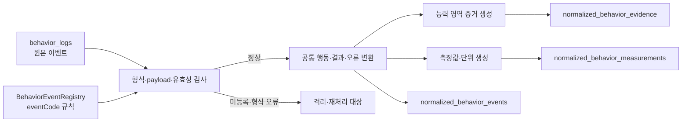

# 2. 행동 로그 데이터 정규화

> 적용 대상: `behavior_logs`에 저장된 사용자별 원본 행동 이벤트  
> 명명 규칙: JSON·Java 필드는 `camelCase`, PostgreSQL 물리 컬럼은 기존 프로젝트 규칙에 따라 `snake_case`를 사용한다.

## 1. 문서 목적

이 문서는 게임마다 서로 다른 행동 로그를 프로파일 계산 전에 공통 의미의 관찰 증거로 변환하는 규칙을 정의한다.

정규화 단계의 책임은 다음과 같다.

- 원본 이벤트의 형식과 의미가 유효한지 검사한다.
- 게임별 `eventCode`를 공통 행동·결과·오류 코드로 변환한다.
- 독립 수행과 지원 수행을 구분한다.
- 평가·훈련·상시·접근성·안전 로그의 사용 범위를 구분한다.
- 하나의 이벤트에서 능력 영역 증거와 측정값을 분리한다.
- 같은 원본과 같은 규칙 버전에서 항상 같은 결과를 생성한다.
- 규칙이 바뀌었을 때 원본으로부터 다시 계산할 수 있게 한다.

정규화 단계는 사용자의 능력 점수나 프로파일을 만들지 않는다. “관찰된 행동이 무엇이었는지”까지만 구조화한다.

## 2. 핵심 원칙

| 원칙 | 적용 방법 |
|---|---|
| 원본 불변 | `behavior_logs`를 수정하거나 정규화 결과로 덮어쓰지 않는다. |
| 규칙 기반 | LLM을 사용하지 않고 버전이 있는 Java 규칙으로 변환한다. |
| 관찰 사실 중심 | 성격·진단·능력 부족을 추론하지 않고 성공·오류·지원·중단 등 관찰값만 기록한다. |
| 게임 간 공통화 | 서로 다른 게임 이벤트를 `SELECT`, `CHECK`, `REQUEST_HELP` 같은 공통 행동으로 변환한다. |
| 증거와 측정 분리 | 능력 영역과의 연결, 숫자 측정값, 이벤트 결과를 서로 다른 구조로 저장한다. |
| 유효성 우선 | 기술 오류·접근성 문제·조력자 개입을 점수 대상에서 제외할 수 있게 표시한다. |
| 안전 분리 | 안전 결과는 일반 성공률과 섞지 않고 별도 상태와 증거로 관리한다. |
| 버전 재현 | 모든 결과에 `normalizerVersion`을 저장하고 이전 버전을 삭제하지 않는다. |
| 실패 격리 | 알 수 없는 코드나 잘못된 payload도 원본을 삭제하지 않고 격리 상태로 남긴다. |

## 3. 전체 처리 흐름



처리 순서는 다음과 같다.

1. `behaviorLogId`와 `normalizerVersion`으로 이미 처리한 이벤트인지 확인한다.
2. 원본의 `eventSchemaVersion`이 지원 대상인지 확인한다.
3. `eventCode`에 해당하는 이벤트 정의를 조회한다.
4. 이벤트 정의와 실제 `payloadType`이 일치하는지 검사한다.
5. 이벤트별 필수 context와 payload 필드, 값 범위와 단위를 검사한다.
6. 기술 오류·접근성·조력자 개입·안전 여부를 반영해 유효성과 사용 범위를 결정한다.
7. 공통 행동, 결과, 오류, 독립 수행 수준을 생성한다.
8. 0개 이상의 능력 영역 증거를 생성한다.
9. 0개 이상의 측정값을 생성한다.
10. 정규화 이벤트·증거·측정값을 하나의 트랜잭션으로 저장한다.

## 4. 정규화 공통 이벤트

### 4.1 권장 Java 계약

```java
public record NormalizedBehaviorEventData(
    UUID behaviorLogId,
    String normalizerVersion,
    NormalizationStatus normalizationStatus,
    BehaviorDomain domain,
    CanonicalActionType actionType,
    ObservedOutcome outcome,
    ErrorType errorType,
    IndependenceLevel independenceLevel,
    EvidenceUse evidenceUse,
    ValidityStatus validityStatus,
    SafetyStatus safetyStatus,
    Instant occurredAt,
    Set<NormalizationFlag> flags,
    List<NormalizedEvidenceData> evidence,
    List<NormalizedMeasurementData> measurements
) {}
```

정규화 결과에는 원본의 자유 서술이나 전체 payload를 복사하지 않는다. 필요하면 `behaviorLogId`로 원본을 조회한다.

### 4.2 정규화 상태

| `NormalizationStatus` | 의미 |
|---|---|
| `NORMALIZED` | 규칙에 따라 정상 변환됨 |
| `QUARANTINED` | 미등록 코드·payload 불일치 등으로 자동 변환하지 못함 |
| `FAILED` | 시스템 오류로 처리가 끝나지 않음. 재시도 대상 |

`QUARANTINED`는 입력 데이터 문제이고 `FAILED`는 서버 처리 문제다. 두 상태를 구분해야 재처리 정책을 다르게 적용할 수 있다.

## 5. 공통 분류 코드

### 5.1 행동 영역

```java
public enum BehaviorDomain {
    SHOPPING,
    COOKING,
    HYGIENE_CLOTHING,
    HOUSEHOLD,
    KIOSK_ATM,
    SAFETY,
    WORK,
    PASSIVE_PLAY
}
```

### 5.2 공통 행동

```java
public enum CanonicalActionType {
    START,
    VIEW_INSTRUCTION,
    SELECT,
    CHECK,
    COMPARE,
    NAVIGATE,
    SEQUENCE,
    REQUEST_HELP,
    USE_SUPPORT,
    SELF_CORRECT,
    RETRY,
    WAIT,
    COMPLETE_STEP,
    COMPLETE_TASK,
    ABORT
}
```

예를 들어 `SHOP.ITEM_SELECTED`, `HYGIENE.TOOL_SELECTED`, `KIOSK.ITEM_SELECTED`는 게임은 다르지만 모두 `SELECT`로 변환할 수 있다.

### 5.3 관찰 결과

```java
public enum ObservedOutcome {
    SUCCESS,
    FAILURE,
    INCOMPLETE,
    INVALID,
    NEUTRAL
}
```

`NEUTRAL`은 지도 열기, 설명 다시 보기, 설정 화면 진입처럼 성공·실패로 점수화하면 안 되는 행동에 사용한다.

### 5.4 오류 유형

```java
public enum ErrorType {
    NONE,
    OMISSION,
    REPETITION,
    WRONG_SELECTION,
    SEQUENCE_ERROR,
    QUANTITY_ERROR,
    TIME_ERROR,
    NAVIGATION_ERROR,
    SAFETY_ERROR,
    TECHNICAL_ERROR,
    UNKNOWN
}
```

오류 코드는 관찰된 행동만 표현한다. 불안·고집·충동성·인지 저하 같은 해석성 코드는 만들지 않는다.

## 6. 독립 수행 수준

```java
public enum IndependenceLevel {
    INDEPENDENT,
    SUPPORTED_LEVEL_1,
    SUPPORTED_LEVEL_2,
    SUPPORTED_LEVEL_3,
    ASSISTED,
    UNKNOWN
}
```

판정 우선순위는 다음과 같다.

| 조건 | 결과 |
|---|---|
| `assistantIntervention == true` | `ASSISTED` |
| `promptLevel == 3` | `SUPPORTED_LEVEL_3` |
| `promptLevel == 2` | `SUPPORTED_LEVEL_2` |
| `promptLevel == 1` | `SUPPORTED_LEVEL_1` |
| `promptLevel == 0`이고 조력자 개입 없음 | `INDEPENDENT` |
| 지원 정보 미수집 | `UNKNOWN` |

오류 후 스스로 수정한 경우 최초 실패 이벤트를 성공으로 덮어쓰지 않는다.

```text
최초 행동: FAILURE
후속 행동: SELF_CORRECT
정규화 증거: 실패 1건 + 독립 자기수정 1건
```

## 7. 증거 사용 범위

```java
public enum EvidenceUse {
    ASSESSMENT_PRIMARY,
    TRAINING_PROGRESS,
    CONTEXT_ONLY,
    ACCESSIBILITY_ONLY,
    SAFETY_ONLY,
    EXCLUDED
}
```

판정 규칙은 다음 순서로 적용한다.

1. 유효하지 않은 이벤트면 `EXCLUDED`로 처리한다.
2. 안전 이벤트면 `SAFETY_ONLY`로 처리한다.
3. `evidenceContext`에 따라 나머지 사용 범위를 결정한다.

| 조건 | 결과 |
|---|---|
| 유효한 `ASSESSMENT_TASK` | `ASSESSMENT_PRIMARY` |
| 유효한 `TRAINING_TASK` | `TRAINING_PROGRESS` |
| `PASSIVE_PLAY` | `CONTEXT_ONLY` |
| `ACCESSIBILITY` | `ACCESSIBILITY_ONLY` |
| 안전 사건 | `SAFETY_ONLY` |
| 기술 오류·조력자 대리 수행 등 | `EXCLUDED` |

`CONTEXT_ONLY`와 `ACCESSIBILITY_ONLY`는 저장하고 분석할 수 있지만 일반 능력 점수의 직접 분자·분모로 사용하지 않는다.

## 8. 유효성 판정

```java
public enum ValidityStatus {
    VALID,
    INVALID_TECHNICAL,
    INVALID_ACCESSIBILITY,
    INVALID_LANGUAGE_ACCESS,
    INVALID_ASSISTANT_INTERVENTION,
    INVALID_PAYLOAD,
    UNKNOWN_EVENT_CODE,
    REVIEW_REQUIRED
}
```

권장 판정 우선순위는 다음과 같다.

| 우선순위 | 조건 | 결과 |
|---:|---|---|
| 1 | 등록되지 않은 `eventCode` | `UNKNOWN_EVENT_CODE` |
| 2 | 요구 payload 종류·필드 불일치 | `INVALID_PAYLOAD` |
| 3 | `technicalError == true` | `INVALID_TECHNICAL` |
| 4 | `invalidReason == SENSORY_ACCESS` | `INVALID_ACCESSIBILITY` |
| 5 | `invalidReason == LANGUAGE_ACCESS` | `INVALID_LANGUAGE_ACCESS` |
| 6 | `assistantIntervention == true` | `INVALID_ASSISTANT_INTERVENTION` |
| 7 | 해석이 모호하거나 규칙 간 충돌 | `REVIEW_REQUIRED` |
| 8 | 위 조건 없음 | `VALID` |

유효하지 않은 이벤트도 정규화 행은 생성한다. 프로파일 집계에서 제외할 수 있도록 `validityStatus`와 `evidenceUse`를 명시한다.

## 9. 정규화 플래그

플래그는 이벤트 자체를 무효로 만들지는 않지만 후속 분석 시 주의가 필요한 조건을 표시한다.

```java
public enum NormalizationFlag {
    SEQUENCE_GAP,
    LATE_ARRIVAL,
    CLOCK_SKEW,
    OFFLINE_QUEUED,
    MISSING_OPTIONAL_CONTEXT,
    FALLBACK_CONTENT,
    SELF_CORRECTED,
    NEAR_MISS,
    VALUE_OUTLIER
}
```

예시 규칙:

- 이전 저장 순번보다 큰 간격이 있으면 `SEQUENCE_GAP`
- 서버 수신이 일정 시간 이상 늦으면 `LATE_ARRIVAL`
- `occurredAt`이 `receivedAt`보다 비정상적으로 미래이면 `CLOCK_SKEW`
- `offlineQueued == true`이면 `OFFLINE_QUEUED`
- `contentSource == FALLBACK`이면 `FALLBACK_CONTENT`
- `selfCorrected == true`이면 `SELF_CORRECTED`
- `nearMiss == true`이면 `NEAR_MISS`

플래그의 시간 기준과 이상치 범위도 정규화 버전에 포함한다.

## 10. 이벤트 코드 레지스트리

정규화의 중심은 `eventCode`별 정의를 관리하는 레지스트리다.

```java
public record BehaviorEventDefinition(
    String eventCode,
    BehaviorPayloadType requiredPayloadType,
    BehaviorDomain domain,
    CanonicalActionType actionType,
    ObservedOutcome defaultOutcome,
    ErrorType defaultErrorType,
    Set<String> requiredFields,
    List<SkillEvidenceDefinition> skillEvidence,
    List<MeasurementDefinition> measurements
) {}
```

초기 구현은 데이터베이스나 자유 형식 YAML보다 버전 관리와 테스트가 쉬운 Java 코드 레지스트리를 권장한다.

```java
Map<String, BehaviorEventDefinition> definitions;
```

레지스트리는 다음을 보장해야 한다.

- 같은 `eventCode`를 중복 등록할 수 없다.
- 모든 코드에 domain과 action type이 존재한다.
- 지정된 payload type과 실제 payload type이 일치해야 한다.
- required field 경로는 실제 DTO에 존재해야 한다.
- 측정 단위와 값 의미가 명시되어야 한다.
- 정규화 버전별 레지스트리 스냅샷을 재현할 수 있어야 한다.

### 10.1 대표 매핑

| 원본 `eventCode` | domain | actionType | outcome | errorType |
|---|---|---|---|---|
| `SHOP.ITEM_SELECTED` | `SHOPPING` | `SELECT` | 원본 `stepOutcome` 사용 | `NONE` |
| `SHOP.WRONG_ITEM_SELECTED` | `SHOPPING` | `SELECT` | `FAILURE` | `WRONG_SELECTION` |
| `COOK.STEP_OMITTED` | `COOKING` | `COMPLETE_STEP` | `FAILURE` | `OMISSION` |
| `COOK.SEQUENCE_ERROR` | `COOKING` | `SEQUENCE` | `FAILURE` | `SEQUENCE_ERROR` |
| `HYGIENE.STEP_COMPLETED` | `HYGIENE_CLOTHING` | `COMPLETE_STEP` | `SUCCESS` | `NONE` |
| `LAUNDRY.CLASSIFICATION_ERROR` | `HOUSEHOLD` | `SELECT` | `FAILURE` | `WRONG_SELECTION` |
| `KIOSK.BACK_USED` | `KIOSK_ATM` | `NAVIGATE` | `NEUTRAL` | `NONE` |
| `ATM.TRANSACTION_ERROR` | `KIOSK_ATM` | `COMPLETE_TASK` | `FAILURE` | `UNKNOWN` |
| `SAFETY.HAZARD_RECHECKED` | `SAFETY` | `CHECK` | `SUCCESS` | `NONE` |
| `WORK.SELF_CORRECTED` | `WORK` | `SELF_CORRECT` | `SUCCESS` | `NONE` |

`defaultOutcome`은 원본에 명확한 `stepOutcome`이 없는 경우에만 사용한다. 원본 결과와 기본값이 충돌하면 이벤트별 명시 규칙을 적용하거나 `REVIEW_REQUIRED`로 보낸다.

## 11. 능력 영역 증거

하나의 행동은 여러 능력 영역과 연결될 수 있으므로 정규화 이벤트 한 행에 `skillCode` 하나만 저장하지 않는다.

```java
public record NormalizedEvidenceData(
    String skillCode,
    EvidenceDirection direction,
    EvidenceRole role
) {}

public enum EvidenceDirection {
    POSITIVE,
    NEGATIVE,
    NEUTRAL
}

public enum EvidenceRole {
    PRIMARY,
    SECONDARY,
    CONTEXT
}
```

`skillCode`는 향후 프로파일이 사용하는 능력 분류 체계의 코드다. 정규화 단계에서는 증거 연결만 수행하며 점수와 가중치는 계산하지 않는다.

예시:

```text
SHOP.OUT_OF_STOCK_DETECTED
├── SHOPPING_PROBLEM_RECOGNITION / POSITIVE / PRIMARY
└── EXECUTIVE_FUNCTION / POSITIVE / SECONDARY

SHOP.STAFF_HELP_REQUESTED
├── FUNCTIONAL_COMMUNICATION / POSITIVE / PRIMARY
└── HELP_SEEKING / POSITIVE / PRIMARY
```

## 12. 측정값 정규화

거리·시간·수량·비율·금액은 이벤트 본체와 분리한다.

```java
public record NormalizedMeasurementData(
    String metricCode,
    Double numericValue,
    String codeValue,
    Double targetNumericValue,
    MeasurementUnit unit,
    ValueSemantics valueSemantics
) {}
```

`numericValue`와 `codeValue` 중 하나만 사용한다. 목표값이 없는 측정에는 `targetNumericValue`를 생략한다.

### 12.1 측정 단위

```java
public enum MeasurementUnit {
    COUNT,
    MILLISECONDS,
    SECONDS,
    GAME_DISTANCE,
    RATIO,
    SCORE,
    KRW,
    CODE
}
```

### 12.2 값 의미

```java
public enum ValueSemantics {
    DELTA,
    SNAPSHOT,
    DURATION,
    TARGET,
    OBSERVATION
}
```

| 값 의미 | 사용 예 |
|---|---|
| `DELTA` | 이번 이벤트에서 오류 1회 증가 |
| `SNAPSHOT` | 해당 시점까지 누적 재시도 3회 |
| `DURATION` | 화면 포그라운드 시간 4,000ms |
| `TARGET` | 요구 수량 3개 |
| `OBSERVATION` | 선택 수량 2개, 경로효율 0.75 |

같은 누적값을 여러 이벤트에서 합산하지 않도록 `DELTA`와 `SNAPSHOT`을 반드시 구분한다. 가능하면 프론트는 원자 이벤트를 보내고 서버가 횟수를 계산한다.

```text
COOK.STEP_OMITTED 이벤트 1건
→ omissionCount = 1, DELTA
```

비율은 이벤트 단위로 미리 만들기보다 분자와 분모가 되는 사실을 각각 저장한다.

```text
SHOP.WRONG_ITEM_SELECTED
→ selectionAttempt = 1
→ wrongItem = 1

프로파일 집계 단계
→ wrongItemRate = sum(wrongItem) / sum(selectionAttempt)
```

## 13. 권장 데이터베이스 구조

### 13.1 `normalized_behavior_events`

| 컬럼 | 타입 | 필수 | 설명 |
|---|---|---|---|
| `id` | UUID | Y | 정규화 이벤트 ID |
| `behavior_log_id` | UUID | Y | `behavior_logs.id` FK |
| `normalizer_version` | VARCHAR(50) | Y | 예: `behavior-normalizer-v1` |
| `normalization_status` | VARCHAR(20) | Y | 정상·격리·실패 상태 |
| `domain` | VARCHAR(30) | N | 공통 행동 영역 |
| `action_type` | VARCHAR(30) | N | 공통 행동 코드 |
| `outcome` | VARCHAR(20) | N | 관찰 결과 |
| `error_type` | VARCHAR(30) | N | 오류 유형 |
| `independence_level` | VARCHAR(30) | N | 독립·지원 수행 수준 |
| `evidence_use` | VARCHAR(30) | N | 프로파일 집계에서 사용할 범위 |
| `validity_status` | VARCHAR(40) | Y | 유효성 결과 |
| `safety_status` | VARCHAR(20) | N | `GREEN`, `YELLOW`, `RED` |
| `occurred_at` | TIMESTAMPTZ | Y | 원본 행동 발생 시각 |
| `normalized_at` | TIMESTAMPTZ | Y | 서버 정규화 시각 |
| `flags` | JSONB | Y | 정규화 플래그 배열 |

유일 조건:

```text
UNIQUE (behavior_log_id, normalizer_version)
```

### 13.2 `normalized_behavior_evidence`

| 컬럼 | 타입 | 필수 | 설명 |
|---|---|---|---|
| `id` | UUID | Y | 증거 ID |
| `normalized_event_id` | UUID | Y | 정규화 이벤트 FK |
| `skill_code` | VARCHAR(100) | Y | 능력 영역 코드 |
| `evidence_direction` | VARCHAR(20) | Y | 긍정·부정·중립 |
| `evidence_role` | VARCHAR(20) | Y | 주·보조·맥락 증거 |

권장 유일 조건:

```text
UNIQUE (normalized_event_id, skill_code, evidence_role)
```

### 13.3 `normalized_behavior_measurements`

| 컬럼 | 타입 | 필수 | 설명 |
|---|---|---|---|
| `id` | UUID | Y | 측정값 ID |
| `normalized_event_id` | UUID | Y | 정규화 이벤트 FK |
| `metric_code` | VARCHAR(100) | Y | 측정 코드 |
| `numeric_value` | NUMERIC(20,6) | N | 숫자 값 |
| `code_value` | VARCHAR(100) | N | 범주형 값 |
| `target_numeric_value` | NUMERIC(20,6) | N | 비교 목표값 |
| `unit` | VARCHAR(30) | Y | 단위 |
| `value_semantics` | VARCHAR(20) | Y | 값의 의미 |

`numeric_value`와 `code_value` 중 정확히 하나만 존재하도록 CHECK 제약을 둔다.

## 14. 정규화 예시

### 14.1 원본 이벤트

```json
{
  "metadata": {
    "clientEventId": "e2c3ee78-eb50-43b6-a771-07e35bc1ef75",
    "eventSequence": 7,
    "eventSchemaVersion": "behavior-event-v1",
    "appVersion": "1.0.0",
    "contentVersion": "shopping-content-v1",
    "offlineQueued": false,
    "occurredAt": "2026-08-28T10:00:00Z"
  },
  "identity": {
    "sessionId": "f215f081-70e8-48e6-b453-73b5eabfe610"
  },
  "task": {
    "gameId": "LIFE_SIMULATION",
    "taskId": "22779c84-8ec5-4b23-9f67-9dbf9b003763",
    "taskVersion": "shopping-task-v1",
    "difficulty": 1,
    "scenarioVariant": "DEFAULT",
    "evidenceContext": "TRAINING_TASK"
  },
  "action": {
    "eventCode": "SHOP.WRONG_ITEM_SELECTED",
    "microActionId": "SELECT_SHOPPING_ITEM",
    "stepOutcome": "FAILURE",
    "stepOrder": 2
  },
  "accessibility": {
    "instructionMode": "PICTURE",
    "textLevel": "EASY",
    "audioEnabled": false,
    "symbolSupport": true,
    "controllerMode": "TOUCH"
  },
  "support": {
    "promptLevel": 0,
    "supportCount": 0,
    "helpRequested": false
  },
  "payload": {
    "type": "SHOPPING",
    "itemId": "APPLE_JUICE"
  }
}
```

### 14.2 정규화 결과

```json
{
  "behaviorLogId": "0f7aa41e-a29a-4d2b-9188-55ab1fd07234",
  "normalizerVersion": "behavior-normalizer-v1",
  "normalizationStatus": "NORMALIZED",
  "domain": "SHOPPING",
  "actionType": "SELECT",
  "outcome": "FAILURE",
  "errorType": "WRONG_SELECTION",
  "independenceLevel": "INDEPENDENT",
  "evidenceUse": "TRAINING_PROGRESS",
  "validityStatus": "VALID",
  "safetyStatus": null,
  "occurredAt": "2026-08-28T10:00:00Z",
  "flags": [],
  "evidence": [
    {
      "skillCode": "SHOPPING_ITEM_SELECTION",
      "direction": "NEGATIVE",
      "role": "PRIMARY"
    }
  ],
  "measurements": [
    {
      "metricCode": "selectionAttempt",
      "numericValue": 1,
      "unit": "COUNT",
      "valueSemantics": "DELTA"
    },
    {
      "metricCode": "wrongItem",
      "numericValue": 1,
      "unit": "COUNT",
      "valueSemantics": "DELTA"
    }
  ]
}
```

## 15. 실행과 트랜잭션 경계

원본 저장과 정규화는 실패 경계를 분리한다.

```text
행동 로그 API
→ behavior_logs 원본 저장 COMMIT
→ AFTER_COMMIT 정규화 요청
→ 정규화 결과 별도 트랜잭션 저장
```

정규화 오류 때문에 원본 저장을 롤백하면 안 된다. 권장 실행 방식은 다음과 같다.

1. 원본 저장 성공 후 Spring application event를 발행한다.
2. `AFTER_COMMIT` listener가 정규화를 시도한다.
3. 정규화 실패 시 오류를 기록하고 원본은 유지한다.
4. 스케줄 작업이 정규화 결과가 없는 원본을 다시 조회해 처리한다.
5. 동일 `(behaviorLogId, normalizerVersion)` 처리는 멱등하게 동작한다.

초기 MVP에서는 같은 애플리케이션 내부 이벤트와 스케줄러를 사용하고, 처리량이 커질 때 메시지 큐 도입을 검토한다.

## 16. 규칙 버전과 재처리

초기 버전은 다음처럼 고정한다.

```text
eventSchemaVersion: behavior-event-v1
normalizerVersion: behavior-normalizer-v1
```

다음 변경은 `normalizerVersion` 증가 대상이다.

- eventCode의 domain·action type 변경
- 결과·오류 판정 규칙 변경
- 유효성 우선순위 변경
- 독립 수행 단계 판정 변경
- 능력 영역 증거 매핑 변경
- measurement 코드·단위·값 의미 변경
- 플래그 기준 변경

재처리 원칙:

- 이전 정규화 결과를 덮어쓰거나 삭제하지 않는다.
- 동일 원본에 새 버전의 정규화 행을 추가한다.
- 프로파일 계산은 사용한 `normalizerVersion`을 명시한다.
- 새 버전 검증이 끝나기 전까지 운영 기본 버전을 변경하지 않는다.

## 17. 테스트 기준

### 17.1 레지스트리 테스트

- eventCode 중복 등록 실패
- 모든 정의에 domain과 action type 존재
- payload type과 required field 경로 검증
- measurement 단위와 값 의미 누락 실패

### 17.2 정규화 테스트

- 각 게임별 대표 성공·실패 이벤트 변환
- 기술 오류·접근성·조력자 개입 제외
- 안전 이벤트가 `SAFETY_ONLY`로 분리됨
- `PASSIVE_PLAY`가 `CONTEXT_ONLY`로 분리됨
- 지원 단계별 independence level 변환
- 자기수정 시 최초 실패가 보존됨
- 알 수 없는 eventCode 격리
- eventCode와 payload type 불일치 격리
- 누적값과 증가량이 중복 합산되지 않음

### 17.3 저장·재처리 테스트

- 같은 원본·같은 버전은 한 번만 저장
- 같은 원본·다른 버전은 함께 저장 가능
- 정규화 실패가 원본 로그 저장을 롤백하지 않음
- 지연 도착·순서 공백 플래그 생성
- 정규화 누락 이벤트 재처리 성공

## 18. 구현 순서

1. 정규화 enum과 공통 결과 DTO 정의
2. 정규화 3개 테이블 Flyway 마이그레이션 작성
3. 정규화 Entity와 Repository 구현
4. `BehaviorEventRegistry`와 중복 검증 구현
5. 공통 유효성·독립 수행·증거 사용 규칙 구현
6. 게임별 이벤트 정의와 measurement extractor 구현
7. `BehaviorNormalizationService` 구현
8. 원본 저장 이후 `AFTER_COMMIT` 실행 연결
9. 누락 이벤트 재처리 작업 구현
10. 단위·통합·재처리 테스트 작성

이 단계가 완료된 뒤 프로파일은 `behavior_logs` 원본이 아니라 특정 `normalizerVersion`의 정규화 이벤트·증거·측정값을 입력으로 사용한다.
