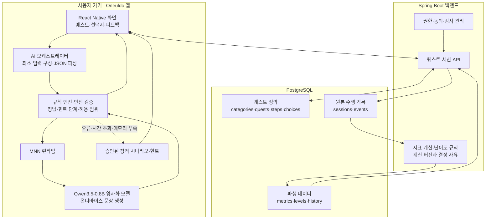

# AI 활용 및 온디바이스 시스템 설계

## 1. 문서 목적

이 문서는 `오늘도_기획서_v2.pdf`, [서비스 기획 요약](./product-plan.md), [데이터베이스 스키마](./database-schema.md), [퀘스트 데이터 파이프라인](./quest-data-pipeline.md)을 기준으로 다음을 정의한다.

- 오늘도에서 AI를 어디에 사용할지
- AI가 어떤 데이터를 입력받아 무엇을 판단할지
- AI와 규칙 엔진의 책임을 어떻게 나눌지
- Qwen3.5-0.8B와 MNN을 이용한 온디바이스 구조를 어떻게 구성할지
- 발달장애인 사용자를 위한 안전 장치와 개인정보 경계를 어떻게 둘지

핵심 원칙은 **AI가 퀘스트의 정답이나 사용자의 능력을 임의로 판정하지 않도록 하는 것**이다. 정답, 보상, 완료 여부, 실전 퀘스트 전환, 난이도 변경은 검증 가능한 규칙이 결정하고, LLM은 승인된 범위 안에서 상황과 문장을 다양하게 표현하는 역할을 맡는다.

## 2. 기획서에서 도출한 AI의 역할

기획서의 핵심 문제는 고정된 시나리오를 반복해서 외워도 장소, 표현, 순서, 상대방 반응이 달라지면 배운 행동을 실제 상황에 적용하기 어렵다는 점이다. 따라서 AI는 무제한 자유 대화를 제공하기보다 **통제된 변화를 반복적으로 제공하는 훈련 도구**로 사용한다.

### 2.1 AI가 담당할 기능

| 기능 | AI가 하는 일 | 기대 효과 |
|---|---|---|
| AI NPC 대화 | 점원, 기사, 고객, 동료, 관리자 역할의 짧은 발화 생성 | 같은 목표를 여러 표현과 반응으로 연습 |
| 상황 변형 | 승인된 시나리오에서 질문 표현, 지시 순서, 물건 위치, 가벼운 돌발 상황을 변경 | 암기보다 상황 대응과 일반화 훈련 강화 |
| 단계별 힌트 표현 | 규칙 엔진이 선택한 힌트 단계에 맞춰 쉽고 짧은 한국어 문장 생성 | 사용자가 막힌 지점에서 적절한 도움 제공 |
| 쉬운 문장 변환 | 퀘스트 지시와 피드백을 한 문장·한 행동 중심으로 재표현 | 인지 부담과 불안 감소 |
| 훈련 결과 설명 | 계산된 지표와 사유 코드를 보호자에게 이해하기 쉬운 문장으로 요약 | 수행 패턴과 재훈련 필요 지점 파악 |
| 재훈련 콘텐츠 추천 | 규칙이 찾은 취약 단계와 상황 유형을 바탕으로 승인된 퀘스트 후보를 설명 | 개인별 반복 훈련 지원 |

### 2.2 AI가 담당하지 않을 기능

- 정답 여부, 성공·실패, 보상 지급을 자유 생성 문장으로 결정하지 않는다.
- 사용자에게 장애 정도, 지능, 의료 상태와 같은 진단성 평가를 내리지 않는다.
- 보호자 승인 없이 실전 퀘스트를 열거나 실제 장소 수행을 권하지 않는다.
- 결제, 약 복용, 응급 대응, 법률 판단처럼 위험한 결정을 자유 대화로 안내하지 않는다.
- 데이터베이스를 직접 수정하지 않는다. AI 결과는 구조화된 값으로 반환한 뒤 앱과 서버가 검증한다.
- 실패를 비난하거나 비교·낙인 표현을 생성하지 않는다.

## 3. 판단 구조: 규칙이 결정하고 AI가 표현한다

오늘도의 AI 기능은 다음 세 계층으로 분리한다.

1. **데이터 계층**은 퀘스트 정의, 세션 이벤트, 계산 지표, 난이도 이력을 저장한다.
2. **규칙 계층**은 정답, 점수, 힌트 단계, 난이도 후보, 안전 정책을 결정한다.
3. **LLM 계층**은 규칙이 허용한 행동을 자연스럽고 쉬운 한국어로 표현한다.

예를 들어 사용자가 같은 단계에서 두 번 오답을 선택한 경우, `quest_events`를 기준으로 규칙 엔진이 `SHOW_HINT`, `hintLevel=2`를 결정한다. LLM은 현재 상황과 승인된 힌트를 받아 “버스 번호를 먼저 확인해 보세요.”와 같은 짧은 문장만 만든다. 난이도를 낮출지 여부는 세션 종료 후 누적 지표와 버전이 있는 계산 규칙이 결정한다.

이 구조는 소형 모델의 출력 편차를 줄이고, 판단 근거를 보호자와 운영자가 재현할 수 있게 한다.

## 4. AI가 사용하는 데이터

### 4.1 입력 데이터 분류

| 데이터 묶음 | 현재 스키마의 출처 | AI가 보는 값 | 사용 목적 |
|---|---|---|---|
| 퀘스트 정의 | `quest_categories`, `quest_subcategories`, `quests` | 퀘스트 코드, 제목, 목표, 현재 난이도, 카테고리 | NPC 역할과 상황 범위 설정 |
| 단계·선택지 | `quest_steps`, `quest_choices` | 현재 단계의 지시·상황·승인된 힌트, 선택지 라벨, 정답 이후 피드백 | 현재 장면 생성과 쉬운 표현 |
| 현재 수행 신호 | `quest_sessions`, `quest_events` | 현재 단계, 시도 횟수, 정답 여부, 힌트 사용 여부, 응답 시간 | 다음 힌트와 반응 강도 결정 보조 |
| 세션 성과 | `quest_session_metrics` | 첫 시도 정확도, 최종 정확도, 힌트·재시도·완료율, 응답 시간 중앙값, 수행 점수 | 결과 설명과 재훈련 사유 생성 |
| 난이도 상태 | `user_category_levels` | 현재·추천 난이도, 결정 코드, 설명 가능한 사유 | 다음 훈련의 표현 복잡도 설정 |
| 난이도 이력 | `difficulty_adjustment_history` | 이전·추천 난이도, 결정, 사유, 계산 버전 | 최근 변화 설명과 급격한 변경 방지 |

AI에는 전체 원본 이력을 그대로 주지 않고 현재 퀘스트에 필요한 값과 최근 집계값만 전달한다. 난이도 판단에는 원본 이벤트보다 `quest_session_metrics`처럼 계산된 지표를 우선 사용한다.

### 4.2 기능별 판단 데이터

| AI 기능 | 필수 입력 | 규칙 엔진의 선행 판단 | AI 출력 |
|---|---|---|---|
| NPC 발화 | NPC 역할, 현재 상황, 퀘스트 목표, 허용 의도, 금지 주제 | 가능한 대화 의도와 길이 제한 | 짧은 NPC 문장, 선택지 표시용 문장 |
| 상황 변형 | 퀘스트 코드, 난이도, 현재 단계, 승인된 변형 목록 | 안전한 변형 유형과 변경 가능한 필드 | 승인 범위 내 상황 문구 |
| 단계별 힌트 | 지시, 승인된 기본 힌트, 시도 횟수, 응답 시간 | 힌트 단계와 공개 가능한 정보 | 한 번에 한 행동을 안내하는 문장 |
| 결과 설명 | 세션 지표, 반복 실패 단계, 결정 코드 | 완료·보상·난이도 결정 | 사용자 또는 보호자용 설명 |
| 재훈련 추천 | 취약 단계, 상황 유형별 성과, 추천 난이도 | 추천 가능한 퀘스트 후보 | 추천 이유와 다음 연습 설명 |

### 4.3 AI에 전달하지 않는 데이터

다음 정보는 AI 기능에 필요하지 않으므로 프롬프트와 모델 입력에서 제외한다.

- `member.password`, 로그인 토큰과 같은 인증 정보
- 이메일, 생년월일, 실명 등 직접 식별 정보
- 장애 진단명·등급과 같은 민감 정보. 현재 스키마에도 저장하지 않는 원칙을 유지한다.
- 보호자나 기관 담당자의 개인정보
- 정확한 위치와 원본 음성. 별도 기능과 명시적 동의가 생기기 전에는 수집하지 않는다.
- 현재 훈련과 관계없는 전체 행동 이력

사용자 구분이 필요하면 서버에서 발급한 짧은 세션 식별자만 사용하고, 모델 입력에는 회원 ID도 가능한 한 넣지 않는다.

## 5. AI 입출력 계약

LLM에는 자유 형식의 데이터베이스 레코드 대신 버전이 있는 최소 JSON을 전달한다. 아래는 힌트 생성 예시다.

```json
{
  "schemaVersion": "ai-input-v1",
  "task": "GENERATE_HINT",
  "quest": {
    "code": "BUS_RIDE",
    "difficulty": 2,
    "goal": "목적지에 맞는 버스를 탄다"
  },
  "step": {
    "order": 2,
    "instruction": "버스 번호를 확인하세요",
    "situation": "정류장에 버스 두 대가 도착했다",
    "approvedHint": "목적지 안내판과 버스 번호를 비교한다"
  },
  "sessionSignals": {
    "attemptNumber": 2,
    "hintLevel": 2,
    "responseTimeMs": 18000
  },
  "policy": {
    "maxSentences": 1,
    "maxChoices": 3,
    "tone": "calm_and_concrete"
  }
}
```

모델 출력도 파싱 가능한 제한된 형식으로 받는다.

```json
{
  "action": "SHOW_HINT",
  "hintLevel": 2,
  "text": "목적지와 같은 번호의 버스를 찾아보세요.",
  "reasonCode": "REPEATED_ATTEMPT"
}
```

앱은 JSON 스키마, 허용된 `action`, 글자 수, 금지 표현을 검사한다. 검증에 실패하거나 제한 시간 안에 응답하지 못하면 승인된 기본 힌트를 사용한다.

## 6. AI가 추가된 시스템 구조



### 6.1 처리 흐름

1. 앱이 서버에서 승인된 퀘스트, 단계, 선택지와 현재 추천 난이도를 내려받는다.
2. 사용자가 단계에 진입하면 앱의 규칙 엔진이 현재 행동과 허용된 AI 작업을 정한다.
3. AI 오케스트레이터가 개인식별정보를 제외한 최소 입력 JSON을 만든다.
4. MNN이 기기 안의 Qwen3.5-0.8B 양자화 모델을 실행한다.
5. 안전 검증기가 출력 형식, 길이, 허용 행동과 금지 표현을 검사한다.
6. 통과한 결과만 화면에 표시한다. 실패하면 정적 콘텐츠로 즉시 대체한다.
7. 서버에는 사용자의 선택과 응답 시간 등 기존 수행 이벤트를 기록한다. AI 원문 전체는 기본적으로 저장하지 않는다.
8. 세션 종료 후 서버 규칙이 지표와 난이도 결정을 계산하고 버전과 사유를 저장한다.

## 7. 온디바이스 적용 원칙

### 7.1 기술 방향

- 1차 대상은 Android arm64 기기이며, Galaxy A 계열과 같은 보급형 기기를 성능 기준에 포함한다.
- Qwen3.5-0.8B의 양자화 모델을 MNN 런타임으로 실행하는 방향을 검증한다.
- 모델은 한국어 전용 모델이 아니므로 실제 퀘스트 문장으로 정확성, 존댓말, 쉬운 표현, 안전성을 별도로 평가한다.
- 초기 버전은 텍스트 입출력만 지원한다. 음성 인식과 음성 합성은 성능·동의·보관 정책을 정의한 뒤 추가한다.
- 모델 파일은 앱 패키지 크기와 업데이트 비용을 고려해 최초 실행 후 Wi-Fi 다운로드 방식을 우선 검토한다.

### 7.2 성능과 장애 대응

- 모델 로딩, 첫 토큰 시간, 전체 생성 시간, 최대 메모리 사용량을 실기기에서 측정한다.
- 출력 길이를 짧게 제한하고 한 번에 한 요청만 처리한다.
- 생성 시간 제한, 메모리 부족, 모델 손상, 지원하지 않는 기기에서는 정적 시나리오로 전환한다.
- 저사양 기기에서는 상황 변형 수와 문맥 길이를 줄이는 성능 등급을 적용한다.
- UI 스레드와 모델 추론 스레드를 분리해 화면 멈춤을 방지한다.

## 8. 안전·개인정보·접근성 원칙

### 8.1 생성 안전

- 허용된 NPC 역할, 의도, 상황 유형을 목록으로 관리한다.
- 모델이 새 퀘스트 규칙이나 정답을 만들 수 없게 한다.
- 비난, 위협, 성적 내용, 차별 표현, 과도한 긴장 유발 표현을 차단한다.
- 응급·결제·의료 상황은 생성형 응답 대신 검토된 고정 안내를 사용한다.
- 결과 화면에는 “왜 이 힌트 또는 난이도가 선택되었는지” 규칙 기반 사유를 표시한다.

### 8.2 접근성

- 한 화면과 한 문장에는 하나의 행동만 제시한다.
- 문장은 짧고 구체적으로 작성하며 비유, 반어, 모호한 대명사를 줄인다.
- 선택지는 기본 2~3개로 제한하고 순서와 버튼 위치를 안정적으로 유지한다.
- 사용자가 답하기까지의 시간은 개인 설정으로 조정할 수 있게 한다.
- 실패 피드백은 “다시 확인해 볼까요?”처럼 불안을 낮추는 표현을 사용한다.

### 8.3 개인정보와 보관

- 원본 `quest_events`는 수정하지 않고, 계산 결과와 결정 이력을 분리해 감사 가능성을 유지한다.
- AI 기능에는 목적에 필요한 최소 데이터만 전달한다.
- 모델 입력과 생성 원문은 기본 저장 대상에서 제외한다. 품질 개선을 위해 저장하려면 별도 동의, 익명화, 보관 기간, 삭제 절차를 먼저 정의한다.
- 모델·프롬프트·정책 변경이 결과에 미친 영향을 추적할 수 있도록 버전을 기록한다.

권장 AI 실행 메타데이터는 다음과 같다.

- `model_version`
- `prompt_version`
- `policy_version`
- `input_schema_version`
- `action_code`
- `fallback_used`
- `latency_ms`

기존 난이도 계산의 `calculation_version`과 AI 실행 버전은 분리한다. AI가 문장만 바뀌었는지, 점수 계산 규칙이 바뀌었는지를 구분하기 위해서다.

## 9. MVP 적용 순서

### 1단계: 안전한 문장 생성

- 카페 또는 버스 퀘스트 하나를 선택한다.
- 승인된 기본 문장을 쉬운 한국어로 바꾸는 기능과 단계별 힌트 표현부터 적용한다.
- 정답·힌트 단계·난이도 결정은 모두 기존 규칙으로 처리한다.

### 2단계: 통제된 NPC 변형

- NPC 역할 1~2개와 상황 변형 2~3개를 허용 목록으로 만든다.
- 동일 목표에서 표현만 달라지는지 테스트한다.
- 금지 표현, JSON 오류, 시간 초과 시 정적 콘텐츠로 전환한다.

### 3단계: 수행 데이터 기반 개인화

- 세션 지표와 카테고리 난이도 상태를 입력해 힌트 표현과 훈련 추천 설명을 개인화한다.
- 보호자 화면에 성과 요약, 어려운 단계, 추천 사유를 표시한다.
- 실제 장소 퀘스트는 충분한 가상 연습과 보호자 승인 후에만 연결한다.

## 10. 구현 전에 확정할 항목

- 지원할 최소 Android OS, RAM, 저장 공간과 목표 Galaxy A 기종
- 모델 양자화 형식, 모델 다운로드 크기, 업데이트·무결성 검증 방식
- 첫 적용 퀘스트와 NPC 역할
- 힌트 단계 및 난이도 승급·유지·하향 규칙
- AI 입력·출력 JSON 스키마와 허용 행동 목록
- 금지 콘텐츠 및 고정 안내가 필요한 위험 상황 목록
- 모델 품질 평가용 한국어 테스트 문장과 통과 기준
- 행동 데이터, AI 메타데이터, 동의 철회 시 삭제 정책

## 11. 완료 기준

- 동일한 퀘스트 목표가 AI 표현 변화 후에도 유지된다.
- AI가 정답, 보상, 완료, 실전 전환을 직접 바꿀 수 없다.
- 모든 출력이 구조 검증과 안전 검증을 통과한 뒤 표시된다.
- 오프라인, 시간 초과, 메모리 부족에서도 정적 퀘스트를 계속 수행할 수 있다.
- 보호자가 난이도와 재훈련 추천의 규칙 기반 사유를 확인할 수 있다.
- 목표 보급형 실기기에서 정한 응답 시간과 메모리 기준을 만족한다.
