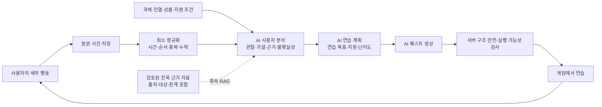
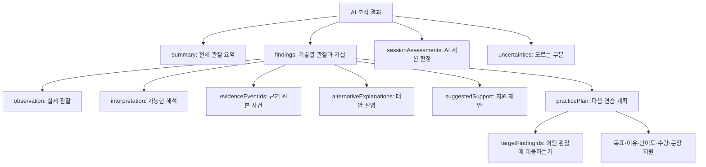
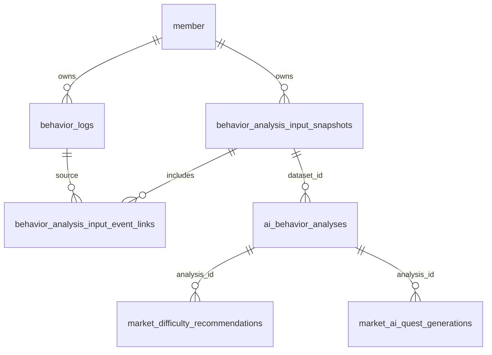

# AI 중심 사용자 분석 및 연습 퀘스트 전환 명세

> 최신 실행 제어: [중복 분석·퀘스트 방지](./duplicate-analysis-prevention-2026-09-05.md) — 진행 요청 공유, 동일 원문 스냅샷 및 검증된 완료 결과 재사용. 최초 분석 시간과 실 모델의 퀘스트 품질 문제는 별도다.

> 최신 진단: [최종 입력 축소 보고서](./final-input-compaction-report-2026-09-05.md) — 원문 유지 상태로 요청 약 28% 축소, 최종 분석 READY. 맞춤 퀘스트는 고정 시나리오 예산 불일치로 실패했으며 문장 품질 주의사항도 기록했다.

> **2026-09-05 후속 구현:** [3~6페이즈 변경 보고서](./phase-3-6-change-report.md)를 함께 확인한다. 아래 1·2페이즈 당시 설명 중 ‘미착수’, 연구 미연결, 큰 입력 즉시 중단, 교통 서버 정답 판정 등은 후속 구현으로 일부 변경되었다. 전체 페이즈 완료나 전문가 검증 완료를 뜻하지 않는다.

작성: 2026-09-05 · 대상: 오늘도 · 상태: 1페이즈 및 2페이즈 첫 적용분 구현

관련 문서: [1페이즈 구현 보고서](./phase-1-ai-analysis-report.md), [2페이즈 보고서](./phase-2-market-content-report.md)

## 1. 목적과 최종 원칙

주 목적은 **사용자의 행동을 이해하는 것**이다. 퀘스트 생성은 그 분석에서 발견한 연습 필요와 지원 요구를 실천 가능한 과제로 바꾸는 후속 기능이다.

‘오답 두 번 → 수리 능력 낮음 → 난이도 1’ 같은 서버 점수표를 만들지 않는다. AI가 원본 행동, 과제 조건, 지원 상황과 근거 자료를 함께 읽고 해석한다. 능력의 부족을 확정하기보다 관찰된 어려움, 대안 설명, 확인할 정보와 도움이 될 연습을 제안한다.

최종 구조에서 서버는 사용자 성공/실패, 능력, 독립 수행 수준, 강점/약점, 다음 난이도를 계산하지 않는다. AI 호출 실패는 **분석 시스템의 실패**이며 사용자의 실패가 아니다.

점선은 1페이즈에 아직 연결되지 않은 기능이다. 이 문서의 ‘최종 원칙’과 ‘현재 구현’을 혼동하지 않는다.

### 서버에 남기는 것과 없애는 것

| 영역 | 서버에 남김 | 서버가 하지 않음 |
|---|---|---|
| 인증·저장 | JWT 소유권, 중복 수신 방지, 원본 및 버전 보관 | 계정의 장애 정도/능력 추정 |
| 로그 준비 | 사건 순서, 시간 표현, 누락·기술 오류 표시 | 사건을 성공/실패로 변환, 중요한 사건만 임의 선별 |
| AI 호출 | 입력 구성, API 오류, 제한된 재시도, 감사 기록 | AI 실패 시 기본 능력·난이도·맞춤 퀘스트 생성 |
| 분석 응답 검사 | JSON 구조, 실제 사건/세션 참조, 필수 필드, 지원 범위 | AI의 사용자 판정을 서버 점수로 덮어쓰기 |
| 게임 엔진 | 가격 합산, 재고/존재하는 상품, 충돌, 실제 결제 차단 | 산술 검사 결과를 사용자 능력이나 최종 성패로 승격 |
| 화면 | AI 해석 및 판단 보류 표시 | 성공률 임계값으로 레벨/강점/약점 계산 |

예: ‘상품 가격 합계 3,200원’은 계산 가능한 게임 사실이다. ‘예산을 넘겼으므로 금전 관리 능력이 낮다’는 사용자 해석이며 AI 영역이다. 화면의 종료 연출이나 보상도 최종적으로는 AI 평가와 분리하거나 AI 평가 결과를 소비하도록 바꾼다.

## 2. 브랜치와 진욱 패키지를 어떻게 활용하는가

### 2.1 thisisdibellob의 기존 작업

검토 기준 HEAD: `28782ec`, 브랜치 `9-ai-서비스-구현-jh-api`.

| 이력 | 의미 | 전환 방침 |
|---|---|---|
| `46e82ae` | 원본 행동 로그 수신 | 원본 보존·중복 처리 기반 재사용 |
| `8acdcdd` | 정규화 및 근거 산출 | 의미 판정/능력 근거 계산은 새 분석 경로에서 사용하지 않음 |
| `06c3d64` | 프로필 집계 | 성공률 기반 집계를 AI 사용자 분석으로 대체 |
| `6e78821` | 이동 등 세부 로그·수신 큐 확장 | 상세 사건 보존, 후속으로 시나리오 맥락 연결 |
| `99cb1aa` | 프로필 대신 전체 타임라인 입력 | 스냅샷·사건 연결을 새 분석의 기반으로 재사용 |

1페이즈 전에는 백엔드 프로필 API가 이미 제거된 반면 프론트 분석 화면은 `/api/behavior-profiles/latest`와 성공률 분류를 계속 참조했다. 또한 AI 난이도 실패 시 서버 기본값, 퀘스트 실패 시 `RULE_FALLBACK` 생성 경로가 남아 있었다.

### 2.2 진욱 패키지는 완성된 학습 모델이 아니다

검토한 로컬 패키지: `jinuk-shopping-ai-evidence-2026-09-04/jinuk-research-2026-09-04`.
수량은 패키지 `validation_summary.json`의 기록이다.

| 자료 | 패키지 기록 | 활용 |
|---|---:|---|
| `sources/all_sources.jsonl` | 출처 151개 | 대상 집단·확인 범위·권리·한계 추적 |
| `corpus/evidence_cards.jsonl` | 주장 카드 184개 | 분석에 필요한 근거 후보 |
| `corpus/rag_candidates.jsonl` | 조건부 후보 44개 | 권리·내용 검토를 거친 검색 연결의 시작점 |
| 원문 | 24개: PDF 13, HTML 11 | 필요한 주장과 실제 원문 대조 |
| `scenario/catalog.json` | 상품 60개 | 브랜드·용량·가격·대체품 조건 구현 |
| 장보기 시나리오 | 16개 | 관찰 가능한 연습 조건과 예외 상황 |
| 진열 슬롯 | 24개 | 재현 가능한 배치와 이동 조건 |
| 합성 검토 사례 | 24개 | 대안 해석·판단 보류·지원 제안 검토 |
| 시뮬레이션/샘플 | 1,600 / 48 | 패키지 구조 검증 참고; 실제 사용자 기록 아님 |

패키지는 `AI_training_runs: 0`, `real_user_sessions: 0`, `expert_validation_complete: false`라고 명시한다. 출처 151개가 모두 전문 학습 데이터라는 뜻이 아니고, 후보 44개도 제품 투입 승인이나 전문가 검증 완료를 뜻하지 않는다.

### 2.3 ‘교육’의 구현 방식

1. **페르소나**: 지적장애인의 생활기술 학습과 개별화 지원을 전문적으로 검토하는 AI 분석 역할을 시스템 프롬프트에 부여한다. 지적장애 전문가인 척 자격을 주장하지 않는다.
2. **근거 연결/RAG**: 검토된 카드와 출처·대상·한계를 검색해 해당 분석 입력에 제공한다. 문헌을 사람 평가의 고정 점수표로 변환하지 않는다.
3. **검증**: 동일 행동에 가능한 다른 해석, 로그 누락, 도움 요청, 기기 오류, 품절 대응 등을 얼마나 적절히 구분하는지 확인한다.
4. **모델 추가 학습**: 별도 선택 사항이다. 현재 Groq 모델의 가중치를 변경하는 구현은 하지 않는다. 학습 권리, 목적, 적절한 학습/평가 데이터와 별도 실행 환경이 확정되어야 한다.

1페이즈는 1번만 적용했다. 프롬프트와 결과에 `evidenceVersion=NOT_CONNECTED_PHASE1`을 남긴다. 44개 카드를 실제 모델 입력에 연결하는 작업은 5페이즈다. 패키지 문서를 개발자가 참고한 것과 모델이 문헌을 실제로 받은 것은 다르다.

## 3. 이제 해야 할 일 — 페이즈별 명세

| 페이즈 | 작업 | 완료 기준 | 현재 |
|---|---|---|---|
| 1. 분석 중심 API·화면 정리 | AI 분석 계약/저장/API, 최소 입력 투영, 화면 교체, 분석→연습→퀘스트 연결, 서버 fallback 제거 | 세부 사건과 AI 근거를 추적하고 오류를 사용자 판정으로 바꾸지 않음 | 구현 및 테스트 |
| 2. 상품·과제 매핑 | 60상품 공통 계약, S01/S02 실행 연결 후 16개 확대 | 상품 ID·가격·용량·브랜드·재고·허용 대안이 화면/로그/AI에서 동일 | 60종·S01/S02 구현; 14개는 정의만 반영 |
| 3. 재현 가능한 장면 | seed, layoutVersion, catalogVersion, scenarioVersion, questInstanceId, 시작 조건 스냅샷 | 같은 과제를 복원하고 사용자가 무엇을 볼 수 있었는지 설명 가능 | 미착수 |
| 4. 로그와 판정 경계 전환 | 중립 사건명, 당시 표시 정보·수량 변화·직원 질문·휴식 기록, 전체 로그 분할 분석, 기존 완료/보상·교통 서버 판정 이관 | 규칙형 성패가 평가 경로에 남지 않고 사건 누락 없는 근거 연결, AI 보류/오류 시 보상 임의 확정 없음 | 미착수 |
| 5. 근거 검색 연결 | 44개 후보 권리·내용 검수, 검색 인덱스, 적용 대상/범위/한계 제공, 인용 ID 검증 | 실제 사용한 카드와 버전 추적, 비적용 집단/권리 불명 원문 자동 투입 없음 | 미착수 |
| 6. 해석·지원 효과 검증 | 합성 24사례, 동일 조건 비교, 전문가/당사자 검토, 지원별 재수행 | 근거 없는 단정/인용, 낙인, 인터페이스 오해를 평가하고 배포 기준 확정 | 미착수 |

1페이즈의 ‘자동 의미 정규화 분리’는 최종 삭제가 아니다. 과거 이력을 확인하기 위한 코드와 DB는 보존한다. 이후 사용처 제거와 별도 이력 보존 정책을 확인한 뒤 삭제한다.

## 4. 입력 명세: 최소 정규화와 원본 보존

### 4.1 원본 계층

`behavior_logs`에 수신 사건을 보존한다. 재전송은 `clientEventId` 및 세션 순번으로 식별하며, 순서 충돌은 오류로 처리한다. 사건을 성공/실패로 판정하기 위해 버리거나 압축하지 않는다.

`behavior_analysis_input_snapshots`는 기간 내 **모든 사건**을 포함하는 불변 스냅샷이고, `behavior_analysis_input_event_links`로 원본 사건과 연결된다. 시작/끝 시간은 수신된 관찰 구간이다. 실제 장면의 시작/종료와 항상 같지 않다.

### 4.2 AI 입력용 투영

원본을 수정하지 않은 복사본에서 이전 수집기/정규화기의 판정 필드를 분리한다.

| 구분 | 예시 |
|---|---|
| 보존 | 사건 ID·코드·순서·시간, 좌표·이동시간, 목록 열기, 수량 전/후, 상품·가격·목표, 지원 요청, 표시/접근성/기기/중단 문맥 |
| 분리 | `normalization`, `normalizedEventId`, `action.stepOutcome`, `taskCompleted`, `completionQuality`, 지원 전후 성패 |
| 분리 | 경로 효율/길을 잃음 판정, 오류 유형별 파생 집계, 누락/잘못된 상품 판정, 문제 해결/단계 완료 등의 기존 결과 필드 |
| 별도 표시 | `excludedLegacyFields`: 사건마다 반복하지 않고 공통 제외 정책과 필드 경로를 한 번 표시 |

제외 목록의 정확한 구현은 `AiBehaviorAnalysisPromptFactory`에 있다. 파생 라벨을 뺀다고 그 라벨을 낳은 원본 사건을 삭제하지 않는다. 다만 구형 로그에 판정 라벨만 있고 그 판단의 원사건이 없다면 복원할 수 없으며 AI는 판단을 보류해야 한다.

2026-09-05 입력 표현 개선: 공통 문맥을 세션의 `contexts`로 분리하고 사건마다 `contextRef`로 명시적으로 참조한다. 좌표 표본은 원본 순서의 배열 행으로 인코딩한다. 객체의 null만 미기록 의미로 생략하고 0·false·빈 배열·빈 객체·배열 내부 null은 보존한다. 원본 DB와 분석 입력 스냅샷은 수정하지 않는다. 자세한 구조와 실제 244개 기록의 왕복 복원 검증은 [입력 압축 실험](./compact-input-report-2026-09-05.md)에 정리했다.

후속 v6에서는 실제 Qwen 토크나이저 기반 요청 예산 검사와 데이터셋 전체에서 고정된 사건·세션 별칭을 적용했다. 생성 결과는 별칭을 UUID로 복원한 후 검증한다. 같은 244개 기록은 단일 사건도 공통 자료와 함께 한도를 초과하여 아직 AI 호출에 도달하지 못했다. 설정·한계·실측은 [토큰 예산 및 ID 별칭 보고서](./token-budget-alias-report-2026-09-05.md)를 참고한다.

v8은 분석용 상품 범위와 가역 표 표현을 적용하고, OBSERVE(부분 관찰) → 필요 시 REDUCE(AI 해석 통합) → FINAL(원 근거 재검토·최종 분석)로 분리한다. 현재 상태와 1~4번의 변경 내역은 [단계별 분석 보고서](./staged-analysis-report-2026-09-05.md)를 참고한다. 앞선 v6 보고서는 당시 실패 결과를 남긴 이력이다.

현재 `SHOP.SESSION_COMPLETED` 같은 기존 사건명과 종료 사유는 남는다. 프롬프트에서 기존 프로그램의 이름일 뿐이라고 경고하지만 이름에 의한 모델 편향을 완전히 제거하지는 못한다. 4페이즈에서 중립 사건명과 원사건 문맥으로 교체한다. 아직 서버/클라이언트가 제공하는 모든 필드의 의미를 독립적으로 검증하는 계층은 아니다.

### 4.3 큰 기록과 기술적 한계

현재 전체 입력의 문자 수 한도는 기본 60,000자(`ai.behavior-analysis.max-input-chars`)다. 토큰 수와 같은 단위가 아니고 공급자 한도를 보장하지 않는다. 한도를 넘으면 `INPUT_TOO_LARGE`, 공급자 제한/시간 초과이면 `FAILED`다. 일부 로그만 몰래 잘라 분석하지 않는다.

아직 전체 로그를 메모리에 읽은 후 검사하므로 매우 큰 계정의 메모리 사용량과 DB 스냅샷 증가는 남아 있다. 4페이즈에서 손실 없는 구간 분할, 원본 사건 ID를 유지한 AI 중간 해석, 전체 통합 해석과 재분석 캐시를 구현한다. 중간 해석은 원본 대체가 아니라 원본으로 되돌아갈 수 있는 보조 자료다.

기간을 지정하면 해당 기간 전체 사건을 보존한다는 의미이며 계정의 전 생애 기록을 모두 포함한다는 뜻은 아니다. 무결성 정보도 사용자 성공/실패가 아닌 수신 상태다.

## 5. AI 출력 명세

세션 판정은 AI가 `SUCCESS | FAILURE | UNDETERMINED` 중 선택한다. 서버는 이를 다시 계산하지 않는다. 각 판정에는 같은 세션의 실제 사건 ID와 설명이 필요하다. 이 검사는 ID가 존재하는지만 확인하며 해석의 타당성을 입증하지는 않는다.

관찰 finding은 최대 12개이며 각각 실제 사건, 해석, 대안 설명, 지원 제안을 포함한다. finding이 없으면 불확실성을 명시한 관찰용 연습을 허용한다. 게임 추천 난이도는 능력 등급이 아니다.

현재 장보기 게임 범위인 난이도 1~3, 품목 2~4, 수량 1~3을 실행 제약으로 사용한다. 이는 기존 교통 퀘스트의 5난이도와 다른 계약이며, 사용자 능력→난이도 매핑표가 아니다. 이후 시나리오 확장 시 게임 지원 범위를 함께 바꾼다.

진단/IQ/장애 등급/개인정보/위험 지시를 출력하지 않도록 시스템 프롬프트에 지정한다. 알 수 없는 JSON 필드도 거부한다. 그러나 자유 문장 안의 모든 임상적 단정이나 위험을 의미적으로 잡아내는 검증은 아직 없으므로, 사람에게 중요한 결정을 자동 적용하는 제품 단계로 간주하지 않는다.

## 6. API와 저장 구조

모든 API는 로그인 사용자의 JWT subject로 소유자를 결정한다. body에서 다른 회원 ID를 지정할 수 없다.

| API | 동작 |
|---|---|
| `POST /api/behavior-analyses` | 새 전체 입력 스냅샷 → AI 분석 → 실행 이력 저장. 선택적 `analysisFrom`, `analysisTo` |
| `GET /api/behavior-analyses/latest` | 최근 실행 조회만 수행. 없음은 204, 실패한 최신 실행도 숨기지 않음 |
| `GET /api/behavior-analyses/{id}` | 본인의 특정 분석 조회. 다른 사람의 ID는 404 |
| `POST /api/market-personalization/recommendation` | 새 AI 분석의 연습 계획을 추천 계약에 옮겨 저장 |
| `POST /api/market-personalization/quest` | 새 분석 → 연습 계획 → AI 퀘스트. 분석/생성 실패는 503 |

개인화 API의 기존 GET은 POST로 변경했다. 조회·프리페치가 외부 호출과 DB 쓰기를 유발하는 계약을 피하기 위해서다. 프론트 API 모듈도 같이 변경한다. 앱 구버전은 호환되지 않으므로 서버·프론트를 함께 갱신해야 한다.

`POST /behavior-analyses`의 상태:

| status | 의미 | analysis |
|---|---|---|
| `READY` | 모델 출력이 구조·참조 검사를 통과 | AI 결과 |
| `NO_HISTORY` | 분석할 사건이 없음 | null |
| `INPUT_TOO_LARGE` | 전체 입력이 현재 한도 초과 | null |
| `FAILED` | API 또는 출력 검사 실패 | null |

`READY`는 전문가 검증 완료나 사실 확인 완료를 의미하지 않는다. 출력 형식/참조 실패만 1회 재시도한다. API 통신 실패에는 즉시 추가 호출하지 않는다. 사용자가 다시 분석을 요청하는 것은 별도 실행이다.

V31은 `ai_behavior_analyses`를 추가한다. 분석 ID, 입력 스냅샷 ID, 소유자, 모델, 프롬프트/근거 버전, 시스템 프롬프트, 입력, 각 시도의 실제 입력·응답·오류, 최종 결과, 시간과 사건 수를 보관한다. 일반 조회 API는 원문 프롬프트/실패 출력은 노출하지 않는다.

추천과 퀘스트 감사 기록에 `analysis_id`를 추가해 연결한다. 퀘스트 실패는 `source=FAILED`, `validated_quest=null`로 남긴다. 과거 `RULE_FALLBACK` 행은 지우지 않고 읽기 호환용으로만 유지한다.

## 7. 실패·보안·운영

- 새 분석 실패 시 과거 결과를 최신 결과처럼 보여주거나 서버의 기본 분석으로 대체하지 않는다.
- 기록이 없는 사용자는 맞춤 분석을 시작할 수 없다. 사용자가 선택한 기본 관찰용 연습으로 첫 사건을 만들 수 있다. 이것은 AI 맞춤 결과가 아니다.
- 기본 프로필에서는 기존 의미 정규화 listener/recovery/admin 경로를 실행하지 않는다. `legacy-rule-analysis`는 과거 재현/테스트용이며 새 운영에 활성화하면 안 된다.
- 원본 기록은 아직 구형 라벨을 받을 수 있지만 새 AI 입력에서는 명시된 파생 판정을 분리한다.
- AI 입력에는 계정 이름/이메일 대신 기존 익명 식별자가 들어간다. 행동·시간·지원 정보도 민감할 수 있어 익명 ID가 완전 익명화를 보장하지는 않는다.
- 외부 API로 보내는 로그의 동의/보관/삭제 정책, 자유 입력 개인정보 제거, 감사 데이터 접근 통제, 비용 한도와 호출 빈도 제한은 배포 전 정비가 필요하다. 이번 구현은 이를 모두 해결했다고 주장하지 않는다.
- 네트워크 호출 전체를 DB 트랜잭션으로 묶지 않는다. 입력 저장, 분석 저장, 추천/퀘스트 저장을 나눠 외부 대기 중 DB 잠금을 줄인다.
- 중복 동시 분석을 합치는 기능과 토큰 사용량 기록은 후속 작업이다. 화면에서는 중복 누르기와 이전 계정의 늦은 응답만 차단한다.

## 8. 1페이즈의 경계와 다음 승인 기준

현재 게임 엔진의 `evaluateMarketCart`, `MarketSimulationScreen`의 완료/성공 표시·보상 연결, 교통 퀘스트 `QuestSessionService`의 선택 정답 판정, 다른 시뮬레이션 알고리즘은 이번에 전부 없애지 않았다. 특히 ‘서버가 절대로 사용자 성패를 결정하지 않는다’는 **프로젝트 전체 목표는 아직 미완료**다. 새 장보기 AI 분석·추천 경로부터 그 경계를 구현했다.

후속 전환에서는 기존 엔진이 ‘결제가 눌렸음/현재 장바구니/표시된 목표’를 사실로 기록하고 AI가 세션을 판정하도록 바꾼다. AI 응답 전에는 ‘검토 중’, 실패 시에는 ‘판단 보류’로 두며 성공 보상을 기본 지급하거나 실패 처리하지 않는다. 실제 금전이나 권리·서비스 접근을 AI 해석만으로 제한하지 않는다.

2페이즈 첫 적용에서 상품 60종의 공통 JSON과 S01/S02를 연결했다. 신구 카탈로그 버전은 섞어 해석하지 않으며, 규격·브랜드·구매 단위와 허용 대안을 함께 제공한다. 나머지 14개는 필요한 동작을 구현하기 전에는 실행 후보에 넣지 않는다. 다음 3페이즈는 버전과 seed를 묶은 장면 재현/스냅샷 작업이다.

### 2페이즈 추가 계약

- 공통 원본: `shared/market/catalog.json`, `quests.json`, `runtime.json`. 서버 리소스와 프론트 import가 같은 원본을 사용한다.
- 퀘스트: `quest.scenarioId`, `quest.catalogVersion`, `quest.scenarioVersion` 추가. 버전 불일치 시 실행하지 않는다.
- 로그 payload: `catalogVersion`, `scenarioId`, `scenarioVersion`, `marketContent` 추가. 과거 값은 바꾸지 않는다.
- AI 선택: S01/S02 또는 현재 기능 안의 CUSTOM. 사용자 점수로 시나리오를 선택하는 서버 규칙은 없다.
- 게임 콘텐츠 연결이지 연구 문헌 연결은 아니다. RAG 미연결 상태를 유지한다.
