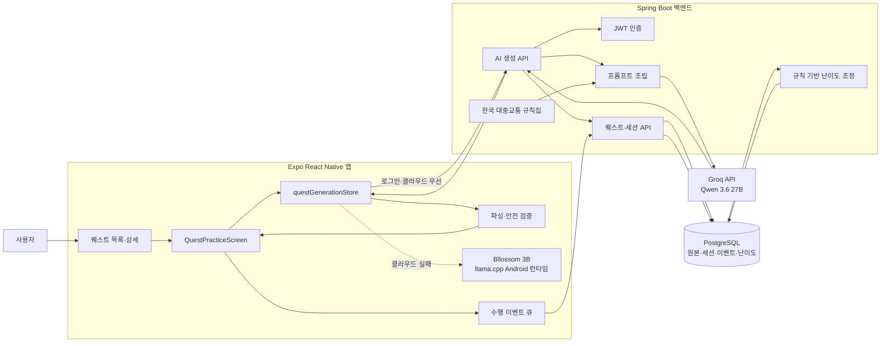
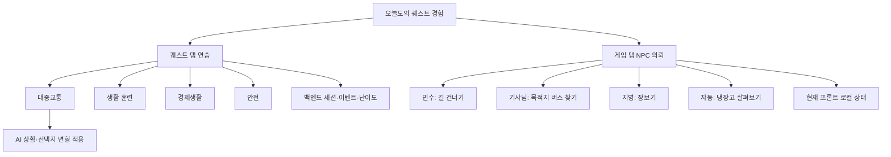
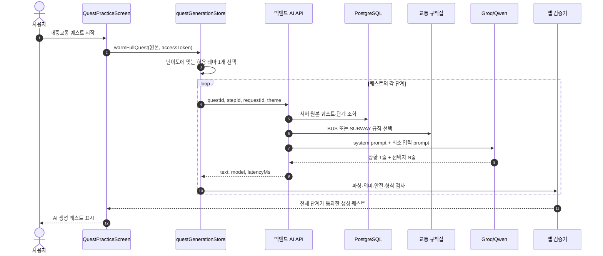
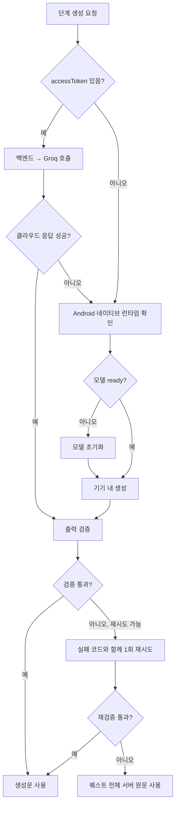
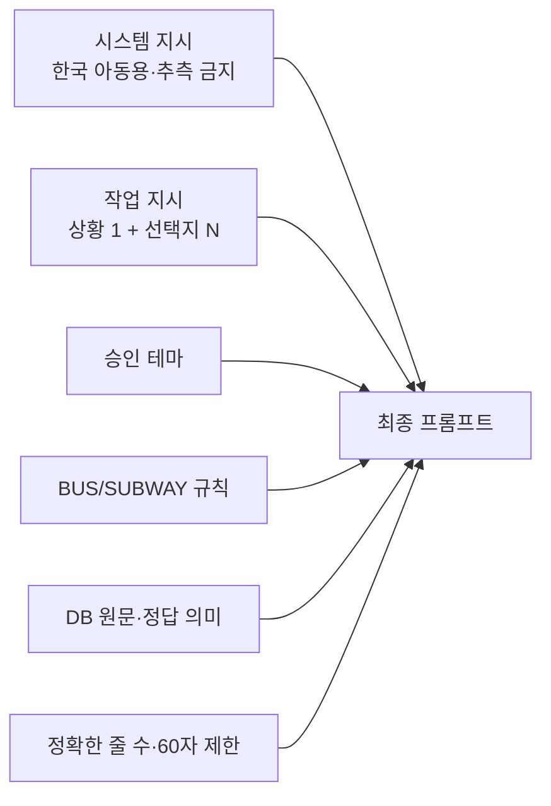
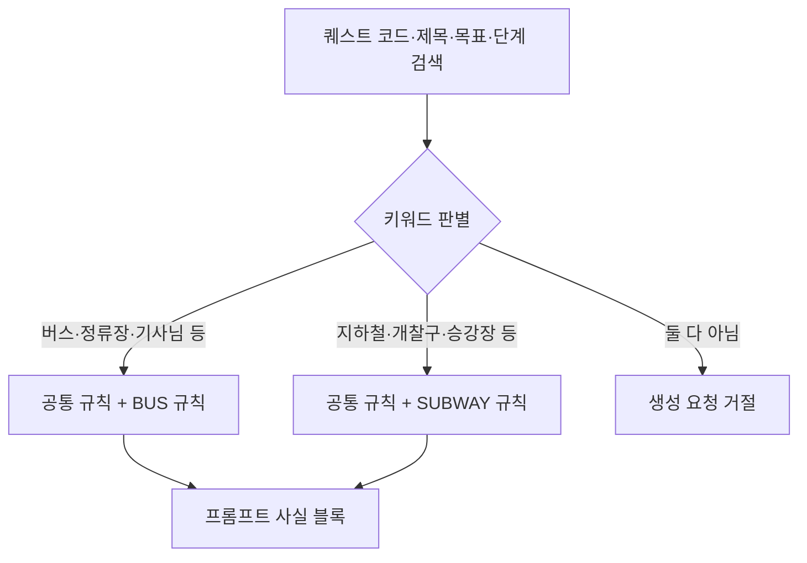
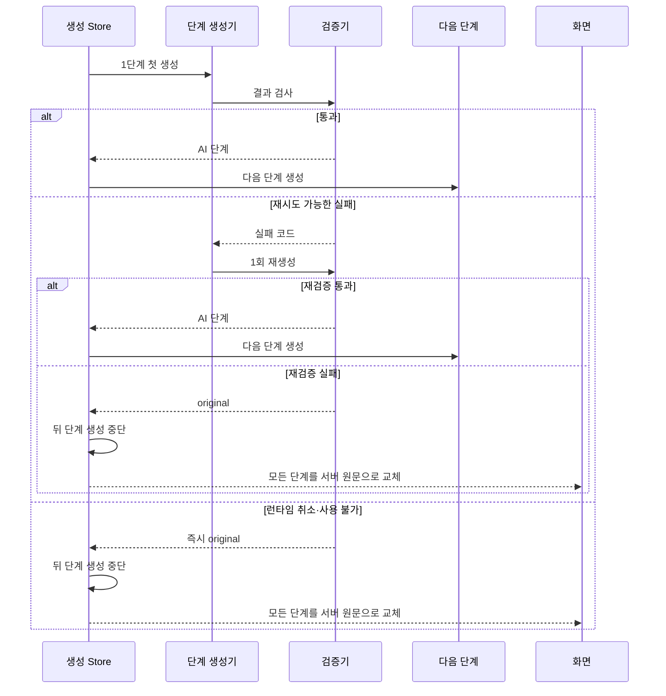
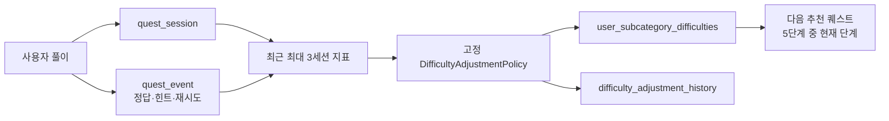

# 오늘도 AI 시스템 통합 문서

> 기준일: 2026-08-24  
> 문서 상태: 현재 코드 기준 단일 진실 공급원(SSOT)  
> 적용 범위: 퀘스트 탭의 대중교통 연습 생성, 수행 기록, 난이도 조정, 클라우드·온디바이스 런타임

## 1. 이 문서를 먼저 읽는 이유

오늘도의 AI 관련 설계, 단계별 구현 기록, Groq 연동 문서를 하나로 합친 문서다. 새 기능을 만들거나 장애를 조사할 때는 이 문서를 먼저 보고, 세부 동작이 의심스러우면 마지막에 연결한 실제 소스 코드를 확인한다.

가장 중요한 경계는 다음과 같다.

- AI는 **정답이나 안전 규칙을 새로 결정하지 않는다.** 서버 원본의 상황과 선택지를 같은 의미로 다시 표현한다.
- 현재 AI 적용 대상은 퀘스트 탭의 `PUBLIC_TRANSPORT` 퀘스트다.
- 게임 탭의 민수·기사님·지영 NPC 의뢰는 별도의 프론트엔드 시뮬레이션이며 현재 AI 생성 대상이 아니다.
- 난이도는 AI가 판단하지 않고, 서버의 고정 수치 규칙이 수행 기록을 계산해 `VERY_EASY`부터 `VERY_HARD`까지 한 단계씩 조정한다.
- 생성이 실패해도 사용자는 검증된 서버 원문으로 계속 연습할 수 있다.

## 2. 전체 구조 한눈에 보기



### 2.1 책임 분리

| 영역 | 책임 | 하지 않는 일 |
|---|---|---|
| 앱 화면 | 로딩, 문제 풀이, 피드백 표시 | 정답 판정 규칙 생성 |
| 앱 AI 계층 | 생성 순서, 파싱, 검증, 재시도, 원문 복귀 | DB 원본 수정 |
| 백엔드 AI 계층 | 권한 확인, 원본 조회, 규칙 선택, Groq 호출 | 생성문을 정답 데이터로 저장 |
| 퀘스트 백엔드 | 원본 퀘스트, 세션, 이벤트, 난이도 상태 관리 | 자유 생성 모델에 난이도 판단 위임 |
| Groq/Qwen | 제한된 문장 재작성 | 사용자 상태 조회, 정답 변경 |
| Bllossom/llama.cpp | 클라우드 불가 시 기기 내 생성 대체 | iOS·웹 지원 |
| DB | 검증된 원본과 수행 사실 저장 | AI 임시 출력 영구 저장 |

## 3. 서로 다른 두 퀘스트 시스템

현재 앱에는 이름이 비슷하지만 구현과 데이터 흐름이 다른 두 시스템이 있다.



게임 탭 보상 XP는 현재 결과 화면에 표시만 된다. 총 경험치 누적, 백엔드 저장, 중복 지급 방지 기능은 아직 없다. 이 기능을 AI 생성 구조와 섞지 않는다.

## 4. 사용자에게 보이는 정상 생성 흐름

대중교통 퀘스트 하나에는 여러 단계가 있다. 한 퀘스트의 모든 단계는 동일한 테마를 사용하고 순차 생성된다.



화면은 생성 중 원문을 잠깐 보여 주지 않고 준비 화면을 표시한다. 생성이 끝난 뒤에만 `AI 생성 퀘스트` 또는 원문 중 하나를 일관되게 사용한다.

## 5. 클라우드 우선과 온디바이스 대체

### 5.1 선택 순서



### 5.2 왜 이 순서인가

- Qwen 클라우드 모델은 소형 온디바이스 모델보다 문장 품질과 지시 이행률이 높다.
- API 키를 앱에 넣지 않고 백엔드에만 보관할 수 있다.
- 네트워크, 무료 한도, Groq 장애가 있어도 Android에서는 Bllossom 런타임으로 한 번 더 시도할 수 있다.
- 두 경로가 모두 실패해도 이미 검수된 원문이 최종 안전망이다.

### 5.3 현재 주의점

앱의 AI 설정 훅은 Android 시작 시 Bllossom 모델 준비와 초기화를 시도한다. 따라서 클라우드가 정상이어도 온디바이스 모델이 메모리에 올라갈 수 있다. 클라우드 전용 운영을 원한다면 향후 모델 준비 시점을 “클라우드 실패 직후”로 늦추는 최적화가 필요하다.

## 6. 단계 생성 입력과 출력

### 6.1 앱에서 백엔드로 보내는 요청

`POST /api/ai/quest-step/generate`

```json
{
  "questId": "UUID",
  "stepId": "UUID",
  "requestId": "quest-warmup-...",
  "theme": "비가 살짝 오는 날",
  "retryFailureCode": "THEME_NOT_APPLIED"
}
```

`retryFailureCode`는 첫 요청에는 없고 검증 실패 후 한 번만 추가될 수 있다. 이 API는 JWT 인증이 필요하다.

앱은 다음 정보를 보내지 않는다.

- 사용자 이름, 이메일, 장애 정보 등 개인정보
- 정답 선택지 ID, DB 내부 식별자 목록, 보상
- 앱이 임의로 만든 원문 전체

백엔드는 전달받은 `questId`와 `stepId`로 DB 원본을 다시 조회한다. 그러므로 앱이 원문이나 정답을 변조해 모델 입력으로 주입할 수 없다.

### 6.2 백엔드 응답

```json
{
  "requestId": "quest-warmup-...",
  "text": "비가 살짝 오는 날, ...\n안내판과 버스 번호를 확인해요.\n아무 버스나 바로 타요.",
  "model": "qwen/qwen3.6-27b",
  "latencyMs": 720
}
```

`latencyMs`는 백엔드에서 Groq 호출 직전부터 응답 수신까지 측정한 시간이다. 네트워크 왕복, 앱 파싱, 재시도, 전체 퀘스트 생성 시간은 포함하지 않는다.

### 6.3 모델이 받는 실제 의미 정보

백엔드는 DB에서 다음 정보만 골라 프롬프트를 만든다.

- 퀘스트 제목, 목표, 난이도
- 승인된 테마
- 해당 단계의 원래 상황과 지시문
- 선택지 문장과 정답 의미(`r=true/false`)
- 해당 교통수단의 한국 대중교통 규칙

모델 출력은 JSON이 아니다. `상황 1줄 + 원래 개수와 같은 선택지 N줄`만 요구한다. 구조 전체를 생성시키지 않는 이유는 JSON 문법 실패와 ID·정답·순서 변경 가능성을 줄이기 위해서다.

## 7. 프롬프트 구조



기본 요청의 핵심 원칙은 다음과 같다.

1. 지시문에 맞는 새로운 상황 한 문장과 선택지만 작성한다.
2. 상황은 승인된 테마로 시작하며 원래 장소·대상·사건의 의미를 유지한다.
3. 선택지 순서, 핵심 행동, 정답과 오답의 의미를 유지한다.
4. 원문에 없는 숫자, 설비, 요금, 법규, 위험 행동을 추가하지 않는다.
5. JSON, 키, 번호, 글머리표, 따옴표, 해설을 출력하지 않는다.

`THEME_NOT_APPLIED` 또는 `SITUATION_MEANING_LOST`로 실패하면 재시도 프롬프트는 상황 한 문장만 요구한다. 첫 응답에서 이미 검증된 선택지는 그대로 재사용해 불필요한 재생성을 줄인다.

## 8. 한국 대중교통 규칙 매핑

규칙집은 `backend/src/main/resources/ai/korean-public-transport-rules.json`에 있고 버전이 명시된다. 이 파일은 모델 학습이 아니라 요청마다 필요한 사실을 넣는 **검색·매핑형 컨텍스트**다.



대표적으로 다음 오류를 막는다.

- 일반 시내·마을버스에 안전벨트가 반드시 있다고 생성
- 지하철 상황에 하차 버튼이나 버스 기사를 등장시킴
- 버스 원문에 없던 개찰구·스크린도어·역무원을 추가
- 목적지 도착 후 하차 버튼을 누른다고 순서를 뒤집음
- 원문에 없는 특정 노선 번호, 요금, 환승 시간, 법률을 생성

규칙집에 사실을 추가할 때는 다음 순서를 따른다.

1. 전국 공통인지, 지역·운영사마다 다른지 확인한다.
2. 공통 규칙인지 `BUS`/`SUBWAY` 전용인지 분리한다.
3. 모델이 해야 할 행동과 생성하면 안 되는 주장을 함께 적는다.
4. 백엔드 프롬프트 테스트와 프론트 검증 테스트를 추가한다.
5. 규칙 버전을 갱신한다.

## 9. 안전 검증과 신뢰 경계

검증은 한 번이 아니라 여러 층에서 수행된다.

| 층 | 검사 내용 | 실패 시 |
|---|---|---|
| Spring Security | `/api/ai/**` JWT 인증 | 401/403 |
| 요청 DTO | UUID, requestId·theme 길이 | 400 |
| 생성 서비스 | `PUBLIC_TRANSPORT` 여부, 승인 테마, 퀘스트에 포함된 stepId | 400 |
| 규칙 선택 | 버스 또는 지하철 문맥인지 | 400 |
| Groq 클라이언트 | 키 설정, 빈 응답, 429, 타임아웃, 기타 HTTP 오류 | 429 또는 503 |
| 앱 파서 | 줄 수, 선택지 개수, 빈 출력 | 1회 재시도 또는 원문 |
| 문장 검사 | 한 줄, 80자 이하, 문장 수, 한국어, 금지어·링크·이메일 | 1회 재시도 또는 원문 |
| 의미 검사 | 부정 의미, 핵심 단어, 숫자, 정답 의미, 선택지 순서 | 1회 재시도 또는 원문 |
| 교통 검사 | 버스·지하철 설비 혼입, 안전벨트, 하차 순서 등 | 1회 재시도 또는 원문 |
| 퀘스트 조립 | 모든 단계 성공 여부 | 하나라도 실패하면 전체 원문 |

### 9.1 AI가 바꿀 수 있는 것

- 상황 표현
- 선택지의 자연스러운 표현
- 승인 목록 안의 상황 테마

### 9.2 AI가 바꿀 수 없는 것

- 단계 ID와 순서
- 선택지 ID와 순서
- 정답 여부
- 지시문과 힌트
- 보상 점수
- 퀘스트의 핵심 사건과 교통수단
- 사용자의 난이도

일부 생성 선택지가 의미 검사를 통과하지 못하면 해당 선택지만 원문으로 복구될 수 있다. 그러나 단계 자체가 실패하거나 재시도도 실패하면 혼합된 문장 흐름을 피하기 위해 **퀘스트 전체가 원문**으로 돌아간다.

## 10. 재시도와 전체 원문 복귀



실패 코드 예시는 다음과 같다.

- `CHOICE_COUNT_CHANGED`: 선택지 개수가 달라짐
- `INVALID_OUTPUT_SHAPE`: 빈 줄이나 해석 불가능한 형식
- `THEME_NOT_APPLIED`: 승인 테마가 상황에 반영되지 않음
- `SITUATION_MEANING_LOST`: 원문 핵심 사건이 사라짐
- `NEW_NUMBER_ADDED`: 원문에 없는 숫자를 만듦
- `CORRECTNESS_CHANGED`: 정답 의미가 바뀜
- `UNSUPPORTED_TRANSPORT_FACT`: 한국 교통 맥락에 맞지 않는 사실
- `RUNTIME_UNAVAILABLE`, `RUNTIME_ERROR`, `CANCELLED`: 실행 환경 문제
- `SKIPPED_AFTER_FAILURE`: 앞 단계 실패로 실행하지 않은 뒤 단계

## 11. 생성 캐시와 동시성

`questGenerationStore`는 메모리 안에 두 종류의 값을 가진다.

- `pending`: 현재 생성 중인 Promise. 같은 퀘스트 중복 호출을 막는다.
- `snapshots`: `idle → generating → ready` 상태와 완성 결과를 보관한다.

네이티브 런타임은 동시에 한 생성만 허용하므로 각 단계를 순차 실행한다. 동일 퀘스트를 다시 열면 메모리 스냅샷을 재사용한다. 앱 프로세스가 종료되면 이 캐시는 사라지며 AI 생성문은 DB에 저장되지 않는다.

## 12. 온디바이스 모델과 메모리

### 12.1 구성

- 모델: Bllossom 3B GGUF Q4_K_M
- 런타임: llama.cpp 기반 Android Expo 네이티브 모듈
- 지원 환경: 현재 Android Development Build
- 주요 기능: 모델 준비, 무결성 검사, 초기화, 생성 예약, 생성, 취소, 메모리 해제

### 12.2 모델 파일과 MMAP

모델은 앱 내부 저장소에 준비되고 크기·SHA-256·revision을 검사한 뒤 재사용한다. llama.cpp는 모델 파일을 MMAP 방식으로 매핑할 수 있다. MMAP은 파일 전체를 일반 힙에 복사하는 대신 운영체제가 파일의 필요한 페이지를 가상 메모리 주소에 연결하는 방식이다.

작업 관리자나 `dumpsys meminfo`에서 보이는 수치는 다음처럼 해석해야 한다.

- RSS/PSS 증가: 현재 물리 메모리에 올라온 모델 페이지가 있음
- file-backed 또는 mapped 영역: 모델 파일을 매핑한 페이지
- swap 증가: 메모리 압박 때문에 일부 익명 페이지 등이 스왑됨
- 파일이 MMAP됐다는 사실만으로 “모델 전체가 스왑에 있다”는 뜻은 아님

모델을 명시적으로 해제하면 네이티브 컨텍스트와 매핑을 정리한다. 다만 OS 캐시는 즉시 0이 되지 않을 수 있다.

## 13. 수행 기록과 난이도 조정

AI 생성과 학습 난이도는 분리되어 있다.



### 13.1 난이도별 콘텐츠 범위

대중교통에는 난이도마다 버스 원문 5개와 지하철 원문 5개가 있어 총 50개가 순환한다. 단계와 선택지 수는 하나의 고정값이 아니라 다음 범위 안에서 원문별로 달라진다.

| 난이도 | 화면 표시 | 단계 수 | 단계당 선택지 수 | 대중교통 원문 |
|---|---|---:|---:|---:|
| `VERY_EASY` | 매우 쉬움 | 2~3 | 2~3 | 버스 5 + 지하철 5 |
| `EASY` | 쉬움 | 3~4 | 2~3 | 버스 5 + 지하철 5 |
| `NORMAL` | 보통 | 4~5 | 3~4 | 버스 5 + 지하철 5 |
| `HARD` | 어려움 | 5~6 | 3~4 | 버스 5 + 지하철 5 |
| `VERY_HARD` | 매우 어려움 | 6~7 | 4~5 | 버스 5 + 지하철 5 |

범위의 기준은 `QuestDifficulty` enum이 관리한다. DB 마이그레이션 테스트는 모든 활성 대중교통 원문의 단계·선택지 수가 이 범위에 들어오는지 검사한다. 화면, 세션, 이벤트, AI 프롬프트와 파서는 실제 배열 길이를 사용하므로 4단계·3선택지를 가정하지 않는다.

### 13.2 자동 승급과 하향

최근 동일 세부 분야의 수행에서 다음 지표를 계산한다.

- 완료율
- 첫 시도 정답률
- 힌트 사용률
- 재시도율
- 서로 다른 퀘스트 수
- 연속 중단 횟수

새 사용자의 세부 분야는 `VERY_EASY`에서 시작한다. 승급은 최근 3세션, 현재 난이도의 최대 단계 수 × 3 이상의 수행 단계, 완료율 100%, 첫 시도 정답률 85% 이상, 힌트·재시도율 각 20% 이하, 서로 다른 퀘스트 2개 이상을 모두 만족할 때 일어난다. 하향은 완료율 60% 미만, 첫 시도 정답률 50% 미만, 높은 힌트·재시도 비율, 또는 2회 연속 중단 중 하나로 판단한다.

난이도는 `VERY_EASY ↔ EASY ↔ NORMAL ↔ HARD ↔ VERY_HARD`에서 한 번에 한 단계만 이동한다. 최저·최고 난이도 밖으로는 이동하지 않으며, 변경 후 24시간 동안 다시 변경하지 않는다. 이동하려는 난이도에 활성 콘텐츠가 없으면 현재 난이도를 유지하고 판정 이력에 `NO_CONTENT`를 남긴다.

## 14. 데이터 저장 원칙

| 데이터 | 저장 위치 | 지속성 |
|---|---|---|
| 검수된 퀘스트·단계·선택지 | PostgreSQL | 영구 |
| 퀘스트 세션·풀이 이벤트 | PostgreSQL | 영구 |
| 사용자 세부 분야 난이도·변경 이력 | PostgreSQL | 영구 |
| AI 생성문 | 앱 메모리 snapshot | 앱 실행 중 |
| 생성 중 Promise | 앱 메모리 pending map | 요청 중 |
| Groq API 키 | 백엔드 환경변수 | 서버 설정 |
| 온디바이스 모델 | Android 앱 내부 파일 | 삭제 전까지 |
| 게임 탭 NPC 의뢰 상태·XP | 프론트 컴포넌트 상태 | 게임 화면을 나갈 때 초기화 |

## 15. 설정과 운영

### 15.1 백엔드 환경변수

| 변수 | 기본값 | 의미 |
|---|---|---|
| `GROQ_ENABLED` | `false` | Groq 호출 허용 |
| `GROQ_API_KEY` | 빈 값 | 서버 전용 API 키 |
| `GROQ_BASE_URL` | `https://api.groq.com` | Groq API 주소 |
| `GROQ_MODEL` | `qwen/qwen3.6-27b` | 생성 모델 |
| `GROQ_TIMEOUT` | `PT20S` | 서버 HTTP 타임아웃 |

앱의 클라우드 요청 타임아웃은 25초다. Groq 요청은 현재 `max_completion_tokens=256`, `temperature=0.7`, `top_p=0.8`, 비스트리밍으로 보낸다.

키는 `.env`나 셸 환경변수로 서버에만 주입하고 앱의 `EXPO_PUBLIC_*`, Git, 문서, 로그에 넣지 않는다.

### 15.2 오류 응답

| 상황 | HTTP | 코드 |
|---|---:|---|
| Groq 한도 초과 | 429 | `CLOUD_AI_RATE_LIMITED` |
| 키 비활성·Groq 장애·서버 타임아웃 | 503 | `CLOUD_AI_UNAVAILABLE` |
| 잘못된 대상·테마·단계 | 400 | `INVALID_REQUEST` |
| 앱 자체 25초 초과 | 앱 오류 | `CLOUD_AI_TIMEOUT` |
| 앱 네트워크 실패 | 앱 오류 | `CLOUD_AI_NETWORK_ERROR` |

서버가 `Retry-After`를 받으면 429 응답에도 전달한다. 현재 자동 결제나 자동 한도 증액 로직은 없다. 제공사 계정 정책과 결제 설정은 Groq 콘솔에서 별도로 확인해야 한다.

## 16. 성능 측정과 로그

성능을 비교할 때 시간을 혼동하지 않는다.

| 지표 | 시작~끝 | 현재 위치 |
|---|---|---|
| Groq 단계 지연 | 서버가 Groq 호출하기 직전~응답 | `QuestGenerationResponse.latencyMs` |
| 앱 단계 체감 지연 | 앱 fetch 시작~파싱·검증 완료 | 별도 계측 필요 |
| 퀘스트 전체 생성 | 첫 단계 시작~마지막 단계 검증 | 별도 계측 필요 |
| 온디바이스 초기화 | 네이티브 모델 초기화 | `initializationMs` |
| 온디바이스 생성 | 네이티브 요청 시작~완료 | `GenerateResult.latencyMs` |

개발 모드에서는 다음 메타데이터만 기록한다.

- `requestId`, 모델명, 단계 순서, 지연시간
- AI/원문 출처
- 실패 코드와 재시도 여부

프롬프트 원문, 생성 원문, 개인정보, API 키는 진단 로그에 남기지 않는다.

## 17. 테스트 전략

### 17.1 프론트엔드

- `CloudFirstQuestRuntime.test.ts`: 클라우드 우선과 네이티브 대체
- `QuestGenerationStore.test.ts`: 중복 방지, 앞 단계 실패 후 중단, 전체 원문 복귀
- `Phase4FullQuestGeneration.test.ts`: 파싱, 1회 재시도, 의미·정답·숫자·교통 사실 검증
- `KoreanTransportRules.test.ts`: 버스·지하철 규칙 선택
- `NativeRuntime.test.ts`: 지원 여부, 준비, 초기화, 생성, 취소, 해제

### 17.2 백엔드

- `QuestGenerationServiceTest`: 대상 카테고리, 테마, 단계 검증과 모델 호출
- `QuestGenerationPromptFactoryTest`: 최소 입력, 규칙 블록, 출력 형식
- `DifficultyAdjustmentPolicyTest`: 승급·하향·유지·쿨다운·콘텐츠 부재

### 17.3 변경 시 최소 확인

1. 프론트 Jest 전체 또는 위 AI 테스트 실행
2. 백엔드 Gradle 테스트 실행
3. 로그인 후 대중교통 퀘스트 실제 생성
4. 단계별 `latencyMs`, source, failureCode 확인
5. Groq 비활성 또는 네트워크 차단 상태에서 대체·원문 복귀 확인
6. 생성문에서 정답, 숫자, 교통수단, 행동 순서가 원문과 같은지 사람이 검토

## 18. 주요 파일 지도

### 프론트엔드

| 파일 | 역할 |
|---|---|
| `src/api/cloudQuestGeneration.ts` | 인증된 클라우드 생성 요청과 25초 타임아웃 |
| `src/ai/cloudFirstQuestRuntime.ts` | Groq 우선, Android 네이티브 대체 |
| `src/ai/questGenerationStore.ts` | 전체 단계 순차 생성, 캐시, 전체 원문 복귀 |
| `src/ai/questStepGenerator.ts` | 프롬프트, 파싱, 검증, 1회 재시도 |
| `src/ai/prompts/koreanTransportRules.ts` | 온디바이스 경로의 교통 규칙 |
| `src/ai/nativeRuntime.ts` | TypeScript와 Expo 네이티브 모듈 연결 |
| `src/ai/useAiVariationSettings.ts` | 모델 준비, 활성화, 해제 |
| `src/ai/useQuestVariation.ts` | 화면에서 생성 snapshot 구독 |
| `src/screens/QuestPracticeScreen.tsx` | 연습 UI, 세션·이벤트 처리 |
| `modules/oneuldo-llama-runtime/` | Android Bllossom/llama.cpp 런타임 |

### 백엔드

| 파일 | 역할 |
|---|---|
| `ai/controller/QuestGenerationController.java` | `/api/ai/quest-step/generate` |
| `ai/service/QuestGenerationService.java` | 원본·대상·테마 검증과 호출 조율 |
| `ai/service/QuestGenerationPromptFactory.java` | 서버 권위 원본으로 프롬프트 조립 |
| `ai/service/KoreanPublicTransportRuleBook.java` | 교통수단 판별과 규칙 선택 |
| `ai/client/RestGroqChatClient.java` | Groq Chat Completions 호출 |
| `resources/ai/korean-public-transport-rules.json` | 한국 버스·지하철 사실 규칙 |
| `quest/service/QuestSessionService.java` | 수행 세션과 이벤트 저장 |
| `quest/service/DifficultyAdjustmentService.java` | 최근 수행 지표 계산 |
| `quest/service/DifficultyAdjustmentPolicy.java` | 결정론적 난이도 규칙 |

## 19. 구현 결정 이력

| 단계 | 남은 결과 | 현재 의미 |
|---|---|---|
| Phase 0 | 모델 파일·체크섬·재현성 기준 | 온디바이스 모델 배포 기반 |
| Phase 1 | 퀘스트 단계·선택지·세션·이벤트 | 서버 원본과 수행 사실의 기반 |
| Phase 2 | Android 네이티브 생성·취소·해제 | Bllossom 대체 경로 |
| Phase 3 | 공통 계약·파서·정책·fallback | 생성 안전 계층 |
| Phase 4 | 대중교통 전체 단계 변형 | 현재 사용자 AI 기능 |
| Phase 5 | 수행 기반 난이도 조정 | AI와 분리된 개인화 규칙 |
| Phase 6 | 버스·지하철 시나리오와 안전 검증 확장 | 현재 콘텐츠 범위 |
| Groq 전환 | Qwen 클라우드 우선 호출 | 품질 향상, 키 보호, 서버 원본 신뢰 |

초기 MNN/Qwen 온디바이스 구현은 Bllossom GGUF/llama.cpp 경로로 대체되었다. 과거 계획 문서를 유지하지 않고 이 결정 이력만 남기는 이유는 현재 빌드 구조와 혼동하지 않기 위해서다.

## 20. 현재 한계와 다음 작업

우선순위가 높은 현재 한계는 다음과 같다.

1. 클라우드가 정상이어도 Android 시작 시 온디바이스 모델을 미리 준비해 메모리와 저장 공간을 사용할 수 있다.
2. 생성 결과 캐시는 메모리 전용이라 앱 재시작 시 다시 생성한다.
3. 서버 자체 사용자별 호출량 제한과 사용량 집계는 없다. 제공사의 429에 의존한다.
4. 전체 퀘스트 체감 시간과 앱 검증 시간을 하나로 수집하는 운영 지표가 없다.
5. 규칙집은 코드 리뷰 기반 정적 파일이며 외부 공공 데이터 자동 갱신 구조가 아니다.
6. 게임 탭 NPC 의뢰와 XP는 백엔드에 저장되지 않으며 AI 시스템과 연결되지 않았다.
7. 온디바이스 모델의 실제 ARM64 기기별 메모리·발열·속도 검증을 지속해야 한다.

## 21. 용어 설명

| 용어 | 뜻 |
|---|---|
| 토큰 | 모델이 글을 처리하는 작은 단위. 글자나 단어와 정확히 일치하지 않는다. |
| 입력 토큰 | 시스템 지시, 규칙집, 원문 등 모델에게 보낸 토큰 |
| 출력 토큰 | 모델이 생성한 문장에 사용된 토큰 |
| fallback | AI 결과를 쓸 수 없을 때 네이티브 또는 검증된 원문으로 돌아가는 것 |
| hallucination | 근거에 없는 사실을 그럴듯하게 생성하는 현상 |
| MMAP | 파일 페이지를 가상 메모리에 매핑해 필요할 때 읽는 방식 |
| GGUF | llama.cpp 계열에서 사용하는 모델 파일 형식 |
| Q4_K_M | 모델 가중치를 줄여 저장·메모리 사용량을 낮춘 양자화 방식 |
| PSS | 공유 메모리를 프로세스별로 나눠 계산한 메모리 지표 |
| swap | 물리 메모리 압박 시 일부 메모리 내용을 보조 저장 영역으로 옮기는 방식 |

## 22. 질문을 반영하는 방법

이 문서 이후 AI 구조에 대해 질문하면 먼저 대화로 설명한다. 사용자가 설명을 이해했고 문서 반영을 원한다는 뜻으로 “됐어”, “이해했어”, “문서에 넣어줘”처럼 확인하면 다음 순서로 갱신한다.

1. 질문과 답을 단순 대화 기록이 아니라 재사용 가능한 개념 설명으로 정리한다.
2. 기존 절과 겹치면 해당 절을 보강하고, 새 주제면 이 문서에 절을 추가한다.
3. 당시 코드와 다르면 코드 기준 사실과 향후 제안을 명확히 분리한다.
4. `기준일`과 필요 시 결정 이력을 갱신한다.
5. 다이어그램에 영향을 주는 구조 변경이면 관련 Mermaid 그림도 함께 수정한다.

## 23. 문서 관리 원칙

- 이 디렉터리의 AI 설명 문서는 이 파일 하나만 유지한다.
- 구현 상태는 현재 코드와 테스트를 기준으로 적는다.
- 과거 시도는 현재 구조 이해에 필요한 결정만 19절에 남긴다.
- 계획은 구현 완료처럼 표현하지 않는다.
- 모델명, 한도, 가격처럼 외부에서 바뀔 수 있는 값은 확인 날짜나 설정 위치를 함께 적는다.
- 보안 정보와 실제 API 키는 예시에도 기록하지 않는다.
