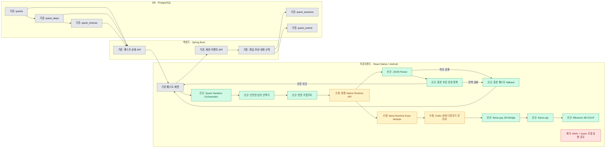
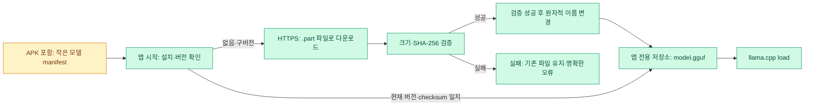
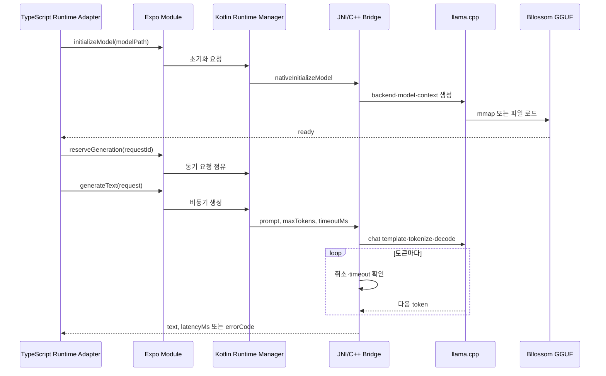
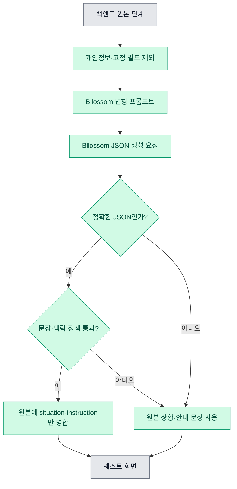

# Bllossom 3B 온디바이스 런타임 전환 설계

## 1. 문서 목적

이 문서는 오늘도의 온디바이스 AI 기준 모델을 기존 **Qwen3.5-0.8B MNN**에서 **Llama-3.2-Korean-Bllossom-3B GGUF Q4_K_M**으로 변경하고, 첫 AI 기능을 단계별 힌트가 아닌 **통제된 퀘스트 상황 변형**으로 구현하기 위한 목표 구조와 마이그레이션 순서를 정의한다.

이 문서가 확정하는 방향은 다음과 같다.

```text
기존
Qwen3.5-0.8B MNN
→ MNN Runtime
→ 단순 문자열 생성

변경
Llama-3.2-Korean-Bllossom-3B Q4_K_M GGUF
→ llama.cpp Runtime
→ 구조가 제한된 퀘스트 상황 변형
→ 정책 검사
→ 실패하면 원본 퀘스트 사용
```

> 2026-08-17 기준 코드·네이티브 라이브러리·모델 배포 경로 전환, Android Debug APK 빌드와 Phase 3 퀘스트 변형 공통 계층을 완료했다. 연결된 기기가 없어 실제 `arm64-v8a`와 MuMu `x86_64` 실행·성능 측정, 퀘스트 화면 적용은 남아 있다.

## 2. 모델과 런타임 결정

### 2.1 목표 모델

| 항목 | 값 |
|---|---|
| Hugging Face 저장소 | `Bllossom/llama-3.2-Korean-Bllossom-3B-gguf-Q4_K_M` |
| 고정 리비전 | `c07b7a0f2688d1212612b653a752a0dfe4e18bae` |
| 파일 | `llama-3.2-Korean-Bllossom-3B-gguf-Q4_K_M.gguf` |
| 파일 크기 | 2,019,377,664바이트, 약 2.02GB |
| SHA-256 | `389f380bbfbe77d9171937b3d166a26ccc3e04201f3d9fb0ca1b5e01b6787621` |
| 양자화 | `Q4_K_M` |
| 모델 계열 | Llama 3.2 3B, 한국어·영어 강화 |
| 라이선스 | Llama 3.2 License, 배포 전 최종 검토 필요 |

공식 모델 위치:

- [Bllossom GGUF 모델](https://huggingface.co/Bllossom/llama-3.2-Korean-Bllossom-3B-gguf-Q4_K_M)
- [Bllossom 원본 모델 설명](https://huggingface.co/Bllossom/llama-3.2-Korean-Bllossom-3B)

### 2.2 목표 런타임

GGUF를 직접 실행하는 [llama.cpp](https://github.com/ggml-org/llama.cpp)를 사용한다.

| 항목 | 고정 값 |
|---|---|
| llama.cpp 태그 | `b10455` |
| 커밋 | `37a215c9e909822fb8ebb72b5bd37623b0b9611f` |
| Android ABI | `arm64-v8a`, `x86_64` |
| Android 연결 | Kotlin → JNI/C++ → llama.cpp |
| 기본 실행 | CPU 우선, 가속은 실기기 측정 후 결정 |

`arm64-v8a`는 실제 Android 기기용이고 `x86_64`는 MuMu Player 반복 검증용이다. 두 ABI를 같은 소스와 옵션으로 직접 빌드한다.

### 2.3 MNN을 그대로 사용하지 않는 이유

- 목표 파일은 MNN 모델 디렉터리가 아니라 단일 GGUF 파일이다.
- MNN 변환을 거치면 원본 `Q4_K_M`과 동일한 양자화·출력 품질이 유지되는지 다시 검증해야 한다.
- llama.cpp는 GGUF의 chat template, tokenizer와 Llama 계열 실행 경로를 직접 제공한다.
- 기존 TypeScript 공개 API를 유지하면 화면과 Phase 3 공통 계층은 네이티브 런타임 교체의 영향을 최소화할 수 있다.

## 3. 변경 범위 색상

아래 구조도에서는 전환 범위를 색으로 구분한다.

- 회색: 기존부터 존재하며 그대로 유지하는 영역
- 노란색: 기존 Qwen/MNN 구조에서 수정하는 영역
- 초록색: Bllossom 전환 과정에서 새로 만드는 영역
- 빨간색: 제거하거나 더 이상 사용하지 않는 영역

## 4. 프론트엔드·백엔드·DB 전체 구조



### 핵심 책임 분리

```text
백엔드·DB
→ 원본 퀘스트, 단계, 선택지, 정답, 보상과 완료 조건 관리

온디바이스 Bllossom
→ 상황 설명과 안내 문장의 표현만 변형

프론트 Policy
→ 모델 출력이 원본 규칙을 침범하지 않는지 검사
```

Phase 3의 첫 버전에서는 백엔드와 DB 스키마를 변경하지 않는다. 생성된 변형 문장은 기본적으로 저장하지 않고 현재 퀘스트 실행의 메모리에서만 사용한다.

## 5. 기존 구조와 목표 구조 비교

| 구분 | 기존 Phase 2 | 변경 후 |
|---|---|---|
| 모델 | Qwen3.5-0.8B | Korean-Bllossom-3B |
| 모델 크기 | 약 484MB | 약 2.02GB |
| 모델 형식 | MNN 디렉터리 6개 파일 | GGUF 단일 파일 |
| 런타임 | MNN 3.6.1 | llama.cpp b10455 |
| APK 모델 포함 | 포함 | 포함하지 않음 |
| 모델 준비 | APK asset 복사 | HTTPS 다운로드·checksum 검증 |
| 생성 결과 | 자유 문자열 | 제한된 JSON |
| 첫 AI 기능 | 미정/힌트 예정 | 퀘스트 상황 변형 |
| 실패 처리 | 런타임 오류 반환 | 원본 퀘스트 fallback |
| 규칙 결정 | 백엔드 | 계속 백엔드 |

## 6. 모델 배포 구조

2.02GB GGUF를 APK asset에 포함하면 설치 파일이 지나치게 커지고, asset에서 앱 전용 경로로 복사할 때 디스크에 중복 저장될 수 있다. 따라서 모델은 앱과 분리해 내려받는다.



### 저장 정책

- 모델은 `noBackupFilesDir/models/bllossom-3b-q4-k-m/` 아래에 저장한다.
- 다운로드 중에는 `.part` 확장자를 사용한다.
- 크기와 SHA-256이 모두 맞을 때만 최종 파일명으로 바꾼다.
- 다운로드 중단 시 정상 모델 파일을 덮어쓰지 않는다.
- 준비 전 `기존 모델 + 새 모델 + 안전 여유 공간`을 기준으로 저장 공간을 검사한다.
- 모델 업데이트 시 새 파일 검증이 끝나기 전까지 이전 모델을 유지한다.
- 다운로드 진행률·취소·재시도 API는 UI에 노출한다.
- 모델 원문과 생성 결과를 외부 공용 저장소에 두지 않는다.

## 7. 네이티브 런타임 구조



### 유지할 Phase 2 동작

- 동시에 하나의 생성만 허용
- 중복 `requestId` 거부
- `BUSY`, `CANCELLED`, `TIMEOUT` 구조화 오류
- 토큰 경계 취소
- 백그라운드 모델 해제
- 해제 후 재초기화
- UTF-8 한국어·이모지 왕복
- Android 이외 환경의 `UNSUPPORTED`

### 바뀌는 네이티브 구현

- `MNN::Transformer::Llm` 객체를 제거한다.
- llama.cpp의 model, context, sampler와 batch 수명을 관리한다.
- GGUF metadata에 있는 Llama chat template를 사용한다.
- Phase 3 strict parser·정책을 우선 적용하고, 실제 출력 평가에서 필요하면 llama.cpp grammar를 추가한다.
- context와 KV cache를 요청마다 초기화한다.
- `arm64-v8a`, `x86_64` JNI 라이브러리를 새 manifest로 관리한다.

## 8. 공개 API와 오류 체계

화면과 Phase 3가 사용하는 TypeScript API 이름은 런타임 제품명과 분리한다.

```ts
getNativeRuntimeStatus(): Promise<NativeRuntimeStatus>;
prepareNativeModel(): Promise<ModelPreparationResult>;
initializeNativeModel(): Promise<NativeRuntimeStatus>;
generateNativeText(request: GenerateRequest): Promise<GenerateResult>;
cancelNativeGeneration(requestId: string): Promise<CancellationResult>;
releaseNativeModel(): Promise<ReleaseResult>;
```

내부 패키지는 `oneuldo-mnn-runtime`에서 `oneuldo-llama-runtime`으로 변경하되, 앱 계층은 계속 `nativeRuntime.ts`만 참조한다.

### 추가할 모델 준비 상태

```ts
type ModelPreparationState =
  | 'not-downloaded'
  | 'downloading'
  | 'verifying'
  | 'ready'
  | 'error';
```

### 추가할 오류 코드

기존 Phase 2 오류 코드에 다음을 추가한다.

```ts
type BllossomRuntimeErrorCode =
  | RuntimeErrorCode
  | 'NETWORK_UNAVAILABLE'
  | 'MODEL_DOWNLOAD_FAILED'
  | 'MODEL_INCOMPATIBLE';
```

`MODEL_CORRUPTED`는 다운로드한 파일의 크기·checksum 불일치, `MODEL_INCOMPATIBLE`은 GGUF metadata 또는 llama.cpp 로드 호환 실패에 사용한다.

## 9. 퀘스트 변형 계약

### 9.1 AI 입력

모델에는 표현 변형에 필요한 최소 정보만 전달한다.

```ts
type QuestVariationInputV1 = {
  schemaVersion: 'quest-variation-input-v1';
  theme: string;
  objective: string;
  originalSituation: string;
  originalInstruction: string;
};
```

다음 값은 모델에 전달하지 않는다.

- 사용자 실명, 이메일, 생년월일과 회원 ID
- Access Token과 서버 내부 식별자
- `choiceId`, `correctChoiceId`와 정답 여부
- 보상, 완료 상태와 난이도 결정 값
- 필요하지 않은 과거 행동 기록 원문

### 9.2 AI 출력

앞선 비교에서는 모델에게 `stepId`를 다시 출력하게 했을 때 두 모델 모두 ID를 누락하거나 변경했다. 따라서 AI 출력에는 변경 가능한 두 필드만 허용한다.

```ts
type QuestVariationOutputV1 = {
  situation: string;
  instruction: string;
};
```

모델이 생성하지 않는 값:

```text
questId
stepId
stepOrder
choices
correctChoiceId
reward
completed
```

최종 화면 객체는 원본에 검증된 표현만 덮어쓴다.

```ts
const presentation = {
  ...originalStep,
  situation: validatedVariation.situation,
  instruction: validatedVariation.instruction,
};
```

이 구조에서는 AI가 정답, 단계 ID와 선택지를 변경할 통로 자체가 없다.

## 10. Phase 3 실행 흐름



### 출력 정책

- 정확히 `situation`, `instruction` 두 필드만 허용한다.
- 각 필드는 한 문장, 80자 이하로 제한한다.
- 빈 문자열, Markdown과 설명문을 거부한다.
- 퀘스트 유형에 필요한 핵심 개념을 검사한다.
- 위험 행동, 위협·비난·불안 유발 표현을 거부한다.
- 한 번에 하나의 행동만 안내한다.
- 원본 objective와 모순되는 결과를 거부한다.
- 검증에 실패하면 모델 문장을 일부라도 화면에 표시하지 않는다.

## 11. 1차 모델 비교 결과

동일한 버스 퀘스트 4단계와 비·혼잡·저녁 3개 테마를 조합한 12개 케이스를 실제로 실행했다.

| 평가 항목 | Qwen3.5-0.8B MNN | Bllossom 3B Q4_K_M |
|---|---:|---:|
| 설명·Markdown 없는 JSON | 5/12 | 12/12 |
| 요청한 필드만 정확히 출력 | 2/12 | 0/12 |
| 정확한 `stepId` 포함 | 7/12 | 6/12 |
| 지정 테마 반영 | 4/12 | 11/12 |
| 원본 퀘스트 목적 유지 | 0/12 | 8/12 |
| 문장만 보면 바로 사용할 만함 | 0/12 | 약 3/12 |
| 완전한 정책 통과 | 0/12 | 0/12 |

### 해석

- Bllossom은 한국어, 버스 맥락과 테마 반영에서 Qwen보다 확실히 나았다.
- Bllossom도 요청하지 않은 `objective`를 추가하고 `stepId`를 누락·변경했다.
- 따라서 모델 교체만으로는 부족하며 strict parser, Phase 3 정책 검사와 원본 fallback이 필수다.
- 모델 출력에서 ID·선택지·정답 필드를 제거하는 구조 변경은 이 비교 결과에서 직접 도출했다.
- 이 비교는 모델별 12개 단일 실행의 1차 품질 프로브다. 최종 채택 검증은 케이스별 3회 이상 반복하고 전문가 검토를 포함한다.

### 참고 성능

| 모델 | 환경 | 평균 전체 생성 시간 |
|---|---|---:|
| Qwen3.5-0.8B MNN | MuMu Android 15 x86_64 | 3.57초 |
| Bllossom 3B llama.cpp | Windows x64 CPU | 5.82초 |

실행 환경이 다르므로 위 시간으로 런타임 성능의 우열을 판단하지 않는다. Bllossom은 해당 Windows CPU 실행에서 약 10토큰/초였으며, Android 성능은 동일 ARM64 기기에서 다시 측정한다.

## 12. 목표 파일 구조

```text
frontend/
├── modules/
│   └── oneuldo-llama-runtime/
│       ├── package.json
│       ├── expo-module.config.json
│       ├── src/
│       │   └── types.ts
│       └── android/
│           └── src/main/java/com/oneuldo/llama/
│               ├── OneuldoLlamaRuntimeModule.kt
│               ├── LlamaRuntimeManager.kt
│               └── ModelDownloadManager.kt
├── native/
│   └── llama-runtime/
│       ├── CMakeLists.txt
│       ├── llama_runtime_bridge.h
│       └── llama_runtime_bridge.cpp
├── src/ai/
│   ├── nativeRuntime.ts
│   ├── nativeRuntime.types.ts
│   ├── contracts.ts
│   ├── orchestrator.ts
│   ├── parser.ts
│   ├── policy.ts
│   ├── fallback.ts
│   ├── selectors/
│   │   └── questVariationInput.ts
│   └── prompts/
│       └── questVariationPrompt.ts
├── scripts/
│   └── build-llama-android.ps1
├── plugins/
│   └── with-llama-runtime.js
└── vendor/
    └── llama.cpp/
        ├── llama-android.manifest.json
        └── android/
            ├── arm64-v8a/
            └── x86_64/
```

2.02GB GGUF 파일은 저장소와 APK의 `models/` 아래에 두지 않는다. 저장소에는 모델 다운로드 manifest만 추적한다.

## 13. 구현 순서

### 1단계 — 기준 고정

- Bllossom 리비전, 파일 크기, SHA-256과 라이선스 기록
- llama.cpp 태그와 커밋 고정
- 기존 Qwen/MNN APK와 메모리 측정값 보존

### 2단계 — llama.cpp 최소 Android 프로브

- `arm64-v8a`, `x86_64` 빌드
- GGUF metadata 조회
- 모델 로드 없이 JNI 버전 호출
- MuMu와 실제 ARM64 기기에서 `.so` 로딩 확인

### 3단계 — 모델 다운로드 관리자

- 작은 manifest만 APK에 포함
- HTTPS 다운로드, 진행률, 취소와 재시도
- 크기·SHA-256 검증
- 저장 공간 검사와 원자적 전환

### 4단계 — 모델 초기화

- model·context·sampler 생성
- 중복 초기화 방지
- 초기화 시간과 PSS 기록
- 초기화 실패 후 재시도

### 5단계 — 생성·취소·해제

- Llama chat template 적용
- UTF-8 한국어 생성
- token 단위 timeout·취소
- 백그라운드 해제와 재초기화
- 기존 TypeScript 공개 API 유지

### 6단계 — 퀘스트 변형 공통 계층

**완료 — 2026-08-17**

- [x] `quest-variation-input-v1` 계약
- [x] 안전한 입력 선택기
- [x] Bllossom용 두 필드 JSON 프롬프트
- [x] 추가 필드를 거절하는 strict parser
- [x] 원본 보존·문장 정책
- [x] 원본 퀘스트 fallback
- [x] 런타임 초기화·생성·검증을 묶은 오케스트레이터

네이티브 grammar는 필수 안전 경계로 간주하지 않는다. 현재 버전은 어떤 형식 오류도 strict parser에서 거절하고 원본을 사용하며, 실제 기기 반복 평가에서 fallback 비율이 높을 때 grammar 추가를 검토한다.

### 7단계 — 품질·성능 재검증

- 12개 기본 케이스를 각 3회 이상 실행
- JSON·정책·원본 보존 통과율 계산
- 보호자·전문가 블라인드 문장 평가
- 동일 ARM64 기기에서 로딩·첫 토큰·tokens/s·PSS 측정
- 저메모리·저장 공간 부족·다운로드 중단 검증

### 8단계 — 기존 MNN 경로 제거

- Bllossom이 모든 완료 조건을 통과한 뒤에만 Qwen asset plugin과 MNN vendor를 제거
- 문서, package scripts와 CI 검증 명령을 llama.cpp 기준으로 변경
- 제거 전까지 개발 브랜치에서 두 런타임을 비교 가능하게 유지

## 14. 완료 기준

### 기능

- Android Development Build가 Bllossom GGUF를 앱 전용 저장소에서 준비한다.
- React Native가 퀘스트 변형 요청과 구조화 결과를 주고받는다.
- AI는 `situation`, `instruction` 이외의 값을 변경하지 못한다.
- 오류·정책 실패 시 원본 퀘스트가 같은 UI 타입으로 표시된다.

### 품질

- JSON 파싱 성공률과 원본 보존율 목표를 테스트 전에 수치로 확정한다.
- 정답, 선택지, 단계 순서와 보상을 변경한 결과는 화면 노출 0건이어야 한다.
- 금지 표현은 화면 노출 0건이어야 한다.
- 같은 입력 반복 결과가 허용된 변형 범위 안에 있어야 한다.

### 안정성

- 실제 `arm64-v8a` 기기와 MuMu `x86_64`에서 초기화·생성·취소·해제 성공
- 백그라운드 전환과 반복 초기화에서 crash·ANR 없음
- 목표 최소 사양 기기에서 OOM 없음
- 다운로드 중단·checksum 실패 후 정상 복구
- 모델을 사용할 수 없는 환경에서도 기존 정적 퀘스트 정상 수행

## 15. 위험과 대응

| 위험 | 영향 | 대응 |
|---|---|---|
| 2.02GB 다운로드 | 설치 이탈·저장 공간 부족 | 선택적 다운로드, 진행률, Wi-Fi 안내, 정확한 공간 검사 |
| 높은 RAM 사용 | OOM·앱 종료 | context 제한, 토큰 제한, 즉시 해제, 최소 사양 측정 |
| 느린 생성 | 퀘스트 흐름 지연 | 짧은 JSON, 낮은 token 상한, 생성 결과 세션 내 재사용 |
| JSON 필드 추가·누락 | 파싱 실패 | strict parser, 원본 fallback, 필요 시 llama.cpp grammar |
| 퀘스트 목표 변경 | 잘못된 훈련 | 가변 필드 2개만 허용, 원본 객체 병합 방식 사용 |
| 어색하거나 불안한 문장 | 사용자 경험·안전 저하 | 길이·금지 표현 정책, 전문가 검토, 원본 fallback |
| 라이선스 미확인 | 배포 위험 | Llama 3.2 License와 모델 배포 조건 최종 검토 |

## 16. 최종 목표 상태

```text
백엔드 원본 퀘스트
→ 프론트가 변형 가능한 정보만 선택
→ Bllossom 3B가 상황·안내 문장만 생성
→ JSON·문장·맥락 정책 검사
→ 성공하면 원본 단계에 두 문장만 병합
→ 실패하면 원본 퀘스트 그대로 사용
→ 선택지·정답·보상 판정은 항상 백엔드 규칙 사용
```

모델이 없어도 오늘도의 퀘스트는 항상 수행 가능해야 한다. Bllossom은 퀘스트의 규칙을 만드는 주체가 아니라, 승인된 범위 안에서 같은 훈련 상황의 표현을 다양하게 만드는 보조 도구로만 사용한다.

## 17. 2026-08-17 구현 결과

### 완료

- `oneuldo-llama-runtime` Expo Module과 `com.oneuldo.llama` Kotlin 계층 신설
- 앱 최초 실행 GGUF 다운로드, 저장 공간 확인, 크기·SHA-256 검증 구현
- llama.cpp model/context/sampler 수명, 생성·취소·timeout·release JNI 구현
- llama.cpp `b10455`를 `arm64-v8a`, `x86_64`로 빌드하고 단일 `.so`로 패키징
- Expo prebuild, Kotlin 컴파일, Android Debug APK 생성 통과
- APK 내부에 두 ABI `.so`와 Bllossom manifest만 포함되고 Qwen/MNN 파일이 없음을 확인
- 기존 Qwen 모델 캐시·manifest·다운로드 스크립트·asset plugin과 MNN 모듈·JNI·vendor 제거

### 네이티브 산출물

| ABI | 파일 크기 | SHA-256 |
|---|---:|---|
| `arm64-v8a` | 51,819,112 | `05b2d9168ece0a954c9fb02cc21ab7cdc30a1f75a77ea50bfd20af7180e6f07e` |
| `x86_64` | 50,734,912 | `c5eae76c8e38eae9b0bcd7b5a4222db9499743aad8627913ab2a1cab21973608` |

### 남은 검증

- 실제 Android `arm64-v8a`에서 약 2GB 다운로드·초기화·생성·메모리 측정
- MuMu `x86_64`에서 동일 회귀 검증
- Phase 4에서 `QuestPracticeScreen` 연결, 로딩 UI와 세션 내 결과 재사용 구현
- 실제 Bllossom 출력의 fallback 비율을 측정한 뒤 필요하면 llama.cpp grammar 추가
