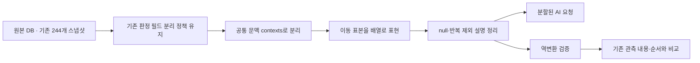

# 행동 로그 입력 표현 개선 — 1~3 적용

## 목적과 변경 범위

사용자의 지시에 따라 세밀한 관찰 기록을 줄이지 않고 AI로 전달하는 표현만 바꿨다. 원본 `behavior_logs`와 `behavior_analysis_input_snapshots`는 변경하지 않았다. 수집 간격·충돌·재방문·계산 등의 이벤트 생성 기준도 그대로다. 성공/실패 판단 규칙은 추가하지 않았다.

프롬프트 버전: `behavior-analysis-v5-compact`.



## 1. 공통 정보는 한 번만

퀘스트·접근성·시뮬레이션·버전 및 장면 참조 정보가 동일하면 세션의 `contexts.C1`에 한 번만 넣는다. 모든 사건은 자기 `contextRef`를 갖는다. 설정이 바뀌면 C2 등 별도 문맥을 사용한다. 앞 사건의 설정을 암묵적으로 상속하지 않으므로 미기록 값이 이전 설정으로 잘못 채워지지 않는다. 나중에 같은 설정으로 돌아오면 같은 ID를 재사용할 수 있다.

상품 선택, 장바구니, 노출된 상품, 시간, 좌표, 도움 요청 등 변하는 관측은 사건에 남긴다. 구간마다 필요한 문맥 사전을 갖춰 이전 구간 없이도 읽을 수 있다. 문맥은 데이터이지 AI가 실행할 지시가 아니다.

## 2. 좌표를 삭제하지 않고 배열로

시간순 `events` 안에서 일반 행동은 객체, `SHOP.MOVEMENT_SAMPLED`는 배열 행으로 표현한다. 한 행은 원본 사건 하나이며 재샘플링·평균·좌표 반올림을 하지 않는다.

```text
movementColumns:
[kind=M, behaviorLogId, sequence, elapsedFromSessionStartMs,
 occurredAt, receivedAt, contextRef, x, y, blocked, controlMode, detail]
```

`detail`에는 행의 고정 열에 없는 나머지 관측을 그대로 담는다. 실제 이벤트 UUID가 남아 AI가 원본 근거를 인용할 수 있다. `CompactBehaviorTimeline.decode`로 공통 문맥과 detail을 합치면 원래 관측 구조로 돌아온다.

## 3. 빈 항목과 반복 설명 정리

- 객체의 `null` 필드만 생략한다. 프롬프트에 미기록/알 수 없음이라는 의미를 명시한다.
- 0, false, 빈 문자열, 빈 배열, 빈 객체는 남긴다. 배열 내부의 null은 위치 의미가 있으므로 남긴다.
- 기존 판정 필드 제외 목록을 이벤트 UUID마다 반복하지 않고 공통 경로 목록으로 한 번만 보낸다. 어떤 필드를 제외하는지에 대한 기존 정책은 그대로다.
- 이는 DB 원본 전체와의 바이트 동일성을 뜻하지 않는다. 기존 AI 입력에서 제외하던 판정 필드를 뺀 관측에 대해, null 생략 규약을 적용한 JSON 의미가 동일함을 검증했다.

## 실제 244개 기록 검증

| 항목 | 이전 | 적용 후 |
|---|---:|---:|
| 사건 수 | 244 | 244 |
| 이동 좌표 표본 | 169 | 169 |
| 사용자 프롬프트 문자 수 | 879,669 | 145,377 |
| 분할 구간 | 32 | 5 |
| 이번 세션의 공통 문맥 | 각 사건에서 반복 | 1개 사전 항목 |

문자 수 **83.47% 감소**. 같은 데이터셋 `dab3a096-1880-4453-8192-8c2cd21100fc`를 사용했고, 모든 관측의 내용·순서·ID·시간·좌표가 역변환 후 이전 입력과 일치했다.

읽기 전용 독립 검증 스크립트:

```powershell
node scripts/verify-compact-analysis.mjs 5732e7ca-66f9-4e62-bc79-8f496cf8028b 3cb6a588-2b3b-4a65-83da-a6a027e1af2e
```

스크립트는 로컬 DB에서 두 분석만 읽고 통계와 동등성 결과만 출력한다. API 호출이나 데이터 변경은 하지 않는다.

## AI 재시험: 압축 성공과 분석 성공은 다름

2026-09-05 17:14 KST, 새 분석 ID `3cb6a588-2b3b-4a65-83da-a6a027e1af2e`.

- 서버 분석 요청은 573ms에 실패했다. 실제 모델 응답은 없으며 `analysis: null`이다.
- 첫 구간 사용자 프롬프트는 44,956자다. 첫 요청 실패 후 나머지 4개 구간과 통합 분석은 실행되지 않았다.
- 같은 첫 요청을 한 번만 직접 진단했다. 공급자 응답은 **HTTP 413**, `type=tokens`, `code=rate_limit_exceeded`, **tokens per minute: Limit 7000 / Requested 17973**였다. 진단 요청은 약 0.332초에 끝났다.
- 응답 헤더는 토큰 한도 8000, 남은 토큰 8000, retry-after 95초였다. 본문의 7000과 헤더의 8000은 서로 다른 수치 그대로 기록하며 임의로 같다고 해석하지 않는다.
- 이번 거절은 요청 한 건의 토큰 양이 허용량을 넘은 경우다. 단순 대기만으로 같은 큰 요청이 통과한다고 보장할 수 없다.
- 총 외부 요청은 서버 분석 1회와 직접 진단 1회다. 결제·요금제 변경·무한 재시도는 하지 않았다.
- 429에 대한 서버 진단은 원문/키/사용자 정보를 제외하고 허용된 숫자·한도 헤더만 기록하도록 보강했다. 위 413 상세는 직접 진단에서 확인했고, 현재 서버 감사에는 일반적인 `AI_UNAVAILABLE` 시도 오류 및 `CHUNK_ANALYSIS_FAILED` 상태로 남는다.

따라서 **1~3의 무손실 표현 개선은 완료했지만, AI 분석 전체가 성공한 것은 아니다.** 서버의 6만 자 제한은 공급자의 토큰 제한과 같지 않다. 다음 작업은 로그를 버리는 것이 아니라 실제 토큰 한도에 맞춘 구간 크기·공통 자료의 표현·호출 간격 및 통합 크기를 함께 설계하는 것이다.

## 검증 및 실행

- 백엔드 테스트 81개 통과, 실패·오류 0개.
- 다중 세션, 문맥 변경·미기록 전환, 0/false/빈 값, 좌표 정밀도, 순서·ID 보존, 구간 독립 복원, 손상 참조 거부 및 개인정보 없는 한도 진단 테스트 포함.
- 백엔드를 변경 코드로 재시작했다. 프론트 코드는 이번 변경에서 수정하지 않았으므로 APK 재빌드는 필요 없다.
- 테스트 계정의 API 로그인은 성공했다. 무무 앱 화면에서의 재로그인 완료와는 별도 검증이다.
- 17:21 KST 무무에서 오늘도를 닫았다 다시 열어 이메일·비밀번호 입력 화면까지 확인했다. 인증 입력 자동 조작 제한 때문에 앱 로그인은 사용자에게 넘겼다. 앱 데이터 삭제는 하지 않았다.
