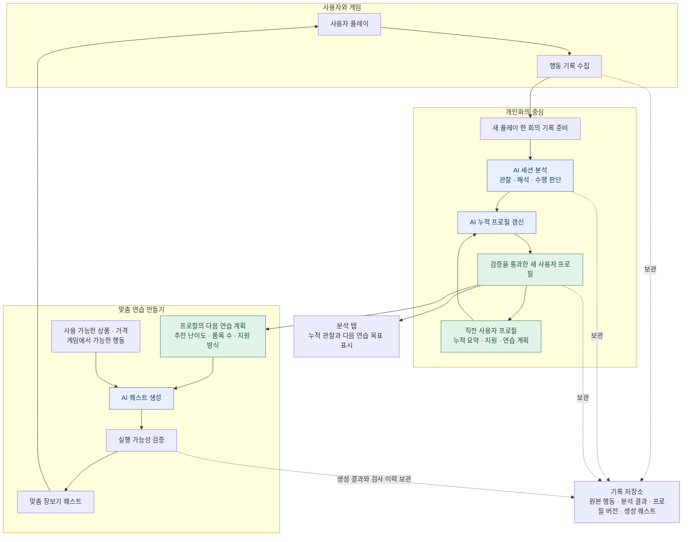
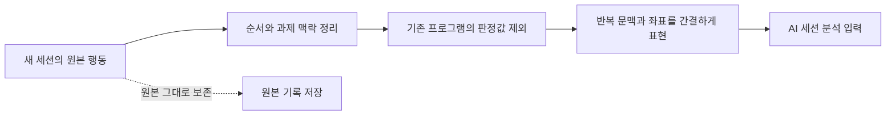
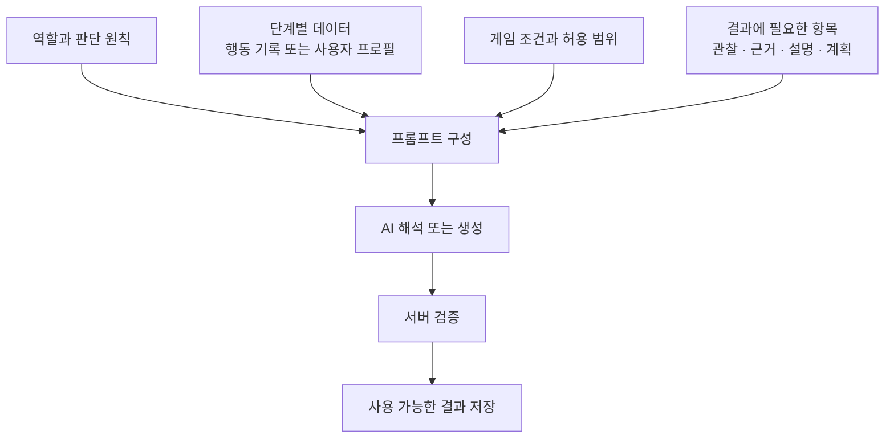
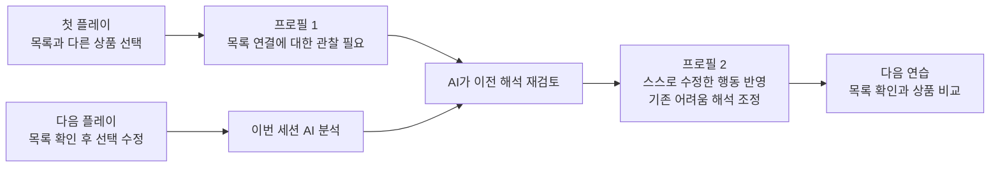

# 오늘도 전체 구조 — 개인화와 AI 프롬프트 중심

> 기준일: 2026년 9월 14일 · 현재 구현 기준
>
> 사용자 행동이 개인 프로필로 정리되고, 그 프로필이 다음 퀘스트에 반영되는 흐름을 설명한다. API 주소와 코드 설명은 생략한다.

## 1. 전체 구조 한눈에 보기

오늘도는 게임에서 관찰한 행동을 AI가 해석하고, 사용자별 누적 프로필을 갱신해 다음 연습에 반영한다. 현재 이 개인화 순환이 구체적으로 연결된 대상은 **장보기**다.

파란색은 AI가 해석하거나 문장을 생성하는 단계, 초록색은 누적 개인화 정보를 뜻한다. 서버는 데이터 정리·보관·검증을 담당하고, AI는 수행 해석과 다음 연습 방향을 작성한다.

**프로필 갱신은 단순한 기록 추가가 아니다.** 새 행동이 이전 해석과 다르면 AI가 이전 판단을 수정하거나 보류할 수 있다.

직전 프로필과 같은 세션을 재분석한 경우에는 그 사실을 프로필 AI에 명시한다. 같은 플레이의 해석 정정을 새로운 플레이, 추가 성공, 능력 향상으로 세지 않도록 지시한다. 이는 교육 효과를 검증하는 장치가 아니라 중복 해석을 줄이기 위한 입력 정보다.

## 2. 한 번의 플레이에서 무엇을 얻는가

한 세션은 한 번의 플레이를 묶은 기록 단위다. 클릭 한 번이나 이동 한 번이 각각 한 세션이 되는 것은 아니다. 한 세션 안에 수백 개의 행동 사건이 들어갈 수 있다.

| 수집하는 내용 | AI가 참고할 수 있는 맥락 |
|---|---|
| 제시한 미션, 구매 목표, 수량, 예산 | 사용자가 무엇을 수행하도록 안내받았는가 |
| 당시 상품 목록, 가격, 규격, 제공 장면 | 사용자가 어떤 선택지를 제공받았는가 |
| 목록·진열대 열기, 상품 선택, 수량 변경 | 목표를 확인하고 선택을 수정한 과정 |
| 장바구니 확인, 계산대 진입, 제출 | 선택 결과를 확인하고 제출한 과정 |
| 위치, 정지, 진열대 접근·이탈·재방문 | 상품을 찾아가는 이동과 탐색 과정 |
| 도움 요청, 휴식, 조작 방해, 종료 | 행동을 해석할 때 고려해야 할 지원·기기·중단 맥락 |

기록된 행동과 사용자의 머릿속 상태는 구분한다. 예를 들어 진열대에 접근했다는 사실만으로 상품을 보았거나 설명을 이해했다고 판단하지 않는다. 반복 이동도 탐색, 조작 연습, 방향 혼동 등 여러 설명이 가능하다.

## 3. AI에 전달하기 전 데이터 준비

이 단계는 사용자 능력을 점수로 판정하는 단계가 아니다. AI가 실제 행동을 읽을 수 있도록 입력을 정리하는 과정이다.

- 행동의 순서, 시간, 좌표, 목표와 선택 내용을 연결한다.
- 예전 프로그램이 계산한 성공 여부, 성공 점수, 경로 효율 같은 판정값은 AI 입력에서 제외한다. AI가 기존 정답표를 따라 판단하는 것을 줄이기 위한 처리다.
- 반복되는 과제 설명과 공통 정보는 묶어 표현하고, 좌표는 간결한 표 형태로 전달한다.
- 분석에 필요한 원본 사건의 순서와 값은 보존한다. 현재 입력 압축은 이동 기록을 일부만 골라 버리는 방식이 아니다.
- 상품·수량·장바구니 같은 상호작용 값은 사건별 객체로도 덧붙인다. 최종 종합 단계에도 이 원본 값 사본을 전달해, AI가 구간 요약의 잘못된 ‘기록 없음’ 주장을 대조하고 정정하도록 한다. 이동 상세는 관찰 단계의 전체 입력에 보존한다.

원본 사본과 이벤트 발생 의미를 전달해도 AI 해석의 정확성이 자동 보장되지는 않는다. 결과 형식·근거 ID 검증과 실제 문장의 사실 검토는 별도로 확인해야 한다.

따라서 **의도적으로 제외한 판정값**과 **실제로 수집되지 않은 행동**은 서로 다르다. AI가 판정값 제외를 ‘로그 누락’으로 표현하는 사례가 있어, 결과 문구의 정확성에는 추가 개선이 필요하다.

## 4. AI 프롬프트는 세 가지 역할로 구성된다

프롬프트는 AI에게 주는 업무 설명과 판단 자료다. 각 단계는 공통적으로 **역할과 제한 + 이번에 읽을 데이터 + 결과에 포함할 항목**을 전달한다.

### 4.1 세션 분석 — 이번에는 어떻게 플레이했는가

| 구분 | 내용 |
|---|---|
| 역할 | 생활기술 연습에서 실제 행동과 과제 맥락을 검토한다. |
| 입력 | 새 플레이 한 세션의 행동 기록, 당시 목표·상품·안내 정보, 지원·중단 맥락, 제한된 참고자료 |
| 주요 지시 | 사실과 추정을 구분하고, 다른 설명과 불확실성을 남긴다. 실제 목표와 행동을 비교해 수행을 판단한다. |
| 결과 | 이번 플레이 요약, 기술별 관찰과 해석, 근거 행동, 성공·실패·판단 보류, 지원 제안, 다음 연습 계획 |

행동 로그가 길면 구간별로 나눠 관찰하고, 필요한 중간 통합을 거쳐 최종 분석을 만든다. **여러 구간은 여러 플레이를 의미하지 않는다.** 한 플레이를 처리하기 위해 AI를 여러 번 호출할 수 있다는 뜻이다.

참고자료는 현재 인터페이스 지원 제안을 보조하는 개발 검토 자료다. 사용자 능력을 직접 판정하는 공식 검사 점수나 진단 기준으로 사용하지 않는다.

### 4.2 프로필 갱신 — 이전과 비교해 무엇이 달라졌는가

| 구분 | 내용 |
|---|---|
| 역할 | 이전 누적 관찰과 새 세션의 해석을 함께 검토해 사용자 프로필을 갱신한다. |
| 입력 | 직전 프로필의 요약·관찰·불확실성·연습 계획과 이번 세션의 AI 분석 결과 |
| 주요 지시 | 기존 해석을 무조건 확정하지 않는다. 새 근거에 따라 유지·강화·약화·보류한다. |
| 결과 | 갱신된 누적 요약, 핵심 기술별 관찰, 지원 제안, 불확실성, 추천 난이도를 포함한 다음 연습 계획 |

현재 구조는 **새 세션 원본을 먼저 분석하고, 그 분석 결과를 직전 프로필과 병합하는 두 단계**다. 누적 원본 로그 전부를 프로필 갱신 때마다 다시 보내지 않는다.

첫 플레이에서는 이전 프로필이 없으므로, 검증을 통과한 첫 세션 분석을 첫 프로필로 저장한다. 이후에는 새 프로필을 별도 버전으로 보관한다. 이전 버전도 남아 있어 판단 변화의 근거를 추적할 수 있다.

프로필에 있는 기술 영역은 현재 AI가 관찰을 설명하는 항목이다. ‘수량 확인’, ‘목록과 상품 연결’, ‘예산 확인’, ‘이동과 탐색’, ‘도움 요청’ 등을 다룰 수 있지만, 모든 영역에 고정된 능력 점수를 부여하는 구조는 아니다.

### 4.3 퀘스트 생성 — 다음에 무엇을 연습하게 할 것인가

| 구분 | 내용 |
|---|---|
| 역할 | 사용자 프로필의 연습 목표를 실제 장보기 과제로 구성한다. |
| 입력 | 최신 프로필, AI가 작성한 연습 계획과 추천 난이도, 허용된 상품·가격·구매 단위, 게임 제약 |
| 주요 지시 | 관찰 근거와 연결되는 과제를 만들고, 실제 제공 상품과 구현된 행동만 사용한다. |
| 결과 | 퀘스트 제목, 목표 상품·수량·예산, 안내 문장, 계산대 대사, 개인화 이유 |

AI는 기존 기본 시나리오를 선택하거나 허용된 상품으로 맞춤 과제를 구성할 수 있다. 완전히 아무 제약 없이 상황을 만드는 방식은 아니다. 현재 구현되지 않은 품절 대응, 예약, 자유 대화형 직원 문의 등을 가능한 기능처럼 생성해서는 안 된다.

## 5. 추천 난이도는 어디서 결정되는가

**추천 난이도는 AI가 세션 분석 또는 프로필 갱신 결과의 ‘다음 연습 계획’에 작성한다.** 서버는 그 값을 읽어 추천으로 보관한다. 추천을 조회할 때마다 별도 AI가 다시 난이도를 판정하는 구조는 아니다.

| 연습 계획의 요소 | 의미 |
|---|---|
| 다음 목표 | 이번 관찰을 바탕으로 무엇을 더 연습하거나 확인할지 |
| 추천 난이도 1~3 | 다음 장보기 과제에 적용할 게임 난이도 |
| 품목 수 2~4개 | 한 과제에서 구매할 품목 수 |
| 수량 복잡도 | 수량 조건에 대한 제안 |
| 예산 압박 | 예산 조건에 대한 제안 |
| 문장 지원 | 안내 문장의 지원 수준에 대한 제안 |
| 추천 이유 | 어떤 관찰 때문에 이 연습을 제안했는지 |

계획의 지원 항목이 모두 별도 게임 기능으로 자동 구현되는 것은 아니다. 실제 적용은 퀘스트 생성과 화면이 지원하는 범위 안에서 이루어진다. 난이도 1~3 역시 지능이나 장애 정도, 개별 능력의 등급이 아니다.

서버는 허용 난이도, 품목 수, 실제 상품·가격, 예산 계산 등 실행 조건을 검사한다. 퀘스트는 추천에 사용한 것과 같은 프로필 버전을 기준으로 생성해 판단 근거가 섞이지 않게 한다.

## 6. 개인화가 누적되는 모습

다음은 구조 이해를 위한 가상 예시이며, 실제 사용자 분석 결과가 아니다.

프로필은 ‘부족한 능력 목록’을 고정하는 문서가 아니다. 관찰된 행동, 가능한 해석, 도움이 될 지원, 아직 확인하지 못한 내용을 함께 담는 누적 요약이다. 새 플레이 한 번의 결과만으로 생활 전반의 능력을 확정하지 않는다.

## 7. 분석 탭과 저장소의 역할

분석 탭은 저장된 최신 프로필의 누적 요약, 기술별 관찰과 해석, 대안 설명, 필요한 지원, 다음 연습 목표를 보여준다. 표시된 결과가 어느 시점의 프로필인지 버전과 갱신 시각으로 확인할 수 있다.

‘최신 플레이 반영하기’를 누르면 종료 기록이 있는 가장 최근 세션 하나를 찾아 현재 프로필과 비교한다. 아직 반영되지 않았다면 그 세션을 분석·병합하고, 이미 반영됐다면 기존 프로필을 반환한다. 이 버튼은 과거 미반영 세션 여러 개를 모두 순서대로 따라잡는 기능은 아니다.

저장소에는 원본 행동, 세션 분석, 프로필의 이전·현재 버전, 추천 계획, 생성 퀘스트와 실패 이력을 보관한다. 요약만 남기고 원본을 지우지는 않는다. 프로필 갱신이 실패하면 마지막으로 검증을 통과한 프로필을 유지한다.

## 8. 현재 적용 범위와 남아 있는 한계

| 영역 | 현재 상태 |
|---|---|
| 장보기 | 행동 수집 → 세션 AI 분석 → 누적 프로필 → 연습 계획 → AI 퀘스트의 순환이 연결돼 있다. |
| 대중교통 퀘스트·NPC | 선택 행동을 기록하고 공통 세션 분석을 요청하는 경로가 있다. 장보기와 같은 맞춤 퀘스트 순환이 모든 교통 기능에 완성된 것은 아니다. |
| 분석 탭 | 최신 프로필 조회와 최근 종료 세션 하나의 수동 반영을 지원한다. |
| 첫 플레이·AI 생성 실패 | 현재 실행 가능한 기본 장보기 시나리오 중 하나를 무작위로 제공한다. AI 개인화 결과와는 출처가 다르다. |
| 긴 이동 기록 | 이동 사건도 분석 입력에 포함된다. 한 세션의 사건이 많으면 여러 AI 호출이 필요해 시간과 토큰이 많이 든다. |
| 분석 신뢰성 | 관찰과 추정의 구분을 지시하고 근거 참조를 검사하지만, AI 해석 자체가 정확하다고 보장하는 검증은 아니다. |
| 장기 누적 | 요약에 이전 해석의 편향이 남을 수 있다. 주기적인 원본 재검토와 전문가 검토는 후속 과제다. |

현재 개인화는 모델을 사용자마다 다시 학습시키는 방식이 아니다. **저장된 사용자 프로필과 새 관찰을 프롬프트에 전달해, 같은 AI가 사용자별로 다른 해석과 연습을 제안하게 하는 방식**이다.
