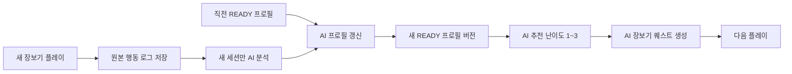
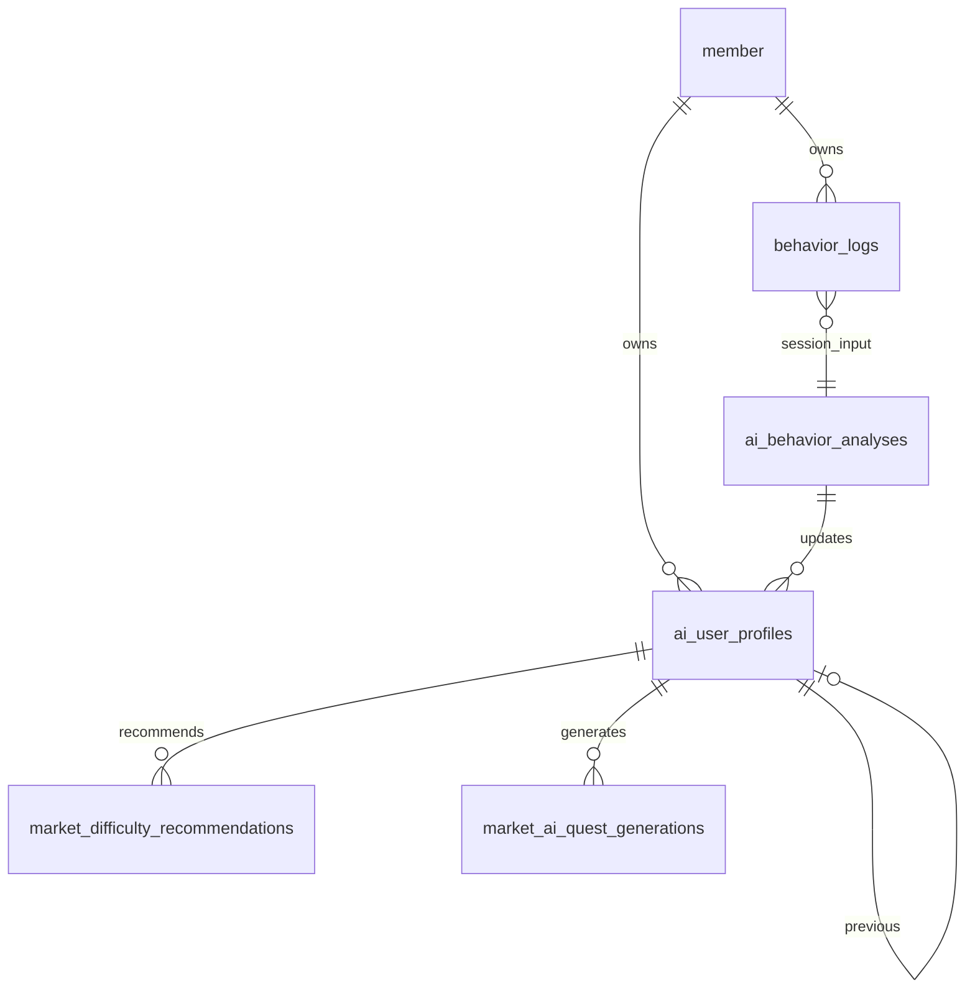

# 사용자별 증분 AI 프로필 구현

> 기준일: 2026-09-06  
> 적용 범위: 장보기 행동 분석, 난이도 추천, AI 장보기 퀘스트 생성  
> 포함 범위: 장보기 완료 시 자동 갱신과 분석 탭의 최신 세션 수동 반영

## 1. 변경 목적

이전 장보기 개인화는 새 추천이나 퀘스트를 요청할 때 누적 행동 로그 전체를 다시 AI에 전달했다. 기록이 늘수록 입력 토큰과 응답 시간이 커지고, 한 번에 처리할 수 있는 입력 한도를 넘으면 최신 결과를 만들 수 없었다.

변경 후에는 사용자마다 **불변 버전의 AI 프로필**을 저장한다. 새 플레이가 끝나면 직전 프로필과 새 세션의 관찰 결과만 사용해 다음 프로필을 만든다.

## 2. 처리 순서

### 첫 번째 플레이

1. 한 번의 장보기 플레이를 `sessionId`로 묶어 원본 행동 로그에 저장한다.
2. 해당 세션만 AI가 분석한다.
3. 검증을 통과한 세션 분석을 프로필 버전 1로 저장한다.
4. 이후 추천과 퀘스트는 이 프로필 ID를 참조한다.

첫 프로필은 비교할 과거가 없으므로 추가 병합 호출 없이 세션 분석을 그대로 기준점으로 사용한다.

### 두 번째 이후 플레이

1. 새 세션만 AI가 분석한다.
2. AI에 직전 `READY` 프로필과 새 세션 분석을 함께 전달한다.
3. AI는 기존 해석을 유지·강화·약화하거나 판단을 보류하고 새 요약과 연습 계획을 작성한다.
4. 서버 검증을 통과하면 프로필 버전을 1 증가시켜 저장한다.
5. 갱신 실패 기록은 `FAILED`로 보존하되, 마지막 `READY` 프로필을 덮어쓰지 않는다.

즉, 7번 플레이한 기록을 매번 모두 다시 보내지 않는다. 프로필 요약은 누적 상태를 담고, 새 세션만 추가 근거로 처리한다. 원본 행동 로그와 세션별 AI 분석은 삭제하지 않으므로 필요하면 감사나 재분석에 사용할 수 있다.

## 3. AI와 서버의 역할

| 구분 | AI가 판단 | 서버가 검사·보관 |
|---|---|---|
| 세션 해석 | 관찰, 가능한 해석, 대안 설명, 불확실성 | 실제 세션·사건 ID 참조 여부 |
| 프로필 갱신 | 누적 요약, 기술별 finding, 필요한 지원 | 출력 JSON 구조와 허용 근거 ID |
| 추천 | 다음 장보기 난이도 1~3, 목표, 품목 수, 문장 지원 | 난이도 1~3, 품목 수 2~4 등 게임 범위 |
| 퀘스트 | 상품·수량·예산·안내 문장 구성 | 실제 상품/가격, 예산 계산, 실행 가능성 |

서버는 성공률 임계값으로 능력을 등급화하거나 추천 난이도를 계산하지 않는다. AI가 낸 난이도를 게임이 지원하는 1~3 범위인지 검사할 뿐이다. 첫 플레이의 세션 판정도 서버 규칙이 아니라 AI 결과다.

## 4. 저장 구조와 추적성

`V35__create_incremental_ai_user_profiles.sql`이 `ai_user_profiles`를 추가한다.

| 필드 | 의미 |
|---|---|
| `member_id` | 프로필 소유 사용자 |
| `profile_version` | 사용자별 누적 버전(1, 2, 3...) |
| `previous_profile_id` | 바로 이전 프로필 |
| `source_analysis_id` | 이번 갱신의 새 세션 AI 분석 |
| `source_dataset_id` | 그 분석에 사용한 불변 입력 스냅샷 |
| `source_session_id` | 새로 반영한 플레이 세션 |
| `status` | `READY` 또는 `FAILED` |
| `profile` | 누적 요약·finding·불확실성·연습 계획 |
| `attempts` | 실제 AI 요청·응답·검사 실패 이력 |

난이도 추천에는 `profile_id`와 `profile_version`을 저장한다. AI 퀘스트 생성에도 `profile_id`를 저장한다. 따라서 나중에 “어느 프로필로 이 난이도와 퀘스트가 만들어졌는가”를 역추적할 수 있다.

## 5. 프롬프트 입력

프로필 갱신 프롬프트에는 다음만 들어간다.

- 직전 프로필의 요약, finding, 불확실성, 연습 계획
- 새 세션 분석의 요약, finding, 세션 판정, 불확실성, 연습 계획
- 사용할 수 있는 근거 사건 ID와 검토된 근거 카드 ID
- 진단·IQ·장애 등급을 추정하지 말라는 제한
- 기존 해석을 무조건 누적하지 말고 새 근거에 따라 수정하거나 보류하라는 지시

긴 UUID를 모델이 한 글자만 잘못 복사해도 다른 근거가 되므로, 사건과 세션 ID는 요청마다 `E1`, `E2`, `S1` 같은 짧은 별칭으로 전달한다. 응답의 별칭은 서버가 원래 UUID로 복원하며, 제공하지 않은 별칭은 거부한다.

추천 프롬프트는 최신 `READY` 프로필의 연습 계획을 사용한다. 퀘스트 생성은 추천이 참조한 **동일한 프로필 ID**를 다시 읽는다. 추천 도중 프로필이 갱신돼도 서로 다른 버전이 섞이지 않는다.

## 6. 실패와 현재 경계

- 프로필이 없는 사용자는 먼저 기본 관찰용 장보기 플레이와 세션 분석이 필요하다. 첫 진입 시 선택 화면은 표시하지 않고, 앱이 현재 실행 가능한 S01/S02 중 하나를 균등 무작위로 골라 바로 시작한다. 이 경로는 AI 맞춤 결과가 아니며 로그의 `contentSource`는 `STATIC`이다.
- AI 맞춤 퀘스트 생성에 실패한 경우에도 같은 방식으로 S01/S02 중 하나를 자동 선택한다. 사용자가 실패 화면에서 시나리오를 직접 고르게 하지 않는다.
- 세션 분석은 성공했지만 프로필 병합이 실패하면 세션 결과는 보존하고 직전 `READY` 프로필을 계속 사용한다.
- 같은 세션 분석을 다시 요청하면 이미 만든 프로필을 재사용한다.
- 같은 프로필의 난이도 추천을 다시 요청하면 기존 추천 행을 재사용한다. 추천 화면 조회 후 퀘스트 생성이 다시 추천을 요구해도 중복 행을 만들지 않는다.
- 기존 전체 누적 분석 API는 개발·수동 재분석 호환을 위해 남겨 두지만, 장보기 추천·퀘스트와 앱의 분석 탭에서는 사용하지 않는다.
- 현재 프로필 갱신 시점은 세션 분석 API가 호출된 때다. 로그 저장만 하고 분석 요청을 하지 않으면 프로필은 갱신되지 않는다.
- 장기간 누적 요약의 편향을 점검하는 주기적 전체 재기준화와 전문가 검토 절차는 후속 과제다.
- 분석 탭 진입은 `GET /api/user-profiles/current`로 최신 `READY` 프로필만 조회한다.
- `최신 플레이 반영하기` 버튼은 `POST /api/user-profiles/current/refresh`를 호출한다. 서버는 종료 문맥이 기록된 가장 최근 세션 하나를 찾고, 현재 프로필의 `sourceSessionId`와 다를 때만 그 세션을 분석한다.
- 새 세션 분석이 성공하면 직전 프로필과 병합해 다음 불변 버전을 저장한다. 이미 반영한 세션이면 AI를 다시 호출하지 않고 현재 프로필을 반환한다.
- 이 버튼은 전체 원시 이력을 분석하지 않는다. 화면에는 누적 요약, finding, 불확실성, 다음 연습 계획, 프로필 버전과 최근 반영 세션을 표시한다.
- 실제 8사건 세션 검증에서 900토큰 출력이 두 번 잘린 문제를 확인해 최종 세션 분석과 프로필 병합의 출력 상한을 1,200토큰으로 조정했다. 입력과 출력 예약 합계는 기존 7,000토큰 요청 예산 검사를 그대로 통과해야 한다.

## 7. 관련 코드

- 프로필 갱신: `behaviorlog/profile/service/AiUserProfileService`
- 프로필 프롬프트: `behaviorlog/profile/service/AiUserProfilePromptFactory`
- 프로필 검증: `behaviorlog/profile/service/AiUserProfileValidator`
- 세션 분석 연결: `behaviorlog/analysis/service/AiBehaviorAnalysisService`
- 난이도 추천: `behaviorlog/personalization/service/MarketDifficultyRecommendationService`
- 퀘스트 생성: `behaviorlog/personalization/service/MarketAiQuestService`
- DB 변경: `db/migration/V35__create_incremental_ai_user_profiles.sql`

## 8. 실제 계정 검증 결과

2026-09-06에 `test@oneuldo.local`의 연속된 완료 세션 2개를 실제 Groq 모델로 검증했다.

| 단계 | 결과 |
|---|---|
| 첫 세션 8사건 분석 | `READY`, AI 판정 `FAILURE`, 프로필 v1 생성, 추천 난이도 1 |
| 다음 세션 6사건 분석 | `READY`, AI 판정 `SUCCESS` |
| 증분 병합 | 프로필 v1과 새 세션 분석만 입력해 프로필 v2 `READY` 생성 |
| v2 연습 계획 | 난이도 2, 품목 3개, 수량·예산 복잡도 `LOW`, 문장 지원 `SIMPLIFIED` |
| 추천 재호출 | 동일 프로필의 기존 추천 1건 재사용 |
| 퀘스트 생성 | `source=AI`, `personalizationMode=AI_PROFILE`, 난이도 2·품목 3개 생성 |
| 추적 | 추천과 퀘스트가 같은 프로필 v2 ID를 참조 |

검증 과정에서 900토큰 출력 잘림, 긴 UUID 한 글자 오복사, 동일 추천 중복 저장 충돌을 발견했다. 각각 최종 출력 1,200토큰 예약, 짧은 근거 별칭과 복원 검사, 프로필 ID 기준 추천 멱등 저장으로 수정한 뒤 재검증했다. 실패한 프로필 병합 행은 감사 이력으로 남았고 최신 `READY` 프로필을 덮어쓰지 않았다.
