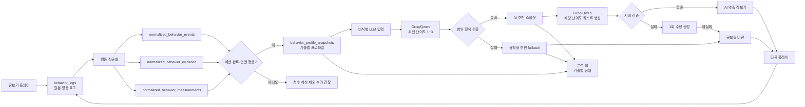
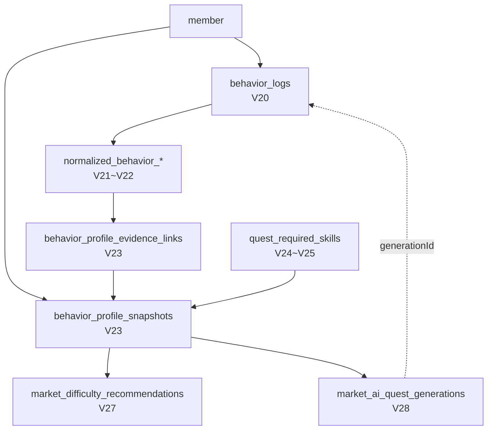

# 오늘도 개인화 시스템 구현 설명

> 2026-09-05 전환 안내: 아래는 성공률·프로필 기반 **이전 구조의 기록**이다. 현재 장보기 분석/추천 경로는 [AI 중심 사용자 분석 명세](./ai-led-user-analysis-spec.md)와 [1페이즈 보고서](./phase-1-ai-analysis-report.md)를 우선한다. 구형 프로필 API와 자동 규칙형 fallback을 현재 구현으로 해석하지 않는다.

> 기준일: 2026-08-31  
> 기준 문서: [`ai-system.md`](./ai-system.md)  
> 확인 범위: 현재 로컬 코드와 Flyway V20~V28  
> 주 적용 대상: 게임 탭 장보기 시뮬레이션, 분석 탭, 퀘스트·NPC 대중교통 추천

## 1. 한 문장으로 정리

기존 구조가 **퀘스트 정답률로 대중교통 난이도를 조절하는 구조**였다면, 현재는 여기에 **장보기의 세부 행동을 정규화하고 기술별 프로파일을 만든 뒤, 그 프로파일로 다음 장보기 퀘스트를 AI가 생성하는 구조**가 추가됐다.

이 개인화 결과는 IQ, 장애 정도, 발달연령 또는 임상 진단이 아니다. 현재 게임 조건에서 관찰된 행동과 필요한 지원 수준을 다음 퀘스트 조정에 사용하는 제품 기능이다.

## 2. `ai-system.md` 기준 변경점

| 구분 | 기존 `ai-system.md`의 중심 구조 | 현재 추가된 개인화 구조 |
|---|---|---|
| 수집 단위 | 퀘스트 세션, 선택지, 정답, 힌트, 재시도 | 장보기의 품목 선택, 수량, 누락, 추가 상품, 예산 결과까지 세부 행동으로 수집 |
| 판단 단위 | 대중교통 세부 분야의 종합 수행 지표 | 언어 이해, 수 개념, 돈 관리의 기술별 수행률 |
| 데이터 처리 | 퀘스트 이벤트를 난이도 정책이 직접 집계 | 원본 행동 로그 → 정규화 이벤트 → 기술 근거 → 프로파일 스냅샷 순으로 처리 |
| 난이도 | `VERY_EASY`~`VERY_HARD` 5단계 | 장보기 전용 1~3단계 추가 |
| AI 역할 | 대중교통 원문의 목표·정답을 유지하며 문장 변형 | 행동 프로파일을 참고해 장보기 난이도, 품목, 수량, 예산, 안내 문장을 생성 |
| 실패 처리 | 대중교통 전체를 DB 원문으로 복귀 | 장보기 AI 재생성 1회 후 규칙형 개인화 미션으로 복귀 |
| 사용자 화면 | 수행 결과와 퀘스트 추천 | 기존 AI 탭 대신 분석 탭에서 기술별 관찰 결과와 전체 추천 난이도 표시 |
| 추적성 | 퀘스트 세션·난이도 변경 이력 | 프로파일, 추천 스냅샷, AI 생성 원문·검증 결과, 실제 플레이 실행본 ID까지 연결 |

`ai-system.md`의 “AI 생성과 학습 난이도는 분리된다”는 설명은 **대중교통 퀘스트에는 그대로 적용**된다. 장보기에는 별도의 행동 프로파일 기반 AI 생성 경로가 추가됐으므로 두 시스템을 같은 난이도 체계로 해석하면 안 된다.

## 3. 현재 전체 구조



처리 순서는 다음과 같다.

1. 프론트가 한 번의 장보기 플레이를 하나의 `sessionId`로 묶는다.
2. 실제 제공된 미션의 `questInstanceId`, `contentSource`, 난이도, 상품별 목표 수량과 예산을 행동 로그에 기록한다.
3. 서버가 각 로그를 이벤트 레지스트리에 따라 공통 행동, 결과, 오류, 독립 수행 수준과 기술 근거로 정규화한다.
4. 이벤트 순번이 빠지지 않은 완료 세션만 프로파일 계산에 사용한다.
5. 완료 세션의 정규화가 모두 끝나면 프로파일을 비식별 입력으로 변환하고 AI가 추천 난이도 1~3을 생성한다.
6. 다음 마트 진입 시 저장된 AI 추천 난이도를 퀘스트 생성 프롬프트에 고정 조건으로 전달한다.
7. AI 출력이 서버 검증을 통과해야만 실제 미션으로 사용한다.
8. 실제 플레이 로그에 생성 ID를 다시 기록해 “어떤 생성 결과를 플레이했는지” 연결한다.

## 4. 수집 데이터와 판정 가능한 근거

장보기에서는 현재 다음 행동이 직접 수집된다.

| 관찰 행동 | 대표 이벤트 | 연결 기술 | 결과 해석 예시 |
|---|---|---|---|
| 필요한 상품 선택 | `SHOP.ITEM_SELECTED` | `LANGUAGE_COMPREHENSION` | 목록의 상품을 고르면 긍정 근거 |
| 상품 누락 | `SHOP.ITEM_MISSING` | `LANGUAGE_COMPREHENSION` | 필요한 상품을 담지 않으면 부정 근거 |
| 불필요한 상품 선택 | `SHOP.WRONG_ITEM_SELECTED` | `LANGUAGE_COMPREHENSION` | 목록 밖 상품을 담으면 부정 근거 |
| 요구 수량 맞추기 | `SHOP.QUANTITY_CHANGED` | `NUMERACY` | 요구 수량과 선택 수량이 같으면 긍정, 다르면 부정 |
| 예산 안에서 완료 | `SHOP.PRICE_CHECKED` | `MONEY_MANAGEMENT` | 총액이 예산 이내면 긍정 근거 |
| 예산 초과 | `SHOP.BUDGET_EXCEEDED` | `MONEY_MANAGEMENT` | 예산을 넘으면 부정 근거 |
| 목록 확인 | `SHOP.LIST_OPENED` | `EXECUTIVE_FUNCTION` | 현재 `NEUTRAL`이라 성공률 분자·분모에는 포함되지 않음 |

### 4.1 행동 로그는 언제, 어떤 단위로 수집하는가

장보기 화면에 들어오면 프론트는 `createMarketBehaviorSession()`으로 플레이 세션을 만든다. 기본값은 평가용인 `ASSESSMENT_TASK`이고, 같은 미션을 다시 연습하는 경우에는 `TRAINING_TASK`로 분리한다. **평가 로그와 훈련 로그를 섞어 사용자의 현재 수행률을 부풀리지 않기 위한 구분**이다.

한 세션에서 공통으로 유지되는 식별값은 다음과 같다.

| 필드 | 역할 |
|---|---|
| `sessionId` | 한 번의 마트 입장부터 계산 또는 중단까지를 묶는 ID |
| `questInstanceId` | 실제 제공된 AI 생성본 또는 fallback 미션의 ID |
| `contentSource` | `GENERATED`, `FALLBACK`, `STATIC` 등 콘텐츠 출처 |
| `taskId`, `taskVersion` | 어떤 과제와 규칙 버전으로 수행했는지 구분 |
| `difficulty` | 플레이한 장보기 난이도 1~3 |
| `evidenceContext` | 평가용인지 훈련용인지 구분 |

사용자가 계산을 완료하면 프론트는 화면 조작을 그대로 무제한 전송하는 대신, 최종 장바구니와 조작 시각을 기준으로 판정 가능한 이벤트 묶음을 만든다.

1. `SHOP.LIST_OPENED`를 첫 이벤트로 기록한다.
2. 목표 상품마다 미선택이면 `SHOP.ITEM_MISSING`, 선택했으면 `SHOP.ITEM_SELECTED`를 기록한다.
3. 각 목표 상품의 요구 수량과 최종 수량을 `SHOP.QUANTITY_CHANGED`로 기록한다.
4. 목록에 없는 상품마다 `SHOP.WRONG_ITEM_SELECTED`를 기록한다.
5. 최종 금액이 예산 이내면 `SHOP.PRICE_CHECKED`, 초과면 `SHOP.BUDGET_EXCEEDED`를 기록한다.
6. 마지막 이벤트에 `sessionEnd.reason=COMPLETED`, 전체 완료 시간과 완료 품질을 붙인다.

사용자가 중간에 나가면 `SHOP.LIST_OPENED`와 `COMMON.ABORT`를 기록하고 `sessionEnd.reason=USER_ABORTED`로 닫는다. 중단 세션은 수행 실패로 임의 변환하지 않고 세션 무결성 및 추가 관찰 정보로 남긴다.

각 이벤트에는 중복 저장과 순번 누락을 검출하기 위한 값도 포함된다.

| 필드 | 처리 방식 |
|---|---|
| `clientEventId` | 이벤트마다 UUID 생성, 재전송되어도 같은 이벤트인지 판별 |
| `eventSequence` | 세션 안에서 1부터 증가, 빠진 순번 검출 |
| `occurredAt` | 실제 행동 발생 시각 |
| `receivedAt` | 서버 수신 시각, 서버가 기록 |
| `offlineQueued` | 오프라인 대기 후 전송했는지 표시 |
| `batchId` | 한 번에 보낸 이벤트 묶음 식별 |

프론트는 배치 전송이 실패하면 로컬 대기열에 보관했다가 같은 `clientEventId`로 다시 보낸다. 서버 응답의 `ACCEPTED`와 `DUPLICATE`를 구분하므로 네트워크 재시도가 근거 수를 두 번 증가시키지 않는다.

### 4.2 원본 행동 로그 형식

아래는 “사과 2개가 필요하지만 1개만 담은 경우”의 `SHOP.QUANTITY_CHANGED` 예시다. 설명을 위해 중요 필드만 남긴 축약본이며, 실제 요청은 접근성·화면 문맥도 함께 보낸다.

```json
{
  "metadata": {
    "clientEventId": "8ad8...",
    "eventSequence": 4,
    "eventSchemaVersion": "behavior-event-v1",
    "appVersion": "1.0.0",
    "contentVersion": "market-basic-shopping-v1",
    "offlineQueued": false,
    "occurredAt": "2026-08-31T10:02:14Z"
  },
  "identity": {
    "sessionId": "f03c..."
  },
  "task": {
    "gameId": "MARKET_SIMULATION",
    "taskId": "30000000-0000-0000-0000-000000000003",
    "taskVersion": "market-basic-shopping-v1",
    "difficulty": 2,
    "scenarioVariant": "BASELINE",
    "evidenceContext": "ASSESSMENT_TASK"
  },
  "action": {
    "eventCode": "SHOP.QUANTITY_CHANGED",
    "microActionId": "CHECK_QUANTITY_apple",
    "stepOutcome": "FAILURE",
    "stepOrder": 4
  },
  "simulation": {
    "questInstanceId": "9f1b...",
    "contentSource": "GENERATED",
    "simulationStarted": true
  },
  "payload": {
    "type": "SHOPPING",
    "itemId": "apple",
    "requiredQuantity": 2,
    "selectedQuantity": 1
  }
}
```

이 시점의 `stepOutcome=FAILURE`는 프론트가 관찰한 과제 결과다. 아직 “수 개념이 부족하다”는 프로파일 판정은 아니며, 서버 정규화를 통과한 뒤 여러 세션의 근거와 함께 집계돼야 한다.

### 4.3 정규화 처리 과정

`BehaviorNormalizationService`는 원본 JSON을 바로 성공률에 넣지 않고 다음 순서로 변환한다.

1. **이벤트 정의 조회**: `BehaviorEventRegistry`에서 `eventCode`의 행동 영역, 행동 유형, 기본 결과, 오류 유형, 연결 기술을 찾는다.
2. **payload 검증**: 이벤트에 요구되는 payload 종류와 필수 필드를 검사한다. 예를 들어 `SHOP.ITEM_MISSING`의 `selectedQuantity`는 반드시 0이어야 한다.
3. **유효성 판정**: 기술 오류, 조력자 개입, 언어·감각·컨트롤러 접근성 문제인지 구분한다.
4. **사용 목적 분리**: 평가, 훈련, 맥락, 접근성, 안전 또는 제외 근거로 분류한다.
5. **공통 결과 변환**: 원본 `SUCCESS/FAILURE/INCOMPLETE/INVALID`를 `ObservedOutcome`으로 통일한다. 레지스트리에 고정 결과가 있으면 고정 결과가 우선한다.
6. **오류 유형 계산**: 수량 불일치는 `QUANTITY_ERROR`, 잘못 고른 상품은 `WRONG_SELECTION`, 누락은 `OMISSION`처럼 통일한다.
7. **독립 수행 수준 계산**: 지원 정보가 없거나 prompt level 0이면 `INDEPENDENT`, 1~3이면 각 지원 단계로 분리한다. 조력자가 직접 개입한 로그는 `ASSISTED`이면서 유효성 제외 대상이다.
8. **기술 근거 생성**: 이벤트 정의에 연결된 기술마다 긍정·부정·중립 근거를 만든다.
9. **측정값 추출**: 수량 차이, 시작 지연, 지원 횟수처럼 합산 가능한 숫자를 별도 measurement로 저장한다.

정규화 결과는 목적에 따라 세 테이블로 나뉜다.

| 결과 | 저장 내용 | 사용 목적 |
|---|---|---|
| `normalized_behavior_events` | 공통 결과, 오류, 독립 수준, 유효성, 안전, 플래그 | 한 행동을 일관된 기준으로 조회 |
| `normalized_behavior_evidence` | 기술 코드, 근거 방향, 근거 역할 | 기술별 성공률과 반복 강점·어려움 계산 |
| `normalized_behavior_measurements` | 숫자 metric과 단위 | 지원량, 지연시간, 수량 차이 등 집계 |

앞의 사과 수량 오류는 정상 payload이고 완료 세션이라는 전제에서 다음처럼 바뀐다.

```json
{
  "normalizedEvent": {
    "sourceEventCode": "SHOP.QUANTITY_CHANGED",
    "domain": "SHOPPING",
    "observedOutcome": "FAILURE",
    "errorType": "QUANTITY_ERROR",
    "independenceLevel": "INDEPENDENT",
    "evidenceUse": "ASSESSMENT_PRIMARY",
    "validityStatus": "VALID",
    "normalizationStatus": "NORMALIZED"
  },
  "evidence": [
    {
      "skillCode": "NUMERACY",
      "direction": "NEGATIVE",
      "role": "PRIMARY"
    }
  ],
  "measurements": [
    {
      "metricCode": "selectedQuantity",
      "numericValue": 1,
      "targetNumericValue": 2,
      "unit": "COUNT"
    }
  ]
}
```

등록되지 않은 이벤트 코드나 필수 payload 누락은 `QUARANTINED`가 된다. 기술 오류·조력자 개입·접근성 문제는 정규화 기록 자체는 남지만 `EvidenceUse.EXCLUDED`로 바뀌어 수행률에는 들어가지 않는다. 늦게 도착한 로그, 시계 오차, fallback 콘텐츠, 선택 문맥 누락 등은 flag로 남겨 데이터 품질을 추적한다.

### 4.4 세션 무결성 검증

프로파일에는 개별 이벤트가 정상이라는 이유만으로 바로 포함되지 않는다. 같은 `sessionId`의 이벤트가 1부터 마지막 순번까지 있고, 세션 종료가 확인돼 `SessionIntegrityStatus.COMPLETE`가 되어야 한다.

| 상태 예시 | 의미 | 프로파일 점수 반영 |
|---|---|---|
| `COMPLETE` | 종료 이벤트가 있고 순번이 완전함 | 유효한 평가·훈련 근거만 반영 |
| `OPEN` | 아직 종료 이벤트가 없음 | 제외 |
| `OPEN_WITH_GAPS` | 진행 중이고 순번 누락도 있음 | 제외 |
| `GAPPED` | 종료됐지만 순번이 빠짐 | 제외 |

이 검증이 필요한 이유는 마지막 예산 결과나 특정 상품 오류만 서버에 도착하지 않은 상태에서 성공률을 계산하면 실제보다 좋거나 나쁘게 보일 수 있기 때문이다. 완료 세션의 수신 로그 수와 정규화 완료 수가 같아진 뒤에만 해당 세션을 원본으로 새 프로파일 스냅샷을 자동 생성한다.

### 4.5 긍정·부정 근거 구분

정규화 결과의 `ObservedOutcome`을 다음처럼 변환한다.

| 관찰 결과 | 근거 방향 | 성공률 반영 |
|---|---|---|
| `SUCCESS` | `POSITIVE` | 분자와 분모에 포함 |
| `FAILURE` | `NEGATIVE` | 분모에 포함 |
| `INCOMPLETE`, `NEUTRAL` | `NEUTRAL` | 성공률 분자·분모에서 제외 |
| 기술 오류, 조력자 개입, 접근성 문제 등 유효하지 않은 로그 | `EXCLUDED` | 프로파일 점수에서 제외 |

기술별 독립 수행 성공률은 다음 식으로 계산한다.

```text
독립 수행 성공률(%)
  = 긍정 독립 평가 근거 수
    / (긍정 독립 평가 근거 수 + 부정 독립 평가 근거 수)
    × 100
```

단순 훈련, 자유 이동, UI 탐색만으로 능력을 단정하지 않는다. `ASSESSMENT_TASK`의 유효한 완료 세션이 주 평가 근거이고, `TRAINING_TASK`는 변화와 지원 감소를 보는 용도로 분리한다.

### 4.6 프로파일 생성 과정

`BehaviorProfileService`는 정규화 버전, 이벤트 레지스트리 버전, 측정 규칙 버전이 현재 코드와 일치하는 이벤트만 조회한다. 그중 기술별 수행률에 들어가는 조건은 모두 다음과 같다.

```text
normalizationStatus == NORMALIZED
validityStatus == VALID
sessionIntegrity.status == COMPLETE
evidenceUse == ASSESSMENT_PRIMARY
evidence.direction == POSITIVE 또는 NEGATIVE
```

집계는 다음 순서로 진행된다.

1. 기술 코드별 근거를 모은다.
2. `INDEPENDENT` 근거와 `SUPPORTED_LEVEL_1~3` 근거를 나눈다.
3. 중립 근거는 개수만 기록하고 성공률에서는 제외한다.
4. 독립·지원 성공률을 각각 계산한다.
5. 서로 다른 과제, 행동 영역, 세션 수와 전체 제외율로 신뢰도를 계산한다.
6. 같은 행동 패턴이 2회 이상 반복된 경우에만 `observedStrengths` 또는 `observedDifficulties`에 요약한다.
7. 근거 없음, 5건 미만, 단일 과제·세션, 상충 결과, 높은 제외율, 순번 누락을 `evidenceGaps`로 기록한다.
8. 지원 수준, 훈련 변화, 안전 사건, 오류·도움 요청 패턴, 데이터 품질을 함께 묶는다.
9. 계산 당시 사용한 이벤트를 프로파일 스냅샷과 연결해 나중에 역추적할 수 있게 한다.

예를 들어 수 개념의 독립 평가 근거가 `긍정 3건 + 부정 2건`, 두 완료 세션에서 관찰됐다면 다음과 같은 일부 프로파일이 만들어진다.

```json
{
  "profileVersion": "behavior-profile-v1",
  "skills": {
    "NUMERACY": {
      "independentSuccessRate": 60.0,
      "supportedSuccessRate": null,
      "independentEvaluableEvidenceCount": 5,
      "supportedEvaluableEvidenceCount": 0,
      "distinctTaskCount": 2,
      "distinctSessionCount": 2,
      "confidence": "MEDIUM",
      "observedStrengths": [],
      "observedDifficulties": [
        {
          "eventCode": "SHOP.QUANTITY_CHANGED",
          "outcome": "FAILURE",
          "independenceLevel": "INDEPENDENT",
          "errorType": "QUANTITY_ERROR",
          "observationCount": 2
        }
      ]
    }
  },
  "supportProfile": {
    "averagePromptLevel": 0.5,
    "supportedSessionCount": 1
  },
  "validityProfile": {
    "excludedEventRate": 4.2,
    "openSessionCount": 0,
    "gappedSessionCount": 0
  },
  "needsMoreAssessment": ["EXECUTIVE_FUNCTION"]
}
```

위 JSON의 60%와 `MEDIUM`은 LLM이 원본 로그를 보고 계산한 값이 아니다. **서버가 결정적인 계산식으로 만든 값**이다. AI는 이 계산 결과와 근거 부족 표시를 받아 다음 난이도와 콘텐츠를 제안한다.

## 5. 현재 장보기 개인화에 사용하는 기술 영역

| 기술 코드 | 화면 표시 | 현재 의미 | 개인화에 반영되는 항목 |
|---|---|---|---|
| `LANGUAGE_COMPREHENSION` | 언어 이해 | 목록과 안내 문장을 이해하고 필요한 상품을 고르는 수행 | 품목 수, 안내 문장 수준 |
| `NUMERACY` | 수 개념 | 요구 수량을 읽고 실제 수량을 맞추는 수행 | 수량 복잡도 |
| `MONEY_MANAGEMENT` | 돈 관리 | 가격과 전체 예산을 확인하는 수행 | 예산 여유·압박 |
| `EXECUTIVE_FUNCTION` | 계획과 순서 | 목록 확인을 중립 행동으로만 수집 | 현재 AI 입력·분석 화면의 직접 대상에서 제외 |

행동 정규화 레지스트리 자체는 위 영역보다 넓다. `SPATIAL_NAVIGATION`, `PROBLEM_SOLVING`, `HELP_SEEKING`, `SAFETY_AWARENESS`, `DAILY_LIVING`, `ERROR_RECOVERY` 등도 저장할 수 있다. 다만 **현재 장보기 AI 입력과 분석 탭이 직접 사용하는 대상은 언어 이해, 수 개념, 돈 관리 세 영역**이다.

현재 구현상 `EXECUTIVE_FUNCTION`의 장보기 이벤트인 `SHOP.LIST_OPENED`는 중립 근거이고, `SHOP.OUT_OF_STOCK_DETECTED`는 현재 기본 장보기 플레이에서 발생하지 않는다. 따라서 장보기만 반복하면 이 영역의 평가 가능한 근거가 다른 세 영역보다 늦게 쌓이거나 계속 부족할 수 있다.

## 6. 프로파일 신뢰도 기준

성공률만 존재한다고 개인화에 바로 쓰지 않는다. 근거 수와 반복 세션을 함께 확인한다.

| 신뢰도 | 현재 코드 기준 |
|---|---|
| `INSUFFICIENT` | 평가 가능한 근거 0건 |
| `LOW` | 근거는 있지만 아래 `MEDIUM` 조건 미달 |
| `MEDIUM` | 평가 가능한 근거 5건 이상, 서로 다른 과제 2개 이상, 완료 세션 2개 이상 |
| `HIGH` | 근거 10건 이상, 과제 3개 이상, 행동 영역 2개 이상, 세션 3개 이상, 제외율 15% 이하 |

AI 입력의 `BEHAVIOR_INFORMED` 상태와 규칙형 fallback에서 한 기술 신호를 “사용 가능”으로 보는 조건은 다음 네 가지를 모두 만족하는 경우다.

```text
독립 수행 성공률이 null이 아님
독립 평가 근거가 5건 이상
서로 다른 완료 세션이 2개 이상
신뢰도가 MEDIUM 또는 HIGH
```

`HIGH`는 서로 다른 행동 영역이 2개 이상이어야 하므로 장보기 한 종류만으로는 도달하기 어렵다. `MEDIUM` 이상 여부는 AI 입력의 개인화 모드와 규칙형 fallback의 사용 가능 근거를 구분할 때 사용하며, AI에는 낮은 신뢰도와 근거 부족 상태도 그대로 전달한다.

## 7. 난이도는 어떻게 판단하는가

현재 프로젝트에는 서로 다른 두 난이도 체계가 있다.

### 7.1 장보기 AI 추천: 1~3단계

정상 경로의 추천 버전은 `market-ai-difficulty-v1`이다. AI는 사용자 선호와 행동 프로파일을 입력받아 추천 난이도, 품목 수, 수량 복잡도, 예산 압박과 문장 지원 수준을 JSON으로 생성한다. 서버는 난이도 1~3, 품목 수 2~4, 허용 enum과 사유 코드 형식만 검증한다.

AI 추천이 실패하면 `market-personalization-v1` 규칙형 정책으로 복구한다. 아래 표는 정상 AI 판단 기준이 아니라 fallback 경계다.

| 조건 | 전체 추천 난이도 | 개인화 모드 |
|---|---:|---|
| 프로파일이 없음 | 2 | `NO_PROFILE` |
| 프로파일은 있지만 사용 가능한 기술이 없음 | 2 | `INSUFFICIENT_EVIDENCE` |
| 사용 가능한 기술 중 하나라도 독립 성공률 50% 미만 | 1 | `BEHAVIOR_INFORMED` |
| 네 기술이 모두 사용 가능하고 모두 80% 이상 | 3 | `BEHAVIOR_INFORMED` |
| 그 외 | 2 | `BEHAVIOR_INFORMED` |

규칙형 fallback에서는 일부 기술만 사용 가능한 경우 약한 기술에 맞춘 지원을 적용할 수 있지만, 난이도 3은 네 기술이 모두 안정적일 때만 허용한다. 정상 AI 추천은 프로파일 전체와 근거 부족 상태를 함께 보고 판단한다.

난이도 외 세부 조정은 다음과 같다.

| 신호 | 50% 미만 | 50% 이상 80% 미만 | 80% 이상 |
|---|---|---|---|
| 언어 이해·계획과 순서 | 품목 2개 | 품목 3개 | 둘 다 강할 때 품목 4개 |
| 수 개념 | 단순 수량 | 중간 수량 | 복합 수량 |
| 돈 관리 | 예산 여유 크게 | 표준 | 예산 여유 작게 |
| 언어 이해 | 구체적 안내 | 표준 안내 | 핵심 안내만 제공 |

50%와 80%는 규칙형 fallback과 분석 화면 레벨 표시에 사용하는 제품 정책 경계값이며, 정상 AI 추천의 고정 분기나 임상적으로 검증된 기준점은 아니다.

### 7.2 AI 추천과 AI 퀘스트 생성의 연결

장보기는 다음 두 AI 단계를 순서대로 실행한다.

1. **AI 추천 난이도**: 행동 프로파일을 보고 난이도 1~3과 조정값을 생성하고 프로파일별로 저장한다.
2. **AI 퀘스트 생성**: 저장된 AI 추천 난이도를 필수 조건으로 받아 상품·수량·예산·문장을 생성한다.

서버는 추천 난이도가 1~3인지 검사하고, 퀘스트 출력 난이도가 앞서 AI가 추천한 값과 같은지도 검사한다. 따라서 분석 탭의 AI 추천 난이도와 실제 AI 퀘스트 난이도가 일치한다.

프로파일이 없거나 근거가 부족한 경우 프롬프트는 난이도 2의 관찰 가능한 기초 과제를 만들도록 지시한다.

### 7.3 대중교통: 5단계

대중교통은 장보기 프로파일과 별도다.

```text
VERY_EASY ↔ EASY ↔ NORMAL ↔ HARD ↔ VERY_HARD
```

최근 같은 세부 분야의 최대 3세션을 기준으로 완료율, 첫 시도 정답률, 힌트율, 재시도율, 서로 다른 퀘스트 수와 연속 중단을 평가한다. 승급은 3세션 이상, 완료율 100%, 첫 시도 정답률 85% 이상, 힌트·재시도율 각 20% 이하, 서로 다른 퀘스트 2개 이상을 모두 만족해야 한다. 난이도는 한 번에 한 단계만 이동하고 변경 후 24시간 쿨다운을 둔다.

게임의 NPC 대중교통 퀴즈도 현재 이 퀘스트 탭 로직을 재사용한다. 이는 대중교통의 5단계 추천과 퀘스트 세션 기록에 연결되지만, 장보기 `behavior_logs` 기반 네 기술 프로파일과는 별도 경로다.

## 8. 프로파일을 AI 프롬프트로 변환하는 방법

AI에는 사용자 이름, 이메일, 생년월일, IQ, 장애 정보, 내부 사용자·세션·로그 ID를 전달하지 않는다.

전달하는 정보는 다음과 같다.

- 대상 기술별 독립·지원 성공률
- 독립·지원 평가 근거 수와 신뢰도
- 반복 관찰된 강점·어려움 이벤트와 오류 유형
- 평균 힌트·지원 수준과 도움 요청 관련 관찰값
- 안전 사건 요약
- 제외율, 순번 누락 세션, 추가 관찰이 필요한 기술
- 사용자가 설정한 선호 난이도, 지원 수준, 수행 시간
- 허용된 장보기 상품과 서버 제약

LLM 입력의 개인화 상태는 다음 네 가지다.

| 모드 | 의미 |
|---|---|
| `NO_PROFILE` | 저장된 행동 프로파일 없음 |
| `STALE_PROFILE` | 최신 프로파일의 근거가 기본 30일보다 오래됨 |
| `INSUFFICIENT_EVIDENCE` | 프로파일은 있으나 대상 기술 중 `MEDIUM` 이상 신뢰도가 없음 |
| `BEHAVIOR_INFORMED` | 대상 기술 중 하나 이상을 행동 근거로 사용할 수 있음 |

`NO_PROFILE`은 오류가 아니라 첫 사용자의 정상 상태다. 이 상태에서는 능력을 추측하지 않고 기초 과제를 제공해 다음 판단에 필요한 행동 근거를 모은다.

### 8.1 서버에서 만드는 비식별 입력

`LlmSimulationInputService`는 최신 프로파일 전체를 그대로 복사하지 않는다. 선택한 장보기 템플릿의 요구 기술과 관련된 정보만 `ProfileContext`로 변환한다.

| 입력 묶음 | 실제 포함 내용 |
|---|---|
| `preferences` | 사용자가 설정한 선호 난이도, 지원 수준, 선호 수행 시간, 선호 분야 |
| `selectedSkills` | 기술 코드, 독립·지원 성공률, 각 근거 수, 신뢰도 |
| `strengths` | 2회 이상 반복된 긍정 행동 코드와 횟수 |
| `difficulties` | 2회 이상 반복된 부정 행동·오류 유형과 횟수 |
| `support` | 평균 prompt level, 지원 횟수, 도움 요청 지연, 지원 세션 수 |
| `safety` | 안전 상태와 red/yellow/near miss 수 |
| `dataQuality` | 제외율, 열린 세션, 순번 누락 세션, 추가 평가가 필요한 기술 |
| `personalizationMode` | 프로파일 존재·신선도·신뢰도에 따른 네 가지 상태 |

프로파일이 30일보다 오래됐으면 `STALE_PROFILE`로 표시한다. 관련 기술 중 `MEDIUM` 또는 `HIGH` 신뢰도가 하나라도 있으면 `BEHAVIOR_INFORMED`, 그렇지 않으면 `INSUFFICIENT_EVIDENCE`다. 이 모드 계산도 AI가 아니라 서버가 한다.

### 8.2 1단계: AI 추천 난이도 프롬프트

첫 번째 AI 호출의 목적은 퀘스트 문장을 쓰는 것이 아니라 **다음 장보기 난이도와 세부 조정값을 추천하는 것**이다. 프롬프트 버전은 `market-ai-difficulty-v1`이다.

시스템 프롬프트의 핵심 제한은 다음과 같다.

```text
제공된 게임 행동 프로파일만 사용한다.
의학적 진단, IQ, 장애 정도, 실제 생활 전체 능력을 추정하지 않는다.
근거 부족도 판단에 반영한다.
JSON 객체 하나만 출력한다.
```

사용자 프롬프트는 설명문이 아니라 서버가 만든 JSON이다. 아래는 앞의 수 개념 예시를 포함한 축약 형태다.

```json
{
  "promptVersion": "market-ai-difficulty-v1",
  "personalizationMode": "BEHAVIOR_INFORMED",
  "preferences": {
    "preferredDifficulty": 2,
    "preferredSupportLevel": "GUIDED",
    "preferredSessionMinutes": 15
  },
  "behaviorProfile": {
    "available": true,
    "stale": false,
    "selectedSkills": [
      {
        "skillCode": "NUMERACY",
        "independentSuccessRate": 60.0,
        "independentEvidenceCount": 5,
        "confidence": "MEDIUM",
        "difficulties": [
          {
            "eventCode": "SHOP.QUANTITY_CHANGED",
            "errorType": "QUANTITY_ERROR",
            "observationCount": 2
          }
        ],
        "evidenceGaps": []
      },
      {
        "skillCode": "EXECUTIVE_FUNCTION",
        "independentSuccessRate": null,
        "independentEvidenceCount": 0,
        "confidence": "INSUFFICIENT",
        "evidenceGaps": ["NO_ASSESSMENT_EVIDENCE"]
      }
    ],
    "dataQuality": {
      "excludedEventRate": 4.2,
      "gappedSessionCount": 0,
      "skillsNeedingMoreAssessment": ["EXECUTIVE_FUNCTION"]
    }
  },
  "difficultyMeaning": {
    "1": "품목과 수량을 단순화하고 안내를 충분히 제공",
    "2": "현재 수행을 안정적으로 관찰하고 연습",
    "3": "품목·수량·예산 판단의 독립 수행 범위를 확대"
  },
  "constraints": {
    "recommendedDifficulty": "1~3 중 하나",
    "itemCount": "2~4",
    "quantityComplexity": "LOW, MEDIUM, HIGH 중 하나",
    "budgetPressure": "LOW, MEDIUM, HIGH 중 하나",
    "textSupport": "SIMPLIFIED, STANDARD, REDUCED 중 하나",
    "insufficientEvidence": "근거가 부족하면 단정하지 말고 난이도 2를 우선 고려"
  }
}
```

AI는 다음 형태만 반환해야 한다.

```json
{
  "recommendedDifficulty": 2,
  "itemCount": 3,
  "quantityComplexity": "MEDIUM",
  "budgetPressure": "MEDIUM",
  "textSupport": "STANDARD",
  "reasonCodes": [
    "NUMERACY_PRACTICE",
    "EXECUTIVE_EVIDENCE_NEEDED"
  ]
}
```

이 예시에서 AI가 할 수 있는 판단은 “수량 오류가 반복됐고 계획 영역의 근거가 없으므로 관찰 가능한 난이도 2를 유지한다” 정도다. “지적 능력이 낮다”거나 “실생활 장보기를 못한다”는 결론은 입력 근거 범위를 벗어나며 금지된다.

서버는 반환값의 난이도 1~3, 품목 수 2~4, enum, 사유 코드 형식을 검증한다. 실패하면 AI를 신뢰해 억지로 저장하지 않고 `market-personalization-v1` 규칙형 추천으로 대체한다.

### 8.3 2단계: AI 퀘스트 생성 프롬프트

두 번째 AI 호출은 앞에서 저장한 추천을 실제 장보기 미션으로 변환한다. 프롬프트 버전은 `market-ai-quest-v1`이다. 이때 같은 프로파일 외에 `aiDifficultyRecommendation`을 명시적으로 포함한다.

```json
{
  "promptVersion": "market-ai-quest-v1",
  "goal": "목록을 보고 필요한 상품과 수량을 맞추고 예산 안에서 계산한다.",
  "preferences": {
    "preferredSupportLevel": "GUIDED",
    "preferredSessionMinutes": 15
  },
  "behaviorProfile": {
    "selectedSkills": [
      {
        "skillCode": "NUMERACY",
        "independentSuccessRate": 60.0,
        "confidence": "MEDIUM"
      }
    ]
  },
  "aiDifficultyRecommendation": {
    "recommendedDifficulty": 2,
    "itemCount": 3,
    "quantityComplexity": "MEDIUM",
    "budgetPressure": "MEDIUM",
    "textSupport": "STANDARD",
    "reasonCodes": ["NUMERACY_PRACTICE"]
  },
  "availableProducts": [
    {"id": "milk", "name": "흰 우유", "price": 1800},
    {"id": "apple", "name": "사과", "price": 1400},
    {"id": "curry", "name": "순한 카레", "price": 2800},
    {"id": "juice", "name": "오렌지 주스", "price": 3200}
  ],
  "constraints": {
    "difficulty": "추천 난이도와 정확히 같아야 함",
    "objectiveCount": "2~4개",
    "quantity": "각 1~3개",
    "budget": "목표 총액 이상, 목표 총액+4000원 이하",
    "briefing": "1~3문장, 각 80자 이하",
    "checkoutDialogue": "정확히 2문장, 각 80자 이하"
  }
}
```

AI 출력 예시는 다음과 같다.

```json
{
  "difficulty": 2,
  "title": "수량을 확인하며 장보기",
  "description": "목록의 상품과 개수를 확인해 예산 안에서 담아요.",
  "budget": 10000,
  "objectives": [
    {"productId": "milk", "quantity": 1},
    {"productId": "apple", "quantity": 2},
    {"productId": "juice", "quantity": 1}
  ],
  "briefing": ["상품 이름과 필요한 개수를 하나씩 확인해요."],
  "checkoutDialogue": ["목록의 개수를 모두 확인했나요?", "네, 예산도 확인했어요."],
  "successMessage": "필요한 수량과 예산을 모두 확인했어요.",
  "adaptationSummary": "반복된 수량 오류를 연습하되 표준 안내를 유지했습니다.",
  "reasonCodes": ["NUMERACY_PRACTICE"]
}
```

서버는 출력 난이도가 1단계 추천과 같은지 다시 검사한다. 상품 ID·가격, 품목 수, 수량, 예산, 문장 수와 길이가 허용 범위를 벗어나면 한 번 수정 생성을 요청하고, 다시 실패하면 규칙형 미션으로 전환한다.

### 8.4 전체 데이터 연결 예시

같은 관찰이 다음 퀘스트에 반영되는 연결은 다음과 같다.

```text
사과 2개 중 1개 선택
  → SHOP.QUANTITY_CHANGED / FAILURE
  → NUMERACY / NEGATIVE / QUANTITY_ERROR
  → 여러 세션 집계: 독립 성공률 60%, MEDIUM
  → AI 난이도 추천: 2, quantityComplexity=MEDIUM
  → AI 퀘스트: 수량 1~2가 섞인 3품목 미션
  → 서버 검증 통과
  → contentSource=GENERATED, questInstanceId 연결
  → 다음 플레이 행동을 다시 수집
```

따라서 프롬프트에 원본 행동 로그 전체를 던져 AI가 사용자를 자유롭게 해석하는 구조가 아니다. 서버가 유효성·세션 완전성·성공률·신뢰도를 먼저 계산하고, AI는 그 비식별 요약 안에서 난이도와 퀘스트를 생성한다.

## 9. AI 생성과 안전 검증

AI가 동적으로 생성하는 항목은 다음과 같다.

- 난이도 1~3
- 퀘스트 제목과 설명
- 목표 상품 2~4개
- 상품별 수량 1~3개
- 목표 총액을 반영한 예산
- 안내 문장, 계산대 대화, 성공 문장
- 조정 요약과 판단 사유 코드

서버 코드는 다음 구조·수치 경계를 고정한다.

| 검증 항목 | 허용 범위 |
|---|---|
| 상품 | 흰 우유, 사과, 순한 카레, 오렌지 주스 |
| 품목 수 | 2~4개, 중복 상품 금지 |
| 수량 | 품목별 1~3개 |
| 예산 | 목표 총액 이상, 목표 총액 + 4,000원 이하 |
| 안내 | 1~3문장, 각 80자 이하 |
| 계산대 대화 | 정확히 2문장, 각 80자 이하 |
| 사유 코드 | 영문 대문자·숫자·밑줄, 최대 8개 |

의학적 진단, IQ·장애 추정, 개인정보 노출, 실제 결제와 위험 행동은 현재 시스템 프롬프트에서 금지한다. 다만 장보기 `MarketAiQuestValidator`는 상품·숫자·문장 길이·사유 코드 형식을 검사할 뿐, 문장 의미를 별도로 판별하는 안전 검증기는 아직 없다.

첫 AI 출력이 실패하면 검증 이유를 포함해 한 번만 수정 생성한다. 두 번째도 실패하거나 AI 호출 자체가 실패하면 `RULE_FALLBACK` 미션을 사용한다.

## 10. 저장 구조 변경



| 마이그레이션 | 역할 |
|---|---|
| V20 | 원본 행동 로그 저장 |
| V21~V22 | 정규화 이벤트, 기술 근거, 측정값, 세션 무결성 및 처리 상태 저장 |
| V23 | 사용자 행동 프로파일 스냅샷과 사용 근거 연결 |
| V24~V25 | 퀘스트가 요구하는 기술 코드와 장보기 대상 네 기술 정렬 |
| V26 | 완료 세션에서 자동 생성된 프로파일을 원본 세션과 연결 |
| V27 | AI 장보기 난이도 추천과 판단 사유 저장, AI 실패 시 규칙형 값 저장 |
| V28 | AI 원문, 재시도, 검증된 최종 미션, 실패 이유와 지연시간 저장 |

`market_ai_quest_generations.id`는 프론트의 `questInstanceId`로 전달된다. 새 장보기 세션의 모든 행동 로그에는 다음 출처도 함께 저장된다.

| `contentSource` | 의미 |
|---|---|
| `GENERATED` | AI 생성과 서버 검증 통과 |
| `FALLBACK` | 서버 규칙형 대체 미션 |
| `STATIC` | 비로그인 또는 API 실패로 기본 미션 사용 |

이 연결로 AI 생성 감사 기록과 실제 플레이 로그를 ID로 직접 조회할 수 있다. 변경 이전 로그는 소급해서 채우지 않는다.

## 11. 분석 탭

기존 하단 AI 탭 대신 `분석` 탭이 다음 API를 읽는다.

```text
GET /api/behavior-profiles/latest
GET /api/market-personalization/recommendation
```

기술별 화면 레벨은 개인화 정책 경계와 맞춘 표시 규칙이다.

| 조건 | 표시 |
|---|---|
| 성공률 없음 또는 신뢰도 `INSUFFICIENT` | 측정 중·더 지켜볼게요 |
| 독립 성공률 50% 미만 | Lv.1·연습 필요 |
| 50% 이상 80% 미만 | Lv.2·발달 중 |
| 80% 이상 | Lv.3·강점 |

화면은 성공률, 신뢰도, 서로 다른 수행 세션 수와 해석 제한을 함께 표시한다. Lv.1~3은 의료·심리검사의 능력 등급이 아니라 앱 안에서 이해하기 위한 상태 표시다.

상단의 `분석한 행동` 요약 카드는 버튼으로 동작한다. 누르면 최신 프로파일의
`observedStrengths`와 `observedDifficulties`를 읽어 다음 정보를 기술별로 펼쳐 보여준다.

- 어떤 행동을 강점 또는 어려움의 근거로 사용했는지
- 독립 수행인지 힌트·직접 도움을 받은 수행인지
- 같은 행동이 몇 회 관찰됐는지

원본 이벤트 1건씩을 그대로 노출하지 않고, 서버가 같은 행동을 묶어 만든 관찰 요약을
사용자용 문장으로 변환해 표시한다.

## 12. 현재 구현 범위와 한계

- 행동 프로파일 기반 AI 생성이 실제 게임에 연결된 범위는 현재 장보기다.
- 장보기 fallback과 분석 표시의 50%·80%는 제품 정책값이며 전문기관이나 임상 자료로 검증된 점수 기준이 아니다.
- 장보기 기본 상품은 네 종류로 제한돼 있어 다양한 실제 장보기 능력을 대표하지 않는다.
- 프로파일은 완료되고 순번이 정상인 유효 세션만 점수화하므로, 데이터가 적을 때 `NO_PROFILE` 또는 `INSUFFICIENT_EVIDENCE`가 오래 유지될 수 있다.
- 계획과 순서는 현재 목록 열기 중립 로그만 수집되며 장보기 AI 입력과 분석 화면의 직접 대상이 아니다.
- AI 추천이 실패하면 서버의 규칙형 추천을 저장하고 퀘스트 생성에 사용한다.
- `LlmSimulationInputService`가 지원 수준과 단계 수를 포함한 `generationPlan`을 만들지만, 장보기 퀘스트 프롬프트는 이 객체 전체가 아니라 AI 추천 결과, 선호와 행동 프로파일을 전달한다.
- 의학적 추정과 위험 내용은 프롬프트에서 금지하지만 장보기 출력에 대한 별도 의미 기반 서버 검증은 아직 없다.
- 최신 프로파일이 같아도 마트에 다시 들어가면 새 AI 미션이 생성될 수 있다.
- AI 생성 결과는 서버 범위 검증을 거치지만, 개인화 임계값과 생성 품질의 실제 사용자 타당성은 별도 검증이 필요하다.
- NPC 대중교통 수행은 대중교통 난이도 시스템에 연결되며 장보기 네 기술 분석에는 직접 합산되지 않는다.

## 13. 주요 코드와 상세 문서

| 목적 | 위치 |
|---|---|
| 전체 AI 기준 문서 | [`docs/ai/ai-system.md`](./ai-system.md) |
| 행동 로그 수집 기준 | [`docs/ai-data-rule/1.행동_로그_수집표.md`](../ai-data-rule/1.행동_로그_수집표.md) |
| 정규화 기준 | [`docs/ai-data-rule/2.행동_로그_데이터_정규화.md`](../ai-data-rule/2.행동_로그_데이터_정규화.md) |
| 프로파일 계산 기준 | [`docs/ai-data-rule/3.행동로그_근거자료_프로파일_설계.md`](../ai-data-rule/3.행동로그_근거자료_프로파일_설계.md) |
| LLM 입력 기준 | [`docs/ai-data-rule/4.프로파일_LLM_입력_설계.md`](../ai-data-rule/4.프로파일_LLM_입력_설계.md) |
| 장보기 규칙형 난이도 | [`docs/shopping-personalization-pilot/dynamic-difficulty-implementation.md`](../shopping-personalization-pilot/dynamic-difficulty-implementation.md) |
| 장보기 AI 생성 | [`docs/shopping-personalization-pilot/ai-personalized-quest-implementation.md`](../shopping-personalization-pilot/ai-personalized-quest-implementation.md) |
| NPC 대중교통 연동 | [`docs/ai/npc-transport-quest-integration.md`](./npc-transport-quest-integration.md) |
| 이벤트→기술 매핑 | `backend/src/main/java/oneuldo/behaviorlog/normalization/registry/BehaviorEventRegistry.java` |
| 프로파일 계산 | `backend/src/main/java/oneuldo/behaviorlog/profile/service/BehaviorProfileService.java` |
| 장보기 추천 정책 | `backend/src/main/java/oneuldo/behaviorlog/personalization/service/MarketDifficultyRecommendationPolicy.java` |
| LLM 입력 생성 | `backend/src/main/java/oneuldo/simulationquest/llm/input/LlmSimulationInputService.java` |
| AI 생성·fallback | `backend/src/main/java/oneuldo/behaviorlog/personalization/service/MarketAiQuestService.java` |
| AI 결과 검증 | `backend/src/main/java/oneuldo/behaviorlog/personalization/service/MarketAiQuestValidator.java` |
| 분석 화면 분류 | `frontend/src/analysis/abilityAnalysis.ts` |
| 분석 화면 | `frontend/src/screens/AbilityAnalysisScreen.tsx` |

## 14. 결론

현재 개인화는 “AI가 사용자를 자유롭게 진단하는 구조”가 아니다. 서버가 행동을 정규화하고 근거 수와 신뢰도를 계산하며, AI는 개인정보가 제거된 프로파일과 허용 범위 안에서 다음 장보기 과제를 구성한다.

핵심 안전장치는 다음 세 가지다.

1. 근거가 부족하면 능력을 단정하지 않고 난이도 2에서 추가 관찰한다.
2. 기술 오류·조력자 개입·불완전 세션은 점수에서 제외한다.
3. AI 출력은 서버 검증을 통과해야 하며 실패하면 규칙형 미션으로 복귀한다.

따라서 현재 구조는 **행동 수집 → 결정적 프로파일 계산 → 제한된 AI 생성 → 다시 행동 수집**의 반복 구조다.
