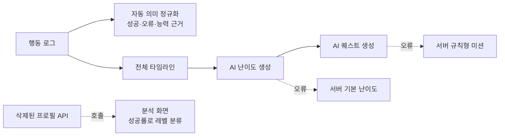
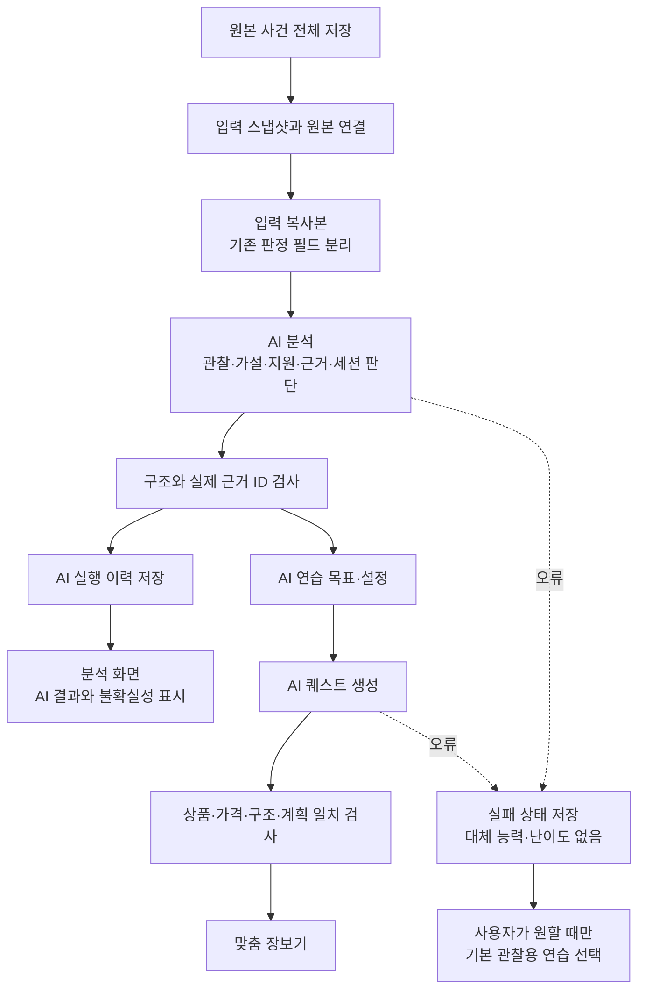
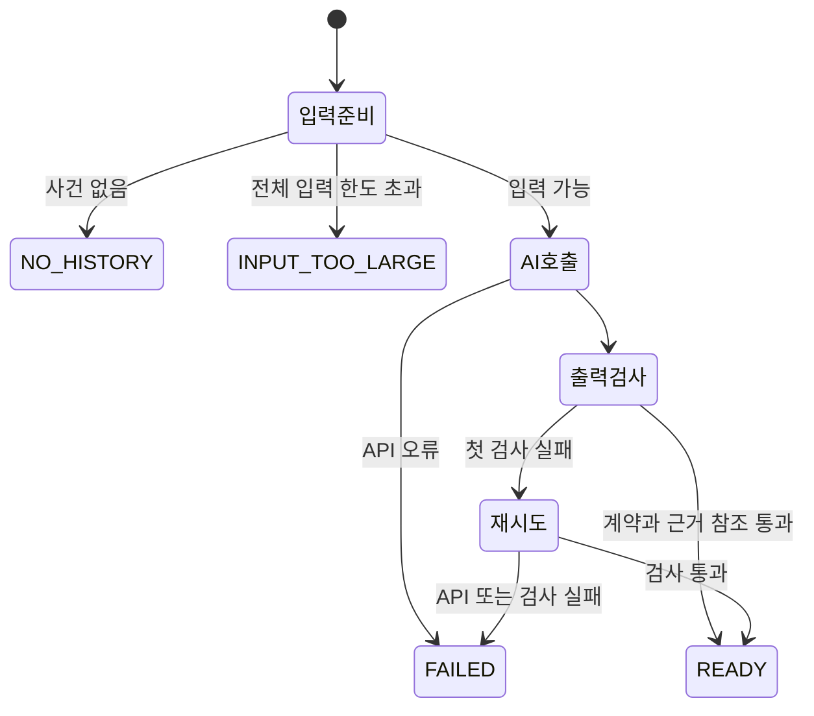

# 1페이즈 — AI 사용자 분석 경로 구현 보고서

작성: 2026-09-05 · 명세: [AI 중심 사용자 분석 및 연습 퀘스트 전환](./ai-led-user-analysis-spec.md)

> 이 문서는 1페이즈 당시의 구현 기록이다. 이후 상품 60종·S01/S02 연결과 프롬프트 버전 변경은 [2페이즈 보고서](./phase-2-market-content-report.md)를 참고한다.

## 결과

장보기 개인화의 중심을 ‘바로 난이도 생성’에서 **‘사용자 행동 분석 → 필요한 연습 계획 → 퀘스트’**로 바꿨다. 분석 화면은 성공률로 레벨을 계산하지 않고 AI가 반환한 관찰·가설·지원·연습 목표를 보여준다.

이번 결과는 코드와 자동 테스트 기준이다. 실제 Groq 사용자 로그 분석, 전문가 검토, 앱 실행 속도 실측을 했다는 의미가 아니다. 진욱 자료 RAG 및 모델 추가 학습은 하지 않았다.

## 1. 바뀐 흐름

### 변경 전



### 변경 후 — 이번 구현



## 2. 구체적인 변경

### 백엔드

- `AiBehaviorAnalysis`: 관찰 finding, 세션 AI 판정, 불확실성, 연습 계획을 분리한 응답 계약.
- `AiBehaviorAnalysisPromptFactory`: 지적장애인의 생활기술·개별화 지원을 검토하는 페르소나. 원본 사건 순서를 유지하고 기존 결과/점수 필드를 입력에서 분리.
- `AiBehaviorAnalysisValidator`: 실제 사건/세션 ID, 필수 텍스트, 출력 구조, 실행 가능 범위만 검사. 사용자 성패 계산 없음.
- `AiBehaviorAnalysisService`: 전체 입력, 한도 확인, API 호출, 형식 실패 1회 재시도, 성공/실패 실행 기록 저장. API 장애 시 서버 분석 생성 없음.
- `AiBehaviorAnalysisController`: 분석 POST와 본인 결과 조회 API.
- `MarketDifficultyRecommendationService`: AI 연습 계획을 그대로 추천 계약에 옮김. 서버 기본값 제거.
- `MarketAiQuestPromptFactory/Service`: 분석과 연습 목표를 입력으로 사용. 규칙형 fallback 제거. 분석 ID를 퀘스트에 연결.
- 기존 의미 정규화 listener/recovery/admin은 `legacy-rule-analysis` 프로필로 격리. 기본 실행에서는 비활성. 입력 생성 때는 사건 수신 무결성만 확인.
- V31: AI 분석 이력 테이블, 추천/퀘스트 분석 ID, 퀘스트 실패 감사 저장 구조 추가. 기존 감사 데이터는 보존.

새 프롬프트 버전은 `behavior-analysis-v1`, 퀘스트 버전은 `market-ai-quest-v2-analysis`다. 모델은 기존 `GroqChatClient` 설정을 재사용한다. 새 키나 모델 추가 학습 환경을 만들지 않았다.

### 프론트엔드

- 삭제된 `/behavior-profiles/latest` 의존성을 제거하고 `/behavior-analyses/latest` 조회 및 명시적 분석 POST로 교체.
- 성공률 50%/80% 기준으로 레벨과 강점/약점을 계산하던 함수·화면을 제거.
- 관찰, 가능한 해석, 대안 설명, 지원 제안, 다음 연습 목표와 불확실성 표시.
- ‘판단 근거 보기’에서 AI 세션 판정, 설명, 사건 ID와 입력/분석 ID 확인.
- 로그인 변경/화면 종료 후 이전 비동기 응답이 결과를 덮어쓰지 않도록 처리.
- 장보기 AI 준비 중에는 이전 기본 미션을 실행하지 않음. 오류 시 기본 미션 자동 전환을 제거하고 사용자가 직접 선택하도록 변경.
- 개인화 생성 API는 GET에서 POST로 변경.

### 제거한 구형 파일

`frontend/src/api/abilityProfile.ts`, `frontend/src/analysis/abilityAnalysis.ts`, 구형 `AbilityAnalysis.test.ts`, 백엔드 `MarketAiDifficultyPromptFactory.java`를 제거했다. 구형 테스트는 새 화면 테스트로 대체했다. 모두 Git 이력에서 복구 가능하다. DB의 원본·과거 분석 이력은 삭제하지 않았다.

## 3. 화면 구성

```text
나의 행동 분석
  의료 진단이나 확정된 능력 평가가 아니라는 설명
  [새 행동 분석하기]

  AI 관찰 요약                         기록 수 / 처리 시간
  ┌ 수량 확인 ──────────────────────────────┐
  │ 관찰한 행동: 실제 사건                   │
  │ AI의 해석: 확인이 필요한 가설            │
  │ 다른 가능한 설명                        │
  │ 도움이 될 수 있는 지원                  │
  └─────────────────────────────────────────┘
  다음 연습 목표 / 관찰과 연습의 연결 이유
  아직 알 수 없는 부분 / 연구 근거 미연결 안내
  [판단 근거 보기]
    세션별 AI 판단과 설명 / 원본 사건 ID
```

이 도식은 실제 스크린샷이 아니라 구현한 화면의 정보 구조다. AI 호출 시간이 분석 실행 기록에 표시되며, 모델 추론 시간만이 아니라 입력 준비·검사·재시도를 포함한 처리 시간이다. 퀘스트 응답의 `latencyMs`는 별도로 퀘스트 단계만 측정한다.

## 4. 예외 경로



여기서 FAILED는 AI 분석 요청의 상태다. 사용자 세션의 FAILURE와 다른 개념이다. 서버가 같은 이름을 사용해 사용자 성패로 바꾸지 않는다.

## 5. 검증 기록

검증 명령과 최종 결과는 아래에 기록한다. 외부 API는 mock 응답을 사용하며 실제 사용자 자료를 전송하지 않는다.

| 검사 | 확인 내용 |
|---|---|
| 백엔드 단위 테스트 | 원본 불변·사건 보존, 판정 필드 분리, AI 성패 유지, 허구 근거 거부, 1회 재시도, 실패 시 분석 없음, 입력 초과/기록 없음, 소유권, 임의 점수 필드 거부 |
| 백엔드 통합 테스트 | 실제 H2 저장 및 원본→분석→연습→퀘스트 연결, analysisId 추적, 자동 의미 정규화 비활성, 실패 감사 저장, 인증/타인 조회 차단 |
| Flyway 테스트 | 기존 이력부터 V31까지 적용 |
| 프론트 테스트 | 자동 생성 없이 조회, 버튼 분석, AI 결과/보류 표시, 실패 상태, 로그아웃/계정 전환 응답 경쟁 방지 |
| TypeScript | 전체 프론트 타입 검사 |

최종 결과(2026-09-05):

- 백엔드 `./gradlew.bat test`: **63개 통과**, Java 25 사용. 신규 단위 9개·통합 3개 및 전체 Flyway 이력 적용 포함.
- 프론트 `node node_modules/typescript/bin/tsc --noEmit`: 통과.
- 프론트 `node node_modules/jest/bin/jest.js --runInBand --silent`: **19개 스위트, 117개 테스트 통과**. 새 분석 화면 테스트 6개 포함.
- `git diff --check`: 공백 오류 없음.

검증 중 새 fixture의 필수 시간 필드 누락, 레거시 프로필 테스트의 H2 DB 공유 충돌, 변경된 화면 문구를 참조하던 기존 테스트를 발견해 수정했다. 레거시 테스트는 별도 DB에서 실행한다. 마지막 재검증에서 실제 대화 애니메이션을 기다리는 기존 App 통합 테스트가 10초 제한을 넘어 후속 테스트 정리도 방해했다. 해당 전체 흐름의 제한만 20초로 늘렸고 기능 검증 조건은 유지했다.

## 6. 아직 하지 않은 일

1. 실제 Groq 호출의 결과 품질과 지연 시간 실측, 운영 PostgreSQL에 V31 적용, 실행 중 서버/앱 재시작은 하지 않았다.
2. 진욱 상품 60개/시나리오 16개/배치를 게임에 매핑하지 않았다. 현재 상품 4개와 게임 실행 범위를 유지한다.
3. 근거 44개를 실제 프롬프트에 연결하거나 모델 가중치를 학습하지 않았다. 현재 페르소나는 역할 지정이며 전문가 인증이 아니다.
4. 긴 기록 분할, 개인정보 제거 강화, 호출 비용/중복 요청 제한, 자유 문장 안전 검토 및 전문가 검증은 남아 있다.
5. 기존 게임 완료 판정·보상·교통 퀘스트 서버 정답 판정까지 전부 이관하지 않았다. 새 분석 경로는 AI가 판단하지만 프로젝트 전체 전환은 진행 중이다.

다음 구현은 명세의 2페이즈: 상품 데이터와 S01/S02 시나리오 계약 매핑이다. 기존 기능을 모두 AI로 전환 완료했다고 간주하지 않는다.
