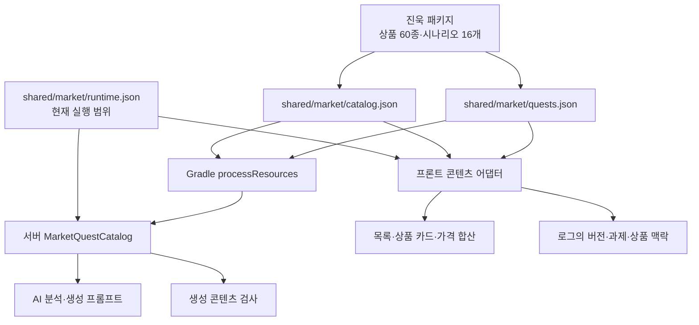
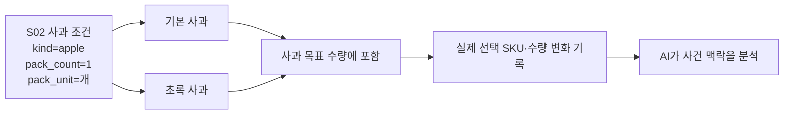
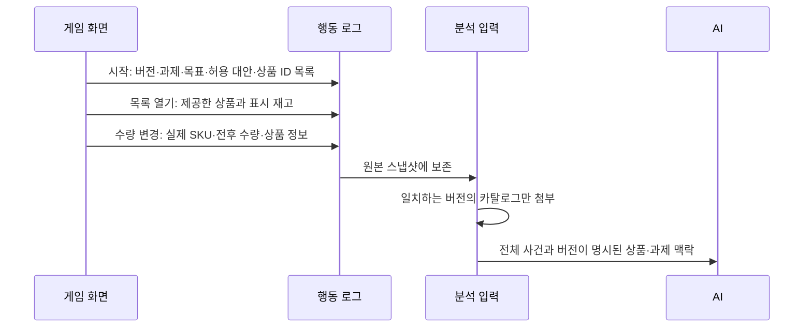

# 2페이즈 — 공통 상품 60종과 S01·S02 매핑 보고서

작성: 2026-09-05 · 상태: **2페이즈 첫 적용분 구현**

관련: [전체 명세](./ai-led-user-analysis-spec.md), [1페이즈 보고서](./phase-1-ai-analysis-report.md)

## 1. 결과와 범위

상품 60종을 서버·앱·AI가 공유하도록 만들고, 진욱 패키지의 S01 ‘아침 준비’와 S02 ‘공원 간식’을 실행 가능한 과제로 연결했다. 16개 시나리오 원본 정의는 모두 포함했지만 **실행을 연 것은 S01·S02 두 개**다.

나머지 14개는 품절·예약·직원 협의·영수증 수정 등 필요한 동작을 확인하고 확장해야 한다. ‘16개 전부 게임 구현 완료’ 또는 ‘진욱 연구 자료로 모델 학습 완료’라고 해석하지 않는다.

서버에 사용자 성공/실패 규칙을 추가하지 않았다. 서버는 생성된 콘텐츠의 상품 존재, 가격, 수량, 실행 가능 범위만 검사한다. AI가 사용자 분석을 근거로 S01/S02 또는 현재 지원 기능 안의 CUSTOM 과제를 선택한다.

## 2. 발견한 불일치와 수정

| 항목 | 이전 서버 | 이전 화면 | 이번 공통 기준 |
|---|---:|---:|---:|
| 상품 수 | 4종 | 24종 | 60종, 분류별 15종 |
| 흰 우유 | 1,800원 | 2,200원 | 가상 2,200원·900mL |
| 사과 | 1,400원 | 1,200원 | 가상 1,200원·1개 |
| 상품 정보 | 이름·가격 중심 | 별도 문자열 | 규격·브랜드/속성·구매 단위 포함 |
| 과제 구분 | 구분 없음 | 기본 장보기 | S01 / S02 / CUSTOM |
| 버전 불일치 | 감지 없음 | 감지 없음 | 실행 중단·오류 표시 |

이전에는 서버 예산 계산과 화면 가격 합산이 달라질 수 있었다. 이제 같은 JSON을 읽으며 UI는 아이콘·색상만 별도로 추가한다.

## 3. 변경 구조



| 파일 | 역할 |
|---|---|
| `shared/market/catalog.json` | 원본 상품 60종과 주의문, 가격·규격·단위·속성 |
| `shared/market/quests.json` | 원본 시나리오 16개와 목표·예산·예외 조건 |
| `shared/market/runtime.json` | 활성 S01/S02, 가상 재고, 실제 지원 기능 |
| `frontend/src/game/marketContent.ts` | 앱 계약 변환과 조건에 맞는 대안 SKU 목록 |
| `frontend/src/game/scenarios.ts` | 시각 스타일, 미션 구성, 콘텐츠 버전 검사 |
| `MarketQuestCatalog.java` | 같은 리소스를 읽어 AI·생성 검사에 제공 |

원본과 저장소의 `catalog.json`, `quests.json`을 JSON으로 읽어 비교해 **내용이 동일함**을 확인했다. 패키지 실행 스크립트는 실행하지 않았다. 원본 패키지 디렉터리가 없어도 저장소와 JAR만으로 실행된다. 학술 원문·RAG 카드·검사 도구는 복사하거나 모델에 투입하지 않았다.

### 버전과 가상 재고

- 카탈로그: `oneuldo-shopping-content-2026-09-04-v2`
- 실행/시나리오 계약: `market-runtime-phase2-v1`
- 분석 프롬프트: `behavior-analysis-v2-content`
- 퀘스트 프롬프트: `market-ai-quest-v3-content`
- 초기 재고: SKU별 구매 단위 5개. 기존 UI의 담기 상한을 명시한 앱의 가상 설정이지 패키지가 제공한 실제 재고 수치가 아니다.

수량은 구매 단위 수다. 달걀 10개입 1팩은 ‘1’이다. 1팩 담으면 진열 재고는 4팩, 빼면 5팩이다. 실제 결제나 사용자 간 공유 재고는 없다.

## 4. S01·S02와 허용 대안

| 과제 | 목표 | 예산 | 구별할 조건 |
|---|---|---:|---|
| S01 아침 준비 | 흰 우유 900mL 1개, 바나나 1송이 | 가상 7,000원 | 200mL 우유·낱개 바나나는 다른 조건 |
| S02 공원 간식 | 사과 2개, 생수 500mL 1개 | 가상 4,000원 | 사과 품종 제한 없음, 물의 용량은 제한 |

S01 기준 합계는 5,800원이다. S02는 기본 사과면 3,200원, 초록 사과면 3,800원으로 모두 예산 안이다.

### distractor는 오답 목록이 아니다

원본 S02의 `distractor_skus`에 초록 사과가 있지만 `match`에는 품종 제한이 없다. 원본 시나리오 문서도 S02에서 다른 사과 품종을 허용한다고 설명한다.



이것은 상품과 요청 조건의 콘텐츠 매핑이다. 초록 사과 선택이나 되돌아감을 능력 부족으로 분류하는 규칙이 아니다. 기존 프론트 장바구니 비교도 허용 SKU를 인식하도록 보완해, 초록 사과를 담고도 수량이 0으로 남거나 `WRONG_ITEM_SELECTED`가 생기는 불일치를 막았다. 기존 완료 판정·보상의 AI 이관 자체는 4페이즈에 남아 있다.

### AI 생성 범위

- S01/S02: 기준 상품 ID·수량·예산은 유지한다. AI가 분석과 연습 목표에 따라 과제를 선택하고 안내·대화·연습 이유를 작성한다. 허용 대안과 목표 라벨은 공통 정의에서 가져온다.
- CUSTOM: 60종 중 2~4품목, 상품별 수량 1~3, 난이도 1~3의 구매 연습. 기존 자유 생성 경로의 확장이다.
- S03~S16: 정의만 존재하며 실행 후보에서 제외한다. 해당 ID의 생성 결과는 거부한다.
- CUSTOM에서도 품절·예약·직원 협의·청구 오류·음성 지원을 구현된 기능처럼 가정하지 않도록 지시한다.

‘난이도 1이면 S01’ 같은 서버 선택 규칙은 없다. 자동 선택되는 관찰용 미션의 난이도 메타데이터 2는 사용자 분석 결과가 아니라 기존 기본 연습과 같은 초기 설정이다.

## 5. 화면과 로그

비로그인 관찰용 플레이 또는 맞춤 생성 실패 시, 앱이 실행 가능한 S01/S02 중 하나를 균등 무작위로 선택해 바로 시작한다. 선택 화면은 표시하지 않으며 AI 맞춤 결과가 아니므로 `contentSource=STATIC`으로 기록한다.

```text
마트 진입
  → S01 또는 S02 자동 선택
  → 선택된 관찰용 연습 바로 시작

분류별 진열 목록: 15종
  흰 우유
  900mL · 구매 단위: 개
  2,200원
  진열 재고 5개
  [담기]
```

위 그림은 스크린샷이 아닌 구현한 정보 구조다. 기존 24종의 시각 스타일을 유지하고 신규 36종은 임시 아이콘·문자 라벨을 사용한다. 상품 이미지 60개를 새로 만든 것은 아니다. 브랜드는 속성이 있는 상품만 표시한다. 분류별 목록에는 15종 모두 있지만 월드 진열대 그림은 개별 SKU의 실제 위치를 뜻하지 않는다. 24슬롯·seed 배치는 3페이즈 대상이다.



`ShoppingBehaviorPayload`에 `catalogVersion`, `scenarioId`, `scenarioVersion`, `marketContent`를 추가했다. JSON 저장 컬럼을 사용하므로 이번 페이즈의 별도 DB 컬럼 마이그레이션은 없다.

시작 사건에는 목표·허용 대안·구매 단위·제공 상품 ID·가상 재고 설정을, 진열 목록 열기에는 제공 상품 정보를, 수량 변경에는 해당 상품 정보를 남긴다. `displayedProducts`는 스크롤 목록에 제공한 상품이지 사용자가 모두 보거나 이해했다는 증거가 아니다. 실제 가시 영역·주의·시선은 측정하지 않았다.

과거 로그에 새 필드를 강제로 채우지 않는다. 신구 사건이 섞여도 현재 카탈로그는 버전이 일치하는 사건에만 적용하도록 지시한다. 오래된 카탈로그의 자동 복원 아카이브는 아직 없다.

## 6. 서버와 앱의 검사

- 서버: 상품 ID·가격·중복·개수·활성 시나리오 존재, 생성된 S01/S02 목표·예산 일치, CUSTOM 실행 범위 확인.
- 앱: 서버 응답의 `catalogVersion`, `scenarioVersion`과 내장 버전 비교. 불일치하면 현재 상품으로 몰래 치환하지 않고 중단.
- 앱: 미등록 SKU, 비활성 과제, S01/S02 목표·예산 변조도 중단.
- 화면: 재고 상한을 버튼과 수량 변경 함수 양쪽에서 적용.

설명 문장 속의 모든 의미 오류를 자동 검증하는 것은 아니다. 원문보다 조건을 좁히는 AI 문장 등은 품질 검증 대상이다. 1페이즈 분석 ID 연결과 감사 기록은 유지하고, 새 필드가 없는 과거 JSON도 보존한다. 버전이 다른 서버·앱 조합은 의도적으로 실행하지 않으므로 함께 업데이트해야 한다.

## 7. 검증 기록

외부 API는 mock으로 대체했다. 실제 사용자 로그 전송, 운영 서버/DB 재시작·변경은 하지 않았다.

| 검사 | 확인 항목 |
|---|---|
| 원본 비교 | 두 JSON의 내용이 제공 패키지와 동일 |
| 백엔드 | 상품·가격·단위, 허용 대안, 실행 제한, CUSTOM 상품, 계약 오류, 로그 보존, 신구 버전 입력 분리 |
| 프론트 데이터/로그 | 16개 정의/2개 활성, 합계·대안, 버전/목표 오류 중단, 당시 정보, 초록 사과 라벨 |
| 프론트 화면 | 규격·브랜드·단위·재고 표시, 초과 담기 방지, 초록 사과 목표 수량 반영 |
| 회귀 | 분석·퀘스트·게임·로그 큐·인증 전체 테스트 |
| 빌드 | TypeScript 및 공유 JSON을 포함한 Expo 웹 번들 |

최종 결과(2026-09-05):

- 백엔드 `./gradlew.bat test`: **69개 통과**, 실패 0. Java 25와 테스트용 H2 사용.
- 프론트 `node node_modules/typescript/bin/tsc --noEmit`: 통과.
- 프론트 `node node_modules/jest/bin/jest.js --runInBand --silent`: **21개 스위트·124개 테스트 통과**.
- `node node_modules/expo/bin/cli export --platform web --output-dir .expo/phase2-export`: 성공. 저장소 밖의 공통 JSON을 포함한 웹 번들 생성 확인.
- `git diff --check`: 공백 오류 없음.

추가 화면 테스트에서 같은 ‘해뜰’ 브랜드의 상품이 여러 개라 단일 요소 조회가 맞지 않는 것을 발견해 복수 상품 표시로 검증했다. 기존 마트 회귀 테스트도 진입 후 관찰용 미션을 명시적으로 고르는 새 흐름에 맞췄다. 테스트를 생략하거나 상품을 줄여 통과시킨 것이 아니다.

웹 번들 결과는 Git에서 제외되는 `frontend/.expo/phase2-export`에 있다. 실제 브라우저 수동 플레이·모바일 네이티브 빌드·실모델 품질/지연 측정은 이번 검증에 포함하지 않았다.

## 8. 남은 일

1. S03~S16의 실행 확대는 미완료다. 정의 가져오기와 예외 동작을 포함한 게임 구현은 다르다.
2. 다음 3페이즈에서 seed·배치·카탈로그·과제 버전·시작 조건을 묶어 장면을 재현한다. 이번 버전 필드는 그 연결점이다.
3. 로그 중립화·전체 기록 분할·완료/보상의 AI 이관은 4페이즈에 남아 있다. 상품 문맥 때문에 입력이 더 커질 수 있으며 큰 기록은 기존 한도 오류로 처리한다.
4. RAG와 전문가/당사자 검증은 미실시다. 페르소나와 mock 테스트만으로 분석 품질이나 생활 능력 향상을 주장하지 않는다.
