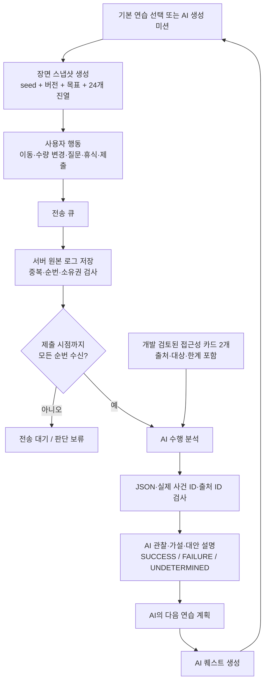
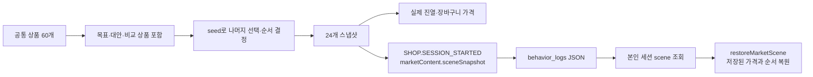
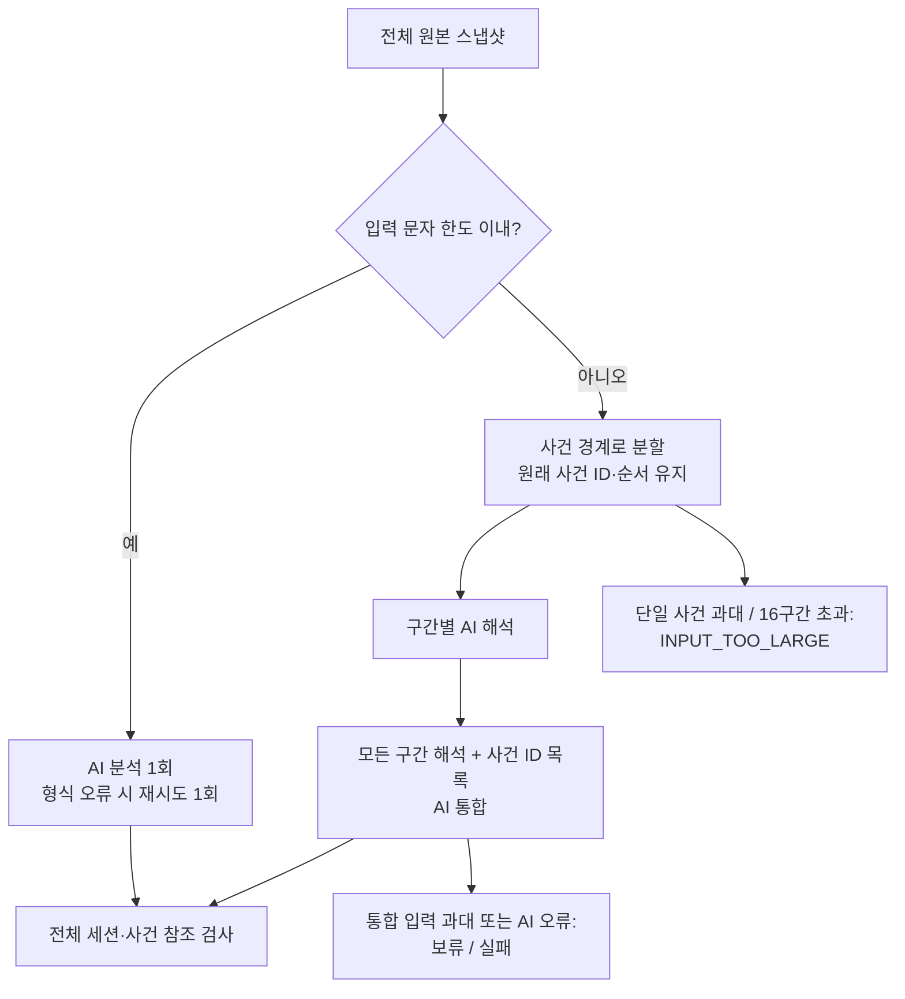

# 3~6페이즈 변경 사항 · 구현 현황과 테스트 안내

작성: 2026-09-05  
대상: 현재 작업 트리(미커밋 변경 포함)  
관련: [전체 전환 명세](./ai-led-user-analysis-spec.md) · [1페이즈](./phase-1-ai-analysis-report.md) · [2페이즈](./phase-2-market-content-report.md)

> 3~6페이즈 전체 완료 보고서가 아니다. 구현된 기능, 제한된 개발 실험, 아직 필요한 제품·전문가 검증을 구분한다.
> 현재 목적은 **AI가 행동을 분석하고 그 분석을 다음 연습에 연결하는 것**이다. 서버가 사용자의 성공·실패를 계산하는 방향으로 되돌리지 않는다.

## 1. 사용자에게 보이는 변화

| 영역 | 이전 | 현재 |
|---|---|---|
| 마트 진열 | 60개 상품을 분류별 15개씩 제공 | 한 회차에 분류별 6개, 총 24개 제공 |
| 장면 기록 | 상품·시나리오 버전과 일부 문맥 | seed·버전·회차 ID·당시 목표·가격·재고·진열 순서를 시작 스냅샷으로 저장 |
| 장바구니 제출 | 앱의 목록 비교로 즉시 성공/수정 안내 | 서버의 로그 수신을 확인한 뒤 AI 수행 검토 요청 |
| 보상 | 로컬 장보기 성공/교통 퀴즈 종료에 연결 | 해당 경로의 자동 성공 보상 중단; AI 결과와 별도로 보상 미지급 표시 |
| 교통 선택 | 정답 선택으로 단계 진행·서버 성패 집계 | 선택 자체를 기록하고 다음으로 진행; 새 기록의 correct는 null |
| 휴식·질문 | 별도 문맥 부족 | 잠시 쉬기/다시 시작, 목록 물어보기와 제시 문구 기록 |
| 분석 화면 | 외부 연구 미연결 안내 | 근거 버전·사용한 카드 ID 표시, 전문가 검증 미완료 명시 |
| 큰 입력 | 한도 초과 시 바로 중단 | 전체 사건을 구간으로 분할해 AI 분석 후 통합; 여전히 기술 한계 초과는 보류 |

상품 60종과 S01/S02는 2페이즈에서 추가한 내용이다. 이번에 60종을 새로 추가한 것으로 세지 않는다.
다른 생활 게임이나 마을의 모든 일상 보상까지 이번에 전환한 것은 아니다.

## 2. 현재 흐름

서버는 가격 합산, 존재하는 상품, 형식, 소유권과 참조를 검사한다.
그 검사 결과로 사용자의 능력이나 성패를 다시 계산하지 않는다.
**AI 호출 오류와 사용자 수행 실패는 다른 상태**다.

## 3. 3페이즈 — 회차별 장면 보존

### 저장하는 값

구현: `frontend/src/game/marketScene.ts`

| 값 | 의미 |
|---|---|
| schemaVersion | market-scene-v1 스냅샷 형식 |
| questInstanceId | 한 회차를 연결하는 ID |
| seed | 진열 선택·순서를 재현하는 32비트 정수 |
| layoutVersion | market-list-layout-v1 |
| catalogVersion / scenarioVersion | 사용한 콘텐츠 버전 |
| mission | 당시 제목·설명·목표·예산·대사 |
| products | 실제 제공할 24개 상품의 가격·규격·구매 단위·초기 재고 등 |
| slots | 분류·목록 순번·상품 ID·보관 구분 |
| startingConditions | 빈 장바구니, 시작점 표기, 지원 목록, 배치 설명 |

배치는 고정 seed의 난수와 셔플로 만든다. 목표 상품, 허용 대안, S01/S02의 필수·비교 상품을 먼저 포함하고 남은 칸을 채운다.
한 분류의 필수 상품이 6개를 넘으면 실행 가능성 오류로 중단한다. 사용자 능력에 따른 배치 점수표는 없다.

현재 카탈로그의 가격이 바뀌어도 복원된 장면은 스냅샷 가격을 사용한다.
시작 사건의 JSON에 보관하므로 별도의 scene 테이블을 만들지는 않았다.

### 정확한 한계

- 재현 대상은 **제공 상품 목록과 시작 콘텐츠**다. 진욱 패키지의 8개 물리 진열대·1200×1000 지도 전체를 앱에 이식한 것은 아니다.
- 기존 매장 지형은 유지한다. storage는 가상 목록 슬롯의 구분이며 실제 냉장 설비나 현실 보관 적합성 검증이 아니다.
- 진열 목록 제공은 화면 내 모든 행을 실제 보거나 이해했다는 증거가 아니다. viewport 노출·시선 추적은 없다.
- 복원 함수와 본인 스냅샷 조회 API는 있지만, 일반 사용자용 “과거 회차 불러오기” 버튼은 없다.
- 스냅샷은 클라이언트가 보고한 문맥이다. 암호학적 서명이나 서버 생성 사실 인증 기능은 없다.
- 회차 시작점을 표기하지만 모든 임베디드 화면·카메라 상태를 픽셀 단위로 재현하지는 않는다.

## 4. 4페이즈 — 로그와 판정 분리

### 4.1 장보기

`MarketBehaviorTracker`는 수량 변화·장바구니·실제 제공 상품을 남긴다.
새 장보기 사건에서 stepOutcome, taskResult의 성공 점수 생산을 중단하고, 잘못된 상품/수량 정답 같은 추가 사건을 제거했다.
이동·근접 원사건은 유지하며 목표 기반 오답 통로/목표 지나침 등의 추가 파생 사건은 새 전송 경로에서 제외한다.
일부 이동 샘플링·거리 계산·기술적 요약은 남아 있다. 모든 프레임을 기록하는 시스템은 아니다.

`MarketSimulationScreen`의 계산 화면에서 “목록 확인”을 누르면:

1. 현재 장바구니를 제출 사건으로 기록한다.
2. 큐 전송을 진행하고 서버 receipt에서 1번부터 제출 시점까지의 순번을 확인한다.
3. 모두 수신되면 해당 세션의 AI 분석을 요청한다.
4. AI 설명을 보여준다. 실패·자료 부족이면 판단을 보류한다.
5. 해당 흐름에서 성공 보상을 자동 지급하지 않는다.

“잠시 쉬기”는 요청과 재개 시점·시간을 기록한다.
“목록 물어보기”는 정해진 질문과 미션 설명을 제시한다. **자유 대화형 AI 직원, 품절 문의, 예약 기능은 아니다.**

### 4.2 교통 퀘스트

- 신규 `quest_events.correct`는 null이다. null은 오답 false가 아니라 **서버 미판정**이다.
- `completedSteps`의 새 의미는 선택을 제출한 서로 다른 단계 수다. 과거 값은 성공 단계 수였으므로 이력을 동일 의미로 합산하면 안 된다.
- 모든 단계 제출 후 `SUBMITTED` 상태가 된다. 이는 성공 판정이 아니다.
- 종료 시 자동 난이도 조정과 성공 포인트 지급 호출을 제거했다.
- 선택 사건을 `TRANSPORT.CHOICE_SUBMITTED`로 공통 behavior_logs에도 저장한다.
- 당시 클라이언트가 보고한 상황·지시·선택지·사용한 힌트·선택 ID·시도·응답 시간을 AI에 전달한다.
- 새 문맥이 없는 구형 클라이언트 기록은 표시 내용 미확인으로 표시한다. 현재 DB 문장으로 조용히 대체하지 않는다.
- 교통 추천 목록의 과거 규칙형 난이도 조회는 끊었다. 현재 이 목록은 기본 관찰용 견본 경로이며 **교통 추천 전체가 AI 개인화로 완성된 것은 아니다.**

### 4.3 긴 타임라인

구현: `TimelineAnalysisPipeline`

기본 60,000자는 토큰 한도가 아니다.
최대 16개 구간, 구간별 형식 재시도 1회와 통합 재시도 1회가 있으므로 최악에는 최대 34회 모델 호출이 발생할 수 있다.
서버는 구간 판정을 다수결이나 평균으로 합치지 않는다.

**남은 한계:** 통합 호출은 구간의 AI 해석과 사건 ID 목록을 받으며 원문을 전부 다시 받지 않는다. 중간 해석에 의미 손실이 있을 수 있다.
원문 재조회 도구, 지속형 청크 캐시, 전체 결과 캐시, 동시 호출 합치기, 토큰 기반 분할, 전체 입력의 스트리밍 DB 조회는 아직 없다.
현재 자동 테스트는 분할의 순서·전체 사건 포함·길이 한도를 확인한다. 긴 기록의 실모델 통합 품질을 입증하지 않는다.

## 5. API와 DB 변경

모두 JWT 사용자 소유권을 기준으로 동작한다.

| API | 역할 |
|---|---|
| POST /api/behavior-analyses/sessions/{sessionId} | 해당 사용자의 한 세션을 새 스냅샷으로 분석 |
| GET /api/behavior-analyses/sessions/{sessionId}/receipt | 본인 세션에서 수신된 순번 조회 |
| GET /api/behavior-analyses/sessions/{sessionId}/scene | 본인 세션의 시작 장면 JSON 조회; 없으면 404 |
| 기존 POST /api/behavior-analyses | 전체/선택 기간 분석; 큰 입력 분할 경로 추가 |
| 기존 교통 events / complete API | 선택 미판정 저장, 완료 대신 SUBMITTED 처리 |

`V32__neutral_transport_observations.sql` 변경:

- quest_events.correct의 NOT NULL 해제.
- quest_sessions 상태 제약에 SUBMITTED 추가.
- behavior_logs payload_type에 TRANSPORT 추가.
- 기존 기록·정답 라벨·보상 이력은 삭제하거나 재계산하지 않음.

분석 입력·실제 요청·모델 출력·오류·근거 버전은 기존 V31의 분석 감사 저장 구조를 재사용한다.
진열 스냅샷과 교통 표시 문맥은 원본 로그 JSON에 저장한다.

## 6. 5페이즈 — 근거 연결의 실제 범위

공통 파일:

- `shared/evidence/candidates.json`: 진욱 패키지의 후보 44개.
- `shared/evidence/review.json`: 카드별 검토 상태·적용 범위.
- `shared/evidence/synthetic-cases.json`: 별도의 가상 검토 사례 24개.
- `EvidenceIndex`: 허용 카드 제공과 인용 ID 검사.
- `AiBehaviorAnalysis.usedEvidenceCardIds`: 모델이 사용했다고 보고한 카드 ID.

현재 허용된 것은 W3C COGA의 I10-C1, I10-C2 **2개뿐**이다.
원문과 고지를 대조한 개발 검토이며, 적용 범위는 인터페이스 접근성 지원 제안이다.
나머지 42개는 내용·권리 검토 대기다. 자동으로 모델에 투입하지 않는다.

[W3C COGA 원문](https://www.w3.org/TR/coga-usable/)과 [W3C 라이선스](https://www.w3.org/copyright/software-license-2015/)를 2026-09-05에 확인했다.
이 자료는 접근성 설계 참고이지 개인 능력·진단·앱 효과를 인증하는 근거가 아니다.

현재 제공기는 승인 상태로 거른 작은 고정 인덱스다. **질문별 임베딩 검색·벡터 DB·44개 전체 RAG를 완성한 것은 아니다.**
빈 입력에는 카드를 제공하지 않으며, 사건이 있는 분석에서는 승인된 2개를 제공한다.
출처 URL, 대상 집단, 주장, 확인 범위, 주의점, 권리·변경 고지를 카드와 함께 유지한다.
모델의 인용 ID가 허용 목록에 있는지는 검사하지만, 문장과 출처가 의미상 맞는지까지 보증하지 않는다.

`expertValidated=false`, `productionApproved=false`다.
이 플래그는 검토 상태 표시이며 운영 배포를 기술적으로 차단하는 별도의 배포 시스템은 아니다.
모델 가중치 변경이나 파인튜닝은 실행하지 않았다.

## 7. 6페이즈 — 테스트 결과와 발견된 품질 문제

| 검증 | 결과 |
|---|---|
| 백엔드 자동 테스트 | 72개 통과, 실패·오류 0 |
| 프론트 자동 테스트 | 22개 suite / 129개 통과 |
| TypeScript | 검사 통과 |
| 웹 export | .expo/phase3-6-export 생성 확인 |
| 합성 자료 점검 | 후보 44개·검토 연결·가상 사례 24개·비전문가 라벨 확인 |
| 실모델 합성 실행 | V01 응답 확인; V02는 HTTP 429로 중단 |
| 전체 24사례 실모델 비교 | 미완료 |
| 전문가·당사자 검증 / 지원 효과 | 미실행 |

### V01 실제 응답

모델: qwen/qwen3.6-27b · API 처리 시간: **2,187ms**

입력: “과일과 우유를 찾는 중 같은 통로를 두 번 지났다.”  
알려진 조건: “첫 매장 방문이고 구역 표지가 화면 밖이었다.”

AI 세션 판단은 UNDETERMINED였다. 최종 구매 결과가 없어 성패를 확정할 수 없다는 설명을 반환했다.
JSON·카드 ID·사건 ID·세션 ID의 기계적 검사는 통과했다.

그러나 다음 **품질 문제도 실제로 나타났다**.

1. observation 안에 “목표 지점을 찾지 못해 되돌아갔거나, 방향 감각을 잃고…”라는 추정을 섞었다. 관찰 사실과 가설 분리가 불완전하다.
2. 제공 기능 범위를 넘어 “단계별 음성 안내 추가”를 제안했다. 현재 앱에 음성 지원이 있다는 뜻으로 제시하면 안 된다.
3. 화면 밖 표지라는 조건을 받았지만 불확실성에서 “무시했는지”를 언급했다. 주어진 조건을 정확하게 유지하는지 추가 검토가 필요하다.

따라서 **형식 통과를 분석 품질 통과로 해석하면 안 된다.**
이 실험은 합성 입력용 스크립트이며 앱의 로그인·저장·검토 전체 E2E 실행을 대체하지 않는다.
두 번째 호출의 429는 공급자 한도 오류다. 분당/토큰/일일 중 어떤 제한인지 이 결과만으로 단정하지 않는다.
자동 재호출·결제·한도 변경은 하지 않았다.

산출물:

- `tmp/phase6/live-responses.json`: 실제 요청·응답·모델·시간·기계적 검사.
- `tmp/phase6/review-report.json`: 24사례 검토표와 실제 응답 1개, 미작성 사람 검토 항목.
- `scripts/run-synthetic-ai-review.mjs`: 외부 호출을 수행하는 합성 테스트. 실행 시 API 사용량 발생.
- `scripts/review-ai-evidence.mjs`: 로컬 자료·응답을 기계적으로 검사. 외부 호출 없음.

가상 기록과 실제 사용자 로그를 혼합하지 않았다. 이 파일들에는 API 키를 출력하지 않는다.
합성 사례의 금지 단정 예시는 정답 라벨이나 학습 데이터로 승격하지 않는다.

## 8. 지금 앱에서 확인할 순서

1. 프론트 개발 주소: **http://localhost:8081**
2. 마트 진입 후 기본 연습 S01/S02를 명시적으로 선택한다. 기록 없는 사용자는 AI 맞춤 생성 대신 기본 관찰용 연습이 필요하다.
3. 각 진열대에서 상품 6개와 당시 가격·규격·재고를 확인한다.
4. 잠시 쉬기/재개, 목록 물어보기를 확인한다.
5. 계산대에서 목록 확인을 누른다. 서버 연결과 로그 수신이 확인되어야 AI 검토가 가능하다.
6. 교통 퀘스트에서는 선택 제출 후 다음 단계로 진행되고 자동 XP가 지급되지 않는지 확인한다.
7. 분석 탭에서 관찰·가설·대안 설명·불확실성·카드 ID를 확인한다.

### 이번 실행의 환경 제약

프론트 개발 서버는 시작했고 HTTP 200 응답과 브라우저의 오늘도 시작 화면(카카오/Google/아이디 로그인 버튼)을 확인했다. Codex 브라우저에 테스트 탭을 열어 두었다.

2026-09-05 16:29 KST 후속 확인에서는 **무무 Android 15 안에서도 오늘도 시작 화면과 카카오/Google/아이디 로그인 버튼 표시를 확인했다.** 기존 APK에는 `ExpoCrypto`가 없었고, 첫 재빌드 후에는 오래된 autolinking 캐시 때문에 `AsyncStorage` 누락 오류가 나타났다. 생성된 autolinking JSON을 백업 이름으로 보존한 뒤 재생성하여 두 모듈을 포함한 x86_64 개발용 APK를 빌드했다. 빌드는 최초 2분 53초, 캐시 갱신 후 28초에 성공했다. `adb install -r`로 기존 앱 데이터를 지우지 않고 덮어 설치했으며, 앱 삭제나 저장소 초기화는 하지 않았다. Metro 8081과 무무의 포트 연결을 유지했다. 이 확인은 시작 화면까지이며 로그인 이후 기능 검증은 아니다.

Docker Desktop은 내부 dockerInference 소켓 초기화 오류로 엔진 시작에 실패했다.
따라서 PostgreSQL과 백엔드 연결을 확인하지 못했으며, **현재 상태로 로그인·저장·실제 AI 분석까지 정상 테스트 가능하다고 보장하지 않는다.**
DB 삭제·Docker 공장 초기화·새 빈 DB로 교체는 하지 않았다.

## 9. 아직 해야 하는 일

| 범위 | 남은 일 |
|---|---|
| 3페이즈 | 과거 회차 불러오기 UI, 실제 카메라·viewport 노출 기록, 지형 재현 확대, 스냅샷 검증 강화 |
| 4페이즈 | 교통 추천의 AI 계획 연결, 다른 생활 게임·보상 경로 전환, 로그 전체 경계 감사, 청크 캐시·통합 품질 검증 |
| 5페이즈 | 나머지 42개 카드 권리·내용 검토, 대상별 검색, 실제 배포 차단 게이트, 의미 수준 인용 검증 |
| 6페이즈 | 나머지 실모델 사례, 위 V01 문제 수정·회귀 검증, 동일 조건 A/B, 전문가·당사자 검토, 동의받은 지원별 재수행 |
| 실행 환경 | Docker 시작 오류 복구 후 기존 PostgreSQL로 서버 실행 및 V31/V32 적용 확인 |

**결론:** 장면과 원본 행동의 추적을 강화하고 서버 성패 판정을 줄이는 구현은 진행됐다.
하지만 “AI가 모든 사용자를 올바르게 분석한다”, “6페이즈 검증까지 완료됐다” 또는 “프로젝트 전체 rule base가 제거됐다”는 상태는 아니다.
