# 오늘도 AI Phase 0~6 구조 및 구현 종합 정리

## 1. 문서 목적

이 문서는 오늘도 프로젝트에서 Phase 0부터 Phase 6까지 어떤 구조를 추가했는지 한 번에 설명한다. 각 구조에 대해 다음 네 가지를 함께 기록한다.

1. 어떤 역할을 하는가
2. 어느 Phase에서 만들어졌거나 완성되었는가
3. 왜 이 구조를 선택했는가
4. 현재 완료 상태는 무엇인가

중간에 모델과 런타임이 `Qwen + MNN`에서 `Korean-Bllossom-3B GGUF + llama.cpp`로 교체되었으므로, 초기 구현과 현재 최종 구조를 구분해 설명한다.

## 2. 상태와 색상 기준

- 초록색: 구현과 자동 테스트 완료
- 노란색: 핵심 코드는 구현했지만 실기기·품질 검증이 남음
- 파란색: 다음 Phase가 사용하기 위해 앞 Phase에서 만든 기반
- 회색: 아직 구현하지 않은 범위

## 3. Phase별 현재 상태

| Phase | 목표 | 현재 상태 | 핵심 결과 |
|---|---|---|---|
| Phase 0 | 모델을 재현 가능하게 준비 | 완료 | Bllossom GGUF manifest, 다운로드·검증 정보 |
| Phase 1 | 퀘스트 수행 데이터 기반 | 완료 | 단계·선택지·세션·이벤트와 서버 정답 판정 |
| Phase 2 | Android 온디바이스 실행 | 코드 완료, 실기기 장시간 검증 남음 | Expo Module, Kotlin, JNI/C++, llama.cpp |
| Phase 3 | AI 공통 계층과 안전장치 | 완료 | 계약, 선택기, 프롬프트, 파서, 정책, fallback |
| Phase 4 | 첫 퀘스트 AI 변형 | 완료 | 사전 생성, 캐시, 화면 연결, 원본 복구 |
| Phase 5 | 자동 난이도와 견본 순환 | 완료 | EASY↔NORMAL 규칙, 이력, 난이도별 견본 5개 |
| Phase 6 | 상황 변형 대상 확대 | 부분 완료 | 대중교통 10개 전체 적용, 퀘스트별 전용 테마 검토 남음 |

## 4. 전체 구조도

아래 그림의 `[P숫자]`는 해당 구조가 처음 만들어지거나 현재 형태로 완성된 Phase다.

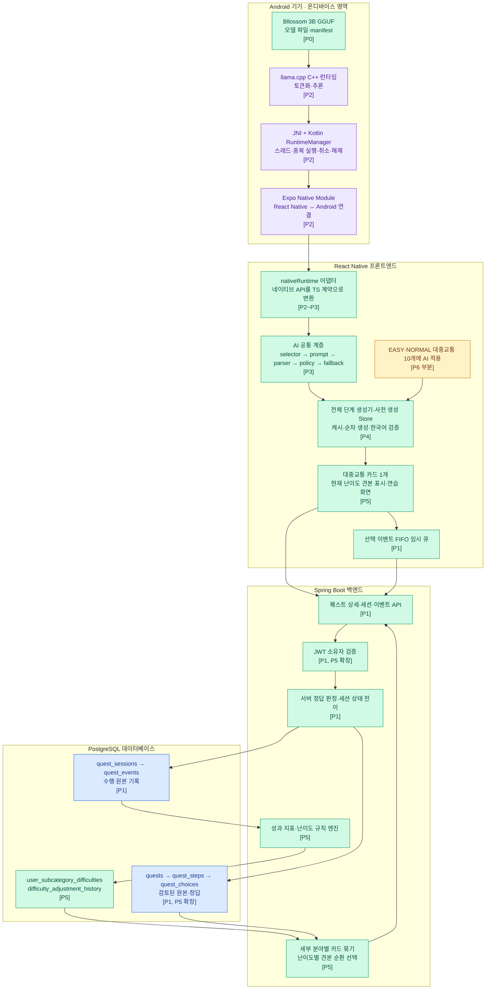

## 5. 이 구조가 나뉜 핵심 이유

```text
DB·백엔드 = 사실과 판정
프론트 AI 계층 = 표현 변형과 안전 검증
Android 네이티브 = 모델 실행
```

이 경계를 선택한 가장 큰 이유는 AI가 틀리더라도 퀘스트의 정답과 학습 기록이 훼손되지 않게 하기 위해서다.

| 계층 | 맡는 것 | 맡기지 않는 것 |
|---|---|---|
| DB | 원본 단계, 선택지, 정답, 보상, 수행 기록 | AI가 만든 임시 문장 |
| 백엔드 | 정답 판정, 세션 상태, 난이도 결정, 견본 선택 | 자유로운 문장 생성 |
| 프론트 AI 계층 | 프롬프트, 생성문 파싱·검증, 원본 복구 | 최종 정답과 난이도 판정 |
| Android 네이티브 | GGUF 로딩, 토큰 생성, 취소·메모리 관리 | 퀘스트 업무 규칙 |

모델을 제거하거나 AI 기능을 끄더라도 DB 원본만으로 퀘스트를 끝까지 수행할 수 있다. 이것이 전체 구조의 가장 중요한 안전 조건이다.

---

## 6. Phase 0 — 모델 준비와 재현성

### 6.1 추가된 구조

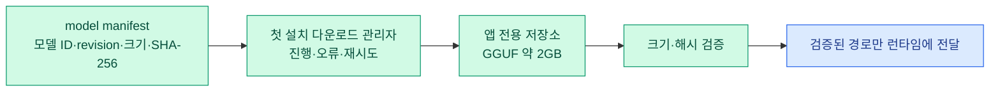

### 6.2 역할

- 모델 ID와 정확한 revision을 고정한다.
- 파일 크기와 SHA-256으로 손상되거나 다른 모델이 들어오는 것을 막는다.
- 대용량 모델을 Git에 넣지 않고 첫 설치 과정에서 앱 전용 저장소로 받는다.
- 새 개발자와 새 기기에서도 같은 모델을 재현한다.

### 6.3 완성 Phase

- 초기 Phase 0에서는 Qwen MNN 모델 준비 구조를 만들었다.
- 모델 비교 후 현재 구조는 `Bllossom/llama-3.2-Korean-Bllossom-3B-gguf-Q4_K_M`로 교체되었다.
- 현재 manifest는 `frontend/models/bllossom-3b-q4-k-m.manifest.json`이다.

### 6.4 이 구조를 선택한 이유

- 2GB가 넘는 모델 바이너리를 Git에 넣으면 저장소와 빌드가 지나치게 무거워진다.
- 모델 이름만 기록하면 같은 이름의 다른 revision을 받을 수 있다.
- 해시를 고정해야 품질 문제와 파일 손상을 구분할 수 있다.
- GGUF는 tokenizer, chat template와 양자화 정보를 한 파일로 묶어 llama.cpp가 직접 실행할 수 있다.

### 6.5 현재 상태

- 모델 manifest와 다운로드 경로: 완료
- Q4_K_M 파일 규격 고정: 완료
- 저장 공간 부족·다운로드 중단 재개에 대한 배포 수준 UX: Phase 7에서 보강 필요

---

## 7. Phase 1 — 퀘스트 수행 데이터 기반

### 7.1 추가된 DB 구조

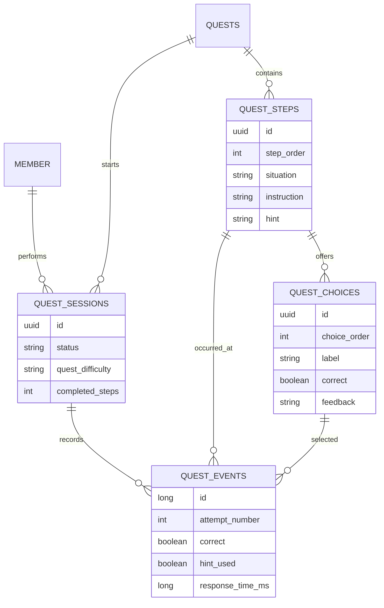

### 7.2 역할

- `quest_steps`: 퀘스트의 순서 있는 단계 원본
- `quest_choices`: 선택지, 서버 정답, 피드백 원본
- `quest_sessions`: 한 번의 시작부터 완료 또는 중단까지의 수행 단위
- `quest_events`: 사용자의 매 선택, 시도 횟수, 힌트 사용과 응답 시간
- `QuestSessionService`: 정답 판정과 상태 전이
- `questEventQueue`: 네트워크 실패 시 이벤트 순서를 보존하는 프론트 임시 큐

### 7.3 완성 Phase

- 테이블과 API, 프론트 동적 수행 화면은 Phase 1에서 완성되었다.
- Phase 5의 난이도 계산은 Phase 1의 세션·이벤트를 그대로 재사용한다.

### 7.4 이 구조를 선택한 이유

- 프론트 하드코딩 질문으로는 콘텐츠 변경과 수행 기록을 신뢰하기 어렵다.
- 정답을 프론트가 판정하면 요청 조작으로 결과가 바뀔 수 있다.
- 세션과 이벤트를 분리해야 “퀘스트 전체 결과”와 “단계별 행동”을 각각 분석할 수 있다.
- 이벤트를 원본 형태로 남겨야 나중에 난이도 규칙이 바뀌어도 다시 계산할 수 있다.

### 7.5 핵심 안전 흐름

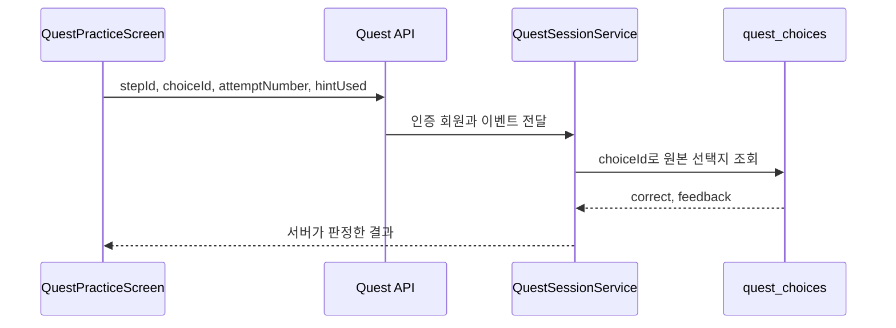

클라이언트가 정답 값을 보내더라도 서버 판정에는 사용하지 않는다.

---

## 8. Phase 2 — Android 온디바이스 런타임

### 8.1 추가된 구조

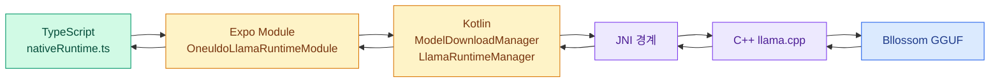

### 8.2 역할

- Expo Module: React Native가 Kotlin 함수를 호출하게 한다.
- Kotlin manager: 모델 상태, 다운로드, 초기화, 요청 직렬화와 메모리 해제를 관리한다.
- JNI: JVM/Kotlin과 C++ 사이에서 문자열과 상태를 전달한다.
- llama.cpp: GGUF tokenizer와 Llama 계열 추론을 실행한다.
- TypeScript adapter: 네이티브 예외와 상태를 앱에서 쓰는 공통 타입으로 변환한다.

### 8.3 완성 Phase

- 처음에는 MNN 프로브와 MNN 런타임으로 연결했다.
- 목표 모델이 단일 GGUF인 Bllossom으로 바뀌면서 Phase 2 구조를 llama.cpp 기반으로 교체했다.
- TypeScript 공개 API는 유지해 상위 AI 계층과 화면의 변경을 줄였다.

### 8.4 이 구조를 선택한 이유

- 온디바이스 AI이므로 프론트 앱 프로세스에서 네이티브 추론을 실행해야 한다.
- React Native JavaScript만으로는 llama.cpp C++ 라이브러리를 직접 호출할 수 없다.
- Expo Go에는 사용자 네이티브 모듈이 없으므로 Development Build와 Expo Module이 필요하다.
- JNI와 Kotlin manager를 분리하면 C++ 추론과 Android 생명주기 관리를 각각 담당할 수 있다.
- GGUF를 직접 실행하면 MNN 변환 과정에서 양자화와 출력 품질을 다시 검증할 필요가 줄어든다.

### 8.5 현재 상태

- arm64-v8a 및 x86_64 빌드 구조: 완료
- MuMu x86_64 모델 실행: 확인
- UI 스레드 밖 생성, 중복 생성 방지, 취소·해제: 구현
- 실제 arm64 기기의 장시간 성능·메모리·발열 검증: 남음

---

## 9. Phase 3 — AI 공통 계층과 안전장치

### 9.1 추가된 구조

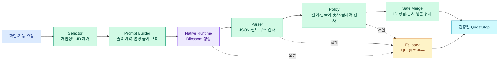

### 9.2 역할

- `contracts.ts`: 입력·출력 형태와 버전을 고정한다.
- selector: 사용자 ID, 이메일, 생년월일과 DB ID를 모델 입력에서 제거한다.
- prompt: 모델이 바꿀 수 있는 필드와 바꿀 수 없는 필드를 명시한다.
- parser: 설명문이 섞이거나 잘린 JSON을 사용자 화면에 직접 보내지 않는다.
- policy: 새 숫자, 영어 혼입, 긴 문장, 금지 표현을 차단한다.
- safe merge: 생성문만 원본에 합치고 ID, 정답과 순서를 유지한다.
- fallback: 어떤 실패에서도 UI가 같은 타입의 원본 퀘스트를 받게 한다.

### 9.3 완성 Phase

- 공통 계약과 안전 파이프라인은 Phase 3에서 완성되었다.
- Phase 4와 Phase 6은 이 계층을 실제 퀘스트 생성에 사용한다.

### 9.4 이 구조를 선택한 이유

- 화면마다 모델을 직접 부르면 서로 다른 검증 기준이 생긴다.
- 모델 출력은 정상 JSON이라고 가정할 수 없다.
- “AI 생성 성공”보다 “검증되지 않은 문장을 보여주지 않음”이 더 중요하다.
- UI가 AI 성공과 실패를 서로 다른 타입으로 처리하면 화면 로직이 복잡해진다.
- 버전을 기록해야 모델·프롬프트·정책 변경 전후의 문제를 추적할 수 있다.

---

## 10. Phase 4 — 첫 통제된 AI 퀘스트 변형

### 10.1 추가된 구조

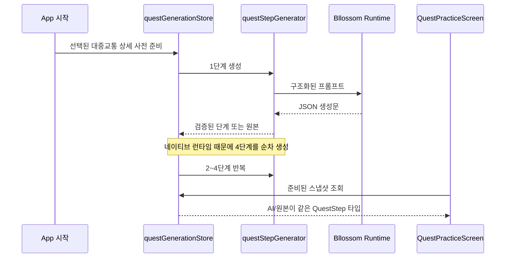

### 10.2 역할

- `questGenerationStore`: 퀘스트 전체 생성 상태와 Promise를 보관해 중복 생성을 막는다.
- `questStepGenerator`: 상황·지시·힌트·선택지 표시 문장을 생성하고 구조·의미를 검사한다.
- `useQuestVariation`: 현재 화면 단계에 준비된 변형을 연결한다.
- `AiScreen`: AI 사용 여부, 모델 준비와 오류 상태를 표시한다.

### 10.3 완성 Phase

- Phase 4에서는 `TAKE_BUS_ALONE` 한 퀘스트로 화면 연결을 완성했다.
- 이후 Phase 5~6에서 대상이 대중교통 원본 전체로 확장되었다.

### 10.4 이 구조를 선택한 이유

- 단계 화면에 들어간 뒤 매번 1~2분씩 기다리지 않도록 앱 시작부터 사전 생성한다.
- llama.cpp 요청을 동시에 여러 개 실행하면 메모리와 런타임 상태가 불안정해질 수 있어 순차 생성한다.
- 퀘스트 ID별 snapshot을 저장해 같은 세션에서 문장이 갑자기 바뀌지 않게 한다.
- 일부 필드가 실패하면 안전한 원본 필드로 복구하고, 구조가 깨지면 단계 전체를 원본으로 돌린다.

### 10.5 AI가 바꿀 수 있는 경계

| 데이터 | 처리 |
|---|---|
| `questId`, `stepId`, choice ID | 원본 고정 |
| 정답 여부, 보상, 단계·선택지 순서와 개수 | 원본 고정 |
| 상황, 지시, 힌트, 선택지 표시 문장 | 검증을 통과한 경우에만 변경 |
| 영어 혼입, 새 숫자, 핵심 의미 훼손 | 해당 필드 또는 단계 원본 복구 |

---

## 11. Phase 5 — 자동 난이도와 대중교통 트랙

### 11.1 난이도 DB 구조

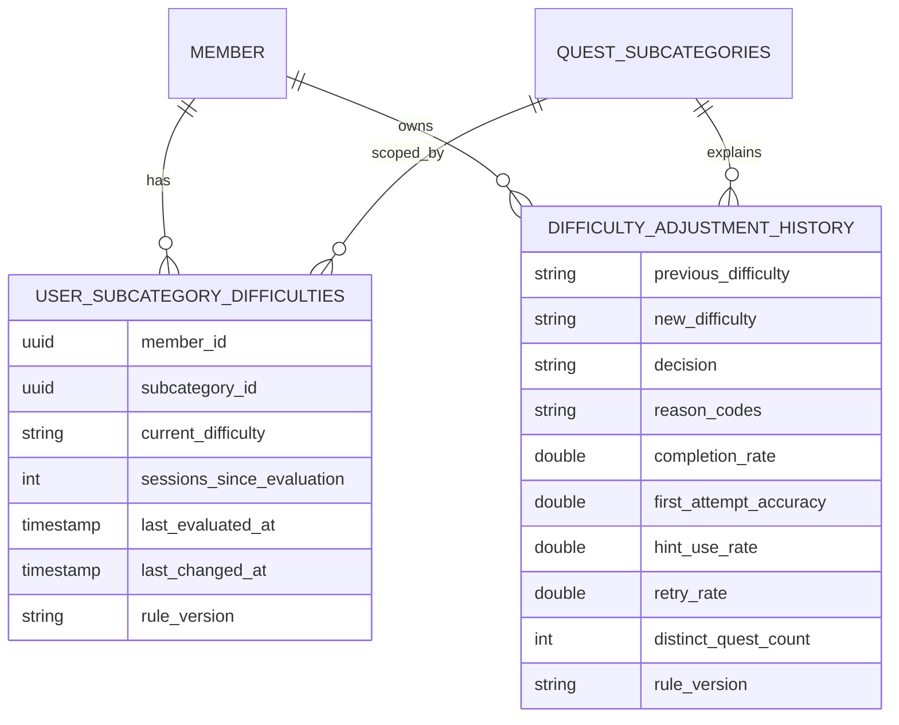

### 11.2 역할

- `DifficultyAdjustmentService`: 최근 같은 분야·같은 난이도 세션과 이벤트로 지표를 계산한다.
- `DifficultyAdjustmentPolicy`: 고정 수치로 승급·유지·하향을 결정한다.
- `user_subcategory_difficulties`: 현재 사용자별 세부 분야 난이도를 빠르게 조회한다.
- `difficulty_adjustment_history`: 판단 당시 지표와 이유를 재현한다.
- `QuestService`: 같은 세부 분야 원본을 카드 한 개로 묶고 현재 난이도 견본을 순환한다.

### 11.3 완성 Phase

- 상태·이력 테이블, 고정 규칙과 개인화 API는 Phase 5에서 완성되었다.
- V10에서 대중교통 EASY 5개와 NORMAL 5개 원본 견본을 완성했다.

### 11.4 이 구조를 선택한 이유

- 사용자는 대중교통에 익숙해도 경제생활은 어려울 수 있으므로 회원 전체 난이도 하나가 아니라 `회원 + 세부 분야` 단위로 저장한다.
- AI가 난이도를 결정하면 같은 기록에도 결과가 달라질 수 있으므로 서버 고정 규칙을 사용한다.
- 현재 상태 테이블과 이력 테이블을 분리하면 조회는 빠르고 과거 판단은 보존된다.
- 콘텐츠를 잠그는 대신 권장 견본만 바꿔 잘못된 초기 판정이 학습 기회를 막지 않게 한다.
- 같은 문제 암기만으로 승급하지 않도록 서로 다른 원본 퀘스트 2개 이상을 요구한다.
- 응답 시간은 기기 성능과 사용자의 읽기·운동 특성 영향을 받으므로 초기 난이도 판정에서 제외한다.

### 11.5 난이도 흐름

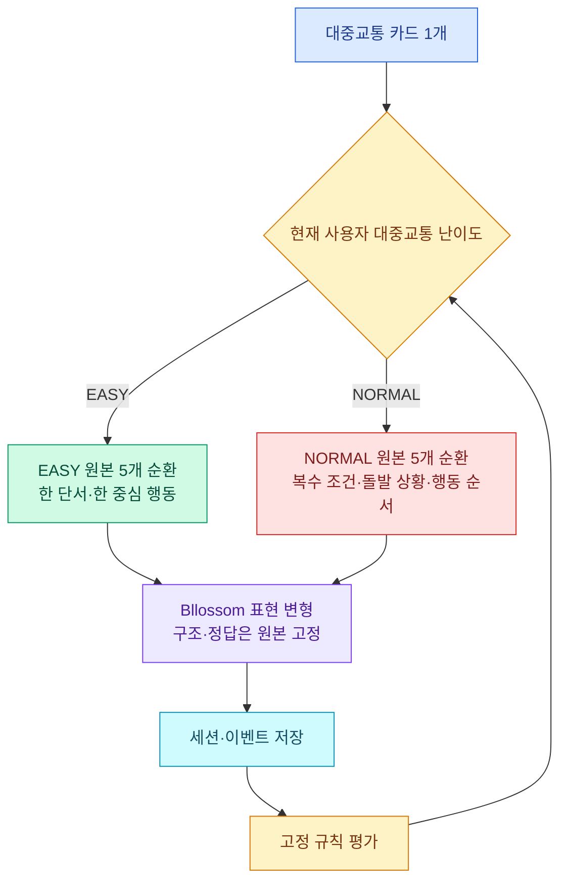

### 11.6 대중교통 원본 구성

| EASY 5개 | NORMAL 5개 |
|---|---|
| 혼자 버스 타기 | 목적지를 지나쳤을 때 |
| 버스 방향 확인하기 | 버스 운행 변경 확인하기 |
| 버스를 놓쳤을 때 | 버스를 갈아타기 |
| 버스 타기 전 준비하기 | 교통카드가 찍히지 않을 때 |
| 목적지에서 안전하게 내리기 | 사람이 많은 버스 이용하기 |

목록에는 10개 카드가 나타나지 않는다. 대중교통 카드 한 개 안에서 현재 난이도의 5개 원본이 수행 횟수에 따라 순환한다.

### 11.7 초기 규칙

승급 조건은 최근 3회, 실제 12단계 이상, 완료율 100%, 첫 시도 정답률 85% 이상, 힌트·재시도율 각각 20% 이하, 서로 다른 원본 2개 이상이다.

하향 조건은 완료율 60% 미만, 첫 시도 정답률 50% 미만, 힌트 70% 이상과 재시도 50% 이상이 동시에 발생하거나 최근 2회 연속 중단이다.

한 번에 EASY와 NORMAL 사이 한 단계만 이동하고 변경 뒤 24시간 동안 다시 바꾸지 않는다.

---

## 12. Phase 6 — 통제된 상황 변형 확장

### 12.1 현재 구현된 구조

Phase 4의 AI 적용 대상은 처음에 `TAKE_BUS_ALONE` 하나였다. 현재는 `categoryCode == PUBLIC_TRANSPORT`인 선택된 모든 EASY·NORMAL 견본으로 확대되었다.

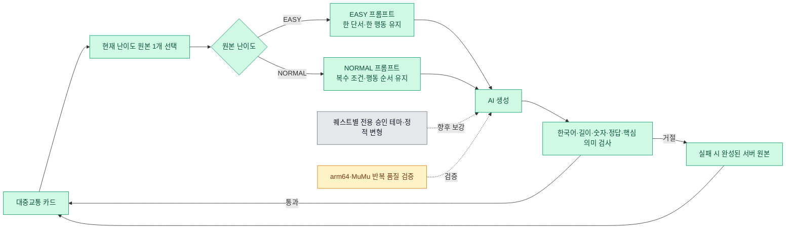

### 12.2 역할

- EASY 원본은 AI가 한 단서와 한 행동을 분명하게 유지한다.
- NORMAL 원본은 번호+방향 같은 복수 확인 조건, 오류·혼잡 같은 돌발 요소와 행동 순서를 유지한다.
- AI가 복잡도를 새로 판정하지 않는다. 백엔드가 검토된 난이도 원본을 고르고 AI는 그 표현만 바꾼다.
- 테마를 자연스럽게 반영하지 못하면 `비 오는 날 + 원문`처럼 접두어를 붙이지 않고 원본 상황으로 복구한다.

### 12.3 현재 형태로 확장한 Phase

- 대중교통 10개 공통 적용과 난이도별 프롬프트는 Phase 6 범위에서 구현되었다.
- 구현은 되었지만 퀘스트별 전용 승인 테마와 실제 반복 품질 검토가 남아 있어 Phase 6 전체는 부분 완료다.

### 12.4 이 구조를 선택한 이유

- AI에게 “더 어렵게 만들어”라고만 하면 원본에 없는 위험 행동이나 새 정답을 만들 수 있다.
- 난이도는 검토된 원본에서 결정하고 AI는 표현만 바꿔야 재현성과 안전성을 유지할 수 있다.
- 카테고리 단위 공통 파이프라인을 사용하면 10개 퀘스트마다 모델 호출 코드를 복제하지 않아도 된다.
- 모든 견본에 같은 한국어·정답·구조 정책을 적용해 품질 기준이 달라지는 것을 막는다.

### 12.5 남은 작업

- 퀘스트별로 허용할 상황 테마와 핵심어 목록 세분화
- 각 원본에 모델 없이도 쓸 수 있는 검토된 정적 변형 준비
- MuMu와 arm64 실제 기기에서 10개 원본 반복 생성 품질 확인
- 생성 시간, 메모리, 발열과 fallback 비율 측정

---

## 13. Phase 간 의존 관계

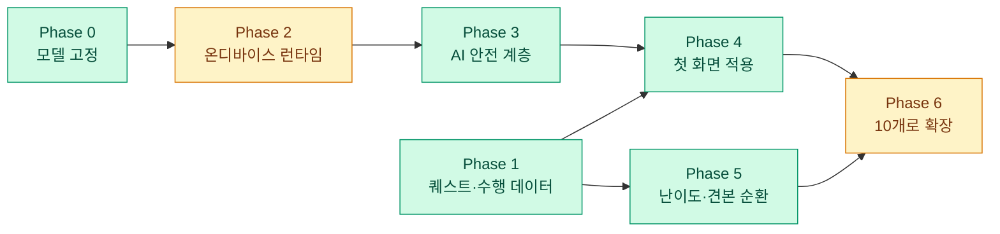

- Phase 0이 없으면 어떤 모델을 실행했는지 재현할 수 없다.
- Phase 1이 없으면 원본 정답과 수행 지표가 없어 Phase 4와 Phase 5를 안전하게 만들 수 없다.
- Phase 2가 없으면 React Native에서 온디바이스 모델을 실행할 수 없다.
- Phase 3이 없으면 모델 원문이 검증 없이 화면에 노출된다.
- Phase 4가 먼저 한 퀘스트에서 전체 생성 흐름을 검증했다.
- Phase 5가 난이도 원본을 결정하고 Phase 6가 해당 원본의 표현 변형 범위를 넓힌다.

## 14. 최종 사용자 흐름

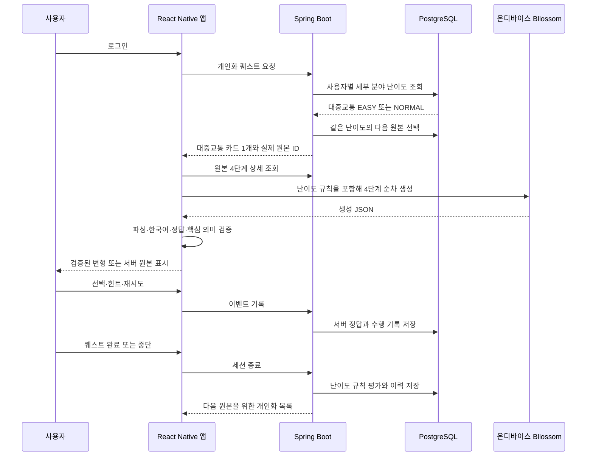

## 15. 주요 구조별 역할·완성 Phase·선택 이유 요약

| 구조 | 역할 | 완성 Phase | 선택 이유 | 상태 |
|---|---|---:|---|---|
| Bllossom GGUF manifest | 모델 버전·크기·해시 고정 | 0 | 재현성과 손상 검증 | 완료 |
| 모델 다운로드 관리자 | 첫 설치 시 앱 저장소에 모델 준비 | 0·2 | 대용량 파일을 Git·APK와 분리 | 코드 완료 |
| `quest_steps`, `quest_choices` | 검토된 단계·정답 원본 | 1 | 프론트 하드코딩 제거, 서버 판정 | 완료 |
| `quest_sessions`, `quest_events` | 전체 수행과 단계 행동 기록 | 1 | 개인화 지표 재계산 가능 | 완료 |
| Expo Module | React Native와 Android 연결 | 2 | Expo 앱에서 사용자 네이티브 코드 호출 | 완료 |
| Kotlin RuntimeManager | 모델·요청·스레드·메모리 상태 관리 | 2 | Android 생명주기와 C++ 분리 | 코드 완료 |
| JNI + llama.cpp | GGUF 실제 추론 | 2 | GGUF 직접 실행과 양자화 유지 | 코드 완료 |
| AI contracts·selector | 타입 고정과 개인정보 제거 | 3 | 입력 범위와 버전 명확화 | 완료 |
| parser·policy·fallback | 잘못된 출력 차단과 원본 복구 | 3 | 검증되지 않은 문장 노출 방지 | 완료 |
| `questGenerationStore` | 사전 생성·중복 방지·스냅샷 | 4 | 긴 생성 대기와 문장 흔들림 완화 | 완료 |
| `questStepGenerator` | 전체 단계 문장 생성·안전 병합 | 4, 6 확장 | 구조·정답을 고정한 표현 변형 | 완료 |
| 난이도 상태 테이블 | 분야별 현재 난이도 조회 | 5 | 사용자 능력이 분야마다 다름 | 완료 |
| 난이도 이력 테이블 | 결정 지표·이유 재현 | 5 | 규칙 조정과 문제 추적 | 완료 |
| 고정 난이도 Policy | EASY↔NORMAL 결정 | 5 | AI 판단의 비결정성 제거 | 완료 |
| 세부 분야 카드 묶기 | 대중교통 카드 한 개만 표시 | 5 | 견본 수와 UI 카드 수 분리 | 완료 |
| 난이도별 원본 5개 | 반복 학습 다양성·복잡도 기준 | 5 | AI가 난이도를 임의 생성하지 않게 함 | 완료 |
| 대중교통 전체 AI 적용 | 선택된 10개 견본 표현 변형 | 6 | 공통 정책 재사용 | 부분 완료 |

## 16. 현재 남아 있는 핵심 검증

1. 실제 arm64-v8a Android 기기의 모델 초기화·생성 시간 측정
2. MuMu x86_64에서 대중교통 10개 반복 생성 안정성 확인
3. 30분 이상 사용 시 메모리·발열·앱 종료 여부 확인
4. NORMAL 생성문이 원본의 복수 조건과 행동 순서를 실제로 유지하는지 사람 검토
5. 퀘스트별 승인 테마와 모델 미사용 정적 변형 추가

따라서 현재 구조는 기능적으로 Phase 0~5가 연결되어 있고 Phase 6의 공통 확장 코드까지 동작한다. 다만 Phase 6은 실제 품질 검토와 퀘스트별 승인 자산이 남아 있으므로 배포 완료 상태로 보지는 않는다.
