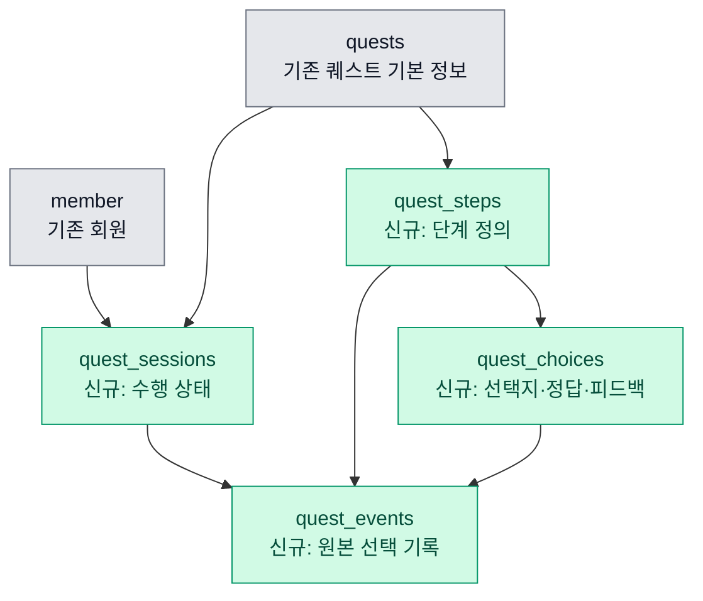
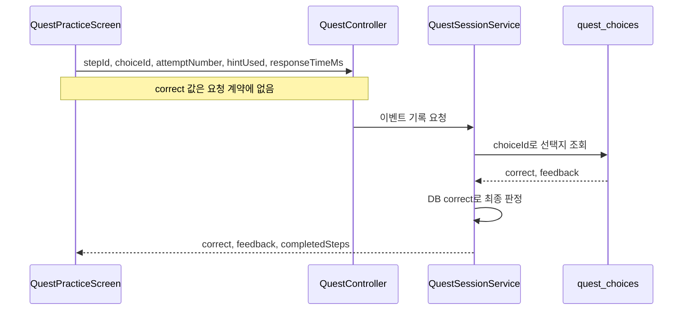
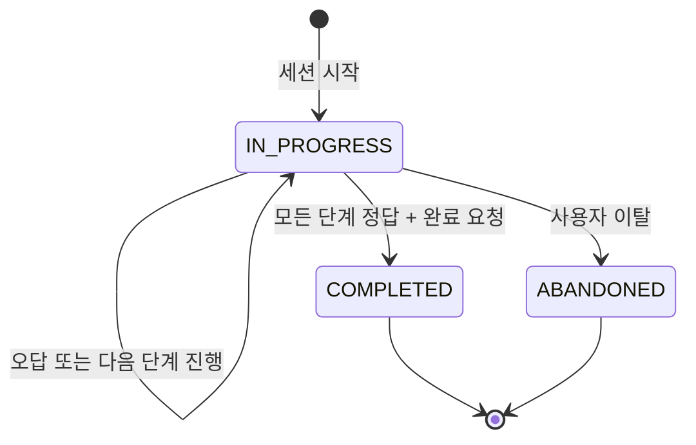

# Phase 1 구현 변경 요약

## 1. 문서 목적

이 문서는 `AI 페이즈별 구현 계획`의 Phase 1인 **퀘스트 수행 데이터 기반 구축**에서 생성하거나 수정한 파일을 하나씩 설명한다.

Phase 1의 핵심 변화는 프론트에 하드코딩되어 있던 퀘스트를 다음 구조로 바꾼 것이다.

```text
DB 퀘스트 정의
  → 백엔드 상세 API
  → 프론트 단계별 수행
  → 사용자 선택 이벤트 기록
  → 서버 정답 판정
  → 세션 완료 또는 중단
```

현재 DB 초기 데이터로 전체 수행이 가능한 대상은 `TAKE_BUS_ALONE`, 즉 **혼자 버스 타기 퀘스트 1종**이다.

## 2. 그림에서 사용하는 색상

아래 구조도에서는 Phase 1의 변경 범위를 구분하기 위해 색을 다르게 사용한다.

- 회색: Phase 1 이전부터 존재하던 구성요소
- 노란색: 기존 파일을 Phase 1에서 수정한 구성요소
- 초록색: Phase 1에서 새로 만든 구성요소

## 3. 데이터베이스에서 새로 생긴 구조



### 새 테이블의 책임

| 테이블 | 새로 저장하는 값 | 필요한 이유 |
|---|---|---|
| `quest_steps` | 단계 순서, 안내, 상황, 기본 힌트 | 프론트 하드코딩 제거 |
| `quest_choices` | 선택지 문장, 정답, 피드백 | 선택지를 DB에서 관리하고 서버가 정답 판정 |
| `quest_sessions` | 사용자, 퀘스트, 진행 상태, 완료 단계, 보상 | 한 번의 퀘스트 수행 범위 관리 |
| `quest_events` | 선택, 시도 번호, 정답, 힌트, 응답 시간 | AI 힌트와 개인화가 사용할 원본 행동 데이터 확보 |

## 4. 전체 애플리케이션 구조에서 바뀐 부분

```mermaid
flowchart LR
    subgraph Frontend["React Native"]
        Onboarding["OnboardingScreen\n수정: 실제 이메일 로그인"]:::modified
        AuthApi["auth.ts\n신규: 로그인 API"]:::added
        App["App.tsx\n수정: Access Token 보관"]:::modified
        QuestApi["quest.ts\n수정: 상세·세션 API"]:::modified
        Queue["questEventQueue.ts\n신규: FIFO 임시 큐"]:::added
        QuestList["QuestScreen\n수정: API 목록"]:::modified
        AppShell["AppShell\n수정: 상세 퀘스트 전달"]:::modified
        Practice["QuestPracticeScreen\n수정: 동적 단계·이벤트 수집"]:::modified
    end

    subgraph Backend["Spring Boot"]
        Security["SecurityConfig\n수정: 수행 API JWT 보호"]:::modified
        Controller["QuestController\n수정: 상세·세션 엔드포인트"]:::modified
        QuestService["QuestService\n수정: 상세 응답 조립"]:::modified
        SessionService["QuestSessionService\n신규: 판정·상태 전이"]:::added
        DefinitionRepo["Step·Choice Repository\n신규"]:::added
        RecordRepo["Session·Event Repository\n신규"]:::added
    end

    subgraph Database["PostgreSQL"]
        ExistingDb["member·quests\n기존"]:::existing
        NewDb["steps·choices·sessions·events\n신규"]:::added
    end

    Onboarding --> AuthApi --> App
    App --> AppShell
    QuestList --> AppShell --> Practice
    Practice --> QuestApi
    Practice --> Queue --> QuestApi
    QuestApi --> Security --> Controller
    Controller --> QuestService --> DefinitionRepo
    Controller --> SessionService --> RecordRepo
    DefinitionRepo --> NewDb
    RecordRepo --> NewDb
    ExistingDb --> NewDb

    classDef existing fill:#e5e7eb,stroke:#6b7280,color:#111827;
    classDef modified fill:#fef3c7,stroke:#d97706,color:#78350f;
    classDef added fill:#d1fae5,stroke:#059669,color:#064e3b;
```



## 5. 새로 만든 파일

### 5.1 DB 마이그레이션

#### `backend/src/main/resources/db/migration/V5__create_quest_step_and_choice_tables.sql`

- `quest_steps`와 `quest_choices` 테이블을 생성한다.
- 퀘스트별 단계 순서와 단계별 선택지 순서가 중복되지 않도록 `UNIQUE` 제약조건을 추가했다.
- 순서는 1 이상이어야 한다.
- 기존 수행 정의가 함부로 삭제되지 않도록 외래 키에 `ON DELETE RESTRICT`를 적용했다.

핵심 구조:

```sql
CREATE TABLE quest_steps (...);
CREATE TABLE quest_choices (...);
```

#### `backend/src/main/resources/db/migration/V6__insert_initial_quest_step_data.sql`

- `TAKE_BUS_ALONE` 퀘스트의 단계 4개를 추가했다.
- 각 단계에 선택지 3개씩 총 12개를 추가했다.
- 각 단계에는 정답이 1개 있다.
- 승인된 정적 힌트와 정답·오답 피드백을 함께 저장한다.

추가된 수행 순서:

```text
버스 번호 찾기
  → 도착한 버스 확인
  → 교통카드 사용
  → 하차 버튼을 누르고 내리기
```

#### `backend/src/main/resources/db/migration/V7__create_quest_session_and_event_tables.sql`

- `quest_sessions`와 `quest_events` 테이블을 생성한다.
- 세션 상태는 `IN_PROGRESS`, `COMPLETED`, `ABANDONED`만 허용한다.
- 동일 세션·단계·시도 번호가 중복되지 않도록 제약조건을 추가했다.
- 사용자 수행 이력과 세션 이벤트 조회용 인덱스를 추가했다.

핵심 제약조건:

```sql
UNIQUE (session_id, step_id, attempt_number)
CHECK (attempt_number >= 1)
CHECK (response_time_ms >= 0)
```

### 5.2 백엔드 Domain

#### `backend/src/main/java/oneuldo/quest/domain/QuestStep.java`

- `quest_steps` 테이블에 대응하는 JPA Entity다.
- `Quest`와 `ManyToOne`으로 연결된다.
- 단계 순서, 안내, 상황, 힌트를 가진다.

```java
private Quest quest;
private int stepOrder;
private String instruction;
private String situation;
private String hint;
```

#### `backend/src/main/java/oneuldo/quest/domain/QuestChoice.java`

- `quest_choices` 테이블에 대응한다.
- `QuestStep`과 `ManyToOne`으로 연결된다.
- 서버 판정 기준인 `correct`와 사용자 피드백을 보관한다.

```java
private QuestStep step;
private int choiceOrder;
private String label;
private boolean correct;
private String feedback;
```

#### `backend/src/main/java/oneuldo/quest/domain/QuestSessionStatus.java`

- 세션 상태를 문자열 Enum으로 제한한다.

```java
IN_PROGRESS,
COMPLETED,
ABANDONED
```

#### `backend/src/main/java/oneuldo/quest/domain/QuestSession.java`

- 한 번의 퀘스트 수행 상태를 표현한다.
- 시작 시 퀘스트 난이도와 전체 단계 수를 스냅샷으로 저장한다.
- `completeStep()`, `complete()`, `abandon()`으로 상태를 변경한다.

주요 상태 변화:

```text
IN_PROGRESS → COMPLETED
IN_PROGRESS → ABANDONED
```

#### `backend/src/main/java/oneuldo/quest/domain/QuestEvent.java`

- 선택 한 번을 수정하지 않는 원본 이벤트로 저장한다.
- 클라이언트가 보낸 정답 값이 아니라 연결된 `QuestChoice.isCorrect()`로 정답 스냅샷을 만든다.
- 시도 번호, 힌트 사용 여부와 응답 시간을 함께 보관한다.

### 5.3 백엔드 DTO

#### `backend/src/main/java/oneuldo/quest/dto/QuestChoiceResponse.java`

- 프론트에 전달할 선택지 형태다.
- 오프라인 훈련을 위해 문장, 정답 스냅샷과 피드백을 전달한다.
- 서버 이벤트 기록에서는 이 정답 값을 신뢰하지 않고 DB에서 다시 판정한다.

#### `backend/src/main/java/oneuldo/quest/dto/QuestStepResponse.java`

- 단계 정보와 해당 단계의 선택지 목록을 하나로 묶는다.
- `List.copyOf()`로 응답 목록을 불변 형태로 만든다.

#### `backend/src/main/java/oneuldo/quest/dto/QuestDetailResponse.java`

- 퀘스트 기본 정보, 학습 목표와 전체 단계 목록을 반환한다.
- `GET /api/quest/{uuid}/detail`의 최종 응답 타입이다.

#### `backend/src/main/java/oneuldo/quest/dto/QuestEventRequest.java`

- 프론트가 선택 이벤트를 기록할 때 보내는 요청이다.
- `correct` 필드는 받지 않는다.
- `attemptNumber >= 1`, `responseTimeMs >= 0`을 검증한다.

```java
UUID stepId;
UUID choiceId;
int attemptNumber;
boolean hintUsed;
long responseTimeMs;
```

#### `backend/src/main/java/oneuldo/quest/dto/QuestEventResponse.java`

- 서버가 다시 계산한 정답 여부와 피드백을 반환한다.
- 현재 완료 단계 수와 전체 단계 수도 함께 반환한다.

#### `backend/src/main/java/oneuldo/quest/dto/QuestSessionResponse.java`

- 세션 ID, 상태, 난이도, 완료 단계, 경험치와 각 상태 시각을 반환한다.

#### `backend/src/main/java/oneuldo/quest/dto/QuestAbandonRequest.java`

- 중단 이유를 받는 요청 DTO다.
- 최대 길이를 50자로 제한한다.
- 값이 없으면 서비스에서 `USER_EXIT`를 사용한다.

### 5.4 백엔드 Repository

#### `backend/src/main/java/oneuldo/quest/repository/QuestStepRepository.java`

- 퀘스트 ID로 단계를 `stepOrder` 오름차순 조회한다.
- 세션을 시작할 때 전체 단계 수도 계산한다.

#### `backend/src/main/java/oneuldo/quest/repository/QuestChoiceRepository.java`

- 단계별 선택지를 `choiceOrder` 순서로 조회한다.
- 여러 단계의 선택지를 한 번에 조회하는 메서드를 추가해 상세 조회의 반복 쿼리를 줄였다.

#### `backend/src/main/java/oneuldo/quest/repository/QuestSessionRepository.java`

- 세션을 저장하고 조회한다.
- `findByIdAndMemberId()`를 사용해 세션 ID와 소유자를 함께 검사한다.

#### `backend/src/main/java/oneuldo/quest/repository/QuestEventRepository.java`

- 세션 이벤트를 생성 순서대로 조회한다.
- 단계별 이벤트 수, 기존 정답 여부와 동일 시도 이벤트를 조회한다.
- 이벤트 재전송과 시도 순서 검증에 사용한다.

### 5.5 백엔드 Service

#### `backend/src/main/java/oneuldo/quest/service/QuestSessionService.java`

Phase 1 수행 규칙을 담당하는 핵심 신규 서비스다.

구현한 기능:

1. 로그인 회원의 세션 시작
2. 활성 퀘스트와 전체 단계 수 확인
3. 세션 소유자 검사
4. 단계와 선택지가 현재 세션에 속하는지 검사
5. DB 선택지 기준 정답 판정
6. 시도 번호가 순서대로 들어오는지 검사
7. 같은 이벤트 재전송 시 기존 결과 반환
8. 정답이 처음 기록될 때만 완료 단계 증가
9. 전체 단계 완료 후 경험치 지급
10. 중단 상태 저장
11. 완료·중단 세션의 추가 이벤트 차단

### 5.6 백엔드 테스트

#### `backend/src/test/java/oneuldo/quest/QuestMigrationTest.java`

- Flyway V1부터 V7까지 H2 PostgreSQL 모드에 실제 적용한다.
- 신규 마이그레이션 SQL 문법과 실행 순서를 확인한다.

#### `backend/src/test/java/oneuldo/quest/controller/QuestControllerTest.java`

- 상세 API의 JSON 연결을 확인한다.
- JWT 없이 세션 시작 시 401인지 확인한다.
- JWT로 세션을 시작하고 이벤트를 기록한다.
- 요청에 거짓 `correct` 값을 추가해도 서버 DB 판정이 유지되는지 확인한다.

#### `backend/src/test/java/oneuldo/quest/service/QuestSessionServiceTest.java`

- 같은 오답을 여러 번 선택했을 때 시도 번호와 응답 시간이 기록되는지 확인한다.
- 힌트 사용 여부가 저장되는지 확인한다.
- 같은 이벤트 재전송이 중복 저장되지 않는지 확인한다.
- 모든 단계를 완료해야 경험치가 지급되는지 확인한다.
- 다른 사용자의 세션 접근과 중단 세션의 추가 기록을 차단하는지 확인한다.

### 5.7 프론트 API와 임시 큐

#### `frontend/src/api/auth.ts`

- 이메일과 비밀번호를 `/api/auth/login`으로 전송한다.
- 로그인 응답의 Access Token과 회원 정보를 TypeScript 타입으로 정의한다.

#### `frontend/src/api/questEventQueue.ts`

- 앱 실행 중 전송하지 못한 선택 이벤트를 메모리에 보관한다.
- 모든 이벤트를 FIFO 순서로 전송해 두 번째 시도가 첫 번째 시도보다 먼저 도착하지 않게 한다.
- 네트워크 오류는 큐에 유지하고, 서버가 거부한 4xx 이벤트는 다음 이벤트를 막지 않도록 제거한다.

#### `frontend/__tests__/QuestEventQueue.test.ts`

- 첫 전송 실패 후 이벤트가 큐에 남는지 확인한다.
- 연결 복구 후 1번, 2번 시도 순서로 재전송되는지 확인한다.

## 6. 기존 파일에서 수정한 내용

### 6.1 백엔드 수정 파일

#### `backend/src/main/java/oneuldo/global/security/SecurityConfig.java`

이전에는 `/api/quest/**` 전체가 공개되어 있었다.

변경 후:

```text
GET /api/quest/**                    공개
POST /api/quest/{id}/sessions        JWT 필요
/api/quest/sessions/**               JWT 필요
```

퀘스트 정의는 로그인 전에 볼 수 있지만 수행 기록은 인증 사용자만 접근할 수 있다.

#### `backend/src/main/java/oneuldo/quest/controller/QuestController.java`

기존 목록·단건 조회 API에 다음 엔드포인트를 추가했다.

| Method | 경로 | 역할 |
|---|---|---|
| GET | `/api/quest/{uuid}/detail` | 단계와 선택지를 포함한 상세 조회 |
| POST | `/api/quest/{uuid}/sessions` | 수행 세션 시작 |
| GET | `/api/quest/sessions/{sessionId}` | 자신의 세션 조회 |
| POST | `/api/quest/sessions/{sessionId}/events` | 선택 이벤트 기록 |
| POST | `/api/quest/sessions/{sessionId}/complete` | 세션 완료 |
| POST | `/api/quest/sessions/{sessionId}/abandon` | 세션 중단 |

JWT의 `subject`를 회원 UUID로 변환해 Service에 전달한다.

#### `backend/src/main/java/oneuldo/quest/service/QuestService.java`

- 기존 목록과 단건 조회에 상세 조회 기능을 추가했다.
- 퀘스트, 단계와 선택지를 DTO로 조립한다.
- 여러 단계의 선택지를 한 쿼리로 조회한 뒤 단계 ID별로 그룹화한다.
- 중복되던 퀘스트 404 처리를 `findQuestOrThrow()`로 분리했다.

#### `backend/src/test/java/oneuldo/quest/service/QuestServiceTest.java`

- 기존 활성 퀘스트 목록 테스트를 유지했다.
- 단계가 순서대로 반환되는지 확인하는 상세 조회 테스트를 추가했다.
- 선택지가 `choiceOrder` 순서대로 반환되는지 확인한다.

### 6.2 프론트 수정 파일

#### `frontend/App.tsx`

- 로그인 후 받은 Access Token을 상태로 보관한다.
- Token을 `AppShell`로 전달한다.
- 기존의 단순 앱 진입 함수를 Token을 받을 수 있는 형태로 바꿨다.

#### `frontend/src/screens/OnboardingScreen.tsx`

- 아이디 입력 표시를 백엔드 계약에 맞게 이메일로 변경했다.
- 시작 버튼이 실제 `login()` API를 호출한다.
- 로그인 중 중복 버튼을 막고 `로그인 중...` 상태를 표시한다.
- 실패 메시지를 화면에 보여준다.
- 기존 카카오·Google 버튼은 아직 데모 진입을 유지한다.

#### `frontend/src/screens/AppShell.tsx`

- 선택된 퀘스트 타입을 요약 정보에서 `QuestDetail`로 변경했다.
- 퀘스트를 열 때 `getQuestDetail()`을 호출한다.
- 상세 퀘스트와 Access Token을 `QuestPracticeScreen`에 전달한다.
- 퀘스트 탭에도 API 퀘스트 목록과 로딩·오류 상태를 전달한다.

#### `frontend/src/screens/QuestScreen.tsx`

- 파일 안의 하드코딩된 퀘스트 배열을 제거했다.
- `QuestSummary[]`를 Props로 받아 카드를 만든다.
- 카테고리 코드는 프론트의 아이콘·색상 설정과 연결한다.
- 로딩, 오류와 빈 목록 상태를 추가했다.
- 카드 선택 시 실제 퀘스트 UUID를 전달한다.

#### `frontend/src/screens/QuestPracticeScreen.tsx`

가장 크게 변경된 기존 파일이다.

삭제한 구조:

```ts
const questions = [/* 하드코딩 질문 */];
```

새 구조:

```text
quest.steps[stepIndex]
  → step.choices
  → 선택·정답 확인
  → QuestEventRequest 생성
  → FIFO 임시 큐
  → 서버 기록
```

추가한 기능:

- API 단계와 선택지 렌더링
- 진행률을 전체 단계 수로 계산
- 단계별 시도 횟수 계산
- 단계 표시부터 선택까지 응답 시간 측정
- 힌트 보기와 `hintUsed` 기록
- 정답·오답 피드백 표시
- 로그인 상태에서 세션 시작
- 최종 단계 후 완료 API 호출
- 화면 이탈 시 중단 API 호출
- 네트워크 실패 시 로컬 수행 유지

#### `frontend/src/api/quest.ts`

- 상세 퀘스트, 단계, 선택지, 세션과 이벤트 TypeScript 타입을 추가했다.
- HTTP 상태를 포함하는 `QuestApiError`를 추가했다.
- 다음 API 호출 함수를 추가했다.

```text
getQuestDetail
startQuestSession
recordQuestEvent
completeQuestSession
abandonQuestSession
```

- 수행 API 요청에는 `Authorization: Bearer ...` 헤더를 붙인다.

#### `frontend/__tests__/App.test.tsx`

- API 퀘스트 목록과 버스 상세 데이터를 Mock으로 제공한다.
- 기존 하드코딩 대화 테스트를 4단계 버스 퀘스트 수행 테스트로 변경했다.
- 모든 단계를 마치고 경험치 결과를 보는 흐름을 검증한다.

#### `frontend/__tests__/Login.test.tsx`

- 실제 로그인 API가 연결됐으므로 `auth.login()`을 Mock한다.
- 아이디 입력 대신 이메일 입력을 검증한다.
- 로그인 Promise 완료 후 앱 진입을 확인하도록 비동기 테스트로 변경했다.

### 6.3 문서 수정 파일

#### `docs/ai-implementation-roadmap.md`

- Phase 1 백엔드·프론트 체크리스트를 구현 완료 상태인 `[x]`로 변경했다.

#### `docs/quest-data-pipeline.md`

- 초기 문서의 앞으로 할 작업 목록이 현재 구현보다 오래된 내용임을 알리는 업데이트 문구를 추가했다.
- 최신 진행 상태는 AI 구현 로드맵을 기준으로 보도록 연결했다.

#### `docs/README.md`

- 관련 문서 목록에 이 Phase 1 구현 변경 요약 문서를 추가했다.

## 7. 서버가 정답을 판정하는 방식

프론트는 오프라인 훈련을 위해 선택지의 정답 스냅샷을 받지만, 이벤트 API 요청에는 정답 값을 사용하지 않는다.



Controller 테스트에서는 요청 JSON에 의도적으로 잘못된 `correct: false`를 넣고 정답 선택지를 보낸다. 서버는 이 알 수 없는 값을 판정에 사용하지 않고 DB 기준으로 `correct: true`를 반환한다.

## 8. 세션 상태 규칙



추가 규칙:

- 모든 단계를 정답 처리하기 전에는 완료할 수 없다.
- 정답 처리된 단계에는 새 이벤트를 추가할 수 없다.
- 완료되거나 중단된 세션에는 새 이벤트를 추가할 수 없다.
- 보상은 `COMPLETED` 상태가 될 때 퀘스트의 보상 값을 저장한다.

## 9. 검증 결과

### 백엔드

```powershell
cd backend
.\gradlew.bat clean test
```

결과: `BUILD SUCCESSFUL`

검증 범위:

- Entity와 Repository 컴파일
- 상세 조회 순서
- Flyway V1~V7 적용
- JWT 인증
- 세션 소유권
- 서버 정답 판정
- 반복 시도와 응답 시간
- 이벤트 재전송 중복 방지
- 완료·중단 상태 전이

### 프론트

```powershell
cd frontend
pnpm typecheck
pnpm test
```

결과:

```text
TypeScript 오류 없음
3 test suites 통과
11 tests 통과
```

## 10. 현재 제한 사항

### 버스 퀘스트만 단계 데이터가 있음

퀘스트 목록의 카페·마트·도움 요청 퀘스트에는 아직 `quest_steps` 초기 데이터가 없다. 이 퀘스트들은 상세 응답의 단계 목록이 비어 있으므로 현재 DB 기반 수행 대상은 버스 퀘스트 1종이다.

### 임시 이벤트 큐는 메모리 기반

앱 실행 중 네트워크가 끊기면 이벤트가 보존되지만 앱을 강제 종료하면 큐가 사라진다. 앱 재시작 후에도 유지하려면 AsyncStorage 또는 로컬 DB 기반 영구 큐가 필요하다.

### 세션 시작 전 오프라인

네트워크가 끊기기 전에 서버 세션이 만들어진 경우에는 이후 이벤트를 큐에 저장할 수 있다. 처음부터 네트워크가 없어 세션을 만들지 못한 경우에는 로컬 훈련은 가능하지만 서버에 연결할 `sessionId`가 없어 수행 기록을 나중에 전송할 수 없다.

### 소셜 로그인은 아직 데모

이메일 로그인은 백엔드 로그인 API와 연결했지만 카카오·Google 버튼은 기존 데모 진입 동작을 유지한다. 소셜 버튼으로 진입하면 JWT가 없으므로 서버 수행 기록을 생성하지 않는다.

### PostgreSQL 실환경 확인

Flyway SQL은 테스트의 H2 PostgreSQL 모드에서 V1~V7 적용을 확인했다. 작업 당시 로컬 Docker 엔진이 실행 중이지 않아 실제 로컬 PostgreSQL 컨테이너 적용은 별도로 실행해야 한다.

## 11. Phase 1 이후 연결점

Phase 2와 Phase 4에서는 이번에 저장하는 데이터를 다음처럼 사용한다.

```text
quest_steps.instruction/situation/hint
quest_choices.label/correct/feedback
quest_events.attempt_number/hint_used/response_time_ms
quest_sessions.completed_steps/status
    ↓
규칙 엔진이 힌트 단계를 결정
    ↓
온디바이스 AI가 승인된 범위 안에서 쉬운 힌트 문장 생성
```

AI는 정답과 보상을 결정하지 않는다. Phase 1에서 만든 DB와 서버 규칙이 정답, 완료와 보상을 계속 결정한다.
