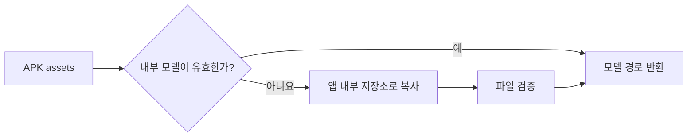
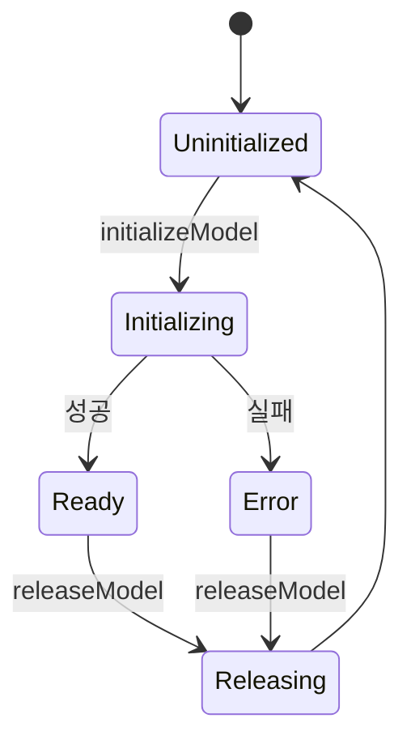

# Phase 2 MNN 네이티브 런타임 구현 계획 (이전 구현 기록)

> 이 문서는 2026-08-16 당시 Qwen/MNN 구현 기록이다. 현재 런타임은 Bllossom GGUF/llama.cpp로 교체되었으며, 최신 구조는 [Bllossom 전환 설계](./bllossom-3b-on-device-migration-plan.md)를 따른다.

## 1. 문서 목적

이 문서는 [AI 페이즈별 구현 계획](./ai-implementation-roadmap.md)의 Phase 2를 실제 개발 순서로 구체화한다.

Phase 2의 목표는 Expo Go가 아닌 오늘도 Android Development Build에서 React Native가 MNN 런타임을 통해 Qwen3.5-0.8B 모델을 호출할 수 있게 만드는 것이다.

이 단계에서는 AI 힌트, AI NPC, 자유 대화와 출력 안전 정책을 구현하지 않는다. 한국어 문자열을 모델에 전달하고 생성 결과를 안전하게 돌려받는 공통 런타임까지만 구현한다.

## 2. 구현 원칙

- 각 단계가 끝날 때 빌드 또는 테스트로 결과를 확인한 뒤 다음 단계로 이동한다.
- 구현을 시작하기 전에 해당 작업이 필요한 이유와 완료 기준을 먼저 확인한다.
- 모델 추론은 Android UI 스레드 밖에서 실행한다.
- 모델은 중복으로 로딩하지 않는다.
- 동시에 여러 생성 요청을 실행하지 않는다.
- 화면 이동, 요청 취소와 앱 상태 변경이 발생해도 앱이 종료되지 않아야 한다.
- 지원하지 않는 환경에서는 명확한 상태를 반환하고 기존 정적 기능을 유지한다.
- 생성된 문자열의 정책 검증과 fallback은 Phase 3에서 구현한다.

## 3. Phase 2 범위

### 포함하는 작업

- Android 개발 환경과 Development Build 검증
- MNN Android 라이브러리 연결
- 로컬 Expo 네이티브 모듈 구성
- Android asset에 포함된 Qwen 모델 파일 준비
- 모델 초기화, 텍스트 생성, 취소와 해제
- 런타임 상태와 동시 요청 관리
- 네이티브 오류의 구조화
- Android 기기 및 MuMu Player 검증

### 포함하지 않는 작업

- 백엔드 API와 데이터베이스 변경
- 퀘스트 정답과 보상 판정
- 힌트 단계 결정
- 프롬프트 개인정보 제거
- 생성 결과의 길이·금지 표현·허용 행동 검증
- 정적 힌트 fallback
- AI NPC와 자유 대화 연결
- 사용자 난이도 추천

## 4. 목표 구조


MNN이 필요한 LLM 기능을 안정적인 Java/Kotlin API로 제공하면 C++ 래퍼를 생략한다. 필요한 LLM API가 C++에만 있다면 Kotlin과 MNN 사이에 JNI/C++ 래퍼를 둔다. 연결 방식은 2단계의 최소 실험 결과로 결정한다.

## 5. 구현 단계 요약


## 6. 단계별 구현 계획

### 1단계 — 개발 환경 확인

#### 필요한 이유

Java, Android SDK, Gradle, 기기 연결 문제와 MNN 연결 문제를 분리하기 위해 필요하다. 기존 앱의 Android 빌드가 먼저 성공해야 이후에 발생하는 오류를 MNN 변경에서 찾을 수 있다.

#### 작업

- Java와 Android SDK 설치 및 경로 확인
- Gradle이 사용할 JDK 확인
- `adb`를 통한 Android 기기 또는 에뮬레이터 연결 확인
- 프론트엔드 의존성 설치와 TypeScript 검사
- Qwen 모델 다운로드와 manifest 기반 무결성 검사
- 기존 오늘도 Development Build 실행 확인

#### 완료 기준

- Java와 `adb` 명령을 실행할 수 있다.
- Android 기기가 `adb devices`에 표시된다.
- 프론트엔드 타입 검사가 통과한다.
- Qwen 모델의 모든 파일이 manifest 검증을 통과한다.
- MNN을 추가하기 전 기존 앱이 Android에서 실행된다.

#### 실행 결과 — 완료 (2026-08-16)

- Eclipse Temurin JDK 17.0.20과 Gradle 8.14.3을 확인했다. Gradle Launcher/Daemon JVM 모두 JDK 17을 사용한다.
- Android SDK는 `%LOCALAPPDATA%\Android\Sdk`에 설치되어 있다. `ANDROID_HOME`, `ANDROID_SDK_ROOT`와 사용자 `PATH`의 `platform-tools` 항목을 등록했다.
- Android SDK Platform 36, Build Tools 36.0.0, NDK 27.1.12297006 조합으로 기준 빌드를 확인했다.
- `pnpm typecheck`가 통과했다.
- `pnpm model:qwen:download`로 고정 리비전의 텍스트 모델을 준비했고, `pnpm model:qwen:verify`에서 manifest의 6개 파일이 모두 크기와 SHA-256 검증을 통과했다.
- `expo prebuild --platform android --no-install`에서 모델 6개 파일이 Android asset으로 복사되었다.
- MNN 추가 전 `app:assembleDebug`가 성공했다. 생성된 기준 APK는 582,948,201바이트이며 모델 6개 파일을 모두 포함한다.
- MuMu Player Android 15 인스턴스가 `127.0.0.1:16384`로 `adb devices`에 표시되었다. ABI는 `x86_64`다.
- 기준 APK 설치와 `com.oneuldo.app` 실행에 성공했다. Development Client 화면이 포커스를 얻었고 Android 런타임 크래시는 발생하지 않았다.

다음 단계의 MNN 최소 실험에서는 실제 Android 배포 대상인 `arm64-v8a`와 현재 MuMu Player의 `x86_64` ABI 차이를 별도로 검증한다.

### 2단계 — MNN 최소 연결 실험

#### 필요한 이유

MNN의 배포 방식, 지원 ABI와 Qwen LLM API를 먼저 확인해야 최종 네이티브 모듈 구조를 결정할 수 있다. 이 단계에서 Kotlin API만 사용할지 JNI/C++ 래퍼가 필요한지 결정한다.

#### 작업

- 사용할 MNN 버전과 Android 배포 형식 확정
- `arm64-v8a` 네이티브 라이브러리 연결
- 최소 Gradle 또는 CMake 빌드 수행
- 앱에서 MNN 라이브러리 로딩 확인
- Qwen 모델 실행에 필요한 LLM API 위치 확인

#### 완료 기준

- Android 앱에서 MNN 네이티브 라이브러리를 로드한다.
- `UnsatisfiedLinkError` 없이 최소 호출이 성공한다.
- Kotlin 직접 연결 또는 JNI/C++ 연결 중 구현 방향이 결정된다.

#### 실행 결과 — MuMu 완료, arm64 실제 기기 확인 대기 (2026-08-16)

- Qwen3.5 지원과 관련 수정이 포함된 MNN 3.6.1, 커밋 `d407447ed56c4121a11ccbd266dc184ca1ead0c2`로 버전을 고정했다.
- 공식 Android 릴리스 바이너리가 ARM만 제공하므로 `arm64-v8a`와 `x86_64`를 동일한 소스와 CMake 옵션으로 빌드한다.
- 두 ABI 모두 LLM, low-memory, Transformer fuse와 OpenCL을 포함한다. `arm64-v8a`에는 ARMv8.2 최적화를 추가한다.
- MNN LLM 공개 API가 C++에 있으므로 Kotlin 직접 연결이 아닌 JNI/C++ 래퍼를 사용하기로 결정했다.
- `pnpm mnn:android:build`로 두 ABI의 `libMNN.so`와 최소 JNI 프로브를 재생성할 수 있다.
- 고정된 네이티브 산출물은 `frontend/vendor/mnn/mnn-android.manifest.json`의 파일 크기와 SHA-256으로 검증한 뒤 APK에 포함한다.
- Android 빌드 ABI를 `arm64-v8a,x86_64`로 제한했고 Debug APK 빌드가 성공했다.
- MuMu Player Android 15 x86_64에서 네이티브 `MNN::getVersion()` 호출이 `3.6.1`을 반환했다. `UnsatisfiedLinkError`와 Android 런타임 크래시는 발생하지 않았다.
- 두 ABI의 `libMNN.so`에서 `MNN::Transformer::Llm::createLLM` 공개 심볼을 확인했다.

실제 `arm64-v8a` Android 기기가 연결되면 동일 APK의 설치, `MNN::getVersion()` 로그와 크래시 여부를 확인해 이 단계를 최종 완료한다.

### 3단계 — 로컬 Expo 네이티브 모듈 구성

#### 필요한 이유

React Native의 TypeScript 코드는 Android의 Kotlin/C++ 기능을 직접 호출할 수 없다. Expo 네이티브 모듈은 두 실행 영역을 연결하고 앱 화면이 안정적인 TypeScript API만 사용하도록 한다.

#### 작업

- `oneuldo-mnn-runtime` 로컬 Expo Module 생성
- TypeScript 공개 API 정의
- Android Kotlin 모듈 등록
- 임시 `getRuntimeVersion` 또는 `getRuntimeStatus` 호출 구현
- Expo Go와 미지원 플랫폼 처리

#### 완료 기준

- TypeScript에서 Kotlin 비동기 함수를 호출할 수 있다.
- Development Build가 네이티브 모듈을 정상적으로 찾는다.
- 네이티브 모듈이 없는 환경에서는 앱이 종료되지 않고 미지원 상태를 반환한다.

#### 실행 결과 — 완료 (2026-08-16)

- `oneuldo-mnn-runtime` 로컬 Expo Module을 만들고 Expo autolinking에 `com.oneuldo.mnn.OneuldoMnnRuntimeModule`을 등록했다.
- TypeScript 공개 계약으로 `getRuntimeStatus(): Promise<NativeRuntimeStatus>`를 정의했다.
- 앱 계층의 `getNativeRuntimeStatus()`는 Android 네이티브 모듈을 선택적으로 찾고, Expo Go·Web·iOS처럼 모듈이 없거나 Android가 아닌 환경에서는 예외 대신 `unsupported` 상태를 반환한다.
- Kotlin 비동기 함수가 JNI 프로브의 `MNN::getVersion()`을 호출하고 MNN 버전, ABI와 초기 상태를 TypeScript에 반환한다.
- 기존 앱 시작 흐름에는 개발 모드 진단 호출만 추가했다. 실제 AI 화면과 모델 초기화는 아직 연결하지 않았다.
- 기존 시작용 `ContentProvider` 프로브를 제거하고 라이브러리 로드와 상태 호출의 책임을 Expo 모듈로 옮겼다.
- Expo autolinking 결과와 Gradle Debug APK 빌드에서 로컬 모듈과 두 ABI의 네이티브 라이브러리 포함을 확인했다.
- MuMu Player x86_64 Development Build에서 TypeScript 호출이 Kotlin과 JNI를 통과해 `{ supported: true, runtimeVersion: "3.6.1", abi: "x86_64", state: "uninitialized" }`를 반환했다. 프로세스는 정상 유지되었다.
- `pnpm typecheck`와 Jest 4개 스위트 14개 테스트가 통과했다. 기존 App 테스트의 React `act(...)` 경고는 남아 있으나 테스트 실패는 없다.

이 단계의 `uninitialized`는 네이티브 런타임 연결은 확인했지만 Qwen 모델 객체는 아직 만들지 않았다는 뜻이다. 모델 파일 준비는 4단계, 실제 런타임 초기화는 5단계에서 진행한다.

### 4단계 — 모델 파일 준비

#### 필요한 이유

MNN이 APK 내부 asset을 파일 경로로 직접 열지 못할 수 있다. 런타임이 모델을 안정적으로 읽을 수 있도록 파일의 존재와 무결성을 확인하고, 필요하면 앱 내부 저장소로 복사해야 한다.

#### 작업

- Android asset 모델 경로 확인
- manifest 기준 파일 목록과 크기 검사
- 필요할 경우 앱 내부 저장소로 모델 복사
- 이미 준비된 동일 모델의 중복 복사 방지
- 복사 실패와 저장 공간 부족 처리

#### 처리 흐름



#### 완료 기준

- 런타임이 읽을 수 있는 모델 디렉터리 경로를 얻는다.
- 누락 또는 손상 파일을 초기화 전에 발견한다.
- 동일 버전 모델을 매번 다시 복사하지 않는다.

#### 실행 결과 — 완료 (2026-08-16)

- Android asset의 `models/qwen3.5-0.8b-mnn`에 모델 6개 파일과 원본 manifest를 함께 포함한다.
- prebuild 단계에서 모든 원본 파일의 크기와 SHA-256을 검사한 뒤 Android asset으로 복사한다.
- `ModelAssetManager`가 manifest를 읽어 앱 전용 `noBackupFilesDir/models/qwen3.5-0.8b-mnn` 디렉터리를 준비한다.
- 첫 준비에서는 `.preparing` 임시 디렉터리로 파일을 스트리밍 복사하면서 크기와 SHA-256을 다시 검증한다. 검증이 모두 끝난 후에만 최종 디렉터리로 전환한다.
- 준비 완료 marker의 리비전과 각 파일 크기가 현재 manifest와 일치하면 기존 디렉터리를 재사용한다.
- 복사 전 모델 전체 크기와 64 MiB 여유 공간을 확인하며 부족하면 `INSUFFICIENT_STORAGE` 오류를 반환한다.
- 누락 asset은 `MODEL_MISSING`, manifest나 checksum 불일치는 `MODEL_CORRUPTED`, 일반 파일 준비 실패는 `INITIALIZATION_FAILED`로 구분한다.
- TypeScript 공개 API에 `prepareNativeModel()`을 추가했다. Expo Go와 미지원 플랫폼에서는 예외 없이 미지원 결과를 반환한다.
- MuMu Player x86_64 첫 실행에서 6개 파일, 총 484,349,697바이트를 복사하고 `/data/user/0/com.oneuldo.app/no_backup/models/qwen3.5-0.8b-mnn` 경로를 반환했다.
- 두 번째 실행은 `reused: true`를 반환하며 복사를 건너뛰었다.
- 내부 `config.json`을 의도적으로 누락시킨 검증에서는 다음 실행이 손상을 감지해 모델 전체를 다시 검증·복구하고 `reused: false`를 반환했다. 복구 후 6개 파일과 앱 프로세스가 모두 정상임을 확인했다.

이 단계는 MNN이 열 수 있는 실제 파일 시스템 경로를 준비한 것이다. 아직 이 경로로 MNN LLM 객체를 만들지는 않았으며, 해당 작업은 5단계에서 진행한다.

### 5단계 — 모델 초기화

#### 필요한 이유

모델 생성 전에 설정, tokenizer, weight와 MNN LLM 객체를 준비해야 한다. 초기화는 시간과 메모리를 많이 사용할 수 있으므로 한 번만 실행하고 상태를 명확히 관리해야 한다.

#### 작업

- 모델 설정과 tokenizer 로딩
- MNN LLM 객체 생성 및 초기화
- 중복 초기화 방지
- 초기화 작업을 UI 스레드 밖에서 실행
- 초기화 시간과 실패 사유 반환

#### 상태 흐름



#### 완료 기준

- Qwen 모델이 정상적으로 초기화된다.
- 중복 호출이 두 번째 모델 인스턴스를 만들지 않는다.
- 실패 시 앱 종료 대신 구조화된 오류를 반환한다.
- TypeScript에서 현재 런타임 상태를 확인할 수 있다.

#### 실행 결과 — MuMu 완료, arm64 실제 기기 확인 대기 (2026-08-16)

- TypeScript 공개 API에 `initializeNativeModel()`을 추가하고 `uninitialized`, `initializing`, `ready`, `error`, `unsupported` 상태와 초기화 시간·오류 정보를 반환하도록 확장했다.
- Kotlin `MnnRuntimeManager`가 모델 파일 준비, 실행 설정 생성, JNI 초기화 호출과 상태 관리를 담당한다. Expo 비동기 함수의 기본 모듈 큐에서 실행하므로 UI 스레드를 막지 않는다.
- JNI/C++ 브리지가 `MNN::Transformer::Llm::createLLM()`과 `load()`를 호출한다. `load()`까지 성공한 객체만 프로세스 전역 런타임으로 보관한다.
- 프로세스 전역 런타임과 Kotlin의 동기화된 상태 검사로 중복 초기화를 막는다. 두 번째 호출은 새 객체를 만들지 않고 `alreadyInitialized: true`를 반환한다.
- 다운로드한 텍스트 전용 모델에는 `visual.mnn`이 없지만 원본 `llm_config.json`은 시각 모델 플래그가 켜져 있다. 원본 checksum 파일은 수정하지 않고 `.oneuldo-text-llm-config.json`과 `.oneuldo-runtime-config.json`을 생성해 `is_visual`과 `has_deepstack`을 끈다.
- MNN을 `LLM_LOG_TO_STRING=ON`으로 다시 빌드해 네이티브 초기화 실패 로그를 Kotlin으로 전달하고, 앱 종료 대신 `INITIALIZATION_FAILED` 구조화 상태로 반환한다.
- `arm64-v8a`와 `x86_64`의 `libMNN.so`, `liboneuldo_mnn_probe.so`를 다시 빌드하고 크기와 SHA-256을 vendor manifest에 갱신했다.
- MuMu Player Android 15 x86_64에서 484,349,697바이트 Qwen 모델의 최초 초기화가 3,804ms에 완료되어 `state: "ready"`를 반환했다.
- 같은 앱 프로세스에서 즉시 다시 호출했을 때 최초 초기화 시간은 유지되고 `alreadyInitialized: true`가 반환되어 모델 재로딩이 없음을 확인했다.
- TypeScript 검사, Jest 4개 스위트 18개 테스트, Expo prebuild와 두 ABI Debug APK 빌드가 모두 통과했다.

실제 `arm64-v8a` Android 기기가 연결되면 동일한 최초 초기화, 중복 호출과 크래시 여부를 확인해 이 단계의 기기 검증을 마무리한다. 모델 해제 API는 생성·취소 흐름과 수명 정책을 함께 다루는 이후 단계에서 구현한다.

### 6단계 — 첫 한국어 텍스트 생성

#### 필요한 이유

React Native에서 전달한 문자열이 MNN과 Qwen을 거쳐 다시 React Native로 돌아오는 전체 경로를 증명하는 Phase 2의 핵심 단계다.

#### 초기 계약

```ts
type GenerateRequest = {
  requestId: string;
  prompt: string;
  maxTokens: number;
  timeoutMs: number;
};

type GenerateResult = {
  requestId: string;
  text: string;
  latencyMs: number;
};
```

#### 작업

- 한국어 프롬프트를 네이티브 계층으로 전달
- 최대 생성 토큰 제한 적용
- 생성 결과를 UTF-8 문자열로 반환
- 생성 소요 시간 측정
- UI 스레드가 멈추지 않는지 확인

#### 완료 기준

- React Native가 전달한 한국어 프롬프트로 결과를 생성한다.
- 요청 ID, 생성 문자열과 지연 시간을 반환한다.
- 생성 중에도 화면 조작과 렌더링이 멈추지 않는다.

#### 실행 결과 — MuMu 완료, arm64 실제 기기 확인 대기 (2026-08-16)

- TypeScript에 `GenerateRequest`, `GenerateResult`와 `generateNativeText()` 공개 API를 추가했다. 요청은 `requestId`, `prompt`, `maxTokens`, `timeoutMs`를 받고 결과는 동일한 요청 ID, 생성 문자열과 지연 시간을 반환한다.
- Kotlin `MnnRuntimeManager`가 빈 요청 ID·프롬프트, 1~256 범위를 벗어난 토큰 수, 잘못된 timeout과 초기화 전 호출을 검사한다.
- Expo `AsyncFunction("generateText")`가 모듈 작업 큐에서 Kotlin 생성 함수를 실행해 UI 스레드와 긴 네이티브 추론을 분리한다.
- JNI/C++ 브리지가 기존 프로세스 전역 MNN LLM 객체를 재사용하고 `response(prompt, output, nullptr, maxTokens)`로 최대 생성 토큰 수를 직접 전달한다.
- 각 단독 요청 전에 MNN KV cache를 `reset()`해 이전 개발 진단 문맥이 다음 결과에 섞이지 않도록 했다. 동시 요청의 명시적 `BUSY` 처리와 요청 ID 점유 관리는 7단계에서 추가한다.
- Java/Kotlin UTF-16과 표준 UTF-8 사이를 직접 변환하도록 JNI 문자열 처리를 보강했다. 한국어 입력뿐 아니라 surrogate pair가 필요한 이모지 출력도 손실 없이 왕복한다.
- 모델 원본 설정과 checksum은 변경하지 않고 실행용 `.oneuldo-runtime-config.json`에서 `enable_thinking: false`를 적용했다. 짧은 모바일 생성이 내부 생각 토큰만 소비하지 않게 하기 위해서다.
- 네이티브 생성 실패, 빈 출력과 초기화 전 호출은 앱 크래시 대신 `GENERATION_FAILED` 또는 `NOT_INITIALIZED` 예외로 Kotlin에 전달한다. 전체 오류 결과 계약은 9단계에서 통일한다.
- MuMu Player Android 15 x86_64에서 `phase2-ko-001` 요청과 한국어 프롬프트를 32토큰 제한으로 전달해 `오늘은 날! 😍✨`를 생성했다. 생성 지연 시간은 460ms였다.
- 같은 실행 로그에서 모델 초기화는 2,145ms였으며 생성은 기존 런타임을 재사용했다. Android 로그에 skipped frame, ANR, fatal exception과 native crash가 없었다.
- TypeScript 검사, Jest 4개 스위트 20개 테스트, 두 ABI JNI 빌드, Expo prebuild와 Debug APK 빌드가 모두 통과했다.

실제 `arm64-v8a` Android 기기가 연결되면 동일 프롬프트의 한국어·이모지 왕복, 지연 시간, 화면 응답성과 크래시 여부를 확인해 기기 검증을 마무리한다. `timeoutMs`는 현재 입력 유효성만 확인하며 실행 중 안전한 중단은 8~9단계에서 취소 기능과 함께 연결한다.

### 7단계 — 런타임 상태와 동시 요청 제어

#### 필요한 이유

초기화와 생성이 겹치거나 여러 생성이 동시에 실행되면 메모리 사용 증가, 상태 손상과 크래시가 발생할 수 있다. 런타임 접근을 한곳에서 직렬화해야 한다.

#### 작업

- 초기화 전 생성 거부
- 동시에 하나의 생성만 허용
- 중복 `requestId` 검사
- 상태 전환 동기화
- Promise가 한 번만 완료되도록 보장

#### 완료 기준

- 생성 버튼을 반복해서 눌러도 하나의 추론만 실행된다.
- 초기화 중이거나 생성 중인 호출은 명확한 상태 또는 오류를 받는다.
- 런타임이 교착 상태에 빠지지 않는다.

#### 실행 결과 — MuMu 완료, arm64 실제 기기 확인 대기 (2026-08-16)

- 런타임 상태에 `generating`, `releasing`을 추가하고 현재 실행 중인 `activeRequestId`를 상태 응답에 포함했다.
- Expo `AsyncFunction`의 직렬 큐에 요청이 쌓이기 전에 TypeScript가 동기 `reserveGeneration()`을 호출한다. 따라서 빠르게 두 번 누른 요청이 나중에 순서대로 실행되지 않고 두 번째 호출이 즉시 `BUSY`를 받는다.
- Kotlin `MnnRuntimeManager`가 초기화·생성·해제 상태 전이를 하나의 잠금으로 보호하고, C++도 별도의 런타임 잠금과 활성 요청 ID로 방어한다.
- 이미 사용한 `requestId`는 최근 100개까지 기억한다. 같은 ID의 재요청은 `BUSY`로 거부해 늦게 도착한 결과가 새 요청의 결과처럼 처리되는 것을 막는다.
- 예약된 요청만 네이티브 생성을 시작할 수 있으며 성공·실패·취소 어느 경로에서도 활성 요청과 상태를 한 번만 정리한다. TypeScript Promise도 한 번만 완료된다.
- MuMu Player에서 256토큰 생성 중 두 번째 요청을 보냈을 때 두 번째 요청은 `BUSY`, 첫 번째 요청 취소 후에는 `CANCELLED`를 받았다. 교착과 앱 크래시는 발생하지 않았다.

실제 `arm64-v8a` Android 기기에서는 빠른 연속 입력과 생성 중 상태 조회를 한 번 더 확인해야 한다. 구현과 `x86_64` 통합 검증은 완료했다.

### 8단계 — 생성 취소와 메모리 해제

#### 필요한 이유

사용자가 화면을 이동하거나 앱을 백그라운드로 전환할 수 있다. 사용하지 않는 추론과 모델 메모리를 안전하게 정리해야 앱 크래시와 메모리 누수를 방지할 수 있다.

#### 작업

- `requestId` 기반 생성 취소
- 취소된 생성 결과 폐기
- MNN이 지원하는 경우 토큰 생성 중단
- 모델과 네이티브 자원 해제
- 해제 후 재초기화 검증
- 앱 생명주기와 해제 정책 연결

#### 완료 기준

- 생성 중 화면을 이동해도 앱이 종료되지 않는다.
- 취소된 결과가 화면에 표시되지 않는다.
- 모델 해제 후 다시 초기화하고 생성할 수 있다.

#### 실행 결과 — MuMu 완료, arm64 실제 기기 확인 대기 (2026-08-16)

- `cancelNativeGeneration(requestId)`를 TypeScript, Expo Module, Kotlin과 JNI/C++ 전 구간에 연결했다.
- 취소 플래그는 네이티브 생성의 토큰 경계마다 확인한다. 취소된 요청은 생성 문자열 대신 `CANCELLED` 오류로 종료되므로 화면에 부분 결과가 전달되지 않는다.
- 네이티브 호출이 시작되기 전 취소도 놓치지 않도록 Kotlin이 취소된 요청 ID를 별도로 보관한다. 현재 요청이 아닌 ID의 취소는 안전하게 `cancelled: false`를 반환한다.
- `releaseNativeModel()`은 진행 중인 생성에 취소를 알리고 네이티브 잠금을 기다린 다음 전역 MNN 객체를 파괴한다. Kotlin 상태와 활성 요청 ID도 `uninitialized`로 초기화한다.
- Android `AppState`가 `background` 또는 `inactive`로 바뀌면 모델을 자동 해제하도록 앱 수명주기 정책을 연결했다.
- MuMu Player에서 취소 결과 `CANCELLED`, 명시적 해제 `released: true`, 해제 후 초기화와 한국어 생성 2회 성공을 확인했다.
- 백그라운드 전환 전후 앱 PID는 `8394`로 유지되어 프로세스가 종료되지 않았다. 자동 해제 후 PSS는 894,559KB에서 390,104KB로 504,455KB 감소했고 native heap은 705,712KB에서 209,788KB로 495,924KB 감소했다.

실제 `arm64-v8a` Android 기기에서는 제조사별 수명주기와 메모리 회수량을 추가 측정해야 한다. MuMu에서는 화면 이동에 해당하는 백그라운드·복귀, 취소·해제·재초기화 흐름이 모두 정상 동작했다.

### 9단계 — 오류 체계와 미지원 환경 처리

#### 필요한 이유

화면이 네이티브 내부 오류 문자열을 해석하게 두면 플랫폼과 구현에 강하게 결합된다. 오류 코드를 통일해야 Phase 3에서 모든 실패를 같은 방식으로 fallback 처리할 수 있다.

#### 초기 오류 코드

```ts
type RuntimeErrorCode =
  | 'UNSUPPORTED'
  | 'MODEL_MISSING'
  | 'MODEL_CORRUPTED'
  | 'INSUFFICIENT_STORAGE'
  | 'INITIALIZATION_FAILED'
  | 'NOT_INITIALIZED'
  | 'BUSY'
  | 'CANCELLED'
  | 'TIMEOUT'
  | 'GENERATION_FAILED';
```

#### 작업

- Kotlin/C++ 예외를 공통 오류 코드로 변환
- 모델 누락, 손상과 저장 공간 부족 구분
- 생성 시간 초과 처리
- Expo Go, Web, iOS와 미지원 ABI 처리
- 오류 후 런타임 상태 복구 확인

#### 완료 기준

- 예상한 모든 실패에서 앱이 종료되지 않는다.
- TypeScript가 오류 원인을 코드로 구분할 수 있다.
- 미지원 환경에서도 기존 정적 기능이 정상 동작한다.

#### 실행 결과 — 완료 (2026-08-16)

- 문서에 정의한 10개 오류 코드를 `RuntimeErrorCode` 공용 타입과 `NativeRuntimeError`에 그대로 반영했다.
- Kotlin의 `CodedException`, JNI의 `[text, errorCode, errorMessage]` 결과와 C++ `GenerationResult`를 연결해 네이티브 내부 실패가 TypeScript의 구조화된 오류 코드로 도착한다.
- 모델 준비 단계의 `MODEL_MISSING`, `MODEL_CORRUPTED`, `INSUFFICIENT_STORAGE`, `INITIALIZATION_FAILED`와 런타임 단계의 `NOT_INITIALIZED`, `BUSY`, `CANCELLED`, `TIMEOUT`, `GENERATION_FAILED`를 구분한다.
- 생성 제한 시간을 C++ 토큰 루프의 경과 시간 검사에 연결했다. MuMu에서 `timeoutMs: 1` 요청이 앱 종료 없이 `TIMEOUT`을 반환했다.
- 시간 초과 뒤 MNN 내부 상태가 남아 다음 생성이 빈 문자열을 반환하는 문제를 발견했다. 오류·취소 경로에서 KV cache를 `reset()`하고 `generate_init()`으로 생성 상태를 복구하도록 수정했으며, 이후 재초기화·재생성 2회가 성공했다.
- Android가 아니거나 로컬 네이티브 모듈이 없는 환경은 상태 조회·모델 준비에서 `unsupported`를 반환하고, 생성·취소·해제에서는 `UNSUPPORTED` 오류를 반환한다.
- Jest에서 미지원 분기, 예약 전달, `BUSY` 정규화, 취소와 해제 계약을 포함해 4개 스위트 23개 테스트가 통과했다.

### 10단계 — 통합 검증과 문서화

#### 필요한 이유

개별 함수가 성공해도 반복 실행, 화면 이동과 앱 상태 전환이 합쳐지면 문제가 발생할 수 있다. 실제 사용 흐름을 반복 검증하고 다른 개발자가 재현할 수 있게 기록해야 Phase 3의 안정적인 기반이 된다.

#### 검증 흐름

```text
지원 여부 확인
→ 모델 준비
→ 모델 초기화
→ 한국어 생성
→ 생성 취소
→ 모델 해제
→ 재초기화
→ 다시 생성
```

#### 작업

- Android arm64 기기에서 전체 흐름 검증
- MuMu Player에서 로딩, 생성과 오류 처리 검증
- 화면 이동과 백그라운드 전환 검증
- 반복 생성과 재초기화 검증
- 초기화 시간, 생성 지연과 메모리 사용량 기록
- 설치·빌드·테스트 절차 문서화

#### 완료 기준

- React Native 화면에서 한국어 입력과 생성 결과를 주고받는다.
- 취소, 화면 이동과 앱 상태 전환에서 크래시가 발생하지 않는다.
- 지원하지 않는 환경에서는 명확한 상태를 반환한다.
- 다른 개발자가 문서만으로 Development Build를 재현할 수 있다.

#### 실행 결과 — MuMu 완료, arm64 실제 기기 확인 대기 (2026-08-16)

- MuMu Player Android 15 `x86_64`에서 지원 확인 → 모델 준비 → 초기화 → 한국어 생성 → 동시 요청 거부 → 시간 초과 → 생성 취소 → 모델 해제 → 재초기화 → 재생성 전체 흐름을 실행했다.
- 대표 실행에서 최초 초기화는 1,795ms, 한국어 32토큰 생성은 630ms였다. 결과 `오늘은 하루가 다르게 시작하며, 정말 좋은일 있네요!✨`가 UTF-8 손실 없이 React Native 로그에 도착했다.
- 해제 후 복구 검증 1회차는 초기화 1,606ms·생성 416ms, 2회차는 초기화 1,618ms·생성 649ms였으며 두 번 모두 한국어 문자열을 반환했다.
- 백그라운드·포그라운드 전환 동안 PID가 유지됐고 FATAL EXCEPTION, ANR과 native crash 로그가 없었다. 백그라운드 자동 해제로 PSS가 약 492.6MiB 감소했다.
- `arm64-v8a`와 `x86_64` 네이티브 라이브러리를 동일한 고정 MNN 소스에서 빌드하고 manifest의 크기·SHA-256을 갱신했다. Expo prebuild와 Android Debug APK 빌드가 성공했다.
- `pnpm typecheck`, Jest 4개 스위트 23개 테스트, Qwen 모델 6개 파일 checksum 검증을 통과했다.
- 설치·빌드·검증 순서, 공개 API, 상태 전이, 오류 코드, 파일별 변경 내용과 측정 결과는 `phase2-implementation-summary.md`에 정리했다.

현재 연결된 Android 장치가 MuMu Player `x86_64`뿐이므로 실제 `arm64-v8a` 기기의 성능·메모리·백그라운드 검증은 완료로 표시하지 않는다. 해당 기기가 연결되면 요약 문서의 체크리스트와 같은 명령·흐름으로 최종 확인한다.

## 7. 예상 파일 구조

최종 파일명은 2단계의 MNN 연결 실험 결과에 따라 조정할 수 있다.

```text
frontend/
├── modules/
│   └── oneuldo-mnn-runtime/
│       ├── package.json
│       ├── expo-module.config.json
│       ├── index.ts
│       ├── src/
│       │   ├── OneuldoMnnRuntimeModule.ts
│       │   └── types.ts
│       └── android/
│           ├── build.gradle
│           ├── CMakeLists.txt                  # C++ 연결 시
│           └── src/main/
│               ├── AndroidManifest.xml
│               ├── java/com/oneuldo/mnn/
│               │   ├── OneuldoMnnRuntimeModule.kt
│               │   ├── MnnRuntimeManager.kt
│               │   └── ModelAssetManager.kt
│               └── cpp/                       # C++ 연결 시
│                   ├── mnn_runtime_bridge.cpp
│                   └── mnn_runtime_bridge.h
├── src/
│   └── ai/
│       ├── nativeRuntime.ts
│       └── nativeRuntime.types.ts
└── __tests__/
    └── NativeRuntime.test.ts
```

## 8. 기존 파일 변경 예상

| 파일 | 예상 변경 |
|---|---|
| `frontend/package.json` | 로컬 모듈, 의존성 및 검증 명령 등록 |
| `frontend/pnpm-lock.yaml` | 추가 의존성 반영 |
| `frontend/app.json` | 필요한 config plugin 또는 Android 설정 등록 |
| `frontend/plugins/with-qwen-model.js` | 런타임에 맞는 모델 배치와 검증 처리 |
| `docs/qwen-model-setup.md` | Development Build와 런타임 실행 방법 추가 |
| `docs/ai/ai-implementation-roadmap.md` | Phase 2 완료 상태만 반영 |

개발 진단 UI가 필요하면 `frontend/App.tsx` 또는 별도의 개발 전용 화면을 최소한으로 수정한다. 실제 AI 친구 화면과 퀘스트 힌트 연결은 Phase 2에서 진행하지 않는다.

## 9. 네이티브 런타임 공개 API

초기 공개 API는 기능별 AI 작업이 아니라 런타임 제어에 집중한다.

```ts
initializeModel(): Promise<RuntimeStatus>;
generate(request: GenerateRequest): Promise<GenerateResult>;
cancel(requestId: string): Promise<void>;
releaseModel(): Promise<void>;
getRuntimeStatus(): Promise<RuntimeStatus>;
```

화면은 MNN, JNI, C++ 객체와 Android 파일 경로를 직접 알지 않는다. 네이티브 구현 세부 사항은 모듈 내부에 숨기고 TypeScript 계약만 사용한다.

## 10. 테스트 구분

| 환경 | 검증 대상 |
|---|---|
| Jest | TypeScript 계약, 플랫폼 분기와 오류 변환 |
| Android Development Build | 모듈 로딩, 실제 초기화, 생성, 취소와 해제 |
| Android arm64 기기 | 성능, 메모리, 백그라운드 전환과 반복 실행 |
| MuMu Player | ABI 호환, 모듈·모델 로딩과 오류 처리 |
| Expo Go/Web/iOS | 미지원 상태와 정적 기능 유지 |

## 11. Phase 2 최종 완료 조건

- Android Development Build에서 MNN과 Qwen 모델을 초기화한다.
- React Native가 한국어 프롬프트를 전달하고 생성 문자열을 받는다.
- 추론이 UI 스레드를 차단하지 않는다.
- 모델 중복 로딩과 동시 생성을 방지한다.
- 생성 취소와 모델 해제 후에도 앱이 정상 동작한다.
- 모델 누락, 손상, 저장 공간 부족과 초기화 실패를 구분한다.
- 지원하지 않는 환경에서는 명확한 상태를 반환하고 기존 기능을 유지한다.
- 실행과 검증 절차가 문서화되어 다른 개발자가 재현할 수 있다.

Phase 2가 완료되면 Phase 3에서 이 런타임 위에 AI 입출력 계약, 프롬프트 구성, 출력 정책 검증과 정적 fallback을 구현한다.
