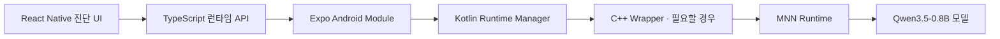
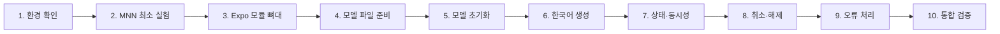
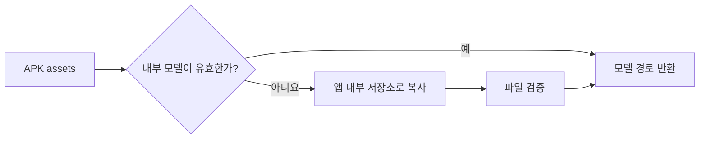
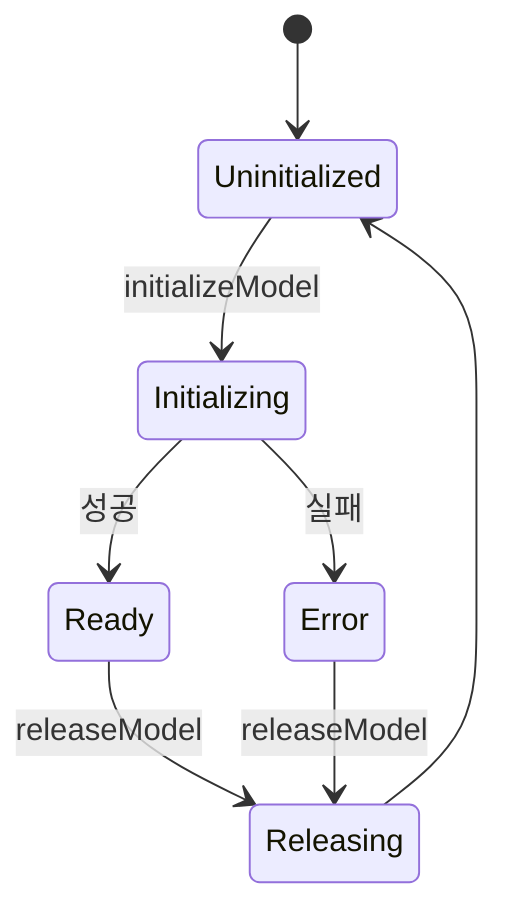

# Phase 2 MNN 네이티브 런타임 구현 계획

## 1. 문서 목적

이 문서는 [AI 페이즈별 구현 계획](./ai-implementation-roadmap.md)의 Phase 2를 실제 개발 순서로 구체화한다.

Phase 2의 목표는 Expo Go가 아닌 오늘도 Android Development Build에서 React Native가 MNN 런타임을 통해 Qwen3.5-0.8B 모델을 호출할 수 있게 만드는 것이다.

이 단계에서는 AI 힌트, AI NPC, 자유 대화와 출력 안전 정책을 구현하지 않는다. 한국어 문자열을 모델에 전달하고 생성 결과를 안전하게 돌려받는 공통 런타임까지만 구현한다.

## 2. 구현 원칙

- 각 단계가 끝날 때 빌드 또는 테스트로 결과를 확인한 뒤 다음 단계로 이동한다.
- 구현을 시작하기 전에 해당 작업이 필요한 이유와 완료 기준을 먼저 확인한다.
- 모델 추론은 Android UI 스레드 밖에서 실행한다.
- 모델은 중복으로 로딩하지 않는다.
- 동시에 여러 생성 요청을 실행하지 않는다.
- 화면 이동, 요청 취소와 앱 상태 변경이 발생해도 앱이 종료되지 않아야 한다.
- 지원하지 않는 환경에서는 명확한 상태를 반환하고 기존 정적 기능을 유지한다.
- 생성된 문자열의 정책 검증과 fallback은 Phase 3에서 구현한다.

## 3. Phase 2 범위

### 포함하는 작업

- Android 개발 환경과 Development Build 검증
- MNN Android 라이브러리 연결
- 로컬 Expo 네이티브 모듈 구성
- Android asset에 포함된 Qwen 모델 파일 준비
- 모델 초기화, 텍스트 생성, 취소와 해제
- 런타임 상태와 동시 요청 관리
- 네이티브 오류의 구조화
- Android 기기 및 MuMu Player 검증

### 포함하지 않는 작업

- 백엔드 API와 데이터베이스 변경
- 퀘스트 정답과 보상 판정
- 힌트 단계 결정
- 프롬프트 개인정보 제거
- 생성 결과의 길이·금지 표현·허용 행동 검증
- 정적 힌트 fallback
- AI NPC와 자유 대화 연결
- 사용자 난이도 추천

## 4. 목표 구조



MNN이 필요한 LLM 기능을 안정적인 Java/Kotlin API로 제공하면 C++ 래퍼를 생략한다. 필요한 LLM API가 C++에만 있다면 Kotlin과 MNN 사이에 JNI/C++ 래퍼를 둔다. 연결 방식은 2단계의 최소 실험 결과로 결정한다.

## 5. 구현 단계 요약



## 6. 단계별 구현 계획

### 1단계 — 개발 환경 확인

#### 필요한 이유

Java, Android SDK, Gradle, 기기 연결 문제와 MNN 연결 문제를 분리하기 위해 필요하다. 기존 앱의 Android 빌드가 먼저 성공해야 이후에 발생하는 오류를 MNN 변경에서 찾을 수 있다.

#### 작업

- Java와 Android SDK 설치 및 경로 확인
- Gradle이 사용할 JDK 확인
- `adb`를 통한 Android 기기 또는 에뮬레이터 연결 확인
- 프론트엔드 의존성 설치와 TypeScript 검사
- Qwen 모델 다운로드와 manifest 기반 무결성 검사
- 기존 오늘도 Development Build 실행 확인

#### 완료 기준

- Java와 `adb` 명령을 실행할 수 있다.
- Android 기기가 `adb devices`에 표시된다.
- 프론트엔드 타입 검사가 통과한다.
- Qwen 모델의 모든 파일이 manifest 검증을 통과한다.
- MNN을 추가하기 전 기존 앱이 Android에서 실행된다.

### 2단계 — MNN 최소 연결 실험

#### 필요한 이유

MNN의 배포 방식, 지원 ABI와 Qwen LLM API를 먼저 확인해야 최종 네이티브 모듈 구조를 결정할 수 있다. 이 단계에서 Kotlin API만 사용할지 JNI/C++ 래퍼가 필요한지 결정한다.

#### 작업

- 사용할 MNN 버전과 Android 배포 형식 확정
- `arm64-v8a` 네이티브 라이브러리 연결
- 최소 Gradle 또는 CMake 빌드 수행
- 앱에서 MNN 라이브러리 로딩 확인
- Qwen 모델 실행에 필요한 LLM API 위치 확인

#### 완료 기준

- Android 앱에서 MNN 네이티브 라이브러리를 로드한다.
- `UnsatisfiedLinkError` 없이 최소 호출이 성공한다.
- Kotlin 직접 연결 또는 JNI/C++ 연결 중 구현 방향이 결정된다.

### 3단계 — 로컬 Expo 네이티브 모듈 구성

#### 필요한 이유

React Native의 TypeScript 코드는 Android의 Kotlin/C++ 기능을 직접 호출할 수 없다. Expo 네이티브 모듈은 두 실행 영역을 연결하고 앱 화면이 안정적인 TypeScript API만 사용하도록 한다.

#### 작업

- `oneuldo-mnn-runtime` 로컬 Expo Module 생성
- TypeScript 공개 API 정의
- Android Kotlin 모듈 등록
- 임시 `getRuntimeVersion` 또는 `getRuntimeStatus` 호출 구현
- Expo Go와 미지원 플랫폼 처리

#### 완료 기준

- TypeScript에서 Kotlin 비동기 함수를 호출할 수 있다.
- Development Build가 네이티브 모듈을 정상적으로 찾는다.
- 네이티브 모듈이 없는 환경에서는 앱이 종료되지 않고 미지원 상태를 반환한다.

### 4단계 — 모델 파일 준비

#### 필요한 이유

MNN이 APK 내부 asset을 파일 경로로 직접 열지 못할 수 있다. 런타임이 모델을 안정적으로 읽을 수 있도록 파일의 존재와 무결성을 확인하고, 필요하면 앱 내부 저장소로 복사해야 한다.

#### 작업

- Android asset 모델 경로 확인
- manifest 기준 파일 목록과 크기 검사
- 필요할 경우 앱 내부 저장소로 모델 복사
- 이미 준비된 동일 모델의 중복 복사 방지
- 복사 실패와 저장 공간 부족 처리

#### 처리 흐름



#### 완료 기준

- 런타임이 읽을 수 있는 모델 디렉터리 경로를 얻는다.
- 누락 또는 손상 파일을 초기화 전에 발견한다.
- 동일 버전 모델을 매번 다시 복사하지 않는다.

### 5단계 — 모델 초기화

#### 필요한 이유

모델 생성 전에 설정, tokenizer, weight와 MNN LLM 객체를 준비해야 한다. 초기화는 시간과 메모리를 많이 사용할 수 있으므로 한 번만 실행하고 상태를 명확히 관리해야 한다.

#### 작업

- 모델 설정과 tokenizer 로딩
- MNN LLM 객체 생성 및 초기화
- 중복 초기화 방지
- 초기화 작업을 UI 스레드 밖에서 실행
- 초기화 시간과 실패 사유 반환

#### 상태 흐름



#### 완료 기준

- Qwen 모델이 정상적으로 초기화된다.
- 중복 호출이 두 번째 모델 인스턴스를 만들지 않는다.
- 실패 시 앱 종료 대신 구조화된 오류를 반환한다.
- TypeScript에서 현재 런타임 상태를 확인할 수 있다.

### 6단계 — 첫 한국어 텍스트 생성

#### 필요한 이유

React Native에서 전달한 문자열이 MNN과 Qwen을 거쳐 다시 React Native로 돌아오는 전체 경로를 증명하는 Phase 2의 핵심 단계다.

#### 초기 계약

```ts
type GenerateRequest = {
  requestId: string;
  prompt: string;
  maxTokens: number;
  timeoutMs: number;
};

type GenerateResult = {
  requestId: string;
  text: string;
  latencyMs: number;
};
```

#### 작업

- 한국어 프롬프트를 네이티브 계층으로 전달
- 최대 생성 토큰 제한 적용
- 생성 결과를 UTF-8 문자열로 반환
- 생성 소요 시간 측정
- UI 스레드가 멈추지 않는지 확인

#### 완료 기준

- React Native가 전달한 한국어 프롬프트로 결과를 생성한다.
- 요청 ID, 생성 문자열과 지연 시간을 반환한다.
- 생성 중에도 화면 조작과 렌더링이 멈추지 않는다.

### 7단계 — 런타임 상태와 동시 요청 제어

#### 필요한 이유

초기화와 생성이 겹치거나 여러 생성이 동시에 실행되면 메모리 사용 증가, 상태 손상과 크래시가 발생할 수 있다. 런타임 접근을 한곳에서 직렬화해야 한다.

#### 작업

- 초기화 전 생성 거부
- 동시에 하나의 생성만 허용
- 중복 `requestId` 검사
- 상태 전환 동기화
- Promise가 한 번만 완료되도록 보장

#### 완료 기준

- 생성 버튼을 반복해서 눌러도 하나의 추론만 실행된다.
- 초기화 중이거나 생성 중인 호출은 명확한 상태 또는 오류를 받는다.
- 런타임이 교착 상태에 빠지지 않는다.

### 8단계 — 생성 취소와 메모리 해제

#### 필요한 이유

사용자가 화면을 이동하거나 앱을 백그라운드로 전환할 수 있다. 사용하지 않는 추론과 모델 메모리를 안전하게 정리해야 앱 크래시와 메모리 누수를 방지할 수 있다.

#### 작업

- `requestId` 기반 생성 취소
- 취소된 생성 결과 폐기
- MNN이 지원하는 경우 토큰 생성 중단
- 모델과 네이티브 자원 해제
- 해제 후 재초기화 검증
- 앱 생명주기와 해제 정책 연결

#### 완료 기준

- 생성 중 화면을 이동해도 앱이 종료되지 않는다.
- 취소된 결과가 화면에 표시되지 않는다.
- 모델 해제 후 다시 초기화하고 생성할 수 있다.

### 9단계 — 오류 체계와 미지원 환경 처리

#### 필요한 이유

화면이 네이티브 내부 오류 문자열을 해석하게 두면 플랫폼과 구현에 강하게 결합된다. 오류 코드를 통일해야 Phase 3에서 모든 실패를 같은 방식으로 fallback 처리할 수 있다.

#### 초기 오류 코드

```ts
type RuntimeErrorCode =
  | 'UNSUPPORTED'
  | 'MODEL_MISSING'
  | 'MODEL_CORRUPTED'
  | 'INSUFFICIENT_STORAGE'
  | 'INITIALIZATION_FAILED'
  | 'NOT_INITIALIZED'
  | 'BUSY'
  | 'CANCELLED'
  | 'TIMEOUT'
  | 'GENERATION_FAILED';
```

#### 작업

- Kotlin/C++ 예외를 공통 오류 코드로 변환
- 모델 누락, 손상과 저장 공간 부족 구분
- 생성 시간 초과 처리
- Expo Go, Web, iOS와 미지원 ABI 처리
- 오류 후 런타임 상태 복구 확인

#### 완료 기준

- 예상한 모든 실패에서 앱이 종료되지 않는다.
- TypeScript가 오류 원인을 코드로 구분할 수 있다.
- 미지원 환경에서도 기존 정적 기능이 정상 동작한다.

### 10단계 — 통합 검증과 문서화

#### 필요한 이유

개별 함수가 성공해도 반복 실행, 화면 이동과 앱 상태 전환이 합쳐지면 문제가 발생할 수 있다. 실제 사용 흐름을 반복 검증하고 다른 개발자가 재현할 수 있게 기록해야 Phase 3의 안정적인 기반이 된다.

#### 검증 흐름

```text
지원 여부 확인
→ 모델 준비
→ 모델 초기화
→ 한국어 생성
→ 생성 취소
→ 모델 해제
→ 재초기화
→ 다시 생성
```

#### 작업

- Android arm64 기기에서 전체 흐름 검증
- MuMu Player에서 로딩, 생성과 오류 처리 검증
- 화면 이동과 백그라운드 전환 검증
- 반복 생성과 재초기화 검증
- 초기화 시간, 생성 지연과 메모리 사용량 기록
- 설치·빌드·테스트 절차 문서화

#### 완료 기준

- React Native 화면에서 한국어 입력과 생성 결과를 주고받는다.
- 취소, 화면 이동과 앱 상태 전환에서 크래시가 발생하지 않는다.
- 지원하지 않는 환경에서는 명확한 상태를 반환한다.
- 다른 개발자가 문서만으로 Development Build를 재현할 수 있다.

## 7. 예상 파일 구조

최종 파일명은 2단계의 MNN 연결 실험 결과에 따라 조정할 수 있다.

```text
frontend/
├── modules/
│   └── oneuldo-mnn-runtime/
│       ├── package.json
│       ├── expo-module.config.json
│       ├── index.ts
│       ├── src/
│       │   ├── OneuldoMnnRuntimeModule.ts
│       │   └── types.ts
│       └── android/
│           ├── build.gradle
│           ├── CMakeLists.txt                  # C++ 연결 시
│           └── src/main/
│               ├── AndroidManifest.xml
│               ├── java/com/oneuldo/mnn/
│               │   ├── OneuldoMnnRuntimeModule.kt
│               │   ├── MnnRuntimeManager.kt
│               │   └── ModelAssetManager.kt
│               └── cpp/                       # C++ 연결 시
│                   ├── mnn_runtime_bridge.cpp
│                   └── mnn_runtime_bridge.h
├── src/
│   └── ai/
│       ├── nativeRuntime.ts
│       └── nativeRuntime.types.ts
└── __tests__/
    └── NativeRuntime.test.ts
```

## 8. 기존 파일 변경 예상

| 파일 | 예상 변경 |
|---|---|
| `frontend/package.json` | 로컬 모듈, 의존성 및 검증 명령 등록 |
| `frontend/pnpm-lock.yaml` | 추가 의존성 반영 |
| `frontend/app.json` | 필요한 config plugin 또는 Android 설정 등록 |
| `frontend/plugins/with-qwen-model.js` | 런타임에 맞는 모델 배치와 검증 처리 |
| `docs/qwen-model-setup.md` | Development Build와 런타임 실행 방법 추가 |
| `docs/ai/ai-implementation-roadmap.md` | Phase 2 완료 상태만 반영 |

개발 진단 UI가 필요하면 `frontend/App.tsx` 또는 별도의 개발 전용 화면을 최소한으로 수정한다. 실제 AI 친구 화면과 퀘스트 힌트 연결은 Phase 2에서 진행하지 않는다.

## 9. 네이티브 런타임 공개 API

초기 공개 API는 기능별 AI 작업이 아니라 런타임 제어에 집중한다.

```ts
initializeModel(): Promise<RuntimeStatus>;
generate(request: GenerateRequest): Promise<GenerateResult>;
cancel(requestId: string): Promise<void>;
releaseModel(): Promise<void>;
getRuntimeStatus(): Promise<RuntimeStatus>;
```

화면은 MNN, JNI, C++ 객체와 Android 파일 경로를 직접 알지 않는다. 네이티브 구현 세부 사항은 모듈 내부에 숨기고 TypeScript 계약만 사용한다.

## 10. 테스트 구분

| 환경 | 검증 대상 |
|---|---|
| Jest | TypeScript 계약, 플랫폼 분기와 오류 변환 |
| Android Development Build | 모듈 로딩, 실제 초기화, 생성, 취소와 해제 |
| Android arm64 기기 | 성능, 메모리, 백그라운드 전환과 반복 실행 |
| MuMu Player | ABI 호환, 모듈·모델 로딩과 오류 처리 |
| Expo Go/Web/iOS | 미지원 상태와 정적 기능 유지 |

## 11. Phase 2 최종 완료 조건

- Android Development Build에서 MNN과 Qwen 모델을 초기화한다.
- React Native가 한국어 프롬프트를 전달하고 생성 문자열을 받는다.
- 추론이 UI 스레드를 차단하지 않는다.
- 모델 중복 로딩과 동시 생성을 방지한다.
- 생성 취소와 모델 해제 후에도 앱이 정상 동작한다.
- 모델 누락, 손상, 저장 공간 부족과 초기화 실패를 구분한다.
- 지원하지 않는 환경에서는 명확한 상태를 반환하고 기존 기능을 유지한다.
- 실행과 검증 절차가 문서화되어 다른 개발자가 재현할 수 있다.

Phase 2가 완료되면 Phase 3에서 이 런타임 위에 AI 입출력 계약, 프롬프트 구성, 출력 정책 검증과 정적 fallback을 구현한다.
