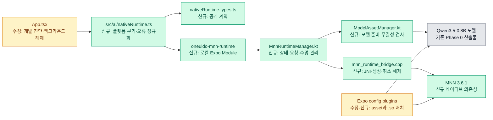
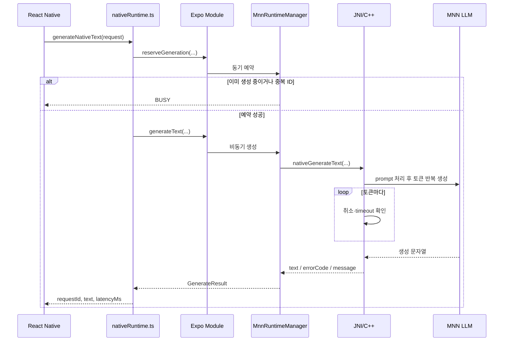
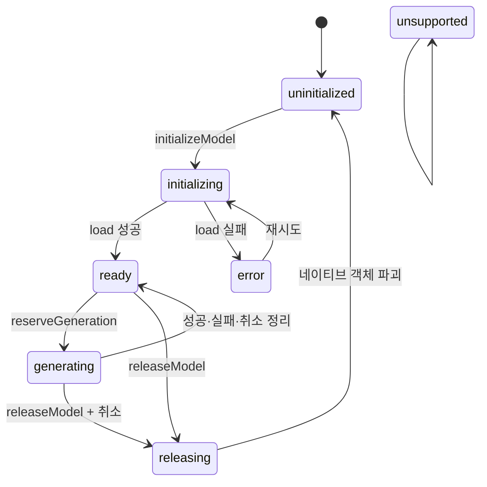

# Phase 2 구현 변경 요약 (이전 Qwen/MNN 구현 기록)

> 아래 내용은 2026-08-16 검증한 이전 구현을 보존한 기록이다. 현재 앱은 Bllossom GGUF/llama.cpp 구조로 교체되었다. 최신 실행 방법은 [Bllossom 모델 가이드](../bllossom-model-setup.md)를 참고한다.

## 1. 문서 목적

이 문서는 `AI 페이즈별 구현 계획`의 Phase 2인 **MNN 네이티브 런타임 연결**에서 생성하거나 수정한 파일, 각 계층의 책임과 실제 검증 결과를 설명한다.

Phase 2의 핵심 변화는 React Native 앱이 Android Development Build에서 Qwen3.5-0.8B MNN 모델을 다음 흐름으로 직접 실행할 수 있게 된 것이다.

```text
React Native TypeScript
  → 로컬 Expo Module
  → Android Kotlin 런타임 관리자
  → JNI/C++ 브리지
  → MNN Qwen 런타임
  → 한국어 생성 결과
```

현재 MuMu Player Android 15 `x86_64`에서는 초기화, 생성, 동시 요청 거부, 시간 초과, 취소, 해제, 백그라운드 전환과 재초기화까지 검증했다. `arm64-v8a` 라이브러리와 APK 빌드는 완료했지만 실제 ARM64 기기가 연결되지 않아 기기 실행 검증은 남아 있다.

## 2. 그림에서 사용하는 색상

아래 구조도에서는 Phase 2의 변경 범위를 구분하기 위해 색을 다르게 사용한다.

- 회색: Phase 2 이전부터 존재하던 구성요소
- 노란색: 기존 파일을 Phase 2에서 수정한 구성요소
- 초록색: Phase 2에서 새로 만든 구성요소

## 3. 전체 구조에서 바뀐 부분



## 4. 단계별 완료 현황

| 단계 | 구현 상태 | 실제 검증 상태 | 핵심 결과 |
|---|---|---|---|
| 1. Android 기준선 | 완료 | MuMu 완료 | JDK 17, SDK 36, NDK 27, 모델 checksum과 기준 APK 확인 |
| 2. MNN 최소 연결 | 완료 | MuMu 완료, ARM64 기기 대기 | MNN 3.6.1 고정, `arm64-v8a`·`x86_64` 빌드, JNI 버전 호출 성공 |
| 3. Expo Module | 완료 | 완료 | TypeScript → Kotlin → JNI 호출과 미지원 분기 구현 |
| 4. 모델 준비 | 완료 | 완료 | asset 복사, SHA-256, 임시 디렉터리, 재사용과 손상 복구 구현 |
| 5. 모델 초기화 | 완료 | MuMu 완료, ARM64 기기 대기 | MNN LLM 생성·로드, 중복 초기화 방지 |
| 6. 한국어 생성 | 완료 | MuMu 완료, ARM64 기기 대기 | 한국어·이모지 UTF-8 왕복과 비동기 생성 성공 |
| 7. 동시 요청 제어 | 완료 | MuMu 완료, ARM64 기기 대기 | 동기 예약, `BUSY`, 중복 ID와 상태 전이 구현 |
| 8. 취소·해제 | 완료 | MuMu 완료, ARM64 기기 대기 | `CANCELLED`, 모델 해제, 백그라운드 정책과 재초기화 성공 |
| 9. 오류 체계 | 완료 | 완료 | 10개 공용 코드, `TIMEOUT`, 오류 후 상태 복구 구현 |
| 10. 통합 검증·문서 | 조건부 완료 | MuMu 완료, ARM64 기기 대기 | 전체 흐름·메모리·반복 실행 검증, 본 문서 작성 |

`조건부 완료`는 코드나 MuMu 검증이 미완료라는 뜻이 아니다. Phase 2 계획이 요구하는 **실제 Android ARM64 기기 전체 흐름 검증**만 물리 기기 미연결로 남아 있다는 뜻이다.

## 5. 런타임 요청 흐름



### 동기 예약이 필요한 이유

Expo의 비동기 함수는 같은 모듈 작업 큐에서 순서대로 실행될 수 있다. 생성 함수를 비동기로만 구현하면 사용자가 버튼을 두 번 눌렀을 때 두 번째 요청이 `BUSY`가 되지 않고 첫 번째 요청 뒤에 대기했다가 실행될 수 있다.

따라서 `reserveGeneration()`은 큐에 넣기 전에 동기로 실행한다. 이 함수가 상태를 `generating`으로 바꾸고 요청 ID를 점유한 뒤에만 비동기 `generateText()`가 실행된다.

## 6. 런타임 상태 전이



상태 변경은 Kotlin의 잠금으로 보호한다. C++도 전역 MNN 객체 접근 잠금, 활성 요청 ID와 원자적 취소 플래그를 사용해 Kotlin 계층을 우회한 잘못된 동시 호출까지 막는다.

## 7. 새로 만든 파일

### 7.1 로컬 Expo Module

#### `frontend/modules/oneuldo-mnn-runtime/package.json`

- 프론트 프로젝트가 `file:./modules/oneuldo-mnn-runtime`로 참조하는 로컬 패키지를 정의한다.
- 앱 코드가 Android 구현 세부사항 대신 하나의 모듈 이름만 가져오게 한다.

#### `frontend/modules/oneuldo-mnn-runtime/expo-module.config.json`

- Expo autolinking이 Android 모듈을 자동 등록하도록 Kotlin 모듈 클래스 위치를 선언한다.

#### `frontend/modules/oneuldo-mnn-runtime/index.ts`

- 모듈 기본 export와 공개 타입을 앱에 노출한다.

#### `frontend/modules/oneuldo-mnn-runtime/src/types.ts`

- 지원 플랫폼, 런타임 상태, 준비·생성·취소·해제 결과와 오류 코드를 정의한다.
- 네이티브 구현이 바뀌어도 React Native 화면은 이 계약만 사용한다.

#### `frontend/modules/oneuldo-mnn-runtime/src/OneuldoMnnRuntimeModule.ts`

- Expo가 자동 연결한 네이티브 모듈을 TypeScript 타입과 함께 가져온다.
- 네이티브 모듈이 없는 Expo Go·Web에서 앱 import 자체가 실패하지 않게 선택적으로 조회한다.

#### `frontend/modules/oneuldo-mnn-runtime/android/build.gradle`

- 로컬 Expo Android Library와 모듈 namespace를 정의한다.

#### `frontend/modules/oneuldo-mnn-runtime/android/src/main/AndroidManifest.xml`

- Android library manifest를 제공한다. 별도 화면이나 시작 Provider 없이 Expo Module 수명주기를 사용한다.

#### `frontend/modules/oneuldo-mnn-runtime/android/src/main/java/com/oneuldo/mnn/OneuldoMnnRuntimeModule.kt`

- TypeScript가 호출하는 Expo 함수와 JNI native 함수를 연결한다.
- 상태 조회와 동기 예약·취소, 비동기 준비·초기화·생성·해제를 외부에 공개한다.
- Kotlin 예외의 `code`가 JavaScript까지 유지되도록 구조화된 예외를 사용한다.

#### `frontend/modules/oneuldo-mnn-runtime/android/src/main/java/com/oneuldo/mnn/MnnRuntimeManager.kt`

- 런타임 상태, 현재 요청, 최근 요청 ID와 취소 요청을 한곳에서 관리한다.
- 초기화 전 생성, 초기화·생성·해제 중 충돌, 중복 요청 ID를 거부한다.
- JNI 결과를 `GenerateResult`, `CancellationResult`, `ReleaseResult`로 변환하고 모든 종료 경로에서 상태를 정리한다.
- 코드에는 상태 예약·취소·해제 이유를 짧은 한국어 주석으로 남겼다.

#### `frontend/modules/oneuldo-mnn-runtime/android/src/main/java/com/oneuldo/mnn/ModelAssetManager.kt`

- APK asset의 모델을 MNN이 읽을 수 있는 앱 전용 파일 경로로 준비한다.
- `.preparing` 임시 폴더에서 크기와 SHA-256을 확인한 뒤에만 최종 폴더로 바꾼다.
- 완료 marker가 현재 리비전과 맞으면 약 484MB 모델 복사를 건너뛴다.
- 저장 공간 부족, 누락과 손상을 서로 다른 오류로 분류한다.

### 7.2 C++와 MNN 연결

#### `frontend/native/mnn-probe/CMakeLists.txt`

- MNN 공유 라이브러리와 오늘도 JNI 라이브러리를 연결한다.
- C++17과 Android 16KB page size 링크 옵션을 적용한다.

#### `frontend/native/mnn-probe/mnn_probe.cpp`

- 실제로 로드된 MNN의 버전을 JNI로 반환하는 최소 연결 프로브다.
- 복잡한 모델 초기화 전에 `.so` 로딩과 심볼 연결만 따로 확인하는 데 사용한다.

#### `frontend/native/mnn-probe/mnn_runtime_bridge.h`

- 초기화·생성 결과와 취소·해제 C++ 함수의 경계를 정의한다.
- 생성 오류를 문자열 하나가 아니라 `error_code`와 `error`로 나눈다.

#### `frontend/native/mnn-probe/mnn_runtime_bridge.cpp`

- MNN LLM 객체를 만들고 모델을 로드한 뒤 프로세스 전역에서 재사용한다.
- 요청 ID 등록, 최대 토큰 수, timeout, 토큰 단위 취소와 UTF-16↔UTF-8 변환을 담당한다.
- 취소·시간 초과 뒤 `reset()`과 `generate_init()`을 호출해 MNN 생성 상태를 다시 사용할 수 있게 복구한다.
- 해제 시 진행 중 생성에 취소를 알리고 잠금을 얻은 뒤 전역 객체를 파괴한다.

### 7.3 빌드와 배치

#### `frontend/scripts/build-mnn-android.ps1`

- 고정 MNN 커밋을 사용해 `arm64-v8a`, `x86_64`의 `libMNN.so`와 JNI 라이브러리를 재현한다.
- LLM, low-memory, Transformer fuse, OpenCL과 문자열 오류 로그 옵션을 같은 방식으로 적용한다.
- 생성물의 크기와 SHA-256을 vendor manifest에 기록한다.

#### `frontend/plugins/with-mnn-runtime.js`

- prebuild 시 vendor manifest를 읽고 모든 `.so` 크기와 SHA-256을 검사한다.
- 검사에 성공한 라이브러리만 Android `jniLibs/<abi>`로 복사한다.
- React Native 빌드 ABI를 `arm64-v8a,x86_64`로 제한한다.

#### `frontend/vendor/mnn/mnn-android.manifest.json`

- MNN 버전 `3.6.1`, 소스 커밋, CMake 옵션, ABI별 네이티브 파일 크기와 SHA-256을 고정한다.

#### `frontend/vendor/mnn/README.md`

- 네이티브 산출물의 출처와 재빌드 방법을 설명한다.

#### `frontend/vendor/mnn/android/<abi>/*.so`

- 실제 APK에 포함되는 ABI별 MNN과 오늘도 JNI 공유 라이브러리다.
- `arm64-v8a`는 실제 Android 기기용, `x86_64`는 MuMu Player 반복 검증용이다.

### 7.4 React Native 어댑터와 테스트

#### `frontend/src/ai/nativeRuntime.types.ts`

- 로컬 모듈 타입을 앱의 AI 계층에서 다시 export한다.
- 이후 Phase 3가 패키지 내부 경로를 알지 않고 이 파일만 참조할 수 있게 한다.

#### `frontend/src/ai/nativeRuntime.ts`

- 플랫폼과 모듈 지원 여부를 판별한다.
- 상태 조회, 준비, 초기화, 생성, 취소와 해제를 앱용 함수로 제공한다.
- Expo/Kotlin 오류를 10개 `RuntimeErrorCode` 중 하나인 `NativeRuntimeError`로 정규화한다.
- 생성 전에 동기 예약을 수행해 빠른 중복·동시 호출을 즉시 거부한다.

#### `frontend/__tests__/NativeRuntime.test.ts`

- Android 정상 호출과 unsupported 플랫폼 분기를 검사한다.
- 상태, 모델 준비, 초기화, 예약과 생성 인자 전달을 확인한다.
- `BUSY` 오류 정규화, 취소와 해제 계약을 검사한다.

## 8. 수정한 기존 파일

### `frontend/App.tsx`

- 개발 빌드에서만 Phase 2 전체 흐름을 실행하는 진단 코드를 추가했다.
- 정상 한국어 생성, 중복 ID, timeout, 동시 요청, 취소, 해제와 2회 재초기화를 순서대로 기록한다.
- Android 앱이 백그라운드 또는 inactive 상태가 되면 모델을 자동 해제한다.
- 실제 AI 친구나 퀘스트 화면에는 아직 모델 결과를 연결하지 않았다. 이 연결은 Phase 3 이후의 책임이다.

### `frontend/app.json`

- Qwen asset과 MNN 네이티브 라이브러리를 prebuild에 반영하는 config plugin을 등록했다.

### `frontend/package.json`과 `frontend/pnpm-lock.yaml`

- 로컬 Expo Module 의존성과 MNN Android 빌드 명령을 추가했다.
- 주요 명령은 `model:qwen:download`, `model:qwen:verify`, `mnn:android:build`다.

### `frontend/plugins/with-qwen-model.js`

- 모델 6개 파일뿐 아니라 manifest도 Android asset에 포함한다.
- prebuild 전에 원본 모델의 크기와 SHA-256을 검사해 잘못된 APK 생성을 막는다.

### `docs/ai/phase2-implementation-plan.md`

- 1~10단계 각각에 2026-08-16 실행 결과를 추가했다.
- MuMu에서 끝난 항목과 실제 ARM64 기기 확인이 필요한 항목을 분리해 표시했다.

## 9. 공개 TypeScript API

화면과 Phase 3의 공통 AI 계층은 아래 함수만 사용한다.

```ts
getNativeRuntimeStatus(): Promise<NativeRuntimeStatus>;
prepareNativeModel(): Promise<ModelPreparationResult>;
initializeNativeModel(): Promise<NativeRuntimeStatus>;
generateNativeText(request: GenerateRequest): Promise<GenerateResult>;
cancelNativeGeneration(requestId: string): Promise<CancellationResult>;
releaseNativeModel(): Promise<ReleaseResult>;
```

생성 요청과 결과는 요청 ID를 공유한다.

```ts
type GenerateRequest = {
  requestId: string;
  prompt: string;
  maxTokens: number; // 1~256
  timeoutMs: number;
};

type GenerateResult = {
  requestId: string;
  text: string;
  latencyMs: number;
};
```

## 10. 공통 오류 코드

| 코드 | 의미 | 대표 발생 위치 |
|---|---|---|
| `UNSUPPORTED` | Android Development Build 런타임을 사용할 수 없음 | Web, iOS, Expo Go, 모듈 없음 |
| `MODEL_MISSING` | 필수 모델 asset 또는 파일이 없음 | 모델 준비 |
| `MODEL_CORRUPTED` | manifest, 크기 또는 SHA-256 불일치 | prebuild·모델 준비 |
| `INSUFFICIENT_STORAGE` | 모델 복사 공간과 여유 공간이 부족함 | 모델 준비 |
| `INITIALIZATION_FAILED` | 모델 준비 또는 MNN load 실패 | Kotlin·C++ 초기화 |
| `NOT_INITIALIZED` | ready 이전에 생성을 요청함 | 요청 예약·C++ |
| `BUSY` | 초기화·생성·해제 중 충돌 또는 중복 ID | Kotlin·C++ |
| `CANCELLED` | 현재 요청이 사용자 또는 해제에 의해 취소됨 | 토큰 생성 루프 |
| `TIMEOUT` | 요청 제한 시간을 넘김 | C++ 토큰 생성 루프 |
| `GENERATION_FAILED` | 그 밖의 네이티브 생성 실패 또는 빈 출력 | C++·TypeScript fallback |

오류 문자열은 개발자 설명용이고, 화면과 Phase 3 fallback 로직은 문자열 파싱 대신 `code`를 사용해야 한다.

## 11. 취소와 메모리 해제가 동작하는 방식

### 생성 취소

1. TypeScript가 `requestId`로 취소를 요청한다.
2. Kotlin이 현재 활성 ID와 비교하고 취소 ID를 기억한다.
3. JNI가 원자적 취소 플래그를 설정한다.
4. C++가 토큰을 하나 생성할 때마다 플래그를 확인한다.
5. 취소되면 부분 문자열을 버리고 `CANCELLED`로 종료한다.
6. Kotlin이 활성 요청을 제거하고 상태를 `ready`로 되돌린다.

MNN의 prompt prefill 자체를 강제로 중단하는 API는 사용하지 않는다. 따라서 네이티브 생성이 시작된 뒤의 취소는 안전한 **토큰 경계**에서 반영된다. 시작 전 취소는 Kotlin의 취소 ID 집합으로 처리한다.

### 모델 해제

1. 상태를 `releasing`으로 바꿔 새 요청을 막는다.
2. 진행 중 생성이 있으면 취소 플래그를 설정한다.
3. C++ 런타임 잠금을 기다린다.
4. 전역 MNN LLM 객체를 파괴한다.
5. Kotlin 상태, 활성 ID와 최근 요청 목록을 초기화한다.
6. 다음 호출은 모델을 다시 초기화할 수 있다.

## 12. 모델과 네이티브 산출물

### Qwen 모델

- 모델: Qwen3.5-0.8B MNN 텍스트 모델
- 파일 수: 6개
- 전체 크기: 484,349,697바이트
- 실행 위치: 앱의 `noBackupFilesDir/models/qwen3.5-0.8b-mnn`
- 실행 설정: 원본 파일을 수정하지 않고 `.oneuldo-runtime-config.json`에서 텍스트 전용·`enable_thinking: false` 적용

`enable_thinking: false`는 짧은 모바일 응답에서 내부 생각 토큰만 최대 토큰 수를 소모해 사용자 응답이 비는 문제를 피하기 위해 필요하다.

### MNN 네이티브 파일

| ABI | 파일 | 크기 | SHA-256 앞 12자리 |
|---|---|---:|---|
| `arm64-v8a` | `libMNN.so` | 6,180,944 | `86158f3a1f0e` |
| `arm64-v8a` | `liboneuldo_mnn_probe.so` | 372,888 | `952f2fcc405a` |
| `x86_64` | `libMNN.so` | 6,935,624 | `c590f6ed765e` |
| `x86_64` | `liboneuldo_mnn_probe.so` | 343,288 | `86d14a6d8f65` |

전체 checksum은 `frontend/vendor/mnn/mnn-android.manifest.json`이 기준이다.

## 13. 실제 통합 검증 결과

### MuMu Player 환경

- Android 15
- ABI `x86_64`
- MNN `3.6.1`
- 앱 패키지 `com.oneuldo.app`

### 전체 흐름 결과

| 검증 항목 | 결과 |
|---|---|
| MNN 버전 호출 | `3.6.1` 반환 |
| 모델 준비 | 6개, 484,349,697바이트 준비·재사용 성공 |
| 최초 초기화 | 1,795ms |
| 한국어 생성 | 630ms, 32토큰 제한 |
| 대표 출력 | `오늘은 하루가 다르게 시작하며, 정말 좋은일 있네요!✨` |
| 중복 requestId | `BUSY` |
| 생성 중 두 번째 요청 | `BUSY` |
| 1ms 제한 요청 | `TIMEOUT` |
| 생성 취소 | `cancelled: true`, 최종 `CANCELLED` |
| 명시적 모델 해제 | `released: true` |
| 복구 1회차 | 초기화 1,606ms, 생성 416ms |
| 복구 2회차 | 초기화 1,618ms, 생성 649ms |
| 백그라운드·복귀 | 동일 PID 유지, crash 없음 |

생성 시간은 프롬프트, 토큰 수, emulator 부하와 캐시 상태에 따라 달라지는 진단값이며 성능 보장값이 아니다.

### 백그라운드 자동 해제 메모리

| 항목 | 모델 로드 상태 | 백그라운드 해제 후 | 감소량 |
|---|---:|---:|---:|
| Native Heap | 705,712KB | 209,788KB | 495,924KB, 약 70.3% |
| TOTAL PSS | 894,559KB | 390,104KB | 504,455KB, 약 56.4% |
| TOTAL RSS | 980,872KB | 478,956KB | 501,916KB, 약 51.2% |

전환 전·후 PID는 모두 `8394`였다. 즉 앱 프로세스를 죽여 메모리가 줄어든 것이 아니라 모델 해제 정책이 실행된 결과다.

### 정적 검증

- TypeScript `tsc --noEmit` 통과
- Jest 4개 스위트, 23개 테스트 통과
- Qwen 모델 6개 파일 크기·SHA-256 통과
- `arm64-v8a`, `x86_64` JNI/MNN 빌드 통과
- Expo Android prebuild 통과
- Android Debug APK 빌드·MuMu 설치 통과
- MuMu 로그에서 FATAL EXCEPTION, ANR, native crash 없음

기존 App 렌더 테스트의 React `act(...)` 경고는 남아 있으나 테스트 실패나 Phase 2 네이티브 오류는 아니다.

## 14. 다른 개발자의 재현 순서

PowerShell에서 다음 순서로 실행한다.

```powershell
cd C:\git\Oneuldo\frontend
pnpm install
pnpm model:qwen:download
pnpm model:qwen:verify
pnpm mnn:android:build
pnpm typecheck
pnpm test
pnpm exec expo prebuild --platform android --no-install
cd android
.\gradlew.bat app:assembleDebug
```

MNN 네이티브 파일을 다시 만들 필요가 없고 vendor manifest 검증만 하려면 `pnpm mnn:android:build`는 생략할 수 있다. 단, `frontend/vendor/mnn/android`의 두 ABI 파일이 manifest와 정확히 일치해야 한다.

MuMu 연결 예시:

```powershell
adb connect 127.0.0.1:16384
adb -s 127.0.0.1:16384 install -r .\app\build\outputs\apk\debug\app-debug.apk
adb -s 127.0.0.1:16384 shell am start -n com.oneuldo.app/.MainActivity
```

실제 기기에서는 `adb devices`에 표시된 serial을 `-s` 뒤에 사용한다. 기기 ABI는 다음 명령으로 확인한다.

```powershell
adb -s <device-serial> shell getprop ro.product.cpu.abi
```

## 15. 실제 ARM64 기기에서 남은 확인

실제 `arm64-v8a` 기기가 연결되면 다음만 추가로 수행하면 Phase 2의 물리 기기 검증까지 끝난다.

- ABI가 `arm64-v8a`인지 확인
- 동일 Debug APK 설치와 MNN `3.6.1` 로딩 확인
- 한국어·이모지 생성 결과 확인
- 빠른 연속 요청에서 `BUSY` 확인
- 긴 생성 취소에서 `CANCELLED` 확인
- 1ms timeout에서 `TIMEOUT` 확인
- 백그라운드 전환 전후 PID, PSS와 native heap 기록
- 해제 후 재초기화·재생성 2회
- FATAL EXCEPTION, ANR과 native crash 로그 확인

ARM64 `.so` 빌드와 APK 포함은 이미 완료했다. 남은 항목은 실제 하드웨어에서의 실행·성능·수명주기 측정이다.

## 16. Phase 3에서 이어질 부분

Phase 2는 범용 모델 런타임까지만 제공한다. 아직 생성 문자열을 퀘스트 힌트나 AI 친구 화면에 직접 표시하지 않는다.

Phase 3에서는 이 런타임 위에 다음을 추가한다.

- 입력에서 개인정보를 제외하는 선택기
- 작업별 프롬프트와 버전 관리
- JSON 출력 파싱과 길이·금지 표현 정책
- `TIMEOUT`, `CANCELLED`, `UNSUPPORTED`를 포함한 정적 fallback
- 검증을 통과한 결과만 UI에 전달하는 공통 orchestrator

즉 Phase 2의 `NativeRuntimeError.code`와 `requestId`가 Phase 3의 안전한 fallback과 늦은 결과 폐기의 기준이 된다.
