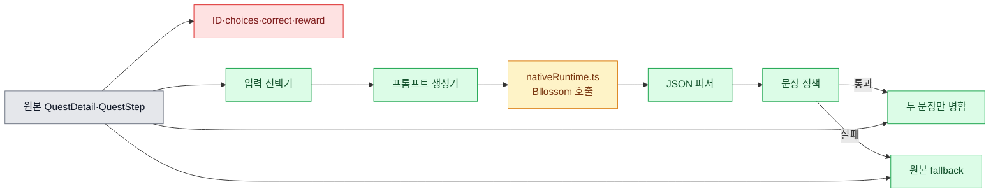
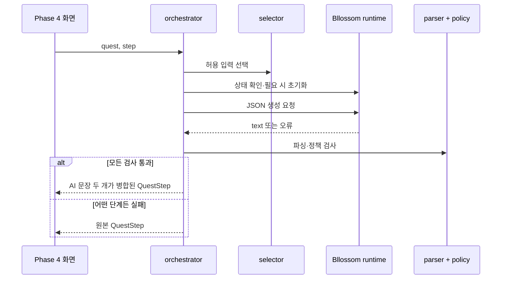

# Phase 3 AI 공통 계층 구현 요약

## 1. 문서 목적

이 문서는 Phase 3인 **AI 공통 계층과 안전장치 구현**에서 새로 만든 코드, 데이터 흐름, 검증 규칙과 테스트 결과를 설명한다.

Phase 3는 AI 문장을 아직 퀘스트 화면에 자동 적용하는 단계가 아니다. Phase 4에서 화면을 연결하기 전에 Bllossom 출력이 원본 퀘스트의 ID·선택지·정답·보상을 변경하지 못하도록 공통 경계를 만드는 단계다.

```text
백엔드 원본 퀘스트
→ 허용 정보 네 개만 선택
→ Bllossom 호출
→ JSON 구조 검사
→ 문장 정책 검사
→ 통과하면 situation·instruction만 병합
→ 하나라도 실패하면 원본 단계 사용
```

## 2. 완료 현황

| 작업 | 상태 | 구현 결과 |
|---|---|---|
| 입력·출력 계약 | 완료 | 버전 상수와 두 필드 출력 타입 정의 |
| 안전한 입력 선택 | 완료 | ID·선택지·정답·보상·사용자 정보 제외 |
| Bllossom 프롬프트 | 완료 | JSON 두 필드와 의미 보존 규칙 명시 |
| 엄격한 파서 | 완료 | 추가 키·배열·빈 값·잘린 JSON 거절 |
| 문장 정책 | 완료 | 80자·한 문장·금지 표현·새 숫자 검사 |
| 원본 fallback | 완료 | 모든 실패에서 원본 `QuestStep` 반환 |
| 오케스트레이터 | 완료 | 초기화·생성·검증·병합을 한 API로 통합 |
| 진단 메타데이터 | 완료 | 버전·시간·fallback 여부만 기록 가능 |
| 화면 연결 | Phase 4 | `QuestPracticeScreen` 적용은 다음 단계 |

## 3. 변경 구조와 색상

- 회색: 기존 Phase 1·2 구성
- 노란색: Phase 3에서 계속 사용하는 기존 어댑터
- 초록색: Phase 3에서 새로 만든 계층
- 빨간색: AI에 전달하거나 AI가 변경할 수 없는 데이터



## 4. 입력 선택 방식

서버에서 받은 원본은 다음처럼 안전 규칙까지 포함한다.

```ts
type QuestStep = {
  id: string;
  stepOrder: number;
  instruction: string;
  situation: string;
  hint: string | null;
  choices: QuestChoice[];
};
```

`selectQuestVariationInput()`은 원본 전체를 직렬화하지 않고 다음 네 문장만 새 객체에 복사한다.

```ts
type QuestVariationInput = {
  schemaVersion: 'quest-variation-input-v1';
  theme: string;
  objective: string;
  originalSituation: string;
  originalInstruction: string;
};
```

| AI에 전달 | AI에 전달하지 않음 |
|---|---|
| 퀘스트 제목 `theme` | questId·stepId |
| 퀘스트 목표 `objective` | 선택지와 choiceId |
| 기존 상황 문장 | `correct`와 정답 정보 |
| 기존 안내 문장 | 힌트·보상·수행 기록·사용자 정보 |

이메일, 휴대전화 번호 또는 UUID 형태가 허용 문장 안에서 발견되면 모델을 호출하지 않고 `SENSITIVE_INPUT` fallback을 사용한다.

## 5. 출력 계약과 파서

허용되는 출력은 정확히 다음 두 키뿐이다.

```json
{
  "situation": "버스들이 정류장으로 들어오고 있어요.",
  "instruction": "목적지 버스 번호를 차분히 확인해 보세요."
}
```

다음 출력은 모두 거절한다.

- 빈 문자열 또는 잘린 JSON
- JSON 배열
- `correctChoiceId`, `reward`, `objective` 같은 추가 필드
- 두 값 중 하나가 없거나 문자열이 아닌 결과
- 서로 다른 JSON 객체가 여러 개 섞인 결과

모델이 JSON 앞에 짧은 설명이나 Markdown code fence를 붙이는 경우에는 객체 하나를 찾아 파싱한다. 하지만 객체 내부 계약은 완화하지 않는다.

## 6. 정책 검사

JSON 모양이 맞아도 화면에 바로 사용하지 않는다.

| 검사 | 거절 예시 | 이유 |
|---|---|---|
| 80자 이하 | 지나치게 긴 안내 | 읽기 부담 제한 |
| 필드마다 한 문장 | `버스가 왔어요. 빨리 타요.` | 한 번에 한 상황·행동 유지 |
| 한 줄 문자열 | 줄바꿈이 들어간 결과 | 화면 구조 안정성 |
| 금지 표현 | `틀리면 혼나요.` | 비난·불안 표현 차단 |
| URL·이메일 금지 | 외부 링크 | 의도하지 않은 정보 노출 방지 |
| 새 숫자 금지 | 원문에 없는 `99번` | 버스 번호 같은 구체값 조작 방지 |

정책은 문장의 의미를 완벽하게 이해하는 판정기가 아니다. 따라서 Phase 4 실제 퀘스트 적용 전에는 반복 생성 평가와 보호자·전문가 검토가 추가로 필요하다.

## 7. 오케스트레이터 동작

화면은 나중에 `generateQuestVariation()` 하나만 호출하면 된다.



AI 성공과 fallback은 모두 `QuestVariationResult` 타입으로 반환된다. 따라서 화면에서 오류별로 서로 다른 데이터 구조를 처리할 필요가 없다.

## 8. 진단 정보와 개인정보

결과에는 다음 메타데이터가 포함된다.

```ts
type QuestVariationMetadata = {
  requestId: string;
  modelVersion: string | null;
  promptVersion: 'quest-variation-prompt-v1';
  policyVersion: 'quest-variation-policy-v1';
  latencyMs: number;
  fallbackUsed: boolean;
  failureCode: QuestVariationFailureCode | null;
};
```

개발 모드 진단 콜백에는 이 메타데이터만 전달한다. 프롬프트, 원본 문장, 모델 출력 원문은 자동 로그에 전달하거나 DB에 저장하지 않는다.

## 9. 새로 만든 파일

| 파일 | 책임 |
|---|---|
| `frontend/src/ai/contracts.ts` | 계약 버전, 입출력·결과·오류 타입 |
| `frontend/src/ai/selectors/questVariationSelector.ts` | 허용된 네 문장만 선택하고 민감정보 차단 |
| `frontend/src/ai/prompts/questVariationPrompt.ts` | Bllossom용 JSON 프롬프트 생성 |
| `frontend/src/ai/parsers/questVariationParser.ts` | JSON 추출과 정확한 두 필드 검사 |
| `frontend/src/ai/policy.ts` | 문장 길이·개수·금지 표현·숫자 검사 |
| `frontend/src/ai/fallback.ts` | 원본 문장 반환과 안전한 두 필드 병합 |
| `frontend/src/ai/orchestrator.ts` | 런타임부터 fallback까지 전체 흐름 총괄 |
| `frontend/src/ai/index.ts` | Phase 3 공개 export 모음 |
| `frontend/__tests__/QuestVariation.test.ts` | 입력·파서·정책·병합·오케스트레이터 테스트 |

## 10. 오류와 fallback

| 실패 코드 | 발생 위치 | 결과 |
|---|---|---|
| `SENSITIVE_INPUT` | 입력 선택 | 원본 단계 |
| `INVALID_INPUT` | 입력 선택 | 원본 단계 |
| `RUNTIME_UNAVAILABLE` | 플랫폼·런타임 상태 | 원본 단계 |
| `RUNTIME_ERROR` | 초기화·생성·timeout | 원본 단계 |
| `INVALID_JSON` | JSON 파서 | 원본 단계 |
| `INVALID_OUTPUT_SHAPE` | 출력 키·타입 검사 | 원본 단계 |
| `POLICY_REJECTED` | 문장 정책 | 원본 단계 |

어떤 오류도 퀘스트 수행 자체를 중단시키지 않는다.

## 11. 검증 결과

- Phase 3 전용 테스트 21개 통과
- TypeScript strict typecheck 통과
- 전체 프론트 테스트 5개 suite, 44개 테스트 통과
- 성공 결과에서도 원본 `id`, `stepOrder`, `hint`, `choices` 참조가 유지됨을 확인
- 런타임 미지원·잘린 JSON·추가 필드·정책 거절·timeout에서 원본 fallback 확인
- 진단 콜백에 프롬프트가 포함되지 않음을 확인

## 12. 의도적으로 남긴 Phase 4 작업

- `QuestPracticeScreen`에서 변형 요청 시점과 로딩 UI 결정
- 같은 세션에서 생성 결과를 재사용하는 캐시
- 실제 Bllossom Android 출력 반복 평가
- 실제 기기의 시간 제한과 `maxTokens` 조정
- 필요하면 llama.cpp grammar 기반 생성 제약 추가
- 보호자·전문가 문장 검토 후 금지 표현과 길이 기준 보정

현재 Phase 3는 **모델 출력이 안전하지 않으면 절대로 화면용 단계로 승격하지 않는 공통 기반**까지 완료한 상태다.
