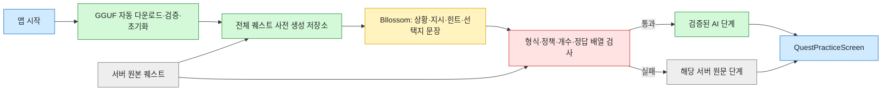

# Phase 4 온디바이스 퀘스트 전체 변형 구현 요약

## 1. 구현 결과

`TAKE_BUS_ALONE`(혼자 버스 타기) 퀘스트를 대상으로 Bllossom 3B가 앱 시작 시 전체 4단계를 순서대로 미리 생성한다.

AI 생성 범위:

- 상황(`situation`), 행동 안내(`instruction`), 힌트(`hint`)
- 모든 선택지의 화면 문장(`choice.label`)

서버 원본 유지 범위:

- 퀘스트·단계·선택지 ID와 순서, 단계·선택지 개수
- 선택지별 정답 여부, 선택 후 피드백, 보상

형식·안전·정답 보존 검사를 하나라도 통과하지 못하면 해당 단계 전체를 서버 원문으로 되돌린다. 서버 DB 원문은 어떤 경우에도 수정하지 않는다.

## 2. 완료 현황

| 항목 | 상태 | 결과 |
|---|---|---|
| 최초 실행 모델 설치 | 완료 | 앱 시작과 함께 약 2GB GGUF 다운로드·해시 검증·초기화 |
| 설치 파일 재사용 | 완료 | 정상 GGUF와 준비 마커가 있으면 재다운로드하지 않음 |
| 앱 시작 사전 생성 | 완료 | 로그인/퀘스트 화면 진입 전 상세 퀘스트 조회 후 생성 시작 |
| 전체 단계·선택지 생성 | 완료 | 4단계를 순차 생성하고 모든 선택지 `label` 생성 |
| 정답·구조 보호 | 완료 | ID·순서·개수·정답 배열이 달라지면 단계 폐기 |
| 정책 검사·fallback | 완료 | JSON·길이·금지어·새 숫자 등 실패 시 원문 사용 |
| 자동 테스트 | 완료 | TypeScript 통과, Jest 7 suites / 58 tests 통과 |
| MuMu x86_64 | 부분 완료 | 자동 준비와 4단계 AI 채택 확인, 10회 반복 품질 검증은 남음 |
| arm64-v8a 실기기 | 대기 | 성능·메모리·발열 측정 필요 |

## 3. “선택지와 정답은 원래 내용 그대로”의 정확한 의미

이전 구현은 선택지 문장까지 원문을 썼다. 현재는 **선택지에 보이는 문장은 AI가 바꾸지만, 선택지가 가리키는 서버 ID와 정답 여부는 유지한다.**

예를 들어 원본이 `choice-a / correct=true / 버스 번호를 비교한다`이면 AI는 문장을 `안내판과 앞 번호를 함께 살펴봐요`로 바꿀 수 있다. 하지만 서버에는 계속 `choice-a`가 전송되고 판정은 계속 `true`다. AI가 정답 여부를 `false`로 반환하거나 선택지 개수를 바꾸면 해당 단계 AI 결과를 전부 버린다.

피드백은 생성 시간과 오류를 줄이고 서버 수행 기록과 설명을 안정적으로 유지하기 위해 원문을 사용한다.

## 4. 실행 구조



## 5. 주요 코드

### `frontend/App.tsx`, `useAiVariationSettings.ts`

AI 준비 훅을 온보딩보다 위에서 실행한다. 첫 설치에서는 HTTPS로 GGUF를 내려받아 크기와 SHA-256을 확인하고 초기화한다. 다음 실행부터는 검증된 파일을 재사용한다. 모델과 퀘스트 목록이 준비되면 버스 퀘스트 상세를 읽어 `warmFullQuest()`를 호출한다.

### `questGenerationStore.ts`

퀘스트별 `idle / generating / ready` 상태와 진행 중 Promise를 앱 전역 메모리에 저장한다. 중복 요청을 합치고 네이티브 런타임 충돌을 막기 위해 모든 단계를 `for ... of`로 순차 생성한다. 한 번의 전체 생성에는 승인된 테마 하나만 사용한다.

### `questStepGenerator.ts`

단계 전체 프롬프트, 짧은 JSON 파서, 검사와 서버 원본 병합을 담당한다. 개인정보와 DB ID는 프롬프트에 넣지 않는다. 모델 출력은 `s`, `i`, `h`, `c[].l`, `c[].r`만 받는다.

검사 항목:

- JSON 루트와 선택지 모양, 문장 길이, 금지 표현
- 원문에 없던 숫자, 힌트 null 구조
- 선택지의 정확한 개수와 서버 원본과 같은 정답 boolean 배열
- 원문 전체를 그대로 복사했는지 여부

비·혼잡·저녁 테마마다 4단계가 이어지는 검토된 상황 설계안을 둔다. 모델이 원문을 복사하거나 테마를 무시하면 접두어를 붙이지 않고 해당 단계의 완성형 한국어 상황을 사용한다. 안내·힌트·선택지는 원문 핵심 단어가 사라지거나 부정 의미가 뒤집히면 그 필드만 원문으로 복구한다. 영문자가 섞인 생성 필드도 화면에 노출하지 않고 한국어 원문 또는 검토된 상황으로 교체한다. 통과 후에도 서버 원본 객체에 문장 필드만 병합하므로 ID·순서·보상은 바뀌지 않는다.

### `useQuestVariation.ts`와 화면

화면은 전역 저장소를 구독한다. 전체 생성 전에는 입력을 막는 준비 화면을, 완료 후에는 단계별 AI 결과 또는 원문을 같은 `QuestStep` 타입으로 보여 준다. 검증된 결과에는 `AI 생성 퀘스트` 배지가 붙는다. AI 탭에는 “설치 후 자동 준비”와 모델 용량을 표시한다.

## 6. 반복 상황 조사 결과

같은 상황이 다시 보인 것은 AI가 DB 원문을 덮어쓴 것이 아니다. MuMu 로그에서 다음 fallback 원인을 확인했다.

1. 초기 제한 45초 시간 초과
2. 출력 정책 위반 또는 예상하지 않은 JSON 필드
3. 형식 예시의 선택지 1개를 따라 원래 3개 대신 1개 출력
4. 안전 지시를 보수적으로 해석해 상황 원문을 그대로 복사
5. 안내를 `해 보세요.`처럼 지나치게 줄여 핵심 행동을 없앰

검증 계층이 잘못된 구조와 판정을 폐기해 원문을 표시했다. 단일 선택지 예시는 제거하고 실제 선택지 개수와 원본 정답 배열을 명시했다. 원문 상황 복사와 테마 이탈은 단계별 검토 문장으로 교체하고, 핵심 행동·부정 의미가 사라지거나 영어가 섞인 개별 문장은 한국어 원문으로 복구한다. 진단 중 잠시 사용한 원문 출력 로그도 제거해 현재는 단계 번호·성공 여부·실패 코드만 기록한다.

## 7. 시험 결과와 방법

2026-08-18 자동 시험:

```powershell
cd C:\git\Oneuldo\frontend
pnpm typecheck
pnpm test -- --runInBand
```

- TypeScript 통과
- Jest 7 suites, 58 tests 통과
- 정답 변경, 선택지 개수 변경, 새 숫자 추가 시 전체 단계 fallback 포함
- 기존 `App.test.tsx`의 React `act(...)` 경고는 있으나 실패는 없음

MuMu `x86_64`에서 GGUF와 준비 마커를 확인했고, 최종 실행에서 4단계 모두 AI 결과가 채택됐다. 각 단계는 약 91~103초, 전체는 약 6분 29초가 걸렸다. 잘못된 선택지 개수 출력은 원문 fallback으로 차단됐고, 화면 확인에서 발견한 지나치게 짧은 안내는 핵심 단어·부정 의미 보존 검사로 보강했다.

수동 시험은 Development Build에서 앱을 열고 모델 자동 설치가 끝난 뒤 버스 퀘스트 4단계를 수행한다. 상황·안내·힌트·선택지의 연결, 서버 정답 판정·피드백·XP 동일 여부, 재실행 시 GGUF 재사용을 확인한다.

```powershell
adb logcat -v time -s OneuldoLlamaRuntime:I ReactNativeJS:I AndroidRuntime:E *:S
```

`[QuestGeneration] source: ai`는 채택, `source: original`은 안전 fallback이다.

## 8. 남은 한계

- 정답 boolean은 고정했지만 AI 선택지 문장의 의미 보존을 규칙만으로 100% 보장할 수는 없다. 출시 전 보호자·전문가 평가와 정적 승인 변형이 필요하다.
- MuMu에서는 전체 4단계 생성에 수 분 걸릴 수 있다. arm64-v8a 실기기 시간·메모리·발열 측정이 필요하다.
- 생성 중 백그라운드로 보내면 모델을 해제하고 해당 단계는 원문으로 fallback한다.
- 생성 결과는 앱 프로세스 메모리에만 저장한다. 디스크 캐시와 다운로드 진행률·중단 재개 UI는 후속 최적화 대상이다.

## 9. 플롯 견본 원본 퀘스트

날씨·시간만 바꾸는 단순 표현 변형을 벗어나기 위해 `V8__insert_bus_scenario_quest_data.sql`에 서로 다른 사건을 가진 버스 퀘스트 4개를 추가했다.

- 버스 방향 확인하기
- 버스를 놓쳤을 때
- 목적지를 지나쳤을 때
- 버스 운행 변경 확인하기

각 퀘스트는 4단계, 단계별 선택지 3개, 정답 1개로 구성한다. 현재는 독립된 정적 퀘스트로 앱에 표시되며, AI가 플롯을 선택하거나 조합하는 입력 견본으로 연결하는 작업은 다음 단계다.
