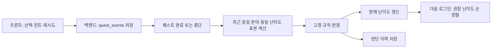
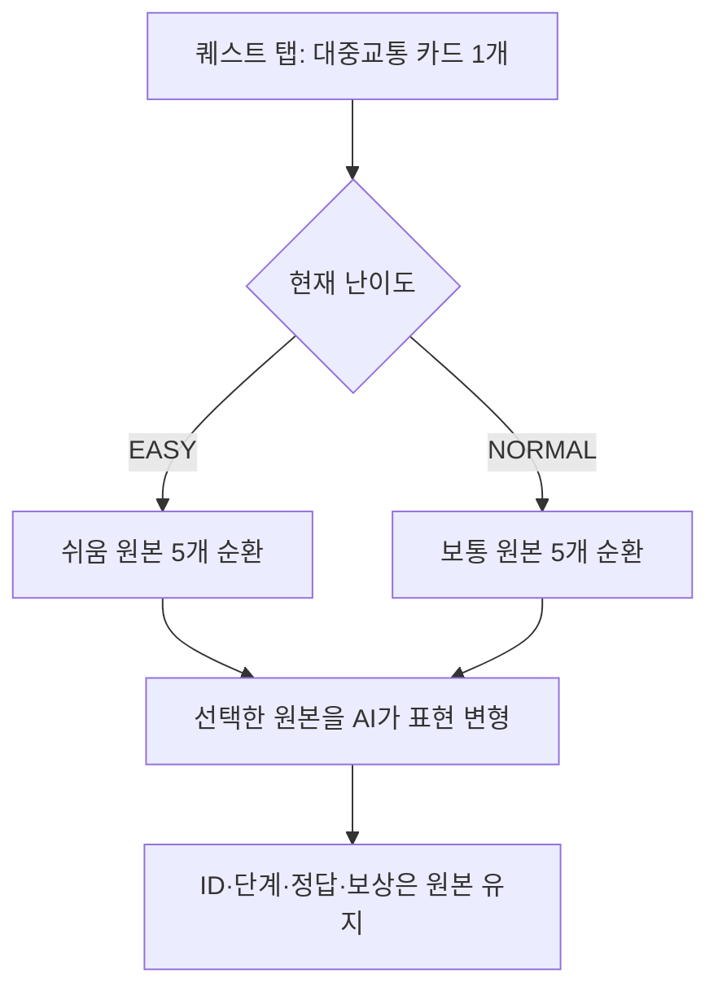

# Phase 5 구현 요약 — 성과 기반 자동 난이도 조정

## 1. 이번 단계의 목적

Phase 5는 사용자가 실제로 퀘스트를 수행한 결과를 이용해 다음에 권장할 난이도를 자동으로 조정한다. 난이도 결정은 Bllossom이나 다른 AI 모델이 아니라 백엔드의 고정 규칙이 담당한다. 따라서 같은 기록과 같은 규칙 버전이라면 항상 같은 결과를 낸다.

이번 구현 범위는 다음과 같이 제한했다.

- 사용자별·세부 분야별 `EASY ↔ NORMAL` 자동 조정
- 권장 난이도와 가까운 퀘스트를 목록 앞에 배치
- 결정 당시 지표와 사유 이력 저장
- 보호자 대시보드 제외
- 실전 퀘스트와 잠금 해제 기능 제외
- AI가 생성한 문장 품질과 응답 시간은 난이도 판정에서 제외
- 퀘스트 탭에는 세부 분야당 카드 하나만 표시
- 대중교통 카드 안에서 현재 난이도의 검토된 원본 5개를 순환

## 2. 전체 흐름



예를 들어 `대중교통` EASY 퀘스트를 충분히 안정적으로 수행하면 그 사용자의 `대중교통`만 NORMAL로 올라간다. `경제생활`이나 `안전` 난이도는 영향을 받지 않는다.

## 2.1 카드와 원본 견본의 관계

대중교통 원본 10개는 사용자가 고르는 카드 10개가 아니다. 화면에는 대중교통 카드 하나만 보이고 서버가 현재 난이도와 이전 수행 횟수를 기준으로 다음 원본을 선택한다.



로그인 전 공개 목록도 세부 분야별 한 장만 반환한다. 로그인 후에는 `시작된 해당 분야 세션 수 % 현재 난이도 원본 수`로 다음 견본을 골라 같은 문제만 반복되지 않게 한다.

### 대중교통 EASY 견본 5개

1. 혼자 버스 타기
2. 버스 방향 확인하기
3. 버스를 놓쳤을 때
4. 버스 타기 전 준비하기
5. 목적지에서 안전하게 내리기

각 단계는 한 가지 단서와 한 가지 중심 행동을 분명하게 연습한다.

### 대중교통 NORMAL 견본 5개

1. 목적지를 지나쳤을 때
2. 버스 운행 변경 확인하기
3. 버스를 갈아타기
4. 교통카드가 찍히지 않을 때
5. 사람이 많은 버스 이용하기

NORMAL은 번호와 방향 같이 두 조건을 함께 확인하거나, 오류·혼잡·운행 변경 같은 돌발 상황에서 행동 순서를 지키게 한다.

### AI가 담당하는 범위

복잡도는 검토된 원본 견본이 결정한다. AI가 쉬운 원본에 임의로 위험 상황을 추가하거나 보통 원본의 확인 조건을 삭제하지 못하게 프롬프트를 난이도별로 나눴다.

- EASY: 한 단서와 한 행동을 유지
- NORMAL: 원본의 복수 확인 조건, 돌발 상황과 행동 순서를 모두 유지
- 공통: 선택지 ID·개수·순서·정답 여부, 단계 ID와 보상은 변경 금지
- 테마 이탈·영어 혼입·의미 훼손: 해당 필드를 서버 원본으로 복구
- AI 실패: 단계 전체를 서버 원본으로 복구

이전처럼 `비가 오는 날 + 원본 문장`을 기계적으로 붙이지 않는다. AI가 테마를 자연스럽게 반영하지 못하면 접두어를 추가하지 않고 완성된 원본 상황을 그대로 사용한다.

## 3. 새로 만든 DB 구조

마이그레이션 파일은 `backend/src/main/resources/db/migration/V9__create_difficulty_adjustment_tables.sql`이다.

### `user_subcategory_difficulties`

현재 상태를 빠르게 읽기 위한 테이블이다.

| 컬럼 | 의미 |
|---|---|
| `member_id` | 사용자 |
| `subcategory_id` | 대중교통 같은 세부 분야 |
| `current_difficulty` | 현재 권장 난이도 |
| `sessions_since_evaluation` | 직전 평가 뒤 쌓인 표본 수 |
| `last_evaluated_at` | 마지막 평가 시각 |
| `last_changed_at` | 실제 난이도가 바뀐 시각 |
| `rule_version` | 적용한 규칙 버전 |

사용자와 세부 분야 조합에는 한 행만 존재한다. 처음 만들어질 때 난이도는 EASY다.

### `difficulty_adjustment_history`

판단을 나중에 재현하고 문제를 확인하기 위한 이력 테이블이다. 이전·새 난이도, 결정 코드, 사유 코드, 완료율, 첫 시도 정답률, 힌트 사용률, 재시도율, 서로 다른 퀘스트 수와 규칙 버전을 저장한다. 원본 프롬프트나 AI 출력은 저장하지 않는다.

## 4. 계산 지표

평가는 현재 권장 난이도와 같은 최근 종료 세션만 사용한다. 사용자가 임의로 다른 난이도 퀘스트를 수행해도 현재 단계의 승급 표본에 섞이지 않는다.

- 완료율: 완료 세션 수 ÷ 평가 세션 수
- 첫 시도 정답률: 첫 선택에서 맞힌 단계 수 ÷ 실제 시도한 단계 수
- 힌트 사용률: 한 번이라도 힌트를 쓴 단계 수 ÷ 실제 시도한 단계 수
- 재시도율: 두 번째 이상 선택한 단계 수 ÷ 실제 시도한 단계 수
- 서로 다른 퀘스트 수: 같은 문제만 반복해서 승급하는 것을 방지
- 연속 중단 수: 최근 기록부터 연속으로 중단한 횟수

응답 시간은 기기 성능, 운동·인지 특성, 화면 읽기 속도의 영향을 크게 받으므로 이번 버전의 판정 입력에서 뺐다. 값 자체는 기존 이벤트에 계속 기록된다.

## 5. 난이도 규칙

규칙 버전은 `phase5-difficulty-v1`이다.

### EASY에서 NORMAL로 승급

아래 조건을 모두 만족해야 한다.

- 최근 3회 이상
- 실제 시도한 단계 12개 이상
- 완료율 100%
- 첫 시도 정답률 85% 이상
- 힌트 사용률 20% 이하
- 재시도율 20% 이하
- 서로 다른 퀘스트 2개 이상
- 활성 NORMAL 콘텐츠 존재
- 직전 난이도 변경 후 24시간 경과

### NORMAL에서 EASY로 하향

다음 중 하나를 만족하면 한 단계 내린다.

- 완료율 60% 미만
- 첫 시도 정답률 50% 미만
- 힌트 사용률 70% 이상이면서 재시도율 50% 이상
- 최근 2회 연속 중단

활성 EASY 콘텐츠가 없거나 직전 변경 후 24시간이 지나지 않았으면 현재 난이도를 유지한다.

### 흔들림 방지

- 한 번에 EASY와 NORMAL 사이 한 단계만 이동한다.
- 일반 평가는 3회 단위로 수행한다.
- 난이도가 바뀐 뒤 24시간 동안 반대 방향으로 다시 바꾸지 않는다.
- 두 번째 기록까지는 연속 중단 여부만 확인하고, 나머지는 세 번째 기록을 기다린다.

## 6. 백엔드 코드 구성

| 파일 | 역할 |
|---|---|
| `DifficultyAdjustmentPolicy.java` | 수치 경계와 결정 코드만 담당하는 순수 규칙 |
| `DifficultyAdjustmentService.java` | 최근 세션·이벤트 조회, 지표 계산, 상태·이력 저장 |
| `DifficultyMetrics.java` | 규칙에 전달할 지표 묶음 |
| `UserSubcategoryDifficulty.java` | 현재 권장 난이도 Entity |
| `DifficultyAdjustmentHistory.java` | 결정 이력 Entity |
| `QuestSessionService.java` | 완료·중단 직후 난이도 평가 호출 |
| `QuestService.java` | 권장 난이도와 가까운 퀘스트 우선 정렬 |
| `QuestController.java` | 인증 전용 `GET /api/quest/recommended` 제공 |
| `V10__complete_bus_difficulty_scenario_sets.sql` | EASY 5개·NORMAL 5개 원본 견본 완성 |
| `questGenerationStore.ts` | 선택된 모든 대중교통 견본을 난이도별 테마로 사전 생성 |
| `questStepGenerator.ts` | EASY·NORMAL 복잡도 보존 프롬프트와 한국어 안전 검증 |

규칙과 데이터 조회를 분리했기 때문에 기준을 바꿀 때 정책 테스트로 경계값을 먼저 확인할 수 있다.

## 7. 프론트엔드 변경

`frontend/src/api/quest.ts`에 인증 토큰을 사용하는 `getRecommendedQuests()`를 추가했다. 앱은 로그인 전에는 기존 공개 목록을 읽고, 로그인 성공 뒤에는 개인화 목록을 다시 받아 교체한다.

이번 단계에서는 별도 난이도 설정 화면이나 보호자 대시보드를 만들지 않았다. 콘텐츠도 잠그지 않는다. 같은 세부 분야의 원본이 늘어도 카드 수는 늘어나지 않고, 현재 난이도에 맞는 다음 원본이 카드 안에서 선택된다. 로그인한 사용자는 퀘스트 탭에서 `나의 대중교통 난이도` 배너로 현재 EASY(쉬움) 또는 NORMAL(보통)을 확인할 수 있다.

## 8. 보안과 안전 경계

- 개인화 목록 API는 JWT 인증이 필요하다.
- 세션 소유자 검증은 기존 방식 그대로 유지한다.
- 클라이언트가 보낸 `correct` 값은 사용하지 않고 서버 선택지의 정답 값을 사용한다.
- AI 문장, 프롬프트, 모델 출력은 난이도 결정에 사용하지 않는다.
- 목표 난이도 콘텐츠가 없을 때 사용자를 빈 화면으로 보내지 않는다.

## 9. 테스트 결과와 확인 방법

자동 테스트는 다음을 확인한다.

- 승급 조건을 모두 만족할 때 EASY → NORMAL
- 같은 퀘스트만 반복하면 승급하지 않음
- NORMAL에서 2회 연속 중단하면 EASY로 하향
- 목표 난이도 콘텐츠가 없으면 유지
- 변경 후 24시간 안에는 재변경하지 않음
- 기존 퀘스트 세션·정답 판정·인증 API 회귀 없음

로컬 확인 명령은 다음과 같다.

```powershell
cd C:\git\Oneuldo\backend
.\gradlew.bat test

cd C:\git\Oneuldo\frontend
npm run typecheck
npm test -- --runInBand
```

실제 앱에서는 동일 사용자가 같은 세부 분야의 EASY 퀘스트를 3회 수행한 뒤 앱에 다시 로그인해 목록 순서를 확인한다. 승급을 확인하려면 3회 안에 서로 다른 EASY 퀘스트가 2개 이상 포함되어야 한다. 이 조건은 같은 쉬운 문제 암기만으로 NORMAL에 올라가는 것을 막는다.

## 10. 남은 검증

- MuMu에서 실제 완료·중단을 반복해 DB 상태와 목록 순서 확인
- 실제 사용 기록을 바탕으로 85%, 20%, 60% 같은 초기 경계값 조정
- EASY·NORMAL 콘텐츠 수가 충분한지 세부 분야별 확인
- 필요할 경우 퀘스트 완료 직후 목록을 새로고침하는 작은 UX 추가

보호자 대시보드, 보호자 관계 권한, 실전 퀘스트, AI 설명 문장은 이번 Phase 5의 후속 작업으로 자동 포함하지 않는다.
