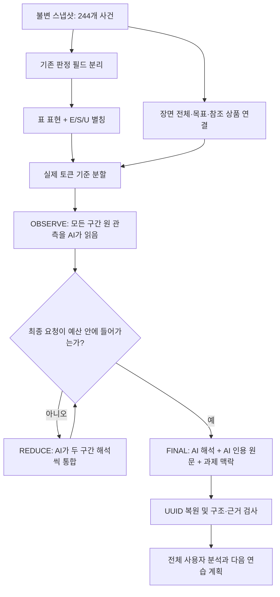

# 행동 분석 프롬프트 1~4번 개선

## 최종 시험 결과

**1~4번 적용과 시험은 완료했지만, 최종 사용자 분석 생성은 아직 실패했다.** 원본 244개 사건을 17개 구간으로 전부 AI에게 보내고 모두 검증을 통과했다. 이어진 통합 과정에서 900토큰 출력이 문장 중간에 잘려 JSON을 완성하지 못했다. 형식 재시도 1회도 같은 이유로 실패하여 최종 분석/연습 계획은 반환하지 않았다.

- 실행 ID: `6af4ded6-29df-4f2d-b694-ae77e53adb98`.
- 시각: 2026-09-05 18:04~18:29 KST.
- 서버 총 처리: **1,530.117초 = 25분 30.117초**, 클라이언트 왕복 1,530.386초.
- 실제 외부 요청 26회: 구간 17회 통과, 통합 7회 통과, 다음 통합 1회 실패와 동일 단계 형식 재시도 1회 실패.
- 최종 상태: `FAILED / INVALID_AI_ANALYSIS`, `analysis: null`. 최종 FINAL 단계에는 도달하지 않았다.
- 검증 통과한 24회 응답의 서버 측 호출·검증 시간은 약 **1.3~3.3초/회**. 전체 시간 대부분은 요청 간격 61초다.
- 이 실행에는 HTTP 413/429가 없었다. 바로 앞 출력 1,200 시험의 429 1회를 합치면 이번 작업의 외부 호출은 총 27회다.
- 25·26번째 rawOutput을 로컬 토크나이저로 다시 계산하니 **각각 정확히 900토큰**이었다. 둘 다 문자열이 닫히기 전에 끝났고 JSON 파싱에 실패했다. 공급자 `finish_reason`은 기존 클라이언트가 저장하지 않지만, 설정된 출력 상한과 실제 잘림 위치가 일치한다.

독립 검증에서 관측 244개·이동 표본 169개의 내용·시간·좌표·순서를 모두 복원했고, 구간 요청을 합쳐 **E1~E244가 순서대로 전부 전송됨**도 확인했다. 현재 프롬프트 107,663자: 최초 879,669자 대비 **87.76% 감소**. 앞 시험의 107,583자와 차이는 짧은 출력 지시를 추가한 데서 발생한다.

```powershell
node scripts/verify-compact-analysis.mjs 5732e7ca-66f9-4e62-bc79-8f496cf8028b 6af4ded6-29df-4f2d-b694-ae77e53adb98
```

### 실제 AI 응답 발췌 — 최종 평가가 아님

첫 구간:

> 사용자가 세션 시작 후 두 단계의 브리핑을 순차적으로 진행함.

> 텍스트 브리핑에 대한 이해도는 관찰 데이터만으로 확인 불가함.

여섯 번째 구간:

> 선반 내에서 '흰 우유'(milk) 1개를 선택하여 장바구니에 추가했다.

> 임무 목표 중 하나인 '흰 우유 900mL 1개'를 정확히 식별하고 선택한 것으로 추정된다.

마지막 구간:

> 계산대 진입 시 장바구니에 '흰 우유'(milk) 1개와 '바나나'(banana) 1개가 포함됨

이것들은 해당 구간을 읽은 AI의 부분 관찰·가설이다. 실제 로그의 E72(우유 수량 0→1), E97(바나나 수량 0→1), E243/E244(장바구니 milk:1, banana:1, 총액 5,800원 및 계산 제출)와 대조할 수 있다. **규격 정보가 보충 카탈로그에 있는데도 직접 확인 불가라고 표현한 부분**, 게임 구역을 ‘냉장실’로 부른 부분 등 의미 해석의 부정확성도 남았다. JSON과 근거 ID 검증 통과는 사실 정확성이나 전문가 수준의 품질 보증이 아니다.

### 남은 문제

입력 크기로 시작도 못 하던 문제는 이번 스냅샷에서 넘겼다. 하지만 통합 응답에 긴 설명과 많은 근거 ID를 반복하여 출력 한도에 걸렸다. 현재 ‘짧게 작성’ 지시만으로 출력 길이가 보장되지는 않는다. 다음에는 통합용 출력 계약을 더 간결하게 설계하고, 저장된 실패 통합 입력만으로 먼저 시험해야 한다. 이번에는 26개 요청 전체를 다시 실행하지 않았다. 잘린 JSON을 서버가 임의로 완성하거나 불완전한 결과를 정상 분석으로 저장하지도 않았다.

## 목적과 변경 범위

원본 행동 기록을 삭제하거나 서버가 중요도를 판단하지 않고, 표현 중복과 단계별 요청 내용을 줄인다. 같은 244개 사건 스냅샷으로 1·2번을 먼저 검사한 뒤, 여전히 한도를 넘어서 3·4번까지 적용했다. DB 로그와 스냅샷은 변경하지 않았다. 변경 버전은 `behavior-analysis-v8-staged`다.

## 무엇이 달라졌나

| 항목 | 이전 | 변경 후 |
|---|---|---|
| 상품 자료 | 일치하는 버전의 전체 60개 상품 | 전체 스냅샷의 장면·목표·사건 참조 상품. 이번 기록은 24개. 범위 불명확 시 전체 유지 |
| 반복 표현 | 상품·배치 객체마다 같은 필드명과 값 반복 | 열 이름·행·공통값을 분리한 가역 표 표현 |
| 보충 상품과 장면 중복 | 같은 상품 속성을 두 군데 전송 | 해당 요청의 장면에 상품 속성이 있으면 보충 목록에서 중복 생략. 원 관측값 우선 |
| ID | 사건 E, 세션 S만 축약 | 기타 UUID도 U 별칭. 전 데이터셋에서 동일 대상의 별칭 유지 |
| 구간 분석 | 구간마다 최종 분석·연습 계획까지 요구 | 관찰·해석·다른 설명·근거·불확실성만 작성 |
| 결과 통합 | 한 번의 큰 통합 요청 | 크면 AI가 두 구간씩 해석 통합. 충분히 작아진 뒤 최종 분석 |
| 원문 재검토 | 구간 해석 위주 | AI가 인용한 사건의 원 관측을 최종 프롬프트에 다시 포함 |
| 출력 예산 | 일괄 4,500토큰 예약 | 구간/최종 별도 설정. 현재 계정 시험 결과 기본값은 각각 900 |

성공·실패와 사용자 능력 해석은 여전히 AI만 작성한다. 서버가 하는 일은 자료 연결, 가역 인코딩, 토큰 계산, 호출 간격, JSON·실제 ID·게임 실행 범위 검사다.

## 구조



원 관측의 표 표현은 무손실이며 왕복 복원 검사 대상이다. **AI가 만드는 중간 해석은 요약이므로 무손실이 아니다.** 따라서 반증·다른 해석·불확실성을 보존하도록 지시하고, 최종 단계에서 AI가 인용한 원 관측을 다시 제공한다. 필요한 원문이 부족하면 판단을 보류하도록 한다. 최종 입력이 계속 너무 크면 원문을 몰래 삭제하지 않고 `FINAL_EVIDENCE_EXCEEDS_LIMIT`으로 중단한다.

현재 REDUCE 단계는 원 관측을 다시 읽는 단계가 아니라 앞선 AI 해석을 통합하는 단계다. 모든 관측을 최초 구간에서 읽었다는 사실이 모든 관측의 의미가 최종 요약에 유지됐다는 증명은 아니다. 전문가 검증·실사용자 성능 검증이 완료된 것도 아니다.

## 1·2번만 적용한 검사

- 전체 60상품 카탈로그 필드: 4,306 → 1,611토큰(표 표현 포함).
- 전체 입력: 약 60,498토큰. 사건 표본을 줄이지 않았으므로 전체를 한 번에 보낼 수는 없었다.
- 가장 먼저 막힌 단일 사건 구간: 입력·출력 예약 합계 12,311 / 로컬 예산 7,000.
- 이 단계는 로컬 토큰 검사이며 외부 API를 호출하지 않았다. 여기서 막혀 3·4번도 적용했다.

## 3·4번 적용 후 첫 API 시험

- 분석 ID: `a88cd521-25ba-4aa0-89f4-66db215d7d90`.
- 데이터셋: `dab3a096-1880-4453-8192-8c2cd21100fc`(244개 사건, 이동 표본 169개).
- 전체 감사 프롬프트: 107,583자. 최초 879,669자 대비 87.77% 감소.
- 17구간으로 분할. 첫 요청: 로컬 입력 계산 5,429토큰, 출력 최대 1,200.
- 공급자 HTTP 429: `Limit=1000 / Requested=1200`. 헤더는 전체 토큰 한도 8,000, 남은 토큰 8,000.
- 서버 처리 2.924초, 클라이언트 왕복 3.098초. `AI_RATE_LIMITED`, AI 출력 없음. 이후 구간은 실행하지 않았다.

요청 출력 최대치와 오류 Requested 값이 같아 출력 측 한도로 판단했다. 당시 로그는 입력/출력 하위 한도를 구분하지 못했으므로 이 해석을 계정의 공식 한도 확정치로 표시하지 않는다. 이후 진단 로그는 ITPM/OTPM 문구를 구분하도록 보강했다.

같은 요청의 무한 재시도 대신 **출력 최대치를 900으로 바꾼 새 설정으로 한 번 재분석**했다. 구간에는 핵심 관찰 1~3개, 최종 결과에는 핵심 finding 1~2개와 짧은 설명을 권장하되, 근거·다른 설명·불확실성을 빼지 않도록 했다. 최대 개수는 모델의 표현 지침이지 서버의 능력 판단 기준이 아니다.

## 검증 방법

- 백엔드 전체 테스트 91개 통과, 실패·오류 0개(실제 스냅샷 진단 및 예약 키 경계 검사 포함). 이후 저장된 출력 잘림 진단을 추가한 관련 테스트 2개도 통과했다. AI 계약 테스트의 모의 응답 성공과 실 API 결과는 구분한다.
- 표 인코딩의 순서, 공통값, 명시적 null과 누락, 0/false/빈 값, 예약 키 이스케이프 왕복 검사.
- 당시 장면의 미구매 상품·목표 대안 포함, 장면 누락 시 전체 카탈로그 유지, 버전 불일치 시 현재 자료를 붙이지 않는 검사.
- 사건·세션·기타 UUID의 고정 별칭과 원문 복원. 없는 근거·다른 세션 근거·잘못된 JSON은 거부.
- 구간의 원 관측은 순서대로 전부 포함. 구간 해석·통합·최종 출력은 별도 계약으로 검사.
- 공급자 오류 즉시 중단, JSON/근거 오류만 1회 재시도. 서버 대체 판정 없음.

독립 원 관측 복원 검사:

```powershell
node scripts/verify-compact-analysis.mjs 5732e7ca-66f9-4e62-bc79-8f496cf8028b a88cd521-25ba-4aa0-89f4-66db215d7d90
```

이 검사는 모든 기존 판정 필드 제외 후의 관측 내용이 동일함을 확인한다. 전체 60개 보충 상품 자료의 선별은 무손실 관측 인코딩과 별개의 명시적 범위 조정이다. 새 퀘스트 생성용 전체 상품 자료는 변경하지 않았다.

## 후속 단독 재검증

이 문서는 당시 전체 실행의 실패 기록이다. 이후 실패한 25번째 REDUCE만 재실행하여 최대 출력 900에서 481토큰·1.975초로 계약 검증을 통과했다. 또한 최대 출력 1,200도 수락되어 이전 오류의 1,000을 고정 출력 상한으로 확정할 수 없음을 확인했다. 전체 FINAL 성공 여부는 아직 미검증이다. 상세: [통합 요청 단독 재검증](reduce-replay-report-2026-09-05.md).

## 설정 및 운영상 한계

- `AI_ANALYSIS_REQUEST_TOKEN_BUDGET`: 기본 7,000. 실제 텍스트 토큰 + 프레이밍 여유 64 + 출력 최대 예약의 **로컬 보수적 예산**이다.
- `AI_ANALYSIS_CHUNK_OUTPUT_TOKENS`: 기본 900. OBSERVE/REDUCE에 적용.
- `AI_ANALYSIS_FINAL_OUTPUT_TOKENS`: 기본 900. 단건 전체 분석/FINAL에 적용.
- 기존 일괄 `AI_ANALYSIS_OUTPUT_TOKENS` 설정은 단계별 설정으로 대체했다.
- 분석 호출 간격 61초는 유지한다. 다른 기능·서버·계정 사용량에 따른 거절까지 보장하지 않는다.
- 구간 상한 64, 전체 시도 상한 129. 중간 실패 시 남은 구간·통합은 중단한다.
- 전체 분석은 동기 요청이다. 여러 구간과 통합이 필요하면 수십 분 걸릴 수 있다. 현재 화면/클라이언트 타임아웃과 진행 표시의 적합성은 별도 확인이 필요하다.
- 원본 기록·스냅샷·프론트 코드는 수정하지 않았다. 계정 요금제·모델·결제 설정도 바꾸지 않았다.
