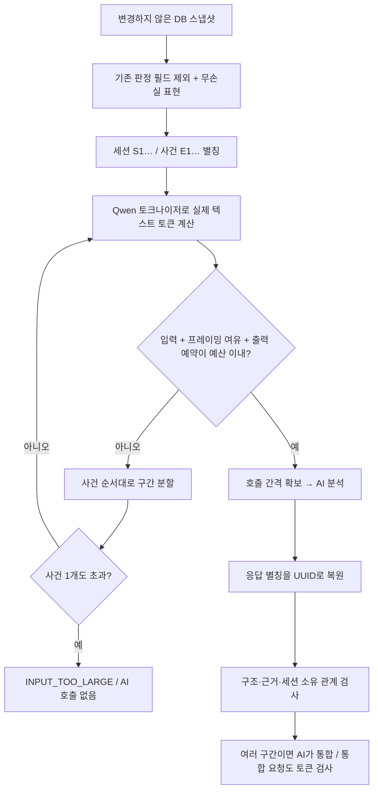

# 실제 토큰 분할·짧은 ID 적용 및 동일 로그 재검사

## 결론

2026-09-05, 요청한 실제 토큰 기준 분할과 사건·세션 ID 별칭을 적용했다. **원본 관측 보존은 확인했지만, 동일 244개 기록의 AI 분석 완료는 아직 실패**했다. 이번에는 공급자에게 초과 요청을 보내지 않고 서버의 요청 크기 검사에서 중단했다. 사용자 수행 실패나 AI의 분석 거부를 뜻하지 않는다.

## 변경 구조



- 문자 수 60,000 기준을 제거했다. 단건·구간·형식 재시도·최종 통합에 토큰 검사를 적용한다.
- `ai.behavior-analysis.request-token-budget`: 기본 **7,000**. 이전 실제 공급자 오류 본문의 제한을 바탕으로 설정한 **로컬 보수적 요청 예산**이다. 계정의 공식 TPM 수치나 모델 컨텍스트 크기와 동일하다는 뜻은 아니다.
- `ai.behavior-analysis.output-tokens`: 기존 **4,500** 유지. `텍스트 입력 토큰 + 프레이밍 여유 64 + 출력 최대 예약`을 합산한다. 제공자의 내부 예약 계산과 정확히 같다고 주장하지 않는다.
- 구간 수 상한 64 유지. 단일 사건이 너무 커도 그 사건을 삭제하거나 중간에서 잘라 보내지 않는다.
- 단일 서버 프로세스의 분석 요청은 61초 간격으로 직렬화한다. 다른 API 기능·다른 서버·동일 계정을 사용하는 외부 요청의 할당량까지 보장하지 않는다. 429/통신 실패는 자동 재시도하지 않고, 형식·근거 오류만 한 번 재시도한다.
- Qwen3.6-27B 공식 tokenizer.json을 로컬에서 사용한다. 약 13MB의 토크나이저 자료이며 **모델 가중치 로딩이 아니다**. SHA-256 검증, 모델명 일치 검사, 절단 없는 토큰 계산을 사용한다. 로딩 실패 시 문자 수 추정으로 대체하지 않는다.
- 짧은 ID는 데이터셋 전체 순서로 부여한다. 뒤 구간에서 E1부터 다시 시작하지 않는다. 원본 DB를 수정하거나 UUID 대응표를 AI에게 다시 보내지 않는다. 감사 시 불변 스냅샷에서 매핑을 재현한다.
- 응답의 `evidenceEventIds`와 `sessionId`만 UUID로 복원한다. 서술문은 치환하지 않는다. 없는 별칭, 사건/세션 별칭 혼용, 다른 구간·세션의 근거는 검증에서 거부한다. 감사 rawOutput은 공급자 원문, 최종 result는 복원된 UUID다.
- 서버는 성공·실패 판정을 생성하지 않는다. AI 판단이 없으면 `analysis: null`이다.

## 동일 244개 관측의 보존·축소 결과

대상 데이터셋: `dab3a096-1880-4453-8192-8c2cd21100fc`.

| 항목 | 결과 |
|---|---:|
| 전체 관측 | 244개 전부 유지 |
| 이동 좌표 관측 | 169개 전부 유지 |
| 최초 사용자 프롬프트 | 879,669자 |
| 앞선 무손실 표현 적용 후 | 145,377자 |
| 이번 짧은 ID 적용 후 | 137,550자 |
| 최초 대비 문자 수 감소 | 84.36% |

별도 로컬 진단에서 같은 v6 프롬프트의 ID 치환 전후 사용자 텍스트는 **70,605 → 63,706토큰**, 6,899토큰(약 9.77%) 감소했다. 이 비교는 v5 대 v6 전체 변경 비교가 아니라, v6 생성기의 별칭 적용 전후 비교다. JSON 키 순서는 프로세스에 따라 달라질 수 있어 토큰 수가 소폭 달라질 수 있다.

진단에서 시스템 텍스트는 541토큰, 전체 입력은 프레이밍 여유 포함 64,311토큰이었다. 주요 사용자 필드의 개별 토큰 수는 다음과 같다. 필드를 따로 토큰화한 수치이므로 전체와 단순 합이 정확히 일치하지 않을 수 있다.

| 필드 | 토큰 |
|---|---:|
| behaviorTimeline | 57,589 |
| matchingContentCatalog: 전체 상품 자료 | 4,306 |
| evidenceCards | 746 |
| outputContract | 475 |
| availablePracticeScenarios | 304 |

독립 검증 스크립트로 압축을 해제하고 ID를 복원한 뒤 최초 입력과 비교했다. 기존 판정 필드 제외 정책 이후의 **모든 관측 JSON이 일치**했다. 좌표·순서·시간·내용을 줄여 얻은 감소가 아니다.

```powershell
node scripts/verify-compact-analysis.mjs 5732e7ca-66f9-4e62-bc79-8f496cf8028b 92f93def-20c2-41d0-8301-4ab6540f2e6f
```

## 실제 백엔드 재실행 결과

- 새 백엔드로 테스트 계정 API 로그인 성공 후 기존 스냅샷 재분석 엔드포인트를 호출했다. 무무 화면에서의 로그인 완료를 뜻하지 않는다.
- 시각: 2026-09-05 17:38 KST.
- 분석 ID: `92f93def-20c2-41d0-8301-4ab6540f2e6f`.
- 결과: `INPUT_TOO_LARGE`.
- 상세: `SINGLE_EVENT_EXCEEDS_LIMIT: required=15811, limit=7000`.
- 서버 처리: **6.483초**. 클라이언트 왕복: **7.413초**. 첫 토크나이저 초기화가 포함되며 AI 생성 시간이 아니다.
- 외부 AI 호출: **0회**. 반환된 분석 문장: **없음**. 244개 스냅샷은 그대로이며 새로운 감사 기록만 추가됐다.

가장 먼저 막힌 1개 사건 구간도 입력·공통 자료·구간/재시도 여유가 약 **11,311토큰**, 출력 예약 4,500을 합치면 **15,811**이다. 출력 예약을 모두 제거하더라도 이 입력은 7,000보다 크다. 따라서 출력 한도만 줄이거나 호출 간격을 늘려서는 이번 데이터가 통과하지 않는다.

## 한계와 다음 작업

이번 범위에서는 전체 60상품 카탈로그의 선별, 사건 내부 자료의 추가 분할, 프롬프트 내용 삭제, 출력 4,500 축소, 다단계 통합 재설계는 하지 않았다. **현재 보수적 기본 예산에서는 소규모 로그도 공통 설명과 출력 예약 때문에 막힐 수 있다.** 토큰 검사가 통과한다고 생성 품질이나 최종 통합 성공을 보장하지 않는다.

다음 우선순위는 로그 표본 삭제가 아니라 **상품·장면 자료의 반복 구조를 더 작게 표현하고, 분석에 필요한 공통 설명의 중복을 줄이는 것**이다. 사건 하나가 여전히 크다면 내용 손실 없는 사건 내부 조각화도 필요하다. 공통 자료 축소 효과를 다시 계측한 뒤, 구간 결과 계약 및 출력 예약 조정을 별도로 검토해야 한다. 요금제나 모델을 임의로 바꾸지 않았다.

## 검증

- 전체 백엔드 테스트 **85개 통과, 실패·오류 0개**(옵트인 실제 스냅샷 진단 포함). 이후 구간→통합 ID 일관성 테스트를 추가한 관련 테스트 묶음 **6개도 통과**했다.
- 구간별 E1/E2 유지, 통합 입력의 동일 ID 참조, UUID 결과 복원과 각 요청의 예산 준수를 모의 AI 응답으로 확인했다.
- 실제 Qwen 토크나이저: 내용별 토큰 수 차이, 긴 입력 비절단 검증.
- 짧은 ID 복원, 미등록 ID·ID 종류 혼동·잘못된 세션 근거·추가 JSON 거부 검증.
- 기존 형식 오류 1회 재시도, 공급자 오류 중단, 서버 대체 판정 금지 검증.
- 실제 244개 관측의 독립 왕복 복원 검증 통과.
- Mock 응답 계약 테스트는 12,000 등 명시적 테스트 예산을 사용한다. 이를 무료 계정에서의 AI 성공으로 해석하면 안 된다. 실제 기본 7,000에서 호출 전 중단도 별도로 검증한다.

## 출처·구현

- [Qwen 공식 토크나이저 고정 리비전](https://huggingface.co/Qwen/Qwen3.6-27B/tree/6a9e13bd6fc8f0983b9b99948120bc37f49c13e9): 원본 파일 및 Apache-2.0 LICENSE를 리소스에 포함.
- [DJL 공식 토크나이저 구현](https://github.com/deepjavalibrary/djl/blob/v0.36.0/extensions/tokenizers/src/main/java/ai/djl/huggingface/tokenizers/HuggingFaceTokenizer.java).
- [Groq rate limits](https://console.groq.com/docs/rate-limits): 공급자 한도와 로컬 보수적 예산을 구분해야 한다.
