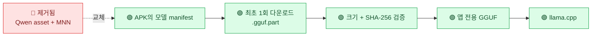

# Bllossom 3B 온디바이스 모델 실행 가이드

## 현재 구성

오늘도 Android 앱은 `Bllossom/llama-3.2-Korean-Bllossom-3B-gguf-Q4_K_M`의 단일 GGUF 파일을 llama.cpp로 실행한다.

| 항목 | 값 |
|---|---|
| 모델 형식 | GGUF `Q4_K_M` |
| 모델 크기 | 2,019,377,664바이트 |
| 런타임 | llama.cpp `b10455` |
| Android ABI | `arm64-v8a`, `x86_64` |
| 저장 위치 | 앱 전용 `noBackupFilesDir/models/bllossom-3b-q4-k-m` |

모델 본체는 APK나 Git에 넣지 않는다. APK에는 URL·크기·SHA-256이 담긴 작은 manifest만 포함하고, 앱의 `prepareModel()`이 최초 실행 시 GGUF를 내려받아 검증한다.



## 개발 빌드 만들기

```powershell
cd C:\git\Oneuldo\frontend
pnpm llama:android:build
pnpm exec expo prebuild --platform android --clean
cd android
.\gradlew.bat :app:assembleDebug
```

생성 APK는 `frontend/android/app/build/outputs/apk/debug/app-debug.apk`에 있다. 네이티브 라이브러리를 바꾸지 않았다면 매번 `pnpm llama:android:build`를 다시 실행할 필요는 없다.

## 최초 모델 준비 흐름

1. 앱이 번들 manifest를 읽는다.
2. 약 2.28GB(모델 + 안전 여유 공간)의 저장 공간을 확인한다.
3. GGUF를 `.part` 파일로 다운로드한다.
4. 정확한 파일 크기와 SHA-256을 검사한다.
5. 통과한 파일만 최종 `.gguf` 이름으로 바꾸고 준비 완료 marker를 기록한다.
6. 다음 실행부터 revision, marker, 파일 크기가 같으면 다운로드를 재사용한다.

다운로드가 끊기거나 checksum이 다르면 임시 파일을 지우고 오류를 반환한다. 검증되지 않은 파일은 llama.cpp에 전달하지 않는다.

## 기기 검증

```powershell
adb devices -l
adb install -r C:\git\Oneuldo\frontend\android\app\build\outputs\apk\debug\app-debug.apk
```

- 실제 Android 기기: `arm64-v8a` 로딩, 초기화 시간, 생성 속도, 최대 메모리를 우선 측정한다.
- MuMu: `x86_64` 라이브러리 로딩과 기능 회귀를 확인한다.
- 최초 다운로드에는 약 2GB 네트워크가 필요하므로 Wi-Fi와 충분한 저장 공간을 준비한다.

## 주요 오류

| 코드 | 뜻 |
|---|---|
| `MODEL_MISSING` | APK에 모델 manifest가 없음 |
| `NETWORK_UNAVAILABLE` | DNS·연결 실패 |
| `MODEL_DOWNLOAD_FAILED` | HTTP·다운로드 실패 |
| `MODEL_CORRUPTED` | 크기 또는 SHA-256 불일치 |
| `INSUFFICIENT_STORAGE` | 앱 저장 공간 부족 |
| `INITIALIZATION_FAILED` | GGUF 또는 llama.cpp 초기화 실패 |

