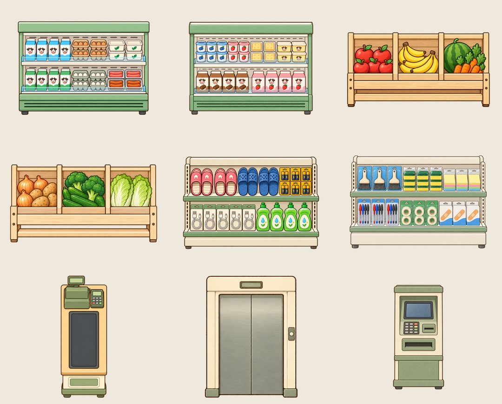

# 마트 직교 정면 에셋 제작 기록

2026-09-11. 기존 마트 그림의 따뜻한 크림·세이지 색과 갈색 윤곽을 유지하면서, 냉장·과일/채소 진열대의 벌어지는 투시를 줄이고 생활용품 진열대, 세로 계산대, 엘리베이터, ATM을 추가했다.

## 생성·편집 방법

- imagegen 스킬을 읽고 기존 로컬 이미지를 `view_image`로 확인했다. 모든 새 그림과 배경 수정은 기본 built-in `image_gen` 도구에서 에셋마다 별도 호출로 제작했다.
- CLI/API 이미지 생성 또는 다른 이미지 모델로 전환하지 않았다. 기존 에셋은 전부 보존했다.
- 첫 생성에서 ATM은 실제 RGBA 투명 PNG로 반환되었다. 나머지 여덟 장은 RGB 체커보드였으므로 그 상태로 적용하지 않았다.
- 두 번째 배경 제거 편집에서 진열대 여섯 장은 실제 RGBA 투명 PNG로 반환되어 채택했다.
- 계산대와 엘리베이터는 두 번째에도 RGB 체커보드여서, 세 번째 built-in 편집으로 외부 배경을 순수 마젠타로 정리했다. 이후 PNG 패키징 시 `r > 90 && b > 90 && min(r,b) - g > 25`에 해당하는 배경의 alpha만 0으로 바꾸었다. 마스크 패키징 전후 RGB 변경 픽셀은 0개였으며, 물체 그림은 추가로 그리거나 변형하지 않았다.
- 계산대는 생성 도구에서 벨트 길이를 줄여 가구 몸통의 높이:너비가 약 2.45:1이 되도록 조정했다. 윗쪽 표시기까지 포함한 전체 실루엣은 447×1182, 약 2.64:1이다.
- 계산대·엘리베이터는 실제 alpha 경계로 자른 뒤 사방 8px 투명 여백을 붙이고 긴 변 512px로 축소했다. 다른 일곱 장은 기존 캔버스 비율을 유지하고 긴 변만 512px로 축소했다. 패키징에는 번들에 설치된 Sharp와 프로젝트에 설치된 pngjs를 사용했으며 앱 의존성을 추가하지 않았다.

## 최종 에셋

모두 `frontend/assets/images/game/market/interior/` 아래에 저장했다. 최종 9개 PNG는 모두 유형 6(RGBA), alpha 범위 0–255이며 완전 투명 픽셀과 실체 픽셀이 함께 존재한다.

| 용도 | 파일 | 최종 크기 | 완전 투명 픽셀 | 파일 크기 |
|---|---|---|---:|---:|
| 냉장 식품 | `shelf_fresh_ortho_v1.png` | 512×341 | 45,913 | 248.3 KiB |
| 냉장 식품 변형 | `shelf_fresh_variant_ortho_v1.png` | 512×341 | 53,904 | 261.0 KiB |
| 과일 | `shelf_produce_ortho_v1.png` | 512×341 | 67,809 | 223.4 KiB |
| 채소 | `shelf_produce_variant_ortho_v1.png` | 512×341 | 62,732 | 259.5 KiB |
| 생활용품 A | `shelf_household_ortho_v1.png` | 512×341 | 43,929 | 287.9 KiB |
| 생활용품 B | `shelf_household_variant_ortho_v1.png` | 512×341 | 43,547 | 276.6 KiB |
| 세로 계산대 | `checkout_vertical_ortho_v1.png` | 198×512 | 9,560 | 133.0 KiB |
| 엘리베이터 | `elevator_front_ortho_v1.png` | 390×512 | 11,479 | 272.0 KiB |
| ATM | `atm_front_ortho_v1.png` | 341×512 | 87,128 | 154.5 KiB |

전체 파일 크기는 2.07 MiB다. 원래 해상도의 채택 파일은 로컬 `frontend/.expo/market-ortho-full-resolution/`에 보존했으며, built-in 원본 생성 파일도 아래 경로에 남아 있다.

## 검증

PNG IHDR 유형, 해상도, alpha 분포를 검사하고, 최종 로컬 파일을 `view_image`로 확인했다. 투명을 무시하고 RGB만 표시하는 뷰와 구별하기 위해 최종 9개를 크림 배경에 alpha 합성한 별도 QA 시트도 확인했다. 시트에서 체커보드·마젠타 배경이 남지 않고 진열 상품, 닫힌 엘리베이터 문, ATM, 세로 벨트와 계산기가 분명히 보인다.

진열대의 곧은 몸통을 확인한 결과 최종 512px 이미지의 y=80/120 구간에서 냉장 A는 x=44–467, 냉장 B는 x=56–455로 동일했다. 과일은 x=25–487로 동일하고 채소는 오른쪽 윤곽에 1px 차이가 있었다. 생활용품 A는 왼쪽 윤곽 1px 차이, B는 x=38–474로 동일했다. 선반 돌출부와 두꺼운 하부 다리 부분은 가구 구조상 다른 폭을 가진다.

QA 시트 순서는 왼쪽부터 오른쪽, 위에서 아래로 냉장 A·냉장 B·과일 / 채소·생활용품 A·생활용품 B / 계산대·엘리베이터·ATM이다.

이 문서는 이미지 제작과 패키징 범위를 기록한다. 실제 앱 배치와 상호작용 검증은 마트 UI 통합 작업에서 수행한다.

## 생성 원본 경로

| 용도 | 1차 원본 | 최종 선택 그림 원본 |
|---|---|---|
| 냉장 식품 | `C:/Users/PC/.codex/generated_images/01a08eda-464c-71d3-b4d1-b96c7493f381/exec-39dbac7f-a312-495a-8c6e-50cd6afd6b6e.png` | `C:/Users/PC/.codex/generated_images/01a08eda-464c-71d3-b4d1-b96c7493f381/exec-87b1f39a-1b3d-4e7e-bfa9-3f1e6dc3f8b0.png` |
| 냉장 식품 변형 | `C:/Users/PC/.codex/generated_images/01a08eda-464c-71d3-b4d1-b96c7493f381/exec-be85fc93-a6bf-4fa0-a496-16d210bb150f.png` | `C:/Users/PC/.codex/generated_images/01a08eda-464c-71d3-b4d1-b96c7493f381/exec-ba87206a-42d1-415a-856e-ae89faad55cc.png` |
| 과일 | `C:/Users/PC/.codex/generated_images/01a08eda-464c-71d3-b4d1-b96c7493f381/exec-a348f169-0f78-45d3-aa73-2a049ac9b9a1.png` | `C:/Users/PC/.codex/generated_images/01a08eda-464c-71d3-b4d1-b96c7493f381/exec-3e8ab1b2-a594-4aa5-8676-0b1249656d9c.png` |
| 채소 | `C:/Users/PC/.codex/generated_images/01a08eda-464c-71d3-b4d1-b96c7493f381/exec-1684673f-46bb-4cab-86b7-c9cdf984beb0.png` | `C:/Users/PC/.codex/generated_images/01a08eda-464c-71d3-b4d1-b96c7493f381/exec-b3e615df-ba2a-41ee-928d-1edeb52960e2.png` |
| 생활용품 A | `C:/Users/PC/.codex/generated_images/01a08eda-464c-71d3-b4d1-b96c7493f381/exec-3d6d8265-6202-4052-807a-99e723dde09c.png` | `C:/Users/PC/.codex/generated_images/01a08eda-464c-71d3-b4d1-b96c7493f381/exec-94deaaad-e5bd-409d-b76d-38c68130bca7.png` |
| 생활용품 B | `C:/Users/PC/.codex/generated_images/01a08eda-464c-71d3-b4d1-b96c7493f381/exec-558b2f1a-6c86-40b4-91f9-a1acb4f1c081.png` | `C:/Users/PC/.codex/generated_images/01a08eda-464c-71d3-b4d1-b96c7493f381/exec-91379f4d-fc71-494d-bf10-fc740cc2efeb.png` |
| 세로 계산대 | `C:/Users/PC/.codex/generated_images/01a08eda-464c-71d3-b4d1-b96c7493f381/exec-293d14c5-625a-4131-9583-c53170c0ed09.png` | `C:/Users/PC/.codex/generated_images/01a08eda-464c-71d3-b4d1-b96c7493f381/exec-4a74ccf1-c1da-4ee1-ba11-0241532be6ce.png` |
| 엘리베이터 | `C:/Users/PC/.codex/generated_images/01a08eda-464c-71d3-b4d1-b96c7493f381/exec-717719bd-b662-44fa-9b01-4dafb3f67a13.png` | `C:/Users/PC/.codex/generated_images/01a08eda-464c-71d3-b4d1-b96c7493f381/exec-1af50868-1f3c-43d6-ac83-c33d91450d78.png` |
| ATM | `C:/Users/PC/.codex/generated_images/01a08eda-464c-71d3-b4d1-b96c7493f381/exec-7afbb247-1915-4f0b-b975-a8281768dc76.png` | `C:/Users/PC/.codex/generated_images/01a08eda-464c-71d3-b4d1-b96c7493f381/exec-7afbb247-1915-4f0b-b975-a8281768dc76.png` |

## 실제 프롬프트 전체

### 1. 냉장 식품

입력: `C:/Users/PC/Documents/Oneuldo/frontend/assets/images/game/market/interior/shelf_fresh_v2.png`

Use case: precise-object-edit. Rebuild the supplied sage-green refrigerated food cabinet in strict orthographic frontal projection. Retain two stocked shelf tiers and the milk cartons, egg cartons, tofu tubs and sausage packs arranged in clear groups. The cabinet consists of a straight flat rectangular green top fascia, two rectangular horizontal shelves and a green lower base with two small feet. No curved hood or diagonal side rails. Critical geometry: perfectly straight-on ORTHOGRAPHIC FRONT ELEVATION, rectangular silhouette. Left and right sides must be exactly vertical and parallel. Every shelf edge must be exactly horizontal. The width at the top is EXACTLY the width at the bottom. No trapezoid, no flaring, no perspective, no convergence, no tilted horizontal lines, no visible side walls, no slanted side edges. Show product front faces clearly. Keep the reference materials and items but rebuild the cabinet projection to a strict rectangle. Output one standalone illustrated game sprite only. Cozy warm hand-painted cartoon illustration, muted cream and sage green, subtle watercolor texture, clean brown outlines, matching the reference art. Keep the whole object visible with a small even transparent margin. Actual transparent PNG alpha background, empty alpha pixels around the object. Do not paint a transparency checkerboard. No solid background, no gray grid, no floor, no shadows outside the object, no environment, no other objects, no people, no lettering, no prices, no logos, no watermark.

### 2. 냉장 식품 변형

입력: `C:/Users/PC/Documents/Oneuldo/frontend/assets/images/game/market/interior/shelf_fresh_variant_v1.png`

Use case: precise-object-edit. Rebuild the supplied sage-green refrigerated food cabinet in strict orthographic frontal projection. Retain two stocked shelf tiers with fruit yogurt cups, cheese packs, butter tubs, chocolate milk and strawberry milk cartons in clear groups. The cabinet consists of a straight flat rectangular green top fascia, two rectangular horizontal shelves and a green lower base with two small feet. No curved hood or diagonal side rails. This will pair with a second identical cabinet displaying plain milk and eggs. Critical geometry: perfectly straight-on ORTHOGRAPHIC FRONT ELEVATION, rectangular silhouette. Left and right sides must be exactly vertical and parallel. Every shelf edge must be exactly horizontal. The width at the top is EXACTLY the width at the bottom. No trapezoid, no flaring, no perspective, no convergence, no tilted horizontal lines, no visible side walls, no slanted side edges. Show product front faces clearly. Keep the reference materials and items but rebuild the cabinet projection to a strict rectangle. Output one standalone illustrated game sprite only. Cozy warm hand-painted cartoon illustration, muted cream and sage green, subtle watercolor texture, clean brown outlines, matching the reference art. Keep the whole object visible with a small even transparent margin. Actual transparent PNG alpha background, empty alpha pixels around the object. Do not paint a transparency checkerboard. No solid background, no gray grid, no floor, no shadows outside the object, no environment, no other objects, no people, no lettering, no prices, no logos, no watermark.

### 3. 과일

입력: `C:/Users/PC/Documents/Oneuldo/frontend/assets/images/game/market/interior/shelf_produce_v2.png`

Use case: precise-object-edit. Rebuild the supplied light natural wooden produce stand as a strict rectangular orthographic front elevation. Retain apples in the left bin, bananas in the middle, watermelon and carrots in the right. Three equal rectangular produce compartments separated by perfectly vertical wooden posts. The bin outer side edges must be straight vertical from top to bottom; remove the source image's diagonal splayed/trapezoid outer rails completely. Show an upright wooden backboard, low horizontal bin fronts, a bottom stretcher and two short legs. Show enough produce above the low front boards to identify it, with no tilted or sloped viewing projection. Critical geometry: perfectly straight-on ORTHOGRAPHIC FRONT ELEVATION, rectangular silhouette. Left and right sides must be exactly vertical and parallel. Every shelf edge must be exactly horizontal. The width at the top is EXACTLY the width at the bottom. No trapezoid, no flaring, no perspective, no convergence, no tilted horizontal lines, no visible side walls, no slanted side edges. Show product front faces clearly. Keep the reference materials and items but rebuild the cabinet projection to a strict rectangle. Output one standalone illustrated game sprite only. Cozy warm hand-painted cartoon illustration, muted cream and sage green, subtle watercolor texture, clean brown outlines, matching the reference art. Keep the whole object visible with a small even transparent margin. Actual transparent PNG alpha background, empty alpha pixels around the object. Do not paint a transparency checkerboard. No solid background, no gray grid, no floor, no shadows outside the object, no environment, no other objects, no people, no lettering, no prices, no logos, no watermark.

### 4. 채소

입력: `C:/Users/PC/Documents/Oneuldo/frontend/assets/images/game/market/interior/shelf_produce_variant_v1.png`

Use case: precise-object-edit. Rebuild the supplied light natural wooden vegetable stand as a strict rectangular orthographic front elevation. Retain onions and potatoes in left bin, broccoli and cucumbers in middle, pale green napa cabbages in right. Three equal rectangular vegetable compartments separated by perfectly vertical wooden posts. The bin outer side edges must be straight vertical from top to bottom; remove the source image's diagonal splayed/trapezoid outer rails completely. Show an upright wooden backboard, low horizontal bin fronts, a bottom stretcher and two short legs. Show vegetables above low front boards, with no tilted or sloped viewing projection. Critical geometry: perfectly straight-on ORTHOGRAPHIC FRONT ELEVATION, rectangular silhouette. Left and right sides must be exactly vertical and parallel. Every shelf edge must be exactly horizontal. The width at the top is EXACTLY the width at the bottom. No trapezoid, no flaring, no perspective, no convergence, no tilted horizontal lines, no visible side walls, no slanted side edges. Show product front faces clearly. Keep the reference materials and items but rebuild the cabinet projection to a strict rectangle. Output one standalone illustrated game sprite only. Cozy warm hand-painted cartoon illustration, muted cream and sage green, subtle watercolor texture, clean brown outlines, matching the reference art. Keep the whole object visible with a small even transparent margin. Actual transparent PNG alpha background, empty alpha pixels around the object. Do not paint a transparency checkerboard. No solid background, no gray grid, no floor, no shadows outside the object, no environment, no other objects, no people, no lettering, no prices, no logos, no watermark.

### 5. 생활용품 A

입력: `C:/Users/PC/Documents/Oneuldo/frontend/assets/images/game/market/interior/shelf_meal_v2.png`

Use case: precise-object-edit. Use the supplied cream and sage-green retail shelf as the furniture and art reference. Replace its food with daily household supplies. Build a strict rectangular, upright orthographic front-view shop shelf with two broad horizontal levels, slim vertical cream side posts and sage-green front shelf trim. Top level holds slippers, bathroom slippers and battery packs; bottom level holds neatly packaged charging cables and dishwashing liquid bottles. Objects recognizable by shape and small simple icons without printed words. Keep every product contained within the shelf. This is the first of a matching two-shelf household section. Critical geometry: perfectly straight-on ORTHOGRAPHIC FRONT ELEVATION, rectangular silhouette. Left and right sides must be exactly vertical and parallel. Every shelf edge must be exactly horizontal. The width at the top is EXACTLY the width at the bottom. No trapezoid, no flaring, no perspective, no convergence, no tilted horizontal lines, no visible side walls, no slanted side edges. Show product front faces clearly. Keep the reference materials and items but rebuild the cabinet projection to a strict rectangle. Output one standalone illustrated game sprite only. Cozy warm hand-painted cartoon illustration, muted cream and sage green, subtle watercolor texture, clean brown outlines, matching the reference art. Keep the whole object visible with a small even transparent margin. Actual transparent PNG alpha background, empty alpha pixels around the object. Do not paint a transparency checkerboard. No solid background, no gray grid, no floor, no shadows outside the object, no environment, no other objects, no people, no lettering, no prices, no logos, no watermark.

### 6. 생활용품 B

입력: `C:/Users/PC/Documents/Oneuldo/frontend/assets/images/game/market/interior/shelf_meal_v2.png`

Use case: precise-object-edit. Use the supplied cream and sage-green retail shelf as the furniture and art reference. Replace its food with daily household supplies. Build a strict rectangular, upright orthographic front-view shop shelf with two broad horizontal levels, slim vertical cream side posts and sage-green front shelf trim. Top level holds cleaning brushes, kitchen scrub sponges and memo-paper pads; bottom level holds neatly packaged ballpoint pens, tape rolls and adhesive bandage boxes. Objects recognizable by shape and small simple icons without printed words. Keep every product contained within the shelf. This is the second of a matching two-shelf household section. Critical geometry: perfectly straight-on ORTHOGRAPHIC FRONT ELEVATION, rectangular silhouette. Left and right sides must be exactly vertical and parallel. Every shelf edge must be exactly horizontal. The width at the top is EXACTLY the width at the bottom. No trapezoid, no flaring, no perspective, no convergence, no tilted horizontal lines, no visible side walls, no slanted side edges. Show product front faces clearly. Keep the reference materials and items but rebuild the cabinet projection to a strict rectangle. Output one standalone illustrated game sprite only. Cozy warm hand-painted cartoon illustration, muted cream and sage green, subtle watercolor texture, clean brown outlines, matching the reference art. Keep the whole object visible with a small even transparent margin. Actual transparent PNG alpha background, empty alpha pixels around the object. Do not paint a transparency checkerboard. No solid background, no gray grid, no floor, no shadows outside the object, no environment, no other objects, no people, no lettering, no prices, no logos, no watermark.

### 7. 세로 계산대

입력: `C:/Users/PC/Documents/Oneuldo/frontend/assets/images/game/market/interior/checkout_front_v2.png`

Use case: precise-object-edit. Create a supermarket checkout fixture using the supplied reference's cream, natural light wood and sage-green materials. Change its orientation to a long narrow VERTICAL checkout counter: the object's long axis runs from the TOP of the image to the BOTTOM, in a game floor plan. The register and small card terminal are located at the TOP end; a long charcoal conveyor belt runs vertically down toward the BOTTOM end. Show this from above at a slightly elevated game camera using PARALLEL ORTHOGRAPHIC projection so both long side rails are exactly vertical and parallel and the width stays constant from top to bottom. No diagonal isometric orientation and no trapezoid perspective. The counter top occupies a vertical rectangular footprint, with a small cream/sage front base face at the bottom. No cashier or human. A single counter only. Portrait composition with length about 2.6 times the width. Output one standalone illustrated game sprite only. Cozy warm hand-painted cartoon illustration, muted cream and sage green, subtle watercolor texture, clean brown outlines, matching the reference art. Keep the whole object visible with a small even transparent margin. Actual transparent PNG alpha background, empty alpha pixels around the object. Do not paint a transparency checkerboard. No solid background, no gray grid, no floor, no shadows outside the object, no environment, no other objects, no people, no lettering, no prices, no logos, no watermark.

### 8. 엘리베이터

입력: `C:/Users/PC/Documents/Oneuldo/frontend/assets/images/game/market/interior/checkout_front_v2.png`

Use case: stylized-concept. Asset type: a decorative elevator for the same warm illustrated supermarket as the input STYLE REFERENCE. Create one closed elevator unit in perfectly straight orthographic FRONT elevation, a simple tall rectangular cream surround with two equal brushed silver/sage-gray sliding doors meeting at a straight vertical center seam, a small unlettered rectangular indicator centered above, and one small side call button. Warm muted palette, gentle painted texture and rounded dark-brown outlines like the reference. Entire outer left and right sides are vertical and parallel; the top/bottom widths identical. No perspective or visible side wall. This is ONE elevator with TWO closed door leaves, not two elevator units. Its silhouette must be isolated for placement against a game wall. Output one standalone illustrated game sprite only. Cozy warm hand-painted cartoon illustration, muted cream and sage green, subtle watercolor texture, clean brown outlines, matching the reference art. Keep the whole object visible with a small even transparent margin. Actual transparent PNG alpha background, empty alpha pixels around the object. Do not paint a transparency checkerboard. No solid background, no gray grid, no floor, no shadows outside the object, no environment, no other objects, no people, no lettering, no prices, no logos, no watermark.

### 9. ATM

입력: `C:/Users/PC/Documents/Oneuldo/frontend/assets/images/game/market/interior/checkout_front_v2.png`

Use case: stylized-concept. Asset type: a decorative freestanding ATM for the same warm illustrated supermarket as the input STYLE REFERENCE. Create one compact sage-green and cream ATM machine in perfectly straight orthographic FRONT elevation. Rectangular upright body, small blue-gray recessed display, a simple keypad directly below it, card slot to the right, cash dispensing slot below, sturdy short plinth. No readable text and no bank logo. Warm muted palette, gentle watercolor texture and dark-brown outlines matching the reference. Outer left and right sides exactly vertical and parallel; top and bottom widths identical. No perspective or visible side wall, no surrounding wall. Single isolated machine. Output one standalone illustrated game sprite only. Cozy warm hand-painted cartoon illustration, muted cream and sage green, subtle watercolor texture, clean brown outlines, matching the reference art. Keep the whole object visible with a small even transparent margin. Actual transparent PNG alpha background, empty alpha pixels around the object. Do not paint a transparency checkerboard. No solid background, no gray grid, no floor, no shadows outside the object, no environment, no other objects, no people, no lettering, no prices, no logos, no watermark.

### 2차 투명 배경 재시도 공통

ATM을 제외한 여덟 장의 첫 생성물을 각각 편집 대상으로 사용했다.

Remove the entire checkerboard backdrop from this single game sprite and return it on a genuinely transparent background. This must be an RGBA PNG with empty transparent space, not an illustration of a checkerboard. Keep the furniture and stocked products exactly as drawn, with no new backdrop, no white rectangle, no grid, no floor and no shadow outside the object. Maintain the same orthographic geometry and straight vertical edges. The only visible content is the isolated furniture itself. Transparent background.

계산대에는 다음 문장을 추가했다.

Also shorten only the long conveyor section so the VISIBLE COUNTER OBJECT's overall height is 2.6 times its width. Keep the register at the top and the belt vertical; retain exactly parallel side rails. This ratio refers to the counter silhouette, not the canvas.

### 3차 계산대 배경·비율 수정

Edit the counter sprite only as follows. First, make it a SHORTER and WIDER vertical supermarket checkout counter with an actual visible furniture silhouette width-to-height ratio of 500:1200 (1:2.4). The counter should look compact, about TWO AND A HALF times as tall as it is wide, not a narrow long plank. Preserve the cash register and card terminal at the TOP and the vertical black conveyor belt beneath them, but the belt must occupy only the middle half of the entire counter height. Keep both side rails perfectly straight VERTICAL and parallel, no perspective. Keep the cream, sage-green and light-wood illustrated material. Second, remove every bit of the existing checkerboard and replace the entire exterior background with a perfectly FLAT SOLID PURE MAGENTA #FF00FF color. Do not draw a checkerboard or imitate transparency. Solid magenta surrounds the object on all sides with no shadow, gradients, textures or variations in the background. Magenta background is for automatic alpha packaging later. Do not add magenta to the furniture. No human, no text, no additional object. Whole fixture and feet visible, small margins.

### 3차 엘리베이터 배경 수정

Edit only the background of the supplied single elevator sprite. Preserve exactly the illustrated elevator, closed two doors, frame, button and colors, front orthographic projection and perfectly vertical sides. Replace ALL checkerboard pixels and all exterior backdrop with a perfectly FLAT SOLID PURE MAGENTA #FF00FF color. Do not draw a checkerboard or imitate transparency. Solid magenta surrounds the object on all sides with no shadow, gradients, textures or variations in the background. Magenta background is for automatic alpha packaging later. Do not add magenta to the elevator. No people, no letters, no additional object. The two closed door panels remain completely opaque.
