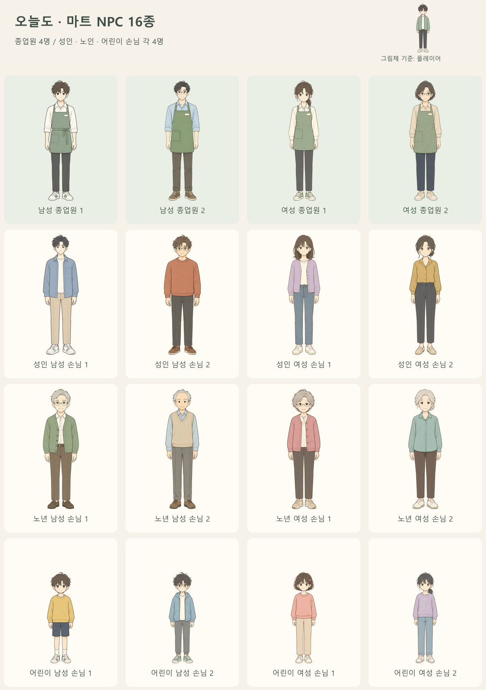

# 마트 종업원·손님 일러스트 16종

2026-09-11. 실제 플레이어의 정면 대기 그림을 참조해 종업원 4종과 손님 12종을 제작하고 마트에 적용했다. 얇은 갈색·회색 윤곽선, 차분한 파스텔 색감, 부드러운 명암과 전신 비율을 맞췄다. 종업원은 녹색 앞치마와 이름표를 공유하고 머리·안경·상의·얼굴을 구별했다. 손님은 연령에 맞는 얼굴과 체형, 서로 다른 머리·의상을 사용한다.

## 구성과 파일

| 구분 | 남성 | 여성 | 합계 |
| --- | --- | --- | --- |
| 종업원 | 2 | 2 | 4 |
| 성인 손님 | 2 | 2 | 4 |
| 노인 손님 | 2 | 2 | 4 |
| 어린이 손님 | 2 | 2 | 4 |
| 합계 | 8 | 8 | 16 |

- [고해상도 투명 PNG 16장 폴더](../../../frontend/assets/images/game/market/people/illustrations/)
- 고해상도 개별 일러스트: `frontend/assets/images/game/market/people/illustrations/*-v1.png` (각 1024×1536)
- 게임용 개별 이미지: `frontend/assets/images/game/market/people/*-v1.png` (각 256×512)
- 그림체 기준: `frontend/assets/images/game/characters/player/fresh-v1/chr_player_fresh_front_idle_f00_v2@2x.png`
- [공통 프롬프트와 16종 디자인 명세](../2026-09-11-market-people-prompts.json)
- [각 최종 생성 요청과 원본 경로](generation-manifest.json)
- [투명도·크기·파일 해시 검사 기록](asset-qa.json)

`employee-male-01/02`, `employee-female-01/02`가 종업원이다. 손님은 `customer-{adult|senior|child}-{male|female}-01/02`이며 파일명 끝에 `-v1.png`를 붙인다. 모든 이미지가 서로 다른 전신 정면 대기 일러스트다.

## 게임 적용

`marketPeople.ts`에 외형 ID·연령·성별·표시 배율을 정의하고, `marketPeopleArt.ts`가 16개 PNG를 정적 import한다. 두 마트 화면이 함께 사용하는 `MarketInteriorLayer.tsx`에서 기존 도형 인물을 `MarketPersonIllustration.tsx`로 교체했다. 계산원도 4개 종업원 일러스트를 사용한다.

성인·노인·종업원은 기존 작은 NPC 프레임 높이 70.72를 사용한다. 어린이는 그 높이의 76%로 표시한다. 모든 그림의 신발 밑면을 같은 발 좌표에 맞추고, 이름표·직원 선택 영역·충돌 판정·직원 도움 기능은 유지했다. 선택 강조는 바닥 그림자와 이름표에 적용하므로 인물의 크기나 발 위치가 흔들리지 않는다.

환경 생성 시 역할별 시드 난수를 별도로 사용한다. 따라서 외형 추가가 기존 매장 배치와 통로를 바꾸지 않는다. 종업원끼리·손님끼리·두 계산원끼리는 각각 중복 없이 선택한다. 계산원은 매장 종업원과 다른 외형을 우선 사용한다. 종업원 3명과 계산원 2명이 동시에 있으면 4개 종업원 외형 중 1개를 재사용한다.

기존 `appearance` 숫자와 새 `appearanceId`를 환경 및 에피소드에 함께 저장한다. 계산원은 `cashierAppearance`를 저장한다. 외형 데이터로 게임의 판정이나 인물의 행동 능력을 변경하지 않는다. 자세한 기록 계약은 [AI 실행 인터페이스](../../../frontend/docs/market-agent-contract.md)를 따른다.

## 생성과 투명 처리

내장 `image_gen`으로 각 인물을 별도로 생성했다. 도구가 실제 알파 대신 RGB를 반환했기 때문에 분리용 분홍 단색 배경을 요청한 뒤 `scripts/prepare-market-people.cjs`로 그 색을 투명 처리했다. 배경에 체크무늬가 그려진 초기 결과는 최종 파일에서 제외했다. PNG에는 실제 알파 채널이 있고 손가락·머리카락·다리 사이의 빈 공간도 분리했다. 게임용 이미지는 비율을 유지해 축소하고 발 기준을 통일했다. 고해상도 버전도 함께 보관한다.

## 검증

- 16종 전체를 모음 이미지에서 플레이어 기준과 비교하고 연령·성별·의상·전신 잘림·투명 배경을 확인했다.
- 모든 게임용 PNG가 256×512이며 실제 알파와 서로 다른 파일 해시를 가진다.
- 100개 시드에서 16종 모두 선택되고 역할 안에서 중복되지 않으며, 같은 시드로 다시 만들면 외형까지 같은 것을 테스트했다.
- 기존 최대 밀집도 100개 시드의 충돌·통로 검사도 통과했다.
- TypeScript 타입 검사 통과. Jest 전체 21개 suite, 171개 테스트 통과. 기존 App의 비동기 `act` 경고는 남아 있다.
- 웹 빌드 성공. 마트 실험 화면에서 종업원·성인 손님·어린이 손님·계산원의 새 PNG가 실제 로드됨을 확인했고 해당 화면의 브라우저 오류는 없었다.

실행 중인 앱을 새로고침한 뒤 새 장보기를 시작하면 새 외형 풀로 배치된다. 휴대폰 실기기에서의 최종 화면은 사용자가 확인할 수 있다.
