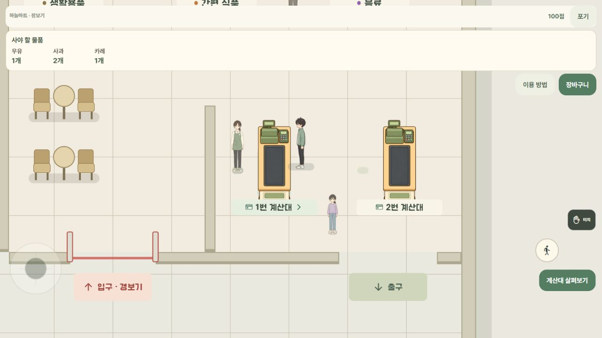
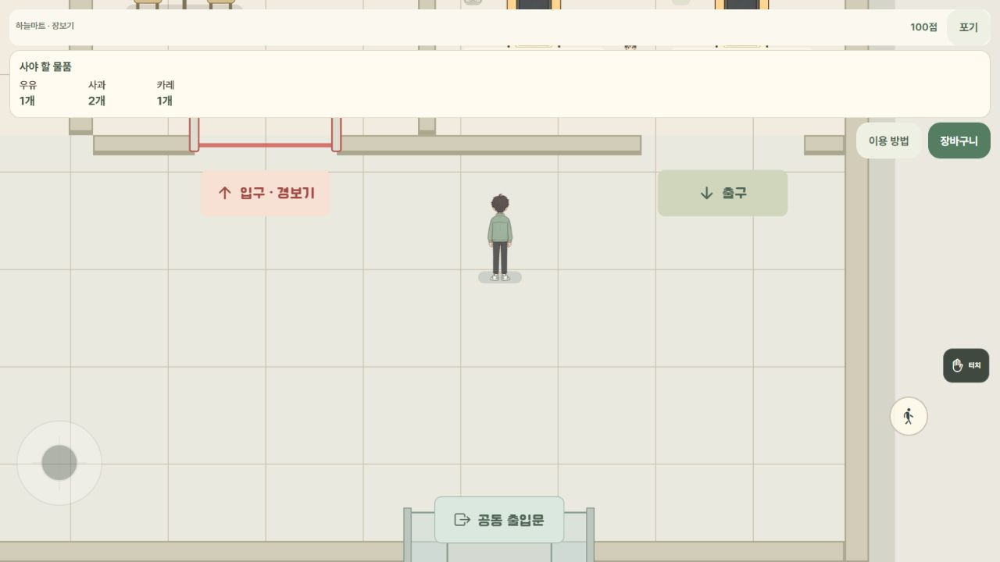

# 마트 공간·충돌·동선 개편 v3

작성일: 2026-09-13. 대상: `Oneuldo/frontend`, 작업 브랜치 `feat/8-시뮬레이션-게임-ui-제작`.

> 이번에는 마트 그림과 실제 이동·상호작용 판정이 어긋나는 부분을 고쳤습니다. 어른 NPC는 플레이어 키에 맞추고, 사람의 발과 진열대 각각의 바닥 면적을 기준으로 충돌하도록 바꿨습니다. 매장 안 입구·출구와 건물 공동 출입문 사이에 넓은 로비를 만들었고, 서쪽 벽에 난 문에도 경보기를 붙였습니다. 계산대 두 개는 75%로 줄여 직원 왼쪽·손님 오른쪽 동선으로 통일했습니다. 탭 이동은 가구를 돌아갈 수 있습니다. 최초 개편의 전체 23개 묶음·189개 테스트와 웹 빌드가 통과했고, 입구·출구 위치 추가 조정 후에도 관련 9개 묶음·109개 테스트와 타입 검사를 다시 통과했습니다. 별도 무음 브라우저에서 NPC 크기와 계산대, 진열대 사이 통과, 옆문·공용 복도·공동 출입문을 직접 확인했습니다.

## 입구·출구 위치 추가 조정

사용자 확인에 따라 매장 입구·출구는 계산대 바로 아래의 기존 위쪽 경계(y1020~1040)에 다시 붙였습니다. 계산 구역의 세로 구분벽(x630, y780, 18×240)도 이 경계에 연결합니다. 축소된 계산대는 기존 바닥 끝 y946을 유지하도록 윗변을 y829로 조정했습니다. 넓힌 공용 복도와 별도 공동 출입문은 이 구역 아래에 있습니다. 무음 브라우저에서 위쪽 계산 구역과 전면 벽의 연결, 정상 출구를 통한 공동 출입문 우회 이동을 확인했습니다.

## 사용자 요청 11개와 반영 내용

| 번호 | 요청 | 반영 내용 | 핵심 파일 |
| --- | --- | --- | --- |
| 1 | NPC를 플레이어 크기에 맞추기 | 플레이어 이미지의 실제 불투명 높이 344px × 게임 표시 배율 0.25 = 월드 86px를 기준으로 성인·노인·종업원·계산원 높이를 맞춤. 어린이는 76%, 즉 65.36px. 이미지 캔버스 여백과 인물 자체 크기를 구분 | `marketPersonLayout.ts`, `MarketPersonIllustration.tsx` |
| 2 | NPC 충돌 박스를 그림 크기에 맞추기 | 16종 이미지의 신발 영역을 측정하여 외형별·연령별 바닥 충돌 사각형을 생성. 그림자도 같은 발판을 사용. 누르기 영역과 물리 충돌 영역은 분리 | `getMarketPersonGeometry`, `getMarketPersonCollider`, `marketEnvironment.ts` |
| 3 | 지나갈 수 있어 보이는데 막히는 곳 확인 | 마트 플레이어 반경 22→12. 세로 진열대 두 개를 둘러싼 하나의 큰 장애물을 각 진열대의 바닥 두 개로 분리. 40px 간격은 실제 통행 가능. 탭 이동에 가구 우회 경로 추가 | `marketEnvironment.ts`, `marketFixtureLayout.ts`, `marketNavigation.ts` |
| 4 | 입구·출구 아래 여유 공간과 공동 출입문 | 월드 높이 1200→1500. 입구·출구와 계산 구역은 예전 위쪽 위치에 붙이고 그 아래 로비를 넓혀 아래 외벽에 별도 공동 출입문 배치. 입구와 출구는 지나가도 게임이 계속되며, 공동 출입문에서 나갈 때 종료 | `prototypeWorld.ts`, `marketEnvironment.ts`, `marketSession.ts` |
| 5 | 옆을 벽으로 막고 문에 경보기, 바깥 복도로 이동 | 서쪽 판매장 벽을 아래 경계까지 연장. 위쪽 연결 문과 아래 입구에 각각 경보기를 둠. 서쪽 복도→로비→공동 출입문 이동 자체에는 경보 없음 | `MARKET_WALLS`, `alarmGates`, `MarketInteriorBackdrop` |
| 6 | 진열대 보기 판정이 실제 거리와 다름 | 고정 접근점 중심 105px 원 대신 두 진열대 각각의 가장 가까운 바닥 면까지 거리로 판정. 다른 집기·벽·사람에 가려진 면은 거부. 독립 지도와 실제 게임이 같은 최근접·접근점 함수를 사용하고 터치 영역도 두 유닛으로 분리 | `getMarketStationDistance`, `getNearestMarketStation`, `getMarketStationApproachPoint`, `MarketShelfTarget` |
| 7 | 계산대를 현재 크기의 75%로 | 충돌 바닥 64×156→48×117. 그림도 이전 표시 크기의 75%로 함께 축소 | `prototypeWorld.ts`, `MarketInteriorLayer.tsx` |
| 8 | 사람/계산대/복도 순서 통일 | 두 곳 모두 계산원 왼쪽, 계산대 가운데, 손님 접근 통로 오른쪽. 2번 계산대의 반대편 계산원 배치를 수정하고 상호작용도 손님 통로에서만 허용 | `checkouts`, `getMarketStationDistance`, `MarketCheckoutFixture` |
| 9 | 엘리베이터를 벽에 붙이기 | 엘리베이터 바닥 뒤에 실제 충돌 벽을 두고, 두 문을 잇는 벽면을 그림 뒤에 표시 | `MARKET_WALLS`, `MARKET_FIXED_OBJECTS`, `MarketInteriorBackdrop` |
| 10 | 실제 마트처럼 보이도록 정리 | 입·출구와 공동 출입문 구분, 연속된 판매장 벽, 여유 있는 로비, 같은 방향 계산 동선, 벽에 붙은 엘리베이터, 일치하는 사람·집기 바닥 기준을 함께 적용. 기존 상품·휴게석·ATM·그림체 유지 | 공유 공간 데이터와 `MarketInteriorLayer.tsx` |
| 11 | 테스트할 때 배경음악이 들리지 않게 | 개발 웹 확인 주소에 `?muteAudio=1`을 붙여 배경음악·대화 효과음·성공 효과음을 무음 처리. 일반 게임 이용자의 음악 설정은 변경하지 않음 | `GamePrototypeScreen.tsx` |

`marketPersonLayout.ts` 등 게임 로직 경로는 `frontend/src/game/`, `MarketInteriorLayer.tsx` 등 공통 마트 컴포넌트는 `frontend/src/components/game/`입니다. 실제 마을 내 장보기 통합은 `frontend/src/screens/GamePrototypeScreen.tsx`, 실험 화면은 `frontend/src/screens/MarketSimulationScreen.tsx`입니다.

## 새 공간과 경보 규칙

좌표는 화면 픽셀이 아니라 마트 월드 좌표입니다. 확대·축소와 관계없이 같은 좌표를 사용합니다.

| 항목 | 값 |
| --- | --- |
| 월드 | 1100×1500 |
| 시작 위치 | `(470,1100)`: 공동 로비에서 매장 입구 쪽 |
| 매장 입구 | `entrance`, `(480,1030)` |
| 매장 출구 | `exit`, `(930,1030)` |
| 공동 외부 출입문 | `common-door`, `(710,1430)`, 문 틈 x620~800 |
| 판매장 앞 경계 | y1020~1040. 입구 틈 x410~550, 출구 틈 x850~1010 |
| 서쪽 판매장 벽 | x286~310. 위쪽 문 y250~380을 제외하고 아래 판매장 경계까지 연결 |
| 1번 계산대 | 바닥 `(720,829,48,117)`, 계산원 `(684,889)`, 고객 접근점 `(807,889)` |
| 2번 계산대 | 바닥 `(925,829,48,117)`, 계산원 `(889,889)`, 고객 접근점 `(1012,889)` |

미결제 물품을 담고 매장 밖 방향으로 아래 입구 또는 서쪽 연결 문의 감지선을 통과하면 기존 설정만큼 감점합니다. 아래 입구는 y1030을 증가 방향으로, 서쪽 문은 x298을 감소 방향으로 통과할 때입니다. x355 이상·y970 이하의 판매장 안쪽으로 돌아온 뒤 다시 경보가 활성화됩니다. 문 근처에서 조금씩 왕복해도 같은 통과에 중복 감점하지 않습니다.

정상 출구, 공동 출입문 앞 로비, 서쪽 바깥 복도를 이동하는 것만으로는 경보가 울리지 않습니다. 빈 장바구니·결제된 장바구니에도 감점하지 않습니다. `entrance`·`exit`는 통행 표식이며 최근접 행동 버튼의 후보에서 제외합니다. 공동 출입문에서 나가면 구매 성공 전에는 기존 `gave-up` 종료로 기록합니다. 언제든 포기하는 기존 행동도 유지합니다.

## 팀 실행기에 전달할 API

상세 규격은 [AI 실행 계약](../frontend/docs/market-agent-contract.md)을 따릅니다.

- 환경·관측의 `schemaVersion:1`, 에피소드 `version:1`은 유지하고 `environment.layoutVersion:3`으로 공간 변경을 구분합니다.
- 기존 seed·설정 입력·상품 선정·인원·외형 카탈로그와 기록 규칙을 유지합니다. 공간 버전이 다르면 같은 seed라도 좌표·충돌은 같다고 가정하지 않습니다. 과거 기록은 저장된 환경 스냅샷으로 해석하며 과거 실행 상태의 직접 재개는 지원하지 않습니다.
- `environment.alarmGates[]`에 두 경보기의 `id, gate, axis, boundary, rearm, outward`를 기록합니다. 기존 `entrance`는 아래 경보기의 호환 별칭입니다.
- `environment.commonDoor`와 `stations['common-door']`는 공동 외부 출입문입니다. `environment.exit`은 실제 외부 종료 위치인 공동 출입문을 가리키고, `stations.exit`은 매장 내부의 정상 출구를 가리킵니다.
- `getMarketStationDistance`는 접근 가능한 실제 표면까지 거리를, `isNearMarketStation`은 종류별 유효 범위를 판정합니다. `getNearestMarketStation`은 현재 가능한 행동 대상 하나를 반환합니다.
- `getMarketStationApproachPoint`는 눌렀던 대상의 가까운 유효 접근점입니다. 두 유닛 중 어느 쪽이든 하나의 분류·재고를 공유합니다.
- `getMarketNavigationPath(environment, from, to, cashierAvailability)`는 시작점을 제외하고 정확한 목적지를 포함하는 경유점 배열을 반환합니다. 이미 도착했으면 `[]`, 막혔거나 연결되지 않으면 `null`입니다.
- 에이전트는 경유점을 참고할 수 있지만 실제 위치 이동은 여전히 어댑터의 최대 32px `move` 행동으로 수행해야 합니다. `setPosition`은 에이전트에게 허용되지 않습니다.
- 계산원 호출 상태는 충돌·근접 판정·경로 탐색에 동일한 `cashierAvailability`를 전달합니다.

## 검증 기록

2026-09-13 최종 통합 검증 결과입니다. 기존 사용자의 진행 중인 게임 탭을 초기화하지 않고 별도 무음 테스트 탭에서 확인했습니다.

| 검증 | 결과 | 확인 내용 |
| --- | --- | --- |
| 환경·세션 회귀 테스트 | 통과 | 100개 seed 및 최대 인원·기둥 배치에서 모든 접근점의 충돌 없음·도달 가능·실제 상호작용 가능, 독립 계산원과 기존 구매·반납·재시도·기록 규칙 |
| NPC 외형 카탈로그 테스트 | 통과: 2개 | 동일 seed 외형 재현, 외형 카탈로그·인원 범위 유지 |
| 공간 단위 검증 | 위 환경 테스트에 포함 | 서쪽 벽·문, 로비·공동 문, 40px 진열대 사이 통행, 열린 면 접근과 벽 너머 차단, 계산대 75%·오른쪽 고객 통로, 엘리베이터 벽 접촉 |
| 경보·종료 검증 | 위 세션 테스트에 포함 | 아래·서쪽 감지선, 한 통과 중복 감점 방지, 재활성화, 무경보 복도, 입·출구 통과 후 계속 진행, 공동 문 종료 |
| 탭 이동 경로 테스트 | 통과: 5개 | 직선, 계산대 우회, 40px 틈, 서쪽 문 우회, 벽 안 목적지 거부, 호출된 계산원 반영, 단절 공간 거부. 반환 경로를 추가로 1px 간격 검사 |
| 전체 타입 검사·전체 테스트·웹 빌드 | 통과 | 최초 23개 묶음·189개 및 Expo 웹 export 통과. 위치 추가 조정 후 공간·세션·경로·외형 46개, UI 54개, 렌더러 9개와 TypeScript 재검증 통과 |
| 데스크톱 브라우저 화면·실제 이동 | 통과 | 1280×720 화면에서 플레이어·계산원 높이 비교, 계산대 2곳의 방향, 생활용품 접근 선택과 두 진열대 사이 통과, 서쪽 문·복도·로비 이동, 공동 문에서만 나가기 버튼 표시, 마트 테스트 탭 콘솔 오류 없음 |
| 모바일 크기 브라우저 | 미실시 | 이번 직접 화면 검증은 데스크톱 브라우저에서 수행 |
| 실기기 iOS·Android | 미실시 | 실제 Expo Go 터치 체감·기기 성능은 별도 확인 필요 |
| AI 실행기 스모크 테스트 | 통과 | layoutVersion 3, 2회 제출 후 구매 성공, 점수 100, 행동 이벤트 247개와 환경 스냅샷 내보내기. 실행기의 도달 판정도 앱과 같은 isNearMarketStation 사용 |

무음 확인 주소: `http://localhost:8081/?muteAudio=1`. 실험 화면은 `http://localhost:8081/?marketLab=1&muteAudio=1`입니다. 무음 옵션은 개발 웹에서만 동작하며 일반 실행 주소의 음악을 끄지 않습니다.

## 실제 확인 화면

플레이어와 성인 계산원의 높이를 맞추고, 두 계산대의 직원·고객 방향을 통일했습니다.

입구·출구 아래 넓은 공용 복도와 별도 공동 출입문입니다. 내부 입구·출구를 지날 때는 장보기가 계속되고, 공동 출입문 근처에서만 마을로 나가기 행동이 표시됩니다.

새 배치는 새 장보기 세션에 적용됩니다. 이미 열어 둔 세션은 기존 환경 스냅샷을 보유할 수 있으므로 사용자가 해당 게임을 마친 뒤 새로 시작하면 됩니다. 사용자 진행 상태를 보존하려고 기존 탭을 강제로 새로고침하지 않았습니다.

## 변경하지 않은 데이터 규칙과 범위

필요 수량과 담은 수량의 분리, 최종 제출 전 정오답 비공개, 첫 실패의 상세 비공개, 두 번째 이후 상세 피드백, 재시도·포기·별점, 상품 5분류 120종·게임마다 9종/12칸, 직접·직원 반납 규칙은 유지합니다.

합성 에피소드와 사람 플레이 데이터의 출처 구분을 유지합니다. 인물 외형이나 페르소나 설정만으로 실제 장애인의 행동을 대표하거나 검증된 학습 데이터가 된다고 주장하지 않습니다. 이번 작업은 프론트엔드 공간·조작 수정이며 백엔드, 실제 모델 호출·데이터 업로드·파인튜닝을 구현하지 않았습니다.

앞선 공간 개편의 이력은 [v2 보고서](market-layout-v2.md), 노트북 작업 절차는 [인수인계](handoff/notebook-handoff-2026-09-11.md)를 참고합니다.
