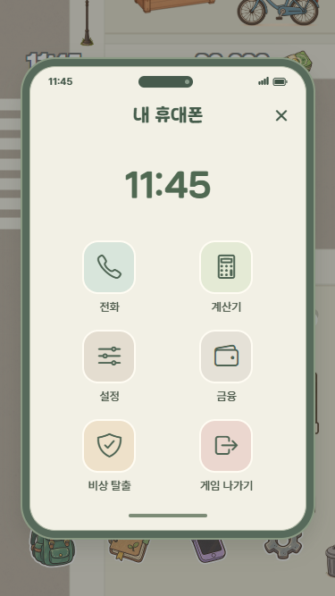
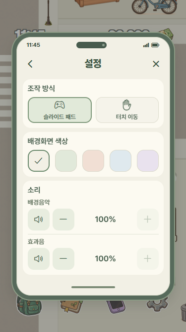

# 휴대폰 메뉴와 마트 출입 보완

2026-09-16 · `feat/8-시뮬레이션-게임-ui-제작` · 진욱·정우·재현 공유용

## 화면에서 달라진 점

- 휴대폰 홈은 **전화, 계산기, 설정, 금융, 비상 탈출, 게임 나가기** 6개 버튼입니다. 금융은 부설명 없이 다른 앱과 같은 높이로 표시되는 비활성 버튼이며 거래나 외부 연결을 하지 않습니다.
- 홈·계산기·설정·연락처·탈출·나가기에서 같은 휴대폰 외곽을 사용합니다. 기본 최대 폭 330, 높이 540이며 작은 화면에서는 가용 높이에 맞춰 줄입니다. 내용이 넘치면 화면 안쪽만 스크롤합니다.
- 휴대폰의 “오늘도, 내 속도로” 문구를 삭제했습니다. 시계 영역의 배경을 없애고 세로 여유를 늘렸습니다.
- **설정 한 페이지**에 조작 방식, 배경화면 색상 5가지, 배경음악·효과음 음량을 넣었습니다. 설정별 묶음 박스는 테두리 없이 표시하며, 하위 설정 화면으로 다시 들어가지 않습니다. 조작 방식을 바꿔도 설정창이 유지됩니다. 하단 도구 모음의 설정 버튼도 같은 페이지를 엽니다.
- 음악과 효과음은 각각 0~100%로 조절하며 25% 단위 버튼과 음소거 버튼을 제공합니다. 대화 타자음과 퀴즈 완료음에도 효과음 설정이 적용됩니다. 음소거 직전 예약된 소리가 뒤늦게 나오지 않도록 취소합니다.
- **전화 → 지영 / 민수**를 선택합니다. 마트에서 지영에게 전화하면 기존 품절·대체 승인 대화가 이어집니다. 마트 밖의 지영, 그리고 민수에게도 가까이 갈 필요 없이 전화하고 통화를 마칠 수 있습니다. 민수가 지영의 부탁을 대신 변경하지는 않습니다.
- 오른쪽 위 소지금 표시를 **30,000원**으로 바꿨습니다. 현재는 표시용 초기 금액이며, 이번 변경에 실제 잔액 차감이나 금융 거래는 포함하지 않았습니다.

## 출입 방향과 공사

**출구로 들어가면 기본 10점 감점**입니다. 장바구니가 비었거나 이미 계산했어도 출입 방향을 확인합니다. 물건을 계산하지 않고 밖으로 나갈 때의 경보기 감점과는 별도로 기록합니다.

문턱에서 조금씩 오가며 감점이 연속 발생하지 않도록 했습니다. 공용 복도로 충분히 돌아온 뒤 출구로 다시 들어간 경우에는 새로운 역진입으로 봅니다. 정상 입구와 안쪽 입구로 들어가거나 출구로 나가는 동작에는 역진입 감점이 없습니다.

바깥 입구가 공사 중이면 **“안쪽 입구를 이용해 주세요.”**라고 안내합니다. 시작 안내와 도움말에도 우회 방법을 표시하고, 터치로 목적지에 이동하는 자동 경로는 출구 대신 정상 입구로 우회합니다. 직접 조작하면 출구로 들어갈 수 있으며 이때 감점됩니다.

연습 환경 설정과 JSON의 `wrongWayPenaltyPoints`로 감점을 0~100 사이에서 바꿀 수 있습니다. 생략한 기존 JSON은 10점을 적용합니다. `wrong_way_entry` 이벤트, `wrongWayEntryCount`, 총 감점과 점수를 함께 저장합니다. API에서 `entrance`는 정면의 바깥 입구이고 `west-door`/`east-door`는 안쪽 측면 입구입니다. 자세한 계약은 [환경·행동 API 문서](../frontend/docs/market-agent-contract.md)에 정리했습니다.

## 품절을 확인하는 방법

새 기본 장보기 판에서는 **냉장 식품 진열대의 흰 우유가 품절**입니다. 상품 자리에 품절 표시가 있고 담기·드래그가 차단됩니다. 진열대를 확인한 뒤 직원에게 재고를 묻고 **휴대폰 → 전화 → 지영**으로 대체 허락을 받습니다. 직원은 재고 사실만 설명하며 부탁한 사람의 이름이나 전화 안내를 말하지 않습니다. 대체가 어려우면 못 산 이유를 전달하는 기존 흐름을 유지합니다.

시작 전 **연습 환경 설정 → 품절 상황 있음/없음**으로 선택할 수 있습니다. 이미 진행 중인 판이나 학습 과제를 끈 예제 JSON에서는 새 기본값이 자동 적용되지 않으므로 새 판으로 시작해야 합니다.

## 확인한 내용

- 총 **41개 테스트 파일, 398개 테스트 통과**. 경로·환경 4개 파일 45개, 나머지 기본 검사 36개 파일 343개, 병렬 작업 중 추가된 설정 저장소 8개와 오디오 2개 검사를 합산했습니다. 변경된 메뉴·출입 규칙에 맞춘 앱 통합 검사도 다시 통과했습니다.
- 타입 검사와 Expo 웹 빌드 통과.
- 실제 Chrome에서 395×844, 375×667 화면의 모든 휴대폰 메뉴 외곽이 **330×540으로 동일**한 것을 확인했습니다. 6개 앱, 금융 비활성, 배경색·음량 변경, 계산, 지영·민수 연결과 통화 종료를 확인했습니다. 해당 실행의 브라우저 오류는 없었습니다.
- 매장 구조 3종과 공사 유무를 조합한 기존 600개 환경의 이동 경로 검사 통과. 역진입 감점은 빈 장바구니·미결제·결제 상태, 양쪽 축 방향, 반복 진입과 문턱 왕복을 검사했습니다.
- 품절 표시와 담기·드래그 차단, 직원 재고 질문, 지영 대체 승인 흐름을 UI 테스트로 확인했습니다.
- 모든 브라우저 검사는 소리를 끈 상태에서 진행했습니다. 실제 휴대폰 기기의 최종 실행은 직접 확인하지 않았습니다.

설정은 앱 실행 중 공통으로 유지됩니다. 웹은 브라우저 저장소에 보관하고, 현재 네이티브 앱은 실행 중 메모리에 유지합니다.

