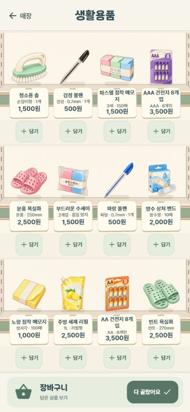
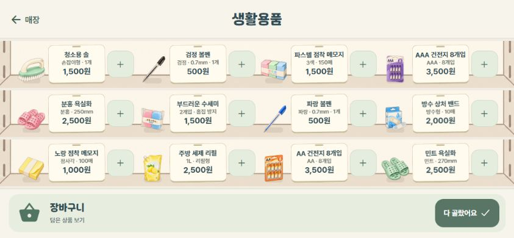
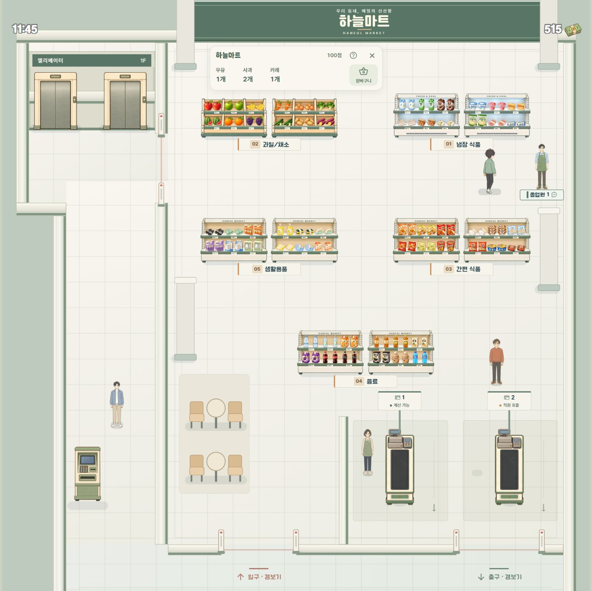
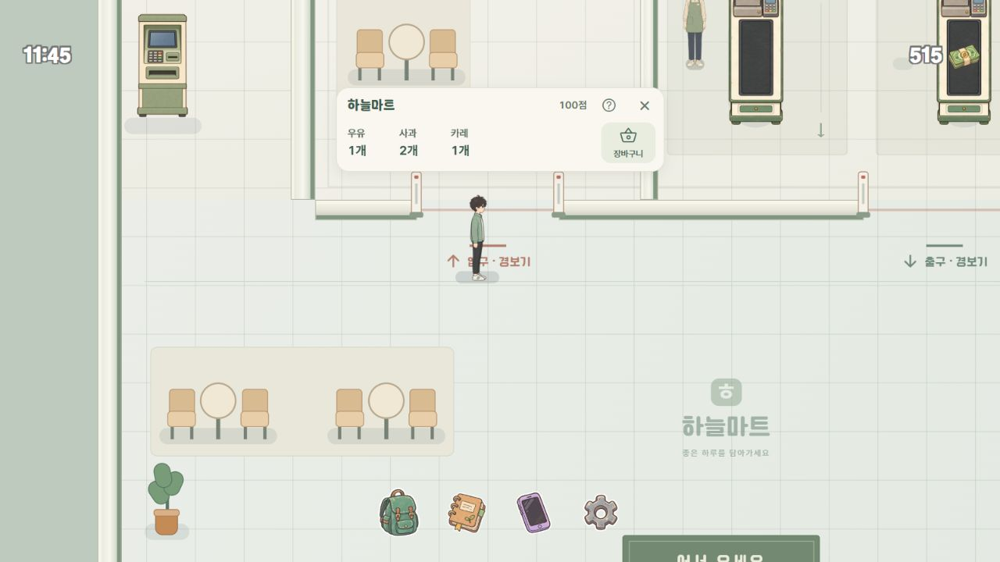
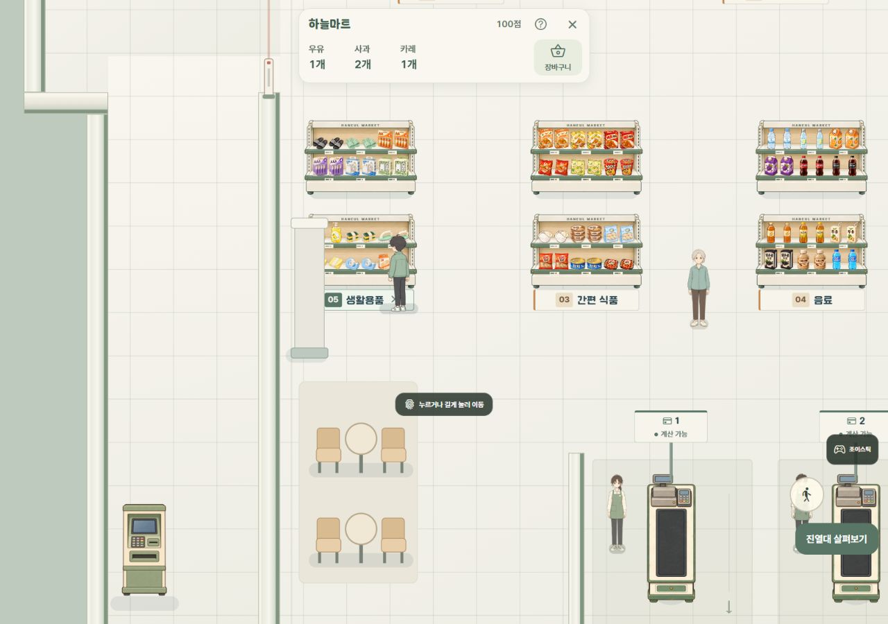
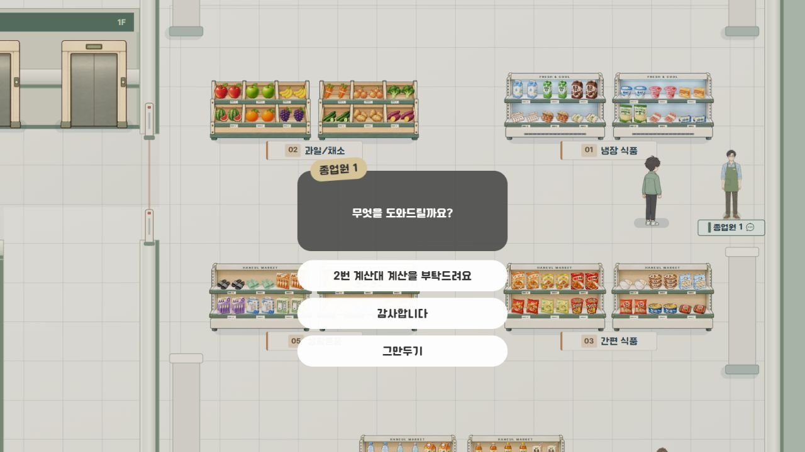

# 마트 v5 — 진열·조작·대화·두 번째 매장 배치

2026-09-13 · 오늘도 프론트엔드 · `feat/8-시뮬레이션-게임-ui-제작`

진열대의 같은 상품 중복을 없애고, 휴대폰에서 12종을 한 번에 보기 쉽도록 화면을 정리했습니다. 짧은 스와이프는 스크롤, 350ms 길게 누른 뒤 움직이기는 장바구니로 상품 끌기로 분리했습니다. 직원 대화에는 마을과 같은 타이핑·등장 효과와 새 부드러운 대화음을 적용했습니다. 기존 매장은 유지하면서 가로 통로 배치를 추가했고, 두 배치 모두 기존 환경 설정과 구매·반납·직원 도움·경보기 기능을 사용합니다.

## 요청별 반영 내역

사용자 요청의 번호를 그대로 유지했습니다. 원문에는 11·12번이 없습니다.

| 요청 | 반영 내용 |
|---|---|
| 1. 동일 상품 중복 | 예전의 9종+3칸 반복 대신, 분류마다 서로 다른 상품 ID 12종을 선정합니다. 같은 상품을 여러 개 담으면 같은 재고에서 수량만 차감합니다. 일반 우유/저지방 우유처럼 서로 다른 상품은 학습을 위해 함께 나올 수 있습니다. |
| 2. 팝업의 잔요소 | 마트 상단 카드를 이름·점수·목표 품목/개수·장바구니·도움/닫기로 간결하게 정리했습니다. 과한 브랜드 띠, 중첩 아이콘 배지, 구분선과 보조 문구를 줄였습니다. 진열대 내부도 아래 항목과 같이 정리했습니다. |
| 3. 직원 대화 효과 | 마을과 같은 34ms 글자 표시, 등장 스프링, 이름표의 작은 움직임, 선택지 등장 효과를 적용했습니다. 대화문을 누르면 즉시 완성되며 새 답변도 차례로 표시합니다. |
| 4. 부드러운 비프음 | 마을·직원 대화음을 공통으로 교체했습니다. 낮고 부드러운 사인파 3종에 매끄러운 시작/끝을 넣고 볼륨을 낮췄습니다. 공백·문장부호마다 소리를 내지 않으며 빠른 연속 재생을 제한합니다. |
| 5. 기둥 표시 순서 | 기둥·진열대의 각 유닛·사람·계산대·플레이어를 바닥 위치에 따라 정렬합니다. 한 묶음 진열대도 두 유닛이 따로 깊이를 가지므로, 그 사이를 지나는 물체의 앞뒤가 맞습니다. 기본 매장에서 기둥이 앞쪽 진열대를 가리는 모습까지 확인했습니다. |
| 6. 왼쪽 아래 로비 | 공용 복도 왼쪽 아래에 의자–원형 테이블–의자 두 묶음, 바닥 구역과 화분을 추가했습니다. 입구/출구와 공동 출입문 사이의 이동 경로는 확보했습니다. |
| 7. 늦게 되는 스크롤 | 로딩 완료를 기다리는 방식이 원인이 아니었습니다. 기존 터치 처리에서 스크롤 동작을 드래그로 먼저 잡는 충돌을 고쳤습니다. 길게 누르기 전에 8px 넘게 움직이면 끌기 대기를 취소하고 스크롤을 허용합니다. |
| 8. 길게 눌러 끌기 | 상품 그림을 350ms 누른 뒤 움직이면 끌기를 시작합니다. 아래 장바구니에 놓으면 1개 담습니다. 바깥에 놓거나 취소하면 담지 않습니다. 손을 떼면 스크롤을 바로 복구하며, 웹 포인터/터치와 네이티브 responder를 각각 처리했습니다. 기존 담기 버튼도 사용할 수 있습니다. |
| 9. 가격표 디자인 | 기존 부드러운 색상에 맞춘 크림색 표찰, 얇은 테두리·그림자·고정 부분을 선반 가장자리에 배치했습니다. 상품명·규격·개당 가격을 표시합니다. 기존 그림과 코드로 구현하여 별도 생성 이미지 없이 통일했습니다. |
| 10. 12개 한 화면 | 4열×3행을 화면 높이에 맞춰 배치합니다. 375×812, 390×844, 가로 844×390에서 12개 표시와 스크롤 잠금을 확인했습니다. 320×568처럼 더 작거나 글자 확대 때문에 넘치면 필요한 만큼 스크롤할 수 있습니다. 조작 버튼은 최소 44px를 유지합니다. |
| 13. 진열대 상단 정리 | 진열대 내부 포기, 상단 사용법, 작은 하늘마트 문구를 제거했습니다. 좌우 공간을 맞춰 분류명을 중앙에 놓았습니다. 진열대 헤더·장바구니 영역뿐 아니라 일반 장바구니 팝업에서도 총 금액을 제거했습니다. 개당 가격과 담은 개수는 유지하며 합계는 계산대의 최종 구매 화면에서만 확인합니다. |
| 14. 두 번째 매장 | 기본 배치 `classic` 외에 가로 통로 배치 `aisles`를 추가했습니다. 상단 두 묶음·중간 두 묶음·하단 한 묶음의 가로 진열 구조입니다. 진열대 종류 섞기와 사람/기둥 후보 설정, 두 계산대, 직원 도움, 세 경보기, 공동 출입문을 동일하게 사용할 수 있습니다. |
| 15. 휴식 문구 | ‘잠깐 쉬어가요’를 제거했습니다. |
| 16. 계산대 번호 | 보이는 간판은 `1`, `2`로 줄였습니다. 스크린 리더의 이동 대상 설명에는 1번/2번 계산대라는 의미를 유지합니다. |
| 17. ATM | ATM 그림의 왼쪽을 기존 서쪽 벽 안쪽에 맞췄습니다. 발판과 통로를 함께 확인했고, 로비 좌석이나 경보기와 충돌하지 않습니다. 장식용 기능을 유지합니다. |

## 두 번째 매장 여는 방법

1. 마트 입장 후 장보기 시작 전 **연습 환경 설정**을 엽니다.
2. **매장 배치 → 가로 통로 배치**를 선택합니다.
3. 필요하면 진열대 위치를 **매번 섞기**로 두고 인원·기둥 수를 바꿉니다.
4. **설정 적용 → 다음 → 장보기 시작**으로 들어갑니다.

기본 배치를 선택하면 원래의 세로 진열대 중심 구조로 돌아갑니다. 배치를 게임 시작 전에 선택하므로 진행 중인 장바구니나 제출 횟수를 다른 환경으로 섞지 않습니다.

## 정우·재현에게 전달할 설정

세션 설정 JSON의 `environment.layoutId`를 `classic` 또는 `aisles`로 지정합니다. 생략한 예전 설정은 `classic`입니다. 같은 버전의 코드에서 같은 시드와 설정을 주면 같은 상품·배치가 만들어집니다.

- [기본 배치 예제](../frontend/docs/market-environment.example.json)
- [가로 통로 배치 예제](../frontend/docs/market-environment.aisles.example.json)
- [환경·행동·결과 데이터 계약](../frontend/docs/market-agent-contract.md)

새 진열 재고는 분류별 12종입니다. `inventoryProductIds`에 12개의 서로 다른 상품을 직접 지정할 수 있습니다. 예전 9종 설정도 가져올 수 있으며, 기존 9종을 유지한 채 3종을 채우고 정규화한 12종 설정을 저장합니다. 상품 중복이나 다른 분류의 상품 ID는 거부합니다. 과거 실행은 그때 저장한 환경·재고 스냅샷으로 해석해야 하며, 이전 시드만으로 새 재고와 같다고 가정하지 않습니다.

예제의 자동 플레이는 실제 장애인이나 검증된 페르소나가 아니라 기능 검사용 프로그램입니다. `provenance.source=synthetic` 및 검사용 출처를 유지했습니다.

## 구현 위치

- `frontend/src/game/marketSession.ts`: 12종 재고·설정 정규화
- `frontend/src/components/game/MarketShelfScene.tsx`, `frontend/src/game/marketShelfLayout.ts`: 길게 눌러 끌기·스크롤·가격표·반응형 진열대
- `frontend/src/components/game/MarketHud.tsx`: 간결한 상단 카드
- `frontend/src/components/game/MarketStaffDialogue.tsx`, `MarketPanelTransition.tsx`: 직원 대화 애니메이션·접근성·닫힘 취소
- `frontend/src/components/game/useDialogueAudio.ts`, `frontend/src/game/dialogueFeedback.ts`: 마을/직원 공통 대화음
- `frontend/assets/audio/dialogue-soft-1.wav`부터 `dialogue-soft-3.wav`, `frontend/scripts/generate-soft-dialogue-tones.py`: 새 대화음과 재생성 스크립트
- `frontend/src/game/marketEnvironment.ts`, `frontend/src/components/game/MarketSetupPanel.tsx`: 매장 배치·로비·ATM·설정
- `frontend/src/components/game/MarketInteriorLayer.tsx`, `MarketArchitectureLayer.tsx`, `MarketMap.tsx`, `frontend/src/screens/GamePrototypeScreen.tsx`: 실제 월드 표시와 깊이 정렬

## 확인 결과

- 타입 검사 통과.
- 최종 전체 Jest 검사 **33개 스위트, 256개 테스트 통과**. 웹 대화에서 숨긴 문장이 중복 읽히지 않는 회귀 검사와 일반 장바구니 합계 제거까지 포함합니다.
- iOS·Android·웹 `expo export --platform all` 통과.
- 두 배치 각각 최대 인원/기둥 조건 100개 시드: 실제 경로 탐색으로 진열대·직원·계산대·문 접근 가능, 이동 구간 충돌 없음.
- 두 배치에서 직접 이동하는 자동 플레이: 진열대 반납·직원 반납·계산원 호출·재시도·최종 성공/별점 생략까지 통과. 모든 진열대는 12칸/서로 다른 12종.
- 실제 브라우저: 메인 앱에서 마을→새 매장→생활용품→직원 반납, 기본 배치의 기둥 겹침, 모바일/가로 화면 가격표, 스크롤 잠금·복구 확인. 테스트 탭의 브라우저 오류 로그 없음.
- 실제 브라우저 직원 대화에서 차례로 나오는 글자와 누르면 완성되는 동작, 숨긴 문장이 중복 읽히지 않는 접근성 트리 확인.
- 모든 실제 브라우저 검증은 `muteAudio=1`로 진행했습니다. 새 소리는 재생하지 않고 파형/진폭을 분석했습니다. 휴대폰 실물의 터치·청취는 이번 PC 검사에 포함되지 않았으며, 네이티브 끌기 동작은 이벤트·타이머 기반 테스트로 검사했습니다.
- `expo install --check`는 현재 설치된 SDK 57 계열 패키지의 새 패치 버전을 권장하여 종료 코드 1을 반환했습니다. `expo 57.0.21→57.0.22`, `expo-audio 57.0.4→57.0.5` 등 9개 패키지의 패치 알림이며, 이번 UI 작업에서는 패키지/잠금파일을 변경하지 않았습니다. 위 타입·테스트·세 플랫폼 빌드는 현재 설치 버전에서 통과했습니다.

## 실제 화면

휴대폰 생활용품 진열대:

가로 화면의 12종 진열대:

가로 통로 배치의 판매 공간:

공용 로비와 벽에 맞춘 ATM:

기본 매장의 기둥이 앞쪽 진열대를 올바르게 가리는 모습:

마을과 통일한 직원 대화:

