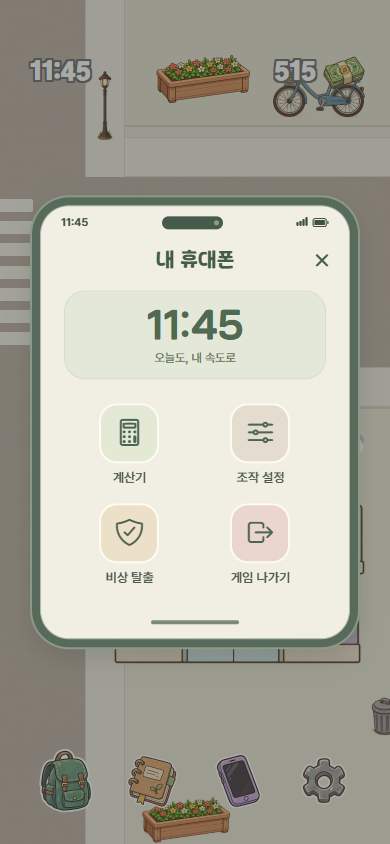
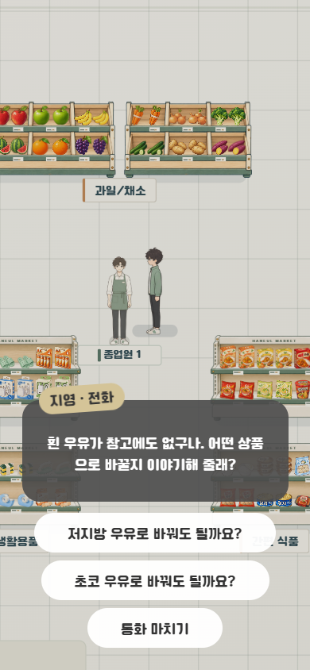
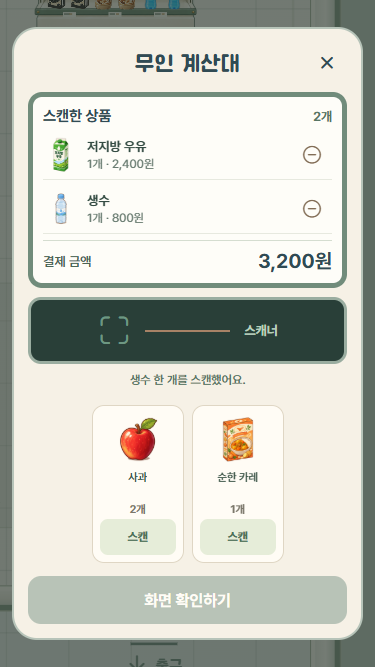

# 장보기 확장: 품절 대처·선택 구매·무인 계산대

진욱·정우·재현 공유용 / 2026-09-16 / 8번 브랜치

이번 변경은 물건을 정확히 담는 연습에 **필요한 정보를 묻기, 부탁이 달라질 때 확인하기, 예산 안에서 직접 고르기, 무인 계산하기**를 더합니다. 마트를 크게 늘리지 않고 기존 매장과 직원, 휴대폰을 사용합니다.

> 휴대폰 6개 앱·통합 설정·전화 연락처·소지금·출입 방향의 후속 변경은 [휴대폰과 출입 보완 보고서](market-phone-entry-2026-09-16.md)를 확인해 주세요.

## 요청한 9가지와 적용 내용

| 요청 | 적용 내용 |
| --- | --- |
| 1. 직원에게 상품 위치 묻기 | 직원 대화의 **“이 물건은 어디에 있나요?”**를 누르면 현재 사야 할 품목과 **뒤로가기**가 나옵니다. 고른 품목에 해당하는 진열대 이름을 알려 줍니다. |
| 2. 품절 상황과 후속 대처 | 목록의 첫 번째 상품을 프론트엔드에서 의도적으로 품절시킵니다. 진열대 확인 → 직원에게 재고 확인 → 휴대폰으로 지영에게 대체 허락 또는 못 산 이유 전달을 진행합니다. |
| 3. 예산과 자기 선택 | 기존 부탁받은 목록에 **“내가 고른 음료 1개, 3,000원 이내”**를 추가합니다. 가격표를 읽고 원하는 음료를 직접 고릅니다. |
| 4. 진열대 이름표 정리 | 진열대 이름 앞 번호를 없애고 이름표의 가로 여백을 줄입니다. |
| 5. 출입구 부설명 정리 | 지도 위 입구·출구 이름 옆의 “경보기”, “공사 중” 같은 부설명을 제거합니다. 경보기와 공사 펜스의 이미지·충돌·기능은 유지합니다. |
| 6. 계산대 한 줄을 키오스크로 | 시작 전 환경 설정에서 **1번 줄 또는 2번 줄**을 셀프 계산대로 바꿀 수 있습니다. 선택한 세로 줄에 새 키오스크 두 대를 위아래로 놓고, 기존 장식용 무인 계산대는 생성하지 않습니다. |
| 7. 휴대폰 계산기 | 덧셈·뺄셈·곱셈·나눗셈, 소수점, 부호 변경, 전체 지우기와 한 자리 지우기를 지원합니다. 0으로 나눌 때 안내하며, 휴대폰을 닫았다 다시 열어도 입력·결과가 유지됩니다. |
| 8. 휴대폰 디자인 | 세이지색 케이스, 크림색 화면, 상태 표시줄, 앱 격자와 홈바를 사용합니다. 계산기·설정·비상 탈출·게임 나가기, 마트에서는 지영에게 전화하는 앱을 제공합니다. 짧은 화면 전환과 모션 감소 설정을 반영합니다. |
| 9. 키오스크 실제 동작 | 장바구니 상품을 스캐너로 끌기 → 스캔 화면 확인 → 결제하기로 진행합니다. 끌기가 어려울 때 사용할 스캔 버튼도 있습니다. |

## 품절 기능은 이렇게 이해하면 됩니다

예를 들어 지영이 **일반 우유 1개**를 부탁했는데 진열대에 우유가 없다고 가정합니다. 문제는 “못 구한 물건을 어떻게든 맞혀 오기”가 아니라 **없다는 사실을 확인하고 부탁한 사람과 다음 행동을 정하기**입니다.

1. **냉장 식품 진열대에서 품절을 확인합니다.** 기본 목록의 `milk` 상품은 표시되지만 재고가 0입니다. 다른 상품의 재고와 무관하게 이 상황을 재현할 수 있습니다.
2. **매장 직원에게 “재고 있나요?”를 묻습니다.** 해당 진열대를 먼저 살펴봤을 때 선택지가 나타납니다. 직원은 창고에도 없다고 알려 줍니다.
3. **휴대폰의 전화 앱에서 지영을 선택합니다.** 아직 진열대나 직원을 확인하지 않았다면 먼저 확인해 달라는 안내를 받습니다.
4. **대체가 가능한 상황:** 이번 매장에 진열되어 있고 수량이 충분한 같은 종류 상품 중에서 “○○로 바꿔도 될까요?”를 고릅니다. 지영이 허락하면 목록 자체가 승인된 상품으로 바뀝니다. 이후 그 상품을 사면 됩니다.
5. **대체가 어려운 상황:** “원래 상품만 구매” 설정이거나 같은 종류의 대체 상품도 없으면, 재고가 없어서 사지 못한 이유를 전달합니다. 지영이 확인하면 해당 물품은 이번 목록에서 빠지고 나머지 장보기를 마무리합니다.

즉, **이유 전달까지 제대로 했다면 그 물건을 못 샀다는 이유로 실패하지 않습니다.** 반대로 혼자 임의로 목록을 지우거나 다른 상품을 담는 것만으로 해결되지는 않습니다. 품절 대상은 대체 허락 전까지 정확한 상품 조건을 적용해, “같은 종류 허용” 설정으로 이 대화 과정을 건너뛰지 않도록 했습니다.

기본값은 대체 허용입니다. 두 번째 흐름을 시험하려면 **연습 환경 설정 → 원래 상품만 구매**를 선택하면 됩니다. 품절을 연습하지 않을 때는 **품절 상황 없음**으로 끌 수 있습니다.

## 예산 선택과 계산하기

기본 3,000원은 **자유롭게 고르는 음료 한 개에만 적용되는 예산**입니다. 우유·사과·카레 등 기존 부탁 목록 전체의 구매 한도가 아닙니다. 예를 들어 2,000원 음료는 선택할 수 있고, 3,500원 음료는 이 추가 과제의 예산을 넘습니다. 가격은 각 상품의 실제 가격표를 보고 판단합니다.

장바구니에 담을 때 예산 초과나 정답을 미리 알려 주지 않습니다. 사용자가 원할 때 휴대폰 계산기에 가격을 직접 입력해 확인할 수 있습니다. 계산기는 장바구니를 자동으로 읽거나 정답을 대신 표시하지 않습니다. 최종 구매 결정 후에 기존 재시도 규칙에 따라 결과를 알려 줍니다.

기존 목록이 이미 특정 음료를 요구한다면, 그 부탁을 충족시키는 상품과 직접 고르는 음료를 구분합니다. 같은 물건 하나를 두 과제에 중복으로 셈하지 않습니다. 설정한 예산 안에서 실제로 살 수 있는 음료가 없으면 시작 설정 단계에서 오류를 알려 줍니다.

## 무인 계산대에서 하는 일

환경 설정의 **계산대 구성**에서 `유인 계산대 두 줄`, `1번 줄을 셀프 계산대`, `2번 줄을 셀프 계산대`, `랜덤` 중 하나를 고릅니다. 한 줄을 바꾸면 그 자리에 키오스크 두 대가 생기고, 남은 유인 계산대에는 최대 한 명의 계산원이 배치됩니다. 키오스크는 계산원 없이 이용합니다.

키오스크에 접근하면 장바구니 상품이 나타납니다. 각 상품을 스캐너로 끌어 한 개씩 찍습니다. 스캔한 상품명·개수·가격이 기계 화면에 표시되고, 잘못 찍었다고 생각하면 한 개씩 취소하고 다시 찍을 수 있습니다. 모두 스캔한 다음 **화면 확인하기 → 결제하기**를 누르면 최종 구매를 판단합니다. 이 결제는 게임 안의 모의 결제입니다.

여기서 “스캔을 모두 했는가”와 “부탁받은 장보기를 맞게 했는가”는 별도로 확인합니다. 기계는 현재 장바구니와 스캔 목록이 같은지 먼저 확인하고, 사야 할 품목·수량·예산의 정답은 최종 결정 후 알려 줍니다. 첫 오답에는 세부 수정 항목을 공개하지 않고, 두 번째부터 설명하는 기존 규칙을 유지합니다. 기계 화면에는 실제 계산대처럼 결제 금액을 보여 주지만, 일반 진열대·장바구니에 자동 총액을 추가하지 않습니다.

## 정우·재현이 설정하거나 확인할 부분

시작 전 **연습 환경 설정**에서 바꿀 수 있으며, 상세 설정의 JSON으로 저장·공유할 수도 있습니다. 설정은 새 에피소드에 적용합니다. 기존 시드, 매장 구조, 진열대 순서, 직원·손님·기둥, 입구 공사 등과 함께 사용합니다.

다음은 기존 설정에 추가할 부분의 예입니다.

```json
{
  "learning": {
    "stockoutEnabled": true,
    "allowSubstitution": true,
    "budgetChoiceEnabled": true,
    "choiceBudget": 3000
  },
  "environment": {
    "kioskLane": "checkout-2"
  }
}
```

| 항목 | 의미 |
| --- | --- |
| `learning.stockoutEnabled` | 첫 번째 목표 상품을 품절 상황으로 만들지 여부. 기본 `true`. |
| `learning.allowSubstitution` | 지영이 같은 종류의 대체 상품을 허락하는지 여부. 기본 `true`. `false`이면 미구매 이유 전달 흐름을 연습합니다. |
| `learning.budgetChoiceEnabled` | 추가 음료 선택 과제를 사용할지 여부. 기본 `true`. |
| `learning.choiceBudget` | 추가 음료의 예산. 기본 3,000원, 1~1,000,000원의 정수. |
| `environment.kioskLane` | `none`, `checkout`, `checkout-2`, `random`. 각각 없음, 1번 줄, 2번 줄, 무작위입니다. |

**기존 JSON도 읽을 수 있지만, 같은 행동을 유지하려면 설정을 명시해야 합니다.** `learning`을 생략하면 이번 추가 과제의 기본값이 적용됩니다. 이전처럼 정해진 목록만 연습하려면 `stockoutEnabled`와 `budgetChoiceEnabled`를 모두 `false`로 설정합니다. 이전 `kioskPresent`는 계속 읽되, `true`는 2번 줄 키오스크로, `false`는 없음으로, `random`은 무작위 구성으로 해석합니다. `kioskLane`이 있으면 그 값을 우선합니다. 과거의 장식용 키오스크는 별도로 만들지 않습니다.

행동 기록에는 상품 위치 질문, 품절 진열대 확인, 직원 재고 확인, 의뢰인 연락, 대체 승인 또는 미구매 사유 전달, 키오스크 최종 스캔 확인과 구매 결과를 남깁니다. 완료된 기록 JSON에 초기 환경·설정, 재고·장바구니, 시도 횟수, 최종 결과와 함께 저장해 조건별 행동을 비교할 수 있습니다. **계산기에서 누른 숫자나 키오스크의 개별 드래그 궤적까지 수집하는 기능은 이번 구현에 포함하지 않았습니다.**

프론트엔드의 로컬 상태와 기존 기록 내보내기를 확장한 작업입니다. 백엔드나 팀원의 AI 서버 연결을 수정하지 않습니다. 사람이 플레이한 기록과 AI 페르소나가 플레이한 합성 기록은 기존 `provenance.source`로 구분합니다. 합성 데이터는 설정과 동작을 점검하는 데 쓸 수 있으나, 실제 발달장애인의 행동 또는 교육 효과를 입증한 데이터로 취급하지 않습니다. 실제 사용자가 도움받는지, 문구·난이도가 적절한지는 당사자·지원자·전문가의 별도 확인이 필요합니다.

## 바로 시험하는 순서

1. 장보기 시작 화면에서 **연습 환경 설정 → 계산대 구성 → 2번 줄을 셀프 계산대**를 선택합니다. 품절·대체 허용·음료 선택 과제는 켜 둡니다.
2. 마트에 들어가 냉장 식품 진열대를 확인합니다. 직원에게 위치를 묻는 선택지와, 품절을 확인한 뒤 나타나는 재고 질문을 각각 확인합니다.
3. 휴대폰에서 **전화 → 지영**을 누르고 저지방 우유 등 대체 상품의 허락을 받습니다. 바뀐 목록을 보고 물건을 담습니다.
4. 부탁받은 상품 외에 **3,000원 이내의 음료 한 개**를 고릅니다. 필요한 계산은 휴대폰 계산기로 직접 할 수 있습니다.
5. 셀프 계산대에 가서 상품을 스캐너로 끌어 찍고 **화면 확인하기 → 결제하기**를 누릅니다.
6. 다음 판에서는 **원래 상품만 구매** 설정으로 바꿔, 대체 허락 대신 못 산 이유를 전달하는 흐름을 시험합니다.

## 아트와 실제 화면

새 키오스크는 기존 계산대의 색감과 선을 참고하여 내장 `image_gen` 도구로 생성한 투명 PNG입니다. [키오스크 이미지](../frontend/assets/images/game/market/interior/self-checkout-v1.png), [제작 방법과 생성 프롬프트 원문](design-concepts/2026-09-16-self-checkout.md)을 함께 보관했습니다. 휴대폰은 기존 아이콘·폰트와 코드로 구성했습니다.

다음은 실제 실행 화면입니다.

| 휴대폰 메뉴 | 지영에게 대체 상품 확인 | 작은 화면의 키오스크 |
| --- | --- | --- |
|  |  |  |

## 검증 결과

- TypeScript 타입 검사 통과.
- 전체 **38개 테스트 묶음, 357개 테스트 통과**. 상품 위치 질문, 품절 확인 순서, 대체 승인과 미구매 이유 전달, 예산 제한·재시도, 유인·무인 계산 흐름, 계산기와 휴대폰 동작을 포함합니다.
- Expo 웹 배포용 빌드 통과.
- 실제 Chrome 브라우저에서 **품절 진열대 확인 → 직원 재고 질문 → 지영의 대체 승인 → 상품 선택 → 키오스크 스캔 → 결제**를 조작하여 **1회 시도 성공, 100점**을 확인했습니다. 마우스 드래그와 모바일 터치 이벤트를 이용한 드래그를 각각 확인했으며, 이 실행에서 브라우저 오류는 없었습니다.
- 휴대폰 계산기의 **3,000−1,200=1,800**, 닫았다 다시 열 때 결과 유지, 390px 및 375px 모바일 화면을 확인했습니다. 키오스크도 375×667 화면에서 결제 진행 버튼이 잘리지 않는 것을 확인했습니다.
- 매장 구조 3종 × 공사 여부 2종 × 시드 100개, 총 **600개 환경의 이동 경로 검사 통과**. 직원에게 다가갔는데 옆 진열대가 상호작용 대상으로 잡히던 접근 위치 문제도 수정하고 회귀 테스트를 추가했습니다.
- 기존 자동 플레이 예제 3개는 추가 학습 과제를 명시적으로 끈 설정으로 실행하여 기존 장보기·재시도·경보기 동작이 유지되는 것을 확인했습니다.
- Expo 외부 터널의 iOS·Android manifest와 JavaScript 번들 응답 200, SDK 57 및 Expo 계정 정보 일치를 확인했습니다. 실제 iPhone·Android 기기의 최종 실행은 직접 확인하지 않았습니다. 모바일 드래그 검증은 데스크톱 Chrome의 터치 입력 에뮬레이션입니다.
- 모든 브라우저 테스트는 소리를 끈 상태로 진행했습니다.

대체 불가 사유 전달, 예산 초과 후 재시도 등 분기들은 자동 테스트로 검증했습니다. 위 브라우저 완료 기록은 대체 승인 후 구매에 성공하는 경로에 해당합니다. 휴대폰에서 앱을 열고 최종 조작감을 확인할 때는 기존 화면을 새로고침한 뒤 새 장보기 판으로 시작하면 됩니다.
