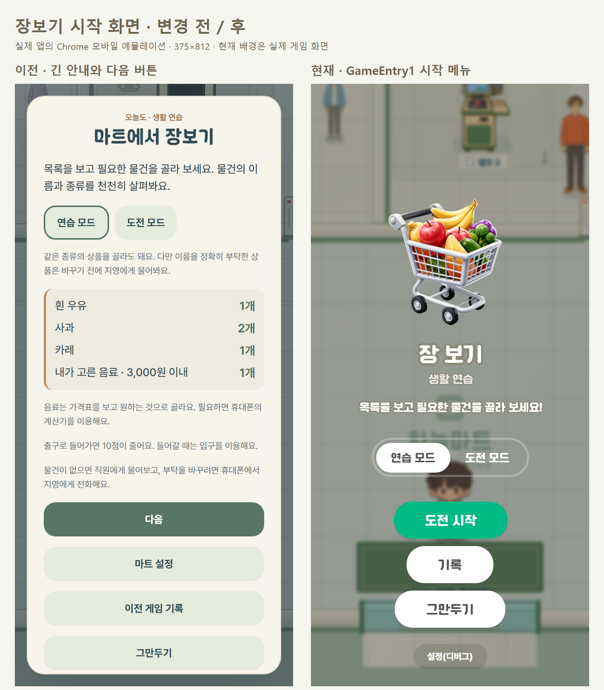

# 장보기 시작 화면 — GameEntry1 적용

작성·촬영·검증: **2026-11-13, 한국 시간**. [이전 설정 메뉴 통합·Sett1~Sett6 활동 기록](../market-settings-2026-11-13/README.md)에 이어지는 작업이다. 주차·활동 시간이나 실제 사용자 평가 결과는 추정하지 않는다.

**최종 후속 상태:** 시작 화면의 흐림 효과를 제거하고 설정과 같은 어두운 배경을 적용했다. iOS에서 하단 여백이 없어지는 KeyboardAvoidingView 패딩 충돌을 수정하고, 연습/도전 선택 테두리의 간격도 맞췄다. 아래 초기 캡처와 구현 설명은 단계별 이력이며 마지막 절의 상태가 현재 코드다.

## 활동일지에 쓸 내용

Figma의 GameEntry1 프레임과 사용자 제공 스크린샷을 확인하고, 장보기 전의 긴 두 단계 안내창을 카트 이미지·제목·모드 선택·시작·기록·종료·설정으로 구성된 한 화면으로 교체하였다. Cafe24 글꼴, 흰색 글씨의 테두리, 버튼 크기와 위치를 원본 모바일 화면에 맞추었다. 사용자의 후속 설명에 따라 배경 사진은 참고용으로만 취급하고, 현재 실행 중인 실제 마트 화면에 흐림과 어두워짐 효과를 적용하였다. 카트의 부드러운 등장과 약한 상하 움직임, 버튼 누름 반응을 추가하고 모션 감소 설정에서는 움직임을 줄였다. 시작 버튼 한 번으로 게임을 시작하고, 자세한 안내는 게임 안의 이용 방법에서 확인하도록 정리하였다. 변경 전후 화면을 촬영하고 타입 검사·관련 테스트·웹 빌드·외부 Expo Go 터널을 검증하였다.

## 기존 / 현재

| 항목 | 기존 | 현재 |
| --- | --- | --- |
| 첫 화면 | 베이지 안내창, 물품·조건·설명 나열 | 카트와 제목, 모드 선택, 시작·기록·그만두기·설정 |
| 시작 | 다음 → 장보기 시작 | 시작 버튼 한 번 |
| 배경 | 게임 위 안내창 | 실제 게임 위 흐림·검정 35%. 참고 배경 사진을 사용하지 않음 |
| 자세한 설명 | 시작 전 두 단계에 반복 | 게임 안 ‘이용 방법’. 물품 목록은 기존 HUD에 유지 |
| 모드 | 연습/도전 버튼 | 시안의 둥근 선택 메뉴. 실제 family/exact 규칙 유지 |
| 움직임 | 안내창 전환 | 화면 페이드, 카트 등장·2dp 부유, 버튼 0.98배 누름. 모션 감소 시 정지 |
| 시작 전 종료 | 포기 결과로 연결 | 마트에서 나가기. 실패 기록을 만들지 않음 |
| 의뢰 장보기 | 의뢰인·예산 표시, 설정 제한 | 동일한 제한과 예산 표시 유지 |

‘도전 시작’은 GameEntry1의 표시 문구를 따랐으며, 연습 모드를 선택하면 실제 연습 규칙으로 시작한다. 이전 요청의 흰색 바구니 시안은 별도로 보관하며 이번 프레임에는 Figma 원본 컬러 카트를 사용한다. 설정·편집기 탭의 즉시 전환과 스크롤 페이드는 유지하였다.

## 원본 캡처

Chrome 모바일 에뮬레이션에서 실제 앱을 촬영했다. 기본 화면은 375×812 CSS px, 배율 2이다. 실기기 촬영이나 사용자 평가 자료는 아니다. 배경과 NPC 위치는 현재 게임 상태에 따라 달라진다.

- [이전 첫 안내](before-01-intro.png), [이전 두 번째 안내](before-02-instructions.png)
- [현재 GameEntry1 메뉴](after-01-entry.png), [연습 모드 선택](after-02-practice.png)
- [375×667 작은 화면에서 아래까지 스크롤](after-03-short-scroll.png)
- [768×1024 태블릿·모션 감소](after-04-tablet-reduced-motion.png)

## 검증

- `pnpm typecheck`: 통과.
- 시작·계산·품절·포기·마트 지도·진열대·플레이 중 편집·설정 연결의 관련 5개 테스트 묶음 **87개 통과**.
- 앱에서 마트 연습을 완료하는 통합 흐름 **1개 통과**. 나머지 App 테스트 13개는 이 실행에서 제외하였다.
- `pnpm build:web`: 통과.
- 브라우저: 원본 카트 215×229dp와 가로 반전, 배경 이미지가 없는 투명 화면 및 실제 게임 블러, 모드 선택, 기록·설정 복귀, 한 번 눌러 시작, 작은 화면 스크롤, 태블릿·모션 감소를 확인했다. 페이지 오류 없음.
- 기존 Expo Go 서버 유지. PC 로그인 `violeillicit` 확인, 현재 외부 주소에서 iOS/Android manifest와 번들 HTTP 200 및 manifest username 확인. 실기기 실행 완료를 의미하지는 않는다.
- 앱 전체 테스트는 이번에 전부 실행하지 않았다. 이전 기록의 별도 마을·냉장고 실패 2건을 이 작업에서 수정하거나 통과한 것으로 기록하지 않는다.

디자인: [GameEntry1 / 569:4649](https://www.figma.com/design/qhD1bhkDWesf29T22fWlhP/Untitled?node-id=569-4649). 카트 원본은 [에셋 기록](../../../frontend/assets/images/game/market/entry/README.md)에 정리하였다. 구현은 `MarketEntryScreen.tsx`, `MarketSimulationScreen.tsx`와 실제 월드 블러 연결을 위한 `GamePrototypeScreen.tsx`다. 백엔드·의존성·SDK 변경, 커밋·푸시는 수행하지 않았다.

## 후속 수정 — 진입·스크롤·이미지·캐릭터

같은 날 사용자 피드백을 받아 다음을 수정하였다.

- **진입 시 잠깐 다른 위치가 보임:** 마트 전환 후 배율을 260ms 동안 바꾸던 처리를 없애고, 새 맵의 첫 표시 전 layout effect에서 배율 1.3과 스폰 위치의 카메라를 함께 적용한다. 기존 마을 배율은 나올 때 복구한다.
- **스크롤 간헐적 정지:** 지도가 100% 배율로 전부 보일 때도 중첩 ScrollView가 터치를 가져가던 문제를 실제 브라우저 손가락 드래그로 재현했다. 기본 배율에서는 일반 View에 지도를 표시하고 확대 상태에서만 내부 지도 스크롤을 사용한다. 바깥 설정 스크롤은 nestedScrollEnabled·드래그 시 키보드 닫기·터치 취소를 지원하며 자동 콘텐츠 인셋을 끈다.
- **하단 여백:** 작은 화면에서는 화면 높이 비율로 줄던 하단 여백을 최소 54dp로 고정하고, 위 패널이 남은 높이를 사용하게 했다. 375×667에서 적용 버튼 아래 여백 54px를 확인했다. [설정 화면](after-06-settings-bottom-54.png), [편집기](after-05-editor-bottom-54.png).
- **새 카트 로딩:** 원본 1796×2400 PNG(2,055,310바이트)를 바로 내려받고 있었다. 원본은 보존하고 표시용 718×960 PNG(435,541바이트)를 만들어 약 78.8% 줄였다. 그림 내용·비율·투명도는 유지한다. 수정 전 외부 터널로 원본 파일 하나를 받는 데 이 PC에서 약 1.97초가 걸렸다. 이는 사용자의 휴대폰에서 측정한 시간이 아니다. 기존 마트 이미지와 HD 캐릭터도 처음에는 외부 개발 터널로 받아야 하므로 첫 실행 지연이 모두 사라졌다고 판단하지 않는다.
- **캐릭터 동작 전환:** 기존에는 새 방향·동작을 디코딩하는 동안 이전 프레임을 멈췄다. 기다리는 동안 이전 걷기 동작을 계속 진행하고, 최근 사용한 디코딩 이미지 3개를 보관해 재방문 시 native onLoad 대기 없이 재사용한다. 표시/대기 포함 최대 5개 atlas로 제한해 모든 방향을 무한히 메모리에 쌓지 않는다. 플레이어의 다음 걷기/달리기 이미지 하나만 낮은 우선순위로 미리 준비한다. 동시 네트워크 요청 2개 제한과 기존 실패·시간 초과 처리는 유지한다.
- **Expo 위치 출렁임 대응:** 카메라와 캐릭터의 독립적인 native 좌표 쓰기를 줄이고 같은 카메라 Animated 노드에서 캐릭터 위치를 계산한다. iOS/Android 카메라 그래프는 native driver로 UI 스레드에서 계산한다. 카메라 X/Y 갱신 사이에도 화면 중앙의 캐릭터 위치가 어긋나지 않는 그래프 검사를 추가했다. 그리기 순서·충돌·이동거리 기반 걷기 주기는 유지한다. 사용자 실기기의 현상을 직접 촬영해 검증한 것은 아니므로 모든 출렁임이 해결되었다고 단정하지 않는다.

후속 검증: 타입 검사·웹 빌드 통과. 관련 10개 테스트 묶음 109개 통과 후 이미지 보관 개수 제한과 배경 요청 우선순위 검사 2개를 추가하고 해당 3묶음 17개를 재실행해 통과했다. 확인된 관련 검사는 총 111개다. 앱의 실제 이동거리 기반 걷기/달리기/벽 정지와 마트 연습 완료 통합 흐름 2개도 통과했다. 브라우저에서 실제 터치 드래그로 그리드 위의 바깥 스크롤 위치가 0→140→0으로 움직이는 것과 걷기/달리기/걷기 복귀, 페이지 오류가 없는 것을 확인했다. 하단 여백·그리드 스크롤·움직임은 Chrome 에뮬레이션 및 RN 검사 기준이며, iOS/Android 실기기의 프레임 시간 측정은 별도다.

마을에서 실제 진입 동작을 실행하고 첫 마트 표시부터 1초간 63개 브라우저 프레임을 기록했다. 첫 프레임부터 배율 1.3이었고 카메라 변환이 하나의 값으로 유지되어, 뒤늦은 260ms 배율 이동이 없는 것을 확인하였다.

## 최종 후속 수정 — 배경 통일·iOS 하단 여백·모드 테두리

- 시작 화면의 BlurView와 이를 위한 월드 BlurTargetView 연결을 제거했다. 현재 시작 화면과 설정은 같은 색·투명도의 `rgba(31,42,34,0.65)` 레이어를 사용하며 흐림 처리는 없다.
- 하단 여백이 Expo iOS에서 계속 사라진 실제 원인은 React Native KeyboardAvoidingView의 `behavior="padding"`이었다. 컴포넌트가 외부 style의 paddingBottom을 키보드 높이로 덮어쓰며, 키보드가 없으면 0으로 만든다. 단순히 값을 54로 바꾼 앞선 수정으로는 iOS에서 해결되지 않았다. 이제 고정 여백을 별도 내부 View로 옮겨 위의 패널이 줄고 하단 공간이 보존되도록 했다.
- 실제 iOS KeyboardAvoidingView 렌더 결과에서 바깥 패딩이 0이어도 내부의 54dp 여백이 남는 회귀 검사를 추가했다. 기존 브라우저 검사는 `padding` 동작을 사용하지 않아 이 문제를 놓쳤으므로, 웹 검사와 iOS 렌더 검사를 구분한다.
- 연습/도전 선택 메뉴의 외곽을 212×52dp, 각 버튼을 100×40dp로 맞췄다. 연습 선택 시 왼쪽·위·아래, 도전 선택 시 오른쪽·위·아래 간격이 각각 6dp인 것을 확인했다.
- 타입 검사와 관련 4개 테스트 묶음 60개 통과. 브라우저에서 배경 두 곳의 색·투명도가 같고 흐림 뷰가 없음을 확인했으며, 높이 812와 667 모두 footer 아래 54px 여백을 확인했다. 실기기 화면 촬영 검증은 수행하지 않았다.

최신 캡처: [연습 모드](after-07-no-blur-practice.png), [도전 모드](after-08-no-blur-challenge.png), [812 높이 설정](after-09-fixed-insets-812.png), [667 높이 설정](after-09-fixed-insets-667.png).

## 선택 메뉴 재확인과 개발용 진입 안내

사용자가 다시 제공한 확대 사진에서는 테두리 안쪽의 빈틈이 왼쪽 약 3px, 위 5px, 아래 4px로 달랐다. 앞선 버튼 레이아웃 수치 검사만으로 실제 보이는 간격까지 같다고 판단한 것은 충분하지 않았다. 흰 선택 배경과 외곽선을 각각 고정된 별도 레이어로 그리도록 변경하고, 버튼 누름 효과는 글자/터치 영역에만 적용한다. 흰 배경은 100×40dp, 위·아래·선택 쪽 바깥 간격 6dp를 유지하며 탭 선택은 즉시 바뀐다. 밀도 1·2·3의 브라우저에서 두 선택 상태와 누르고 있는 상태의 지시자 위치·크기를 검사했다. 타입 검사·장보기 흐름 테스트 41개·웹 빌드 통과.

`marketLab=1`은 기존 장보기 컴포넌트를 단독으로 여는 개발용 진입이고 `muteAudio=1`은 검사 중 소리를 끄는 옵션이다. 별도 서버나 별도 게임·이미지 에셋을 만드는 용도가 아니다. 사용자는 개발에 필요하면 유지하도록 승인하였다. 앞으로 사용자에게는 일반 앱 주소를 우선 안내하고 실제 앱 진입 흐름도 함께 검사한다. `localhost:8081`과 현재 외부 터널을 같은 375×812·밀도 2·동일 경로에서 열어 Cafe24 글꼴·선택 메뉴의 위치와 크기·최신 코드 표시가 같고 요청 실패가 없음을 확인했다. 사용자가 보고한 두 브라우저의 전체 조건이 같았다고 단정하지 않는다. [로컬 캡처](after-10-localhost-same-viewport.png), [외부 캡처](after-10-tunnel-same-viewport.png).
