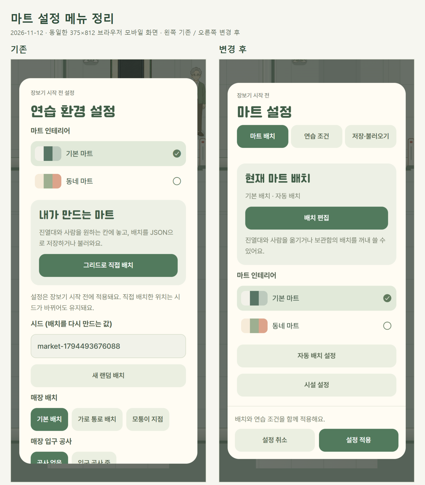
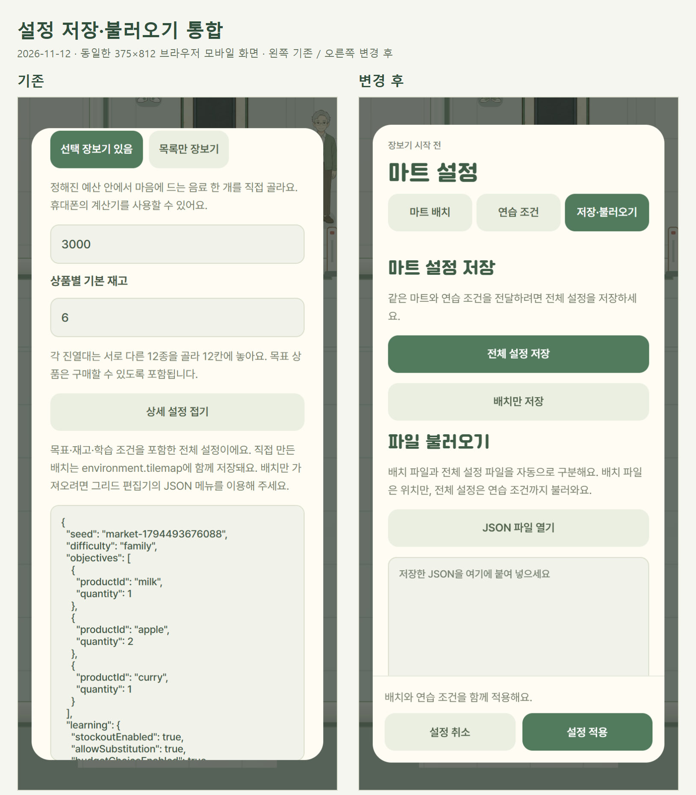

# 마트 설정 메뉴 통합 — 변경 전·후

후속 Figma 스타일 적용·배경 및 스크롤 보완을 함께 정리한 [통합 활동일지와 비교 화면](../market-settings-2026-11-13/README.md)이 있다. 이 문서는 11월 12일 작업 당시의 기록과 캡처를 유지한다.

작업·촬영일: **2026-11-12 (한국 시간)**. 프론트엔드의 현재 작업 트리에서 변경 전에 원본 화면을 촬영하고, 수정 후 같은 **375×812 CSS px**의 Chrome 모바일 에뮬레이션으로 촬영했다. 원본 PNG는 750×1624px이다. 태블릿은 별도로 768×1024 CSS px에서 확인했다. 실제 iPhone·Android의 Expo Go 실기기 촬영은 아니다. 주차와 활동 시간은 별도로 배정한다.

## 활동일지에 넣을 문장

마트의 기존 환경 설정과 그리드 배치 편집에 유사한 항목과 별도 JSON 메뉴가 있어 사용 흐름을 정리하였다. 진입 이름을 ‘마트 설정’으로 통일하고, ‘마트 배치·연습 조건·저장·불러오기’ 세 탭으로 구성하였다. 자주 사용하지 않는 자동 배치·시설·감점 설정은 접어서 표시하고, 적용 버튼을 화면 하단에 고정하였다. 배치 JSON과 전체 설정 JSON은 한곳에서 자동으로 구분하여 읽도록 변경하고, 저장 버튼을 ‘전체 설정 저장’과 ‘배치만 저장’으로 구분하였다. 직접 만든 배치를 기본·랜덤 배치로 바꿀 때 확인을 추가하였다. 플레이 중에는 공간만 바꾸도록 제한하고, 장바구니·재고·점수·기록과 호출한 계산원이 유지되는지 테스트하였다. 같은 모바일 화면 크기로 변경 전·후를 기록하고 태블릿 화면도 확인하였다.

## 기존 / 변경 후

| 항목 | 기존 | 변경 후 |
| --- | --- | --- |
| 설정 진입 | 시작 전 ‘연습 환경 설정’, 휴대폰 ‘마트 배치 편집’ | 두 경로 모두 ‘마트 설정’ |
| 메뉴 구성 | 인테리어·배치·시드·시설·학습 조건·JSON이 긴 화면에 이어짐 | ‘마트 배치 / 연습 조건 / 저장·불러오기’ 세 탭 |
| 중복 배치 항목 | 수동 편집과 기본·랜덤 배치 선택이 함께 노출 | 현재 배치와 편집을 먼저 표시, 자동 배치는 필요할 때 펼침 |
| 직접 배치 해제 | 기본·랜덤 선택 시 해제 | 변경 전 확인, 보관함의 저장 항목 유지 |
| JSON 입력 | 설정창과 그리드 편집기의 입력 형식·진입점이 별도 | 한곳에서 기존 두 형식을 자동 구분 |
| JSON 저장 | ‘설정 JSON 저장’, ‘JSON 저장’ | ‘전체 설정 저장’, ‘배치만 저장’ |
| 적용 흐름 | 설정 화면의 아래쪽까지 이동, 편집기의 ‘배치 적용’과 혼동 가능 | 편집기는 ‘편집 완료’, 설정 하단에 적용·취소 고정 |
| 플레이 중 변경 | 배치 편집기로 바로 진입 | 같은 설정 메뉴에서 공간만 수정·적용, 과제 조건과 진행 유지 |

전체 설정 JSON은 기존처럼 `environment.tilemap`에 수동 배치를 포함한다. 배치 JSON은 같은 도면을 다른 과제에서 재사용하기 위한 형식으로 유지한다. 테마는 기존의 별도 인테리어 설정이며 두 JSON에 새로 포함하지 않았다. 서버·백엔드 연동이나 저장 스키마 변경은 이번 범위가 아니다.

## 비교 이미지

원본 화면 내용은 수정하지 않았으며, 비교 이미지는 같은 크기의 원본 두 장에 제목을 붙여 좌우로 배치한 것이다.

| 원본 캡처 | 파일 |
| --- | --- |
| 기존 설정 첫 화면 | [before-01-settings.png](before-01-settings.png) |
| 기존 상세 JSON 영역 | [before-02-json.png](before-02-json.png) |
| 변경 후 마트 배치 탭 | [after-01-layout.png](after-01-layout.png) |
| 변경 후 연습 조건 탭 | [after-02-practice.png](after-02-practice.png) |
| 변경 후 저장·불러오기 탭 | [after-03-transfer.png](after-03-transfer.png) |
| 변경 후 그리드 편집기 | [after-04-editor.png](after-04-editor.png) |
| 변경 후 태블릿 | [after-05-tablet.png](after-05-tablet.png) |

## 검증

- 타입 검사 통과.
- 설정·그리드·진행 중 배치 변경 관련 5개 테스트 묶음, 39개 테스트 통과.
- Chrome에서 전체 설정/배치 JSON 다운로드 파일명·내용, 기존 전체 설정 예제 불러오기, 편집 완료·최종 적용 및 중복 JSON 메뉴 제거를 확인했다.
- 웹 빌드 통과. Expo SDK 57 패치 버전 권장 목록은 별도로 남아 있으며 의존성 버전은 바꾸지 않았다.
- 전체 테스트: **112개 묶음 중 111개 통과 / 1개 실패, 1,218개 테스트 중 1,216개 통과 / 2개 실패**.
- 실패는 `App.test.tsx`의 ‘민수와 일상 대화 후 의뢰를 받아 안전 퀴즈를 완료한다’와 ‘집 냉장고에서 바나나 요거트 컵을 만들고 마을로 돌아온다’이다. 각각 설정 메뉴에 진입하기 전 `부동산` 문구 및 `냉장고에서 할 일 선택` 요소를 찾는 단계에서 실패했다. 이번 범위에서 해당 마을·냉장고 흐름을 수정하지 않았고, 실패 원인을 해결했다고 기록하지 않는다. 같은 App 테스트의 마트 연습 완료 흐름은 통과했다.
- 외부 터널의 iOS·Android manifest와 JavaScript 번들 응답도 확인했다. Expo Go 로그인 계정은 `violeillicit`이며, HTTP 응답과 실제 휴대폰 실행은 별도다.

이 검증으로 실제 발달장애 사용자의 이해도·학습 효과가 개선되었다고 판단하지 않는다. 모바일 브라우저 화면·기능 검사와 실제 기기·사용자 평가는 별도다.

구현: `MarketSetupPanel.tsx`, `MarketLayoutEditor.tsx`, `marketSettingsTransfer.ts`, `MarketSimulationScreen.tsx`, `PhoneSettings.tsx`. 사용 방법은 [배치·설정 인수인계](../../../frontend/docs/market-tilemap-editor.md)에 갱신하였다. 커밋·푸시는 수행하지 않았다.
