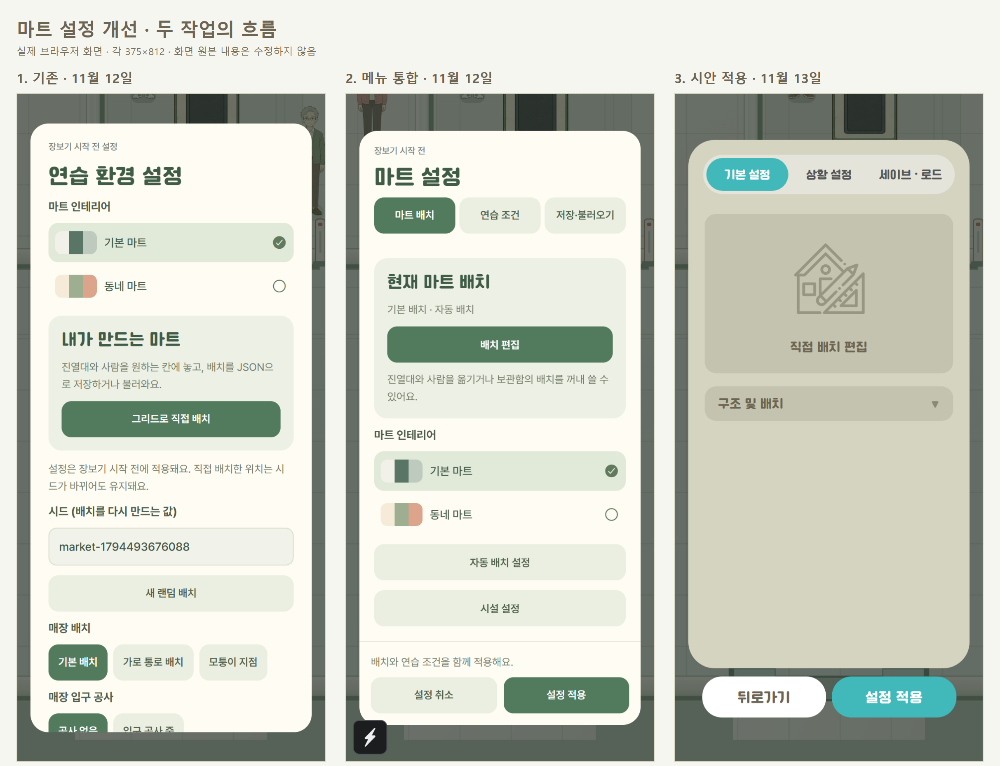
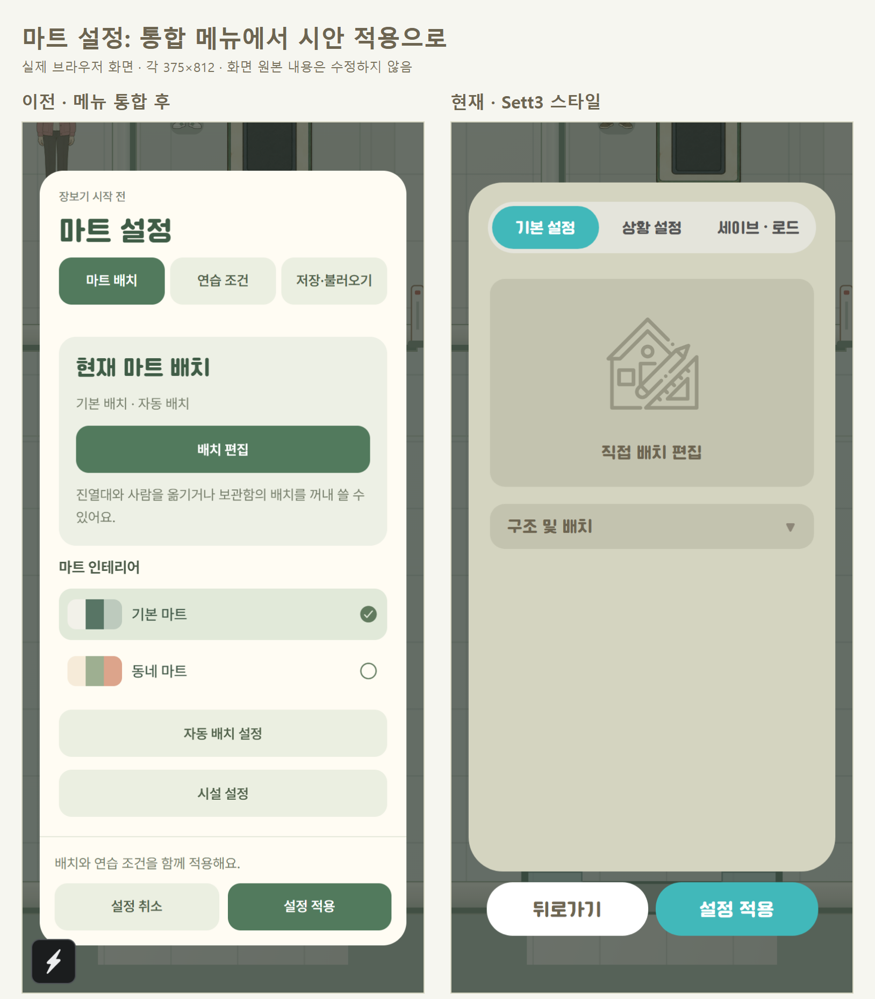
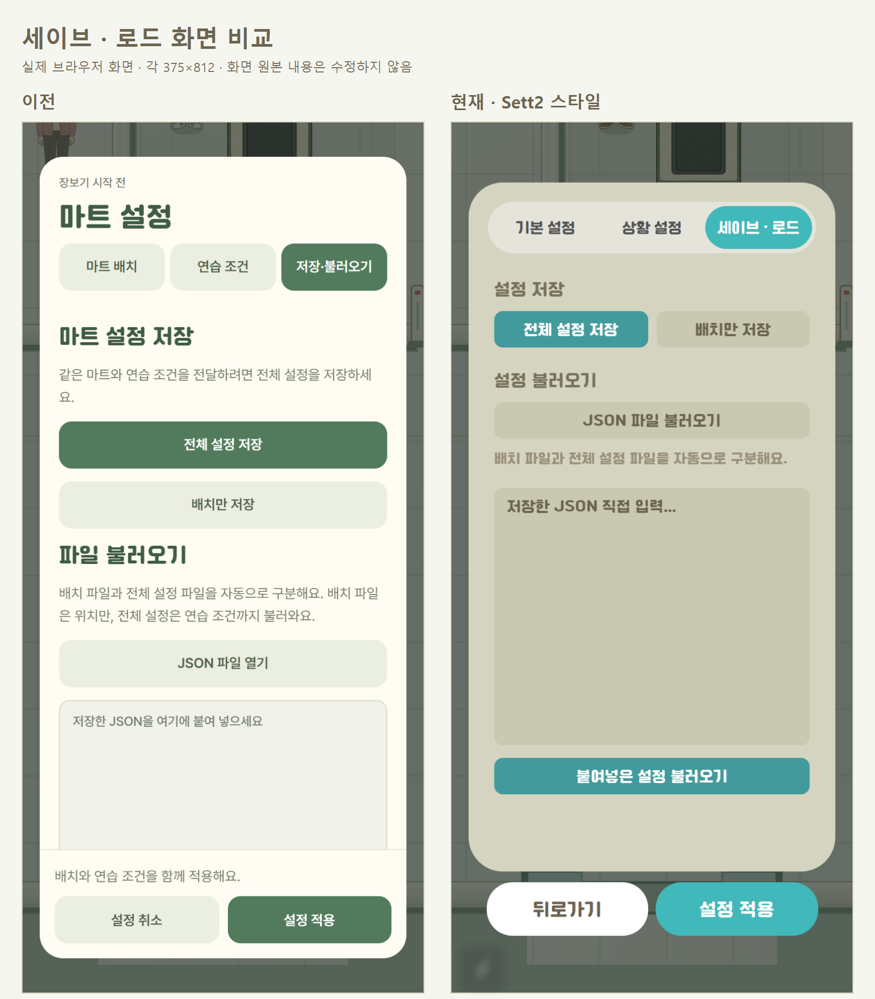
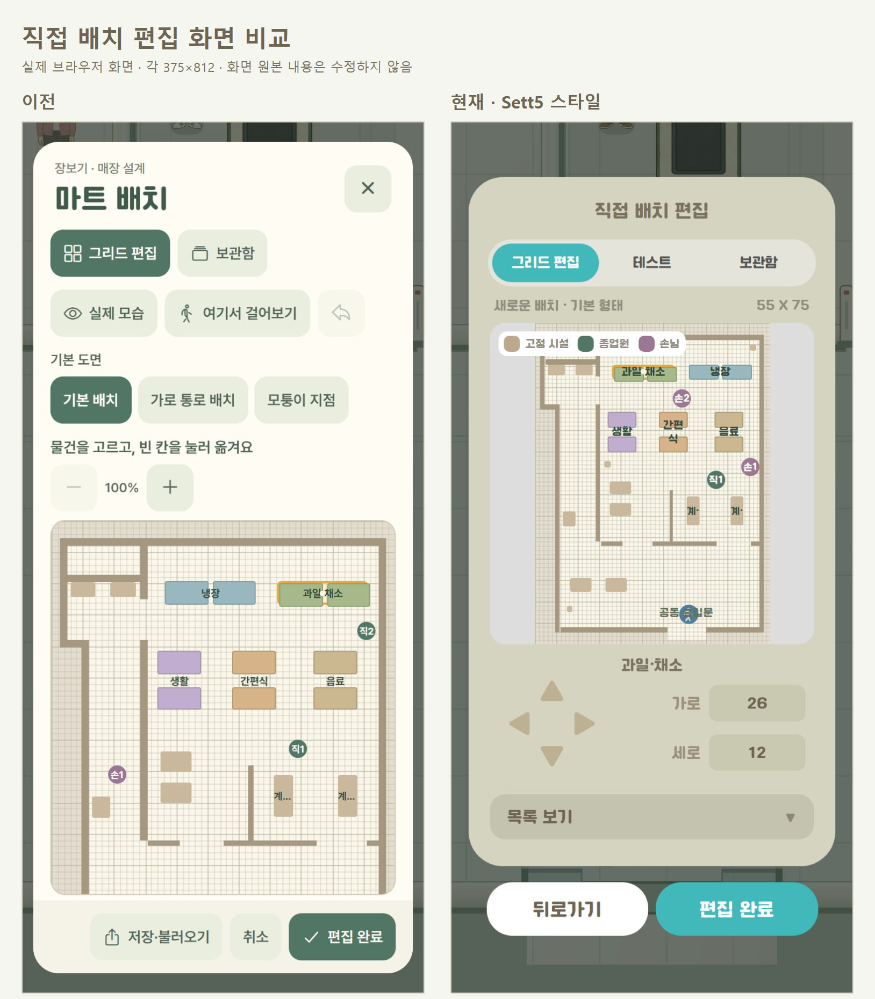
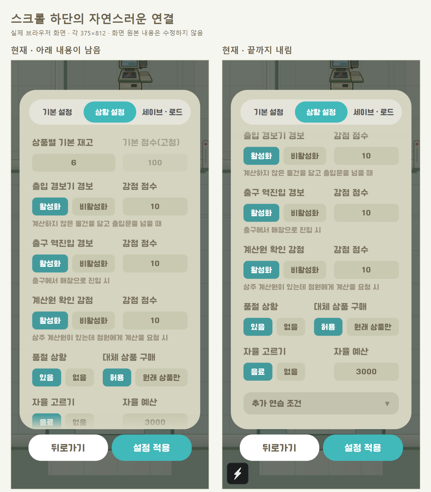

# 마트 설정 개선 — 통합 활동일지와 변경 전·후

작성·최종 촬영 기준: **2026-11-13, 한국 시간**. 앞서 진행한 메뉴 단일화와 이번 Figma 스타일 적용을 함께 정리한 기록이다. 주차·활동 시간은 별도로 배정한다. 이전 기록과 이미지 원본은 [2026-11-12 메뉴 단일화 기록](../market-settings-2026-11-12/README.md)에 보존하였다.

같은 날 이어서 진행한 **장보기 시작 화면 GameEntry1 적용**도 [활동 내용·기존/현재 비교·검증 기록](../market-entry-2026-11-13/README.md)에 연결하였다. 현재 게임을 흐리게 비추는 배경, 원본 카트와 시작 메뉴, 부드러운 움직임과 한 번 눌러 시작하는 흐름을 포함한다.

## 활동일지에 쓸 내용

**2026-11-12 — 설정 메뉴 단일화**

마트 환경 설정과 그리드 편집에 흩어진 배치·연습 조건·JSON 기능을 하나의 설정 메뉴로 정리하였다. ‘마트 배치·연습 조건·저장·불러오기’ 탭을 구성하고, 배치 JSON과 전체 설정 JSON을 같은 곳에서 구분해 읽도록 변경하였다. 적용 버튼을 화면 하단에 고정하고, 직접 만든 배치를 기본·랜덤 배치로 바꿀 때 확인을 추가하였다. 플레이 중에는 공간만 변경하도록 제한하여 장바구니·재고·점수·진행 기록을 유지하였다. 동일한 모바일 크기로 기존·변경 후 화면을 촬영하고 타입 검사·관련 테스트·웹 빌드로 확인하였다.

**2026-11-13 — Figma 스타일 적용과 스크롤·모션 보완**

사용자가 제공한 Figma Sett1~Sett6 프레임과 스크린샷을 확인하고, 설정 메뉴와 직접 배치 편집 화면의 색상·Cafe24 폰트·둥근 패널·버튼·간격을 시안에 맞춰 교체하였다. 탭을 ‘기본 설정·상황 설정·세이브 · 로드’로 표시하고, 긴 ‘구조 및 배치’ 항목은 패널 안에서 스크롤되도록 구성하였다. 직접 배치 편집은 실제 그리드 지도와 좌표 조작을 유지하면서 ‘그리드 편집·테스트·보관함’으로 정리하였다. 탭 선택 표시의 부드러운 이동, 펼치기·접기, 화면 진입과 누름 반응을 적용하고 모션 감소 설정도 반영하였다. 사용자 피드백에 따라 초록색 전체 배경은 기존 게임이 어둡게 비치는 배경으로 복구하고 화살표 이미지의 초록 바탕도 제거하였다. 긴 내용이 갑자기 잘리지 않도록 스크롤 가장자리에 페이드를 적용하고, 남은 내용이 있는 방향에만 표시되는지 검사하였다. 변경 전·후 화면과 스크롤·테스트·보관함·태블릿 화면을 추가로 촬영하였다.

## 두 작업의 흐름

아래 비교는 **기존의 긴 설정 화면 → 메뉴 단일화 → Figma 스타일 적용** 순서다. 원본 내용은 수정하지 않고 같은 크기로 나란히 배치하였다.

| 항목 | 메뉴 단일화 후 | 이번 변경 후 |
| --- | --- | --- |
| 설정 탭 | 마트 배치 / 연습 조건 / 저장·불러오기 | 기본 설정 / 상황 설정 / 세이브 · 로드 |
| 기본 화면 | 현재 배치 카드·별도 인테리어·자동 배치·시설 항목 | 시안의 ‘직접 배치 편집’ 카드와 ‘구조 및 배치’ 펼치기 |
| 상황 설정 | 조건을 세로로 나열, 감점은 별도 펼치기 | 재고·고정 점수·감점·품절·대체 구매·자율 예산을 시안의 열 구성으로 정리 |
| 기존 추가 조건 | 상품 판정·계산 실수 조건 | ‘추가 연습 조건’ 아래에 보존 |
| 배치 편집 | 도구·팔레트·미리보기가 함께 노출 | 그리드·좌표 화살표를 먼저 표시하고 목록과 테스트 탭으로 분리 |
| 파일 | 두 형식을 한곳에서 구분 | 기능 유지, 시안의 저장 버튼·JSON 입력 영역으로 대체 |
| 외부 배경 | 어두운 게임 배경 | 최종 사용자 피드백대로 동일하게 유지. 시안의 초록색 단색 배경은 사용하지 않음 |
| 스크롤 끝 | 내용이 패널 경계에서 바로 잘림 | 28dp 그라데이션, 상단/하단 잔여 내용에 따라 150ms로 나타나고 사라짐 |
| 모션 | 공통 누름 반응 중심 | 후속 요청으로 탭 선택 표시·내용은 제자리에서 즉시 교체. 화면 진입·펼치기/접기 모션은 유지 |

기존 JSON 스키마, 배치 보관함과 장보기 진행 보존 규칙은 유지하였다. 요청 범위는 화면 스타일 교체로 적용하여 시안의 **‘반전’ 도면과 ‘출구 공사’라는 새 게임 동작은 추가하지 않았다**. 기존 기본·가로·모퉁이 도면과 입구 공사 기능을 유지한다. 이 차이를 새 기능 구현 완료로 기록하지 않는다.

**후속 피드백 반영:** 사용자의 ‘없애자’는 반전·출구 공사처럼 아직 없는 기능을 제외하라는 뜻으로 확인하였다. 스크롤 가장자리 페이드는 유지한다. 설정과 편집기의 탭 선택 표시·내용에서 슬라이드와 지연 진입을 제거해 제자리에서 즉시 바뀌게 했다. 정지 화면의 배치·색상은 아래 캡처와 같다. 추가로 장보기 메뉴용 흰색 단색·투명 배경 아이콘을 생성하고, 얇은 윤곽선과 작은 별 반짝임 세 개를 넣은 수정본을 [프로젝트 에셋](../../../frontend/assets/images/game/market/shopping-white-sparkles-v2.png)에 보관하였다. 아이콘은 별도 제공 에셋이며 시작 화면에 연결한 상태는 아니다.

## 기존 / 현재 비교

## 원본 스크린샷

화면은 실행 중인 실제 앱의 **375×812 CSS px, 배율 2** Chrome 모바일 에뮬레이션에서 촬영하였다. PNG는 750×1624px이다. 실제 휴대폰에서 촬영한 이미지가 아니며, 지도는 시안의 빈 자리 대신 실제 편집 가능한 배치를 표시한다. 이전 캡처는 이번 스타일 변경 전에 촬영하였다. 태블릿 캡처는 768×1024 CSS px이다.

| 이전 화면 | 현재 화면 |
| --- | --- |
| [설정 첫 화면](before-01-layout.png) | [기본 설정](after-01-basic.png) |
| [연습 조건](before-02-practice.png) | [상황 설정](after-04-situation.png) |
| [저장·불러오기](before-03-transfer.png) | [세이브 · 로드](after-05-transfer.png) |
| [배치 편집](before-04-editor.png) | [그리드 편집](after-06-grid.png) |
| [이전 태블릿](before-05-tablet.png) | [현재 태블릿](after-13-tablet.png) |

추가 캡처: [구조 및 배치 위쪽](after-02-structure-top.png), [구조 및 배치 아래쪽](after-03-structure-bottom.png), [테스트 탭](after-07-test.png), [스크롤 시작](after-08-scroll-fade-top.png), [스크롤 끝](after-09-scroll-fade-bottom.png), [그리드 목록 펼침](after-10-grid-list.png), [보관함](after-11-library.png), [실제 전경](after-12-preview.png).

## 확인 결과와 범위

- 타입 검사와 웹 빌드 통과.
- 탭 즉시 전환 후 타입 검사와 관련 8개 테스트 묶음 94개를 재실행해 통과했다. Animated 테스트의 act 경고는 출력되었다. 브라우저에서도 배경·화살표 투명도·페이드 방향·미리보기 복귀·태블릿을 재확인했다.
- 설정·그리드·미리보기·보관함·플레이 중 배치 변경·공통 전환 관련 **9개 테스트 묶음의 71개 테스트**가 최종 실행에서 모두 통과했다. 이후 감점 비활성화/복원과 계산원 화살표 순환 검사 **2개를 추가**하고 해당 설정창 검사 11개를 재실행하여 통과했다. 따라서 확인한 관련 검사는 총 73개다.
- 앱의 **의뢰 없이 마트 연습을 완료하는 통합 흐름 1개**도 별도로 통과했다.
- Chrome에서 기존 게임이 비치는 반투명 배경, 화살표의 투명 픽셀, 스크롤 시작/끝의 페이드 방향, 하단 적용 버튼의 화면 내 위치, 미리보기 복귀, 모션 감소, 태블릿 크기를 검사했다.
- [11월 12일 전체 검사](../market-settings-2026-11-12/README.md)의 별도 마을·냉장고 테스트 실패 2건은 이번 화면 변경 범위에서 수정하지 않았다. 전체 테스트를 모두 통과했다고 쓰지 않는다.
- Expo SDK 패치 업데이트는 이번에 수행하지 않았다. 실기기 Expo Go 실행과 실제 사용자의 이해도·학습 효과 평가는 별도 확인이 필요하다.

사용한 디자인: [Sett1](https://www.figma.com/design/qhD1bhkDWesf29T22fWlhP/Untitled?node-id=564-3566), [Sett2](https://www.figma.com/design/qhD1bhkDWesf29T22fWlhP/Untitled?node-id=566-3926), [Sett3](https://www.figma.com/design/qhD1bhkDWesf29T22fWlhP/Untitled?node-id=425-1001), [Sett4](https://www.figma.com/design/qhD1bhkDWesf29T22fWlhP/Untitled?node-id=566-4151), [Sett5](https://www.figma.com/design/qhD1bhkDWesf29T22fWlhP/Untitled?node-id=568-4389), [Sett6](https://www.figma.com/design/qhD1bhkDWesf29T22fWlhP/Untitled?node-id=568-4571). 사용자가 제공한 Sett1.png~Sett6.png도 함께 대조하였다.

관련 구현: `frontend/src/components/game/MarketSettingsUi.tsx`, `MarketSetupPanel.tsx`, `MarketLayoutEditor.tsx`, `MarketLayoutLibrary.tsx`. 신규 서버·백엔드 연동과 커밋·푸시는 수행하지 않았다.
