# 장보기 UI 통합·훈련 테스트·이동 경로 활동 기록

## 후속: 매장 지도 표시

2026-11-15 추가 요청으로 매장 입구·출구를 표시하고 매대 이름을 도형 중앙에 정렬했다. 글씨는 8px에서 11px로 키우고 ‘과일/채소’ 등 전체 이름을 사용했다. 좁은 매대는 두 줄로 표시한다. 결과 지도와 SVG 저장에도 같은 표시를 적용했다. 타입 검사, 기존 UI 테스트 3개, 모바일 브라우저의 위치·폰트·SVG 다운로드 확인을 통과했다.

| 변경 전 | 변경 후 |
| --- | --- |
| 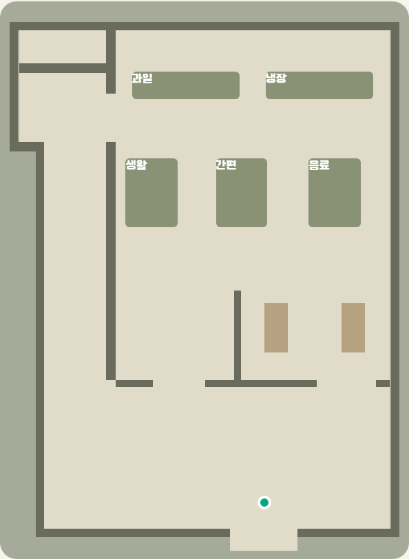 | 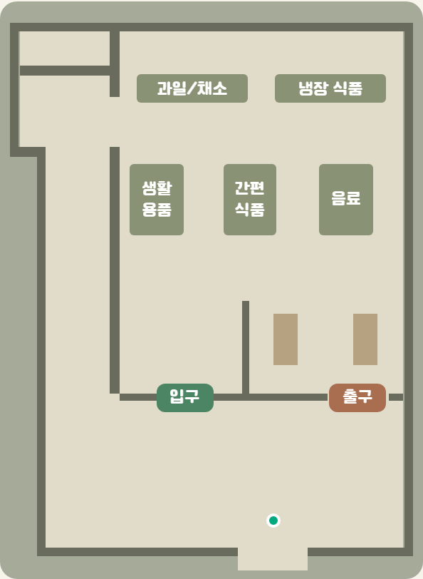 |

원본 검증 기록: `output/market-map-labels-2026-11-15/`. 학교 외장하드 미보관 상태는 아래 기존 기록과 구분하여 해당 폴더의 `archive.log`를 따른다.

작성/현재 촬영: **2026-11-15, 한국 시간**. 과거 촬영본의 날짜는 각 원본 문서를 따른다. 실제 활동 시간이나 주차는 추정하지 않는다.

## 브랜치

`develop`의 `ff000c07ff46061d69bdeebd54c902d1140daf08`에서 `feat/8-장보기-게임-구체화`를 만들었다. 이전 `feat/8-시뮬레이션-게임-장보기-구현`의 `38a41b9ce23916b991b83e9181b2687913753649`에 있는 UI·성능·게임·아트·문서를 작업 트리에 스쿼시 반영하고, develop의 AI 추천·행동 기록·재생·시간 제한 기능과 충돌을 조정했다. develop과 backend, `docs/collaboration.md`는 수정하지 않았다. 새 커밋/푸시는 실행하지 않았다.

## 활동일지용 문장

장보기 설정을 기본 설정·상황 설정·세이브/로드로 통합하고, 사용자 시안에 맞춰 설정과 그리드 배치 편집 화면을 변경하였다. 시작 화면도 카트와 모드 선택 중심으로 정리하고, 배경 흐림 제거·하단 여백·버튼 간격·이미지와 캐릭터 표시를 보완하였다. 이후 develop의 AI 테스트 기능과 기존 UI 작업을 새 브랜치에서 통합하였다. 게임 결과에서 실제 이동 경로와 시간별 위치·정지를 확인하고 JSON/SVG로 내보내는 기능을 추가하였다. 직원 이름표를 근접 대화 아이콘으로 바꾸고, 어머니 심부름·매대 찾기·직원 방향 안내·선택형 지도·사람 몰림·소리와 빛을 조합해 이름 있는 테스트로 저장하고 다시 선택하도록 만들었다. 단위·화면·브라우저 검사를 진행하고 전후 캡처를 함께 보관하였다.

## 이전 / 변경 후 — 기존 활동 기록과 연결

| 작업 | 전후 자료 | 현재 반영 내용 |
| --- | --- | --- |
| 설정 메뉴 단일화 | [11/12 메뉴·JSON 비교](../market-settings-2026-11-12/README.md) | 설정/그리드의 역할 구분과 JSON 호환 유지 |
| Sett1~Sett6 | [11/13 설정·그리드·스크롤 비교](../market-settings-2026-11-13/README.md) | 어두운 실제 게임 배경, 54px 하단 여백, 제자리 탭 전환 유지 |
| GameEntry1 | [11/13 시작 화면 전후](../market-entry-2026-11-13/README.md) | 카트·모드 UI 유지, AI 과제의 규격·예산·시간·단계 안내 보존 |
| 결과 확인 | 기존 점수·기록 중심 | 지도 위 경로, 시간 위치, 정지, 시간 재생, 그림 저장 추가 |
| 테스트 구성 | 고정 장보기와 학습 옵션 | 과제·힌트·상황·물건 목록·이름 있는 테스트 보관함 추가 |
| 직원 표시 | 아래쪽 이름표 | 가까이 가면 머리 위 반투명 배지와 흰색 선 말풍선 |

아래 비교 그림은 **과거 촬영본**이다. 이번에 develop을 다시 촬영한 자료로 표기하지 않는다.

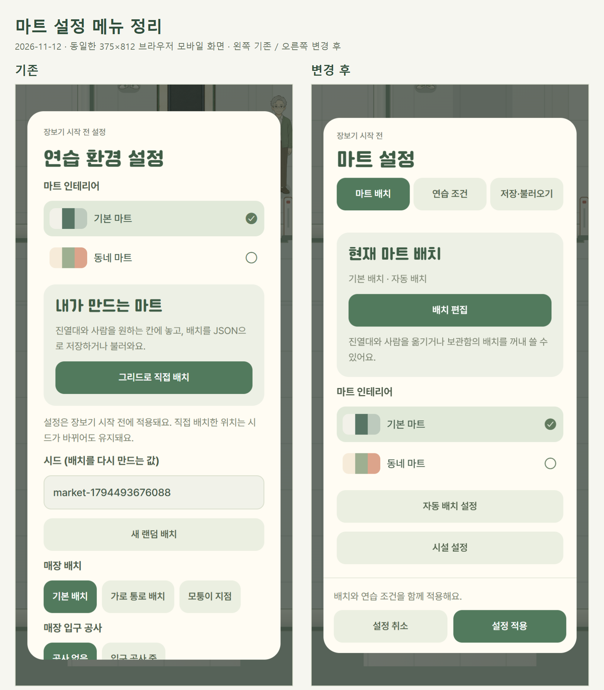

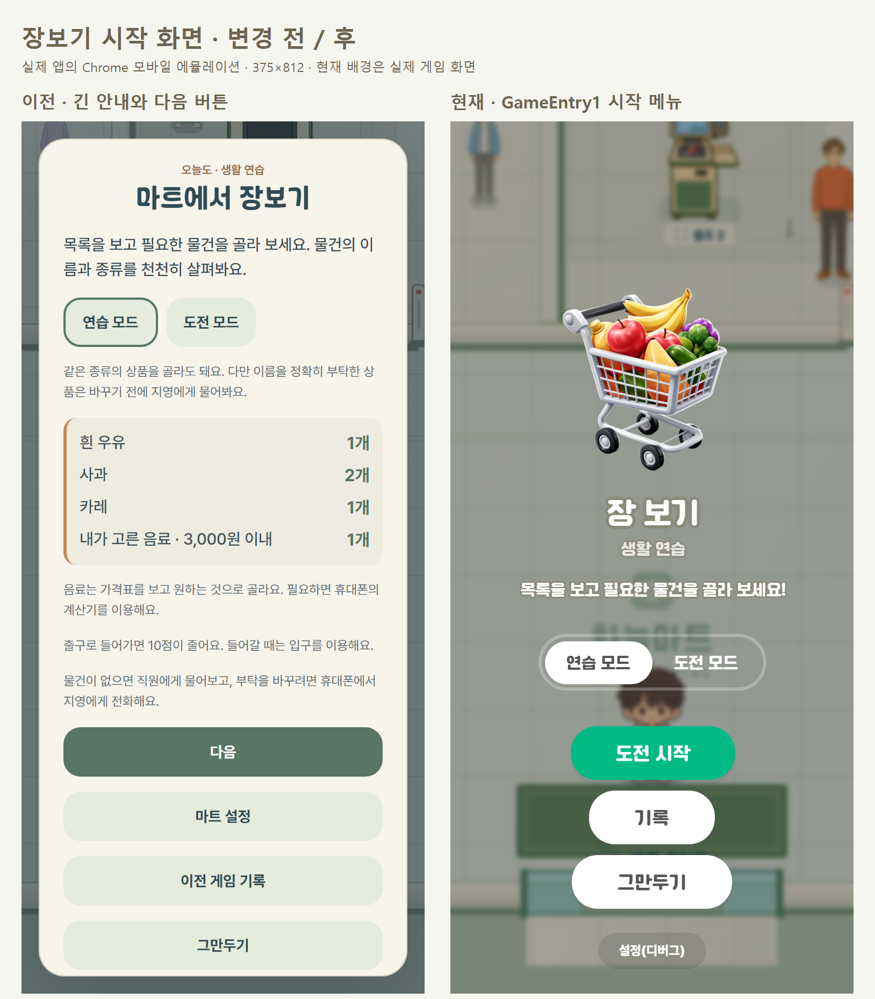

## 현재 캡처

| 시작 화면 | 과제·힌트·돌발 상황 |
| --- | --- |
| 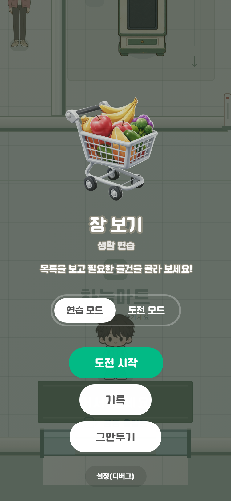 | 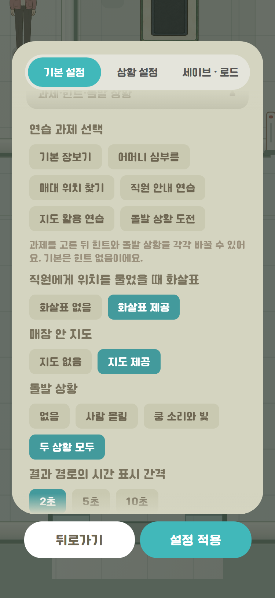 |

| 테스트 저장/선택 | 선택형 내부 지도 |
| --- | --- |
| 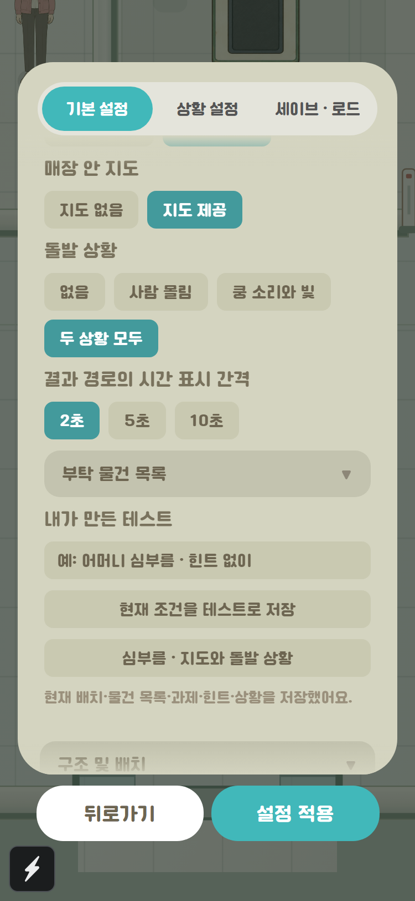 | 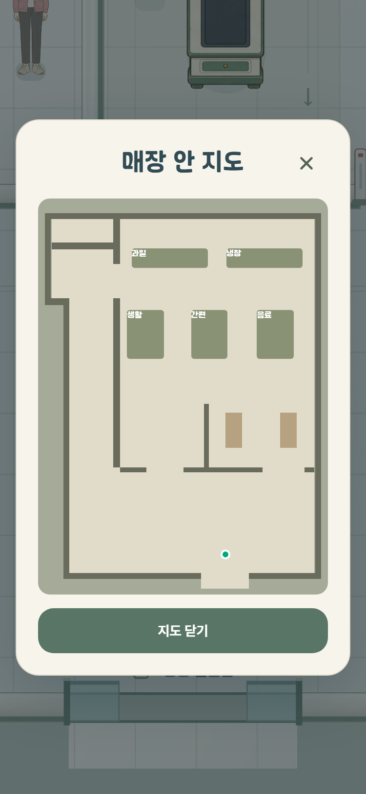 |

| 결과 경로 | 특정 시간 위치 |
| --- | --- |
| 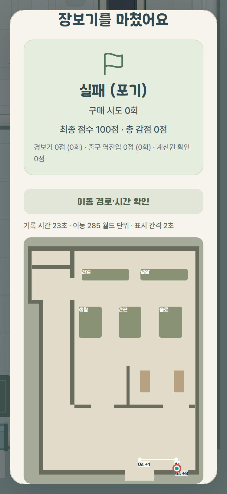 | 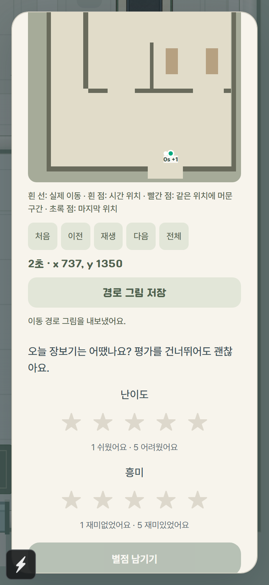 |

브라우저에서 실제로 이동한 경로 지도 원본:

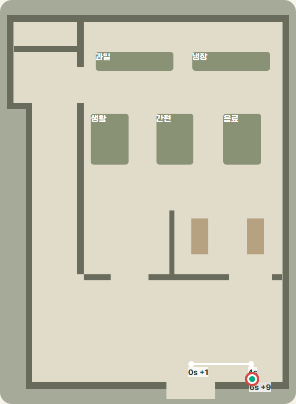

이는 기능 확인용 짧은 플레이다. 페르소나 실험이나 사용자 효과 검증으로 계산하지 않는다.

## 검증과 경계

최종 수치는 [검증 결과](validation.json), 원본 로그·JSON·SVG는 `output/market-training-2026-11-15/`에 보관한다. 타입 검사·웹 빌드·관련 및 전체 Jest 검사를 수행했다. 브라우저에서 조건 저장, 지도 열기/닫기, 실제 이동, 시간별 위치, SVG/JSON 다운로드와 화면 오류 유무를 확인했다.

- SDK 57을 유지했다. Expo 호환 검사에는 기존 패키지의 패치 업데이트 권고 14개가 남아 있으며 일괄 업데이트하지 않았다.
- 실제 iPhone/Android의 터치·음성·Expo Go는 이번 데스크톱 브라우저 검사에 포함되지 않는다.
- 사람 몰림은 기존 손님 아트를 이용한 주의 분산 상황이다. 길을 막거나 이동하는 군중 AI는 추가하지 않았다.
- 프론트엔드 결과와 agent episode export에 경로를 추가했다. Backend DB·원격 분석 화면에 그림을 영구 저장하는 연동은 별도다.
- 원격 보관 완료 여부는 검증 결과에 실제 도구 실행 결과로 기록한다. 원본 로컬 자료는 유지한다.

[사용법·설정 JSON·페르소나 export 필드](../../../frontend/docs/market-training.md)

최종 검사: **170개 묶음 / 1,667개 테스트 통과**, 타입 검사·웹 빌드 통과.

외장하드 보관은 Windows 보관 도구의 `os.O_DIRECTORY` 실행 오류로 **미전송**이다. 원본은 로컬에 보존했다. 검증용 의존성 백업 삭제는 자동 승인 검토에서 정책 차단으로 거부되어 남아 있으며, 독립적인 로그/캐시 파일에는 손실 없는 압축을 적용했다.
