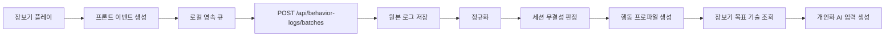

# 장보기 행동 데이터 기반 개인화 시범 도입 명세서

## 1. 문서 목적

이 문서는 현재 장보기 게임에 행동 데이터 수집을 시범 적용하고, 수집된 근거가 사용자별 행동 프로파일과 AI 퀘스트 입력으로 변환되는 과정을 검증하기 위한 구현 명세다.

이번 시범 도입의 핵심은 사용자를 의학적으로 진단하거나 지능·장애 정도를 추정하는 것이 아니다. 게임 안에서 직접 관찰된 행동만으로 다음 장보기 과제의 안내 수준, 선택지 수, 힌트 강도를 조정할 수 있는지를 검증한다.

## 2. 현재 상태와 전제

### 2.1 이미 구현된 부분

- 프론트엔드에 `market-basic-shopping` 장보기 시나리오가 있다.
- 기본 과제는 우유 1개, 사과 2개, 카레 1개를 10,000원 안에서 담는 것이다.
- 백엔드에 행동 로그 단건·배치 저장 API가 있다.
- 저장된 원본 로그를 정규화하고 행동 프로파일로 집계하는 기능이 있다.
- 프로파일을 바탕으로 AI 입력용 개인화 설정을 만드는 서비스가 있다.

### 2.2 최초 작성 시 연결되지 않았던 부분

- 장보기 화면은 행동 로그 API를 호출하지 않는다.
- 장보기 화면까지 로그인 토큰이 전달되지 않는다.
- 오프라인 행동 로그를 영속적으로 보관하는 프론트 큐가 없다.
- 장보기 퀘스트의 목표 기술 코드와 실제 장보기 이벤트가 생성하는 기술 근거가 일부 일치하지 않는다.
- AI 입력 생성 서비스가 현재 실제 퀘스트 생성 경로에 연결되어 있지 않다.

따라서 1차 시범에서는 `플레이 → 원본 저장 → 정규화 → 프로파일 생성 → AI 입력 확인`까지를 완료 조건으로 삼는다. AI가 만든 새 장보기 퀘스트를 바로 게임에 반영하는 기능은 2차 범위로 분리한다.

### 2.3 2026-08-29 구현 갱신

위 항목 중 로그인 토큰 전달, 장보기 행동 로그 전송, 오프라인 재전송 큐, 완료 세션 자동 프로파일 생성, 동적 난이도 추천과 장보기 미션 반영까지 구현됐다. 현재 구현 상세와 정책 경계값은 [장보기 동적 난이도 개인화 구현 명세](./dynamic-difficulty-implementation.md)를 기준으로 한다.

## 3. 시범 도입 범위

### 3.1 포함 범위

1. 로그인 사용자의 장보기 행동을 이벤트로 기록한다.
2. 이벤트를 중복 없이 순서대로 백엔드에 전송한다.
3. 백엔드에서 이벤트를 기술별 긍정·부정·중립 근거로 정규화한다.
4. 완료된 세션만 사용자 행동 프로파일에 반영한다.
5. 프로파일로부터 다음 장보기 퀘스트용 개인화 입력을 생성한다.
6. 정상 행동, 오답 후 수정, 수량 오류, 예산 초과, 중복 전송, 순서 누락을 테스트한다.

### 3.2 제외 범위

- IQ, 장애 등급, 의학적 진단 또는 임상적 능력 추정
- `지각 능력`, `공간 능력`, `언어 능력` 같은 상위 능력 범주의 최종 확정
- 모든 게임에 대한 행동 로그 적용
- 카메라·마이크·생체 정보 수집
- AI가 상품, 가격, 상점 구조를 실시간 생성하는 기능
- 비로그인 사용자의 개인화 프로파일 생성
- 실제 결제 또는 실제 위치 정보 사용

## 4. 시범 과제

### 4.1 1차 과제: 기본 장보기

| 항목 | 값 |
|---|---|
| 게임 ID | `MARKET_SIMULATION` |
| 퀘스트 코드 | `SHOP_AT_MARKET` |
| 프론트 시나리오 ID | `market-basic-shopping` |
| 백엔드 과제 ID | `30000000-0000-0000-0000-000000000003` |
| 콘텐츠 버전 | `market-basic-shopping-v1` |
| 예산 | 10,000원 |
| 목표 | 우유 1개, 사과 2개, 카레 1개 |
| 주요 관찰 기술 | 상품명 이해, 수량 이해, 예산 판단 |

1차 과제는 현재 UI만으로 재현 가능한 행동만 수집한다. 매장 이동 경로, 잘못 간 진열대, 품절 대처는 현재 게임에서 실제로 발생하지 않으므로 수집하지 않는다.

### 4.2 2차 과제: 변형 장보기

단일 과제·단일 세션만으로는 현재 프로파일 규칙상 충분한 신뢰도를 만들기 어렵다. 2차에는 별도 `taskId`와 `taskVersion`을 가진 장보기 변형 과제를 추가한다.

권장 변형은 다음 중 하나다.

- 같은 예산에서 목표 상품과 요구 수량을 바꾼 과제
- 품절 상품을 확인하고 정해진 대체품을 선택하는 과제
- 두 상품의 가격을 비교한 뒤 예산 안에서 선택하는 과제

2차 과제는 동일 화면의 단순 재시작이 아니라 서로 다른 과제로 식별되어야 한다. 그래야 `distinct task` 조건을 충족하고 반복 암기와 일반화된 수행을 구분할 수 있다.

## 5. 전체 처리 흐름



처리 원칙은 다음과 같다.

- 원본 이벤트는 수정하지 않고 보존한다.
- 같은 `clientEventId`를 재전송해도 한 번만 저장한다.
- 이벤트 순서가 빠진 세션은 프로파일 근거에서 제외한다.
- 기술별 긍정·부정 판정은 프론트가 아니라 백엔드 규칙이 최종 결정한다.
- AI 입력에는 필요한 집계 결과만 넣고 원본 행동 이력이나 개인정보는 넣지 않는다.

## 6. 프론트엔드 구현 명세

### 6.1 토큰 전달

현재 장보기 화면은 로그인 토큰을 받지 않는다. 다음 경로로 `accessToken`을 전달한다.

```text
App
└─ AppShell
   └─ GamePrototypeScreen
      └─ MarketSimulationScreen
```

행동 로그 API는 인증이 필요하므로 다음 정책을 적용한다.

- 로그인 사용자: 행동 로그 수집 및 전송
- 비로그인 사용자: 게임은 실행 가능하지만 행동 로그와 개인화 프로파일은 생성하지 않음
- 비로그인 상태에서 수집한 이벤트를 나중에 특정 사용자에게 소급 귀속하지 않음

### 6.2 추가할 모듈

권장 파일 구조는 다음과 같다.

```text
frontend/src/
├─ api/
│  └─ behaviorLog.ts
└─ behavior/
   ├─ behaviorSchema.ts
   ├─ behaviorEventQueue.ts
   └─ marketBehaviorTracker.ts
```

각 모듈의 책임은 다음과 같다.

| 파일 | 책임 |
|---|---|
| `behaviorLog.ts` | 단건·배치 API 타입과 요청 함수 |
| `behaviorSchema.ts` | 스키마·앱·콘텐츠 버전 상수와 공통 타입 |
| `behaviorEventQueue.ts` | 전송 전 이벤트의 영속 저장, 재시도, 성공 이벤트 제거 |
| `marketBehaviorTracker.ts` | 장보기 UI 행동을 표준 이벤트로 변환하고 순번 부여 |

이벤트 ID와 세션 ID에는 UUID를 사용한다. React Native 환경에서 동작을 보장하기 위해 `expo-crypto`의 UUID 기능을 사용한다. 오프라인 큐에는 `@react-native-async-storage/async-storage`를 사용한다.

### 6.3 세션 규칙

- 장보기 과제를 시작할 때마다 새 `sessionId`를 만든다.
- `eventSequence`는 세션마다 1부터 시작하고 1씩 증가한다.
- 첫 시도는 `ASSESSMENT_TASK`로 기록한다.
- 첫 계산 결과가 나온 시점에 성공·실패와 관계없이 평가 세션을 종료한다.
- 재시도 버튼을 누르면 새 `sessionId`를 만들고 `TRAINING_TASK`로 기록한다.
- 재시도 로그를 최초 평가 근거와 같은 세션에 섞지 않는다.
- 명시적 나가기 또는 앱 백그라운드 전환 시 가능한 경우 종료 이벤트를 기록한다.
- 강제 종료로 마지막 이벤트를 보내지 못한 세션은 미완료로 남으며 프로파일에서 제외한다.

### 6.4 공통 메타데이터

모든 이벤트는 다음 값을 포함한다.

| 필드 | 값 또는 생성 규칙 |
|---|---|
| `clientEventId` | 이벤트 생성 시 UUID |
| `eventSequence` | 세션 내부 단조 증가 정수 |
| `eventSchemaVersion` | `behavior-event-v1` |
| `appVersion` | 앱 설정의 실제 버전 |
| `contentVersion` | `market-basic-shopping-v1` |
| `offlineQueued` | 최초 생성 시 네트워크 전송 불가 여부 |
| `occurredAt` | 사용자 행동이 발생한 시각의 ISO-8601 값 |
| `sessionId` | 과제 시도 단위 UUID |
| `taskId` | 장보기 백엔드 과제 UUID |
| `taskVersion` | `market-basic-shopping-v1` |
| `gameId` | `MARKET_SIMULATION` |
| `difficulty` | 난이도 순번: `VERY_EASY=0`, `EASY=1`, `NORMAL=2`, `HARD=3`, `VERY_HARD=4` |
| `scenarioVariant` | `BASELINE` 또는 변형 시나리오 코드 |

`occurredAt`은 서버 전송 시각으로 덮어쓰지 않는다. 오프라인에서 발생한 행동의 실제 순서를 보존해야 하기 때문이다.

### 6.5 접근성 문맥

백엔드 계약상 `accessibility`가 필수다. 시범 단계에서는 실제 UI 설정에서 값을 읽되, 아직 설정이 없는 항목은 명시적인 기본값을 사용한다.

```json
{
  "instructionMode": "TEXT",
  "textLevel": "STANDARD",
  "audioEnabled": false,
  "symbolSupport": true,
  "controllerMode": "TOUCH"
}
```

기본값을 사용자 능력으로 해석하면 안 된다. 이 값은 과제를 어떤 방식으로 제시했는지 설명하는 조건 변수다.

## 7. 장보기 이벤트 명세

### 7.1 수집 원칙

- 버튼 한 번을 무조건 긍정·부정 근거 한 건으로 계산하지 않는다.
- 최종 수행 판정에 필요한 이벤트와 단순 조작 이벤트를 구분한다.
- 같은 오류를 반복해서 눌렀다는 이유만으로 부정 근거가 무제한 증가하지 않도록 세션 단위 집계 규칙을 둔다.
- 현재 UI에서 관찰할 수 없는 행동은 추측해서 기록하지 않는다.

### 7.2 이벤트 표

| 발생 시점 | 이벤트 코드 | `stepOutcome` | 핵심 payload | 정규화 기술 | 근거 방향 |
|---|---|---|---|---|---|
| 장보기 목록을 사용자가 처음 확인 | `SHOP.LIST_OPENED` | `INCOMPLETE` | `listOpenCount` | `EXECUTIVE_FUNCTION` | 중립 |
| 목표 상품을 최종 장바구니에 포함 | `SHOP.ITEM_SELECTED` | `SUCCESS` | `itemId`, `requiredQuantity`, `selectedQuantity` | `LANGUAGE_COMPREHENSION` | 긍정 |
| 목표가 아닌 상품을 최종 장바구니에 포함 | `SHOP.WRONG_ITEM_SELECTED` | `FAILURE` | `itemId`, `selectedQuantity` | `LANGUAGE_COMPREHENSION` | 부정 |
| 계산 시 요구 수량과 실제 수량 비교 | `SHOP.QUANTITY_CHANGED` | 일치=`SUCCESS`, 불일치=`FAILURE` | `itemId`, `requiredQuantity`, `selectedQuantity` | `NUMERACY` | 긍정 또는 부정 |
| 계산 시 총액이 예산 이내 | `SHOP.PRICE_CHECKED` | `SUCCESS` | `priceAmount`, `budgetAmount` | `MONEY_MANAGEMENT` | 긍정 |
| 계산 시 총액이 예산 초과 | `SHOP.BUDGET_EXCEEDED` | `FAILURE` | `priceAmount`, `budgetAmount` | `MONEY_MANAGEMENT` | 부정 |
| 잘못 담은 상품을 계산 전 제거 | `COMMON.SELF_CORRECT` | `SUCCESS` | 오류 전후 상태 요약 | `ERROR_RECOVERY` | 긍정 |
| 사용자가 과제 중 나가기 | `COMMON.ABORT` | `INCOMPLETE` | 종료 이유 | 공통 | 중립 |

### 7.3 계산 시점 스냅샷 방식

수량 버튼을 누를 때마다 긍정·부정 근거를 생성하면 한 사용자가 같은 수량을 여러 번 올리고 내리는 것만으로 프로파일 비율이 왜곡된다. 1차 시범에서는 다음 방식으로 제한한다.

1. 수량 증감 조작은 프론트 세션 상태에서만 센다.
2. 사용자가 `계산하기`를 누르면 장바구니 최종 상태를 스냅샷으로 만든다.
3. 목표 상품마다 `SHOP.ITEM_SELECTED` 또는 누락 판정 이벤트를 한 번 생성한다.
4. 목표 상품마다 `SHOP.QUANTITY_CHANGED`를 한 번 생성한다.
5. 최종 총액에 따라 `SHOP.PRICE_CHECKED` 또는 `SHOP.BUDGET_EXCEEDED`를 한 번 생성한다.
6. 마지막 이벤트에 `taskResult`와 `sessionEnd`를 붙인다.

현재 이벤트 레지스트리에는 `SHOP.ITEM_MISSING`이 없다. 목표 상품 누락을 `SHOP.WRONG_ITEM_SELECTED`로 기록하면 의미가 달라지므로, 구현 전에 다음 중 하나를 선택해야 한다.

- 권장: `SHOP.ITEM_MISSING`을 새로 등록하고 `LANGUAGE_COMPREHENSION`, `FAILURE`, `OMISSION`으로 정규화한다.
- 임시안: 누락은 수량 `0`인 `SHOP.QUANTITY_CHANGED` 부정 근거로만 기록한다.

시범 구현에서는 권장안을 사용한다. 새 이벤트에는 `itemId`, `requiredQuantity`, `selectedQuantity=0`을 필수 payload로 지정한다.

### 7.4 세션 마지막 이벤트

성공 여부와 세션 완료 여부는 다른 개념이다. 계산을 끝냈다면 정답이 아니어도 세션은 정상 종료된 것이다.

- 계산 성공: `taskCompleted=true`, `completionQuality=100.0`, `sessionEnd.reason=COMPLETED`
- 계산 실패: `taskCompleted=false`, 실제 충족률을 `completionQuality`에 기록, `sessionEnd.reason=COMPLETED`
- 사용자 나가기: `taskCompleted=false`, 현재 충족률을 `completionQuality`에 기록, `sessionEnd.reason=USER_ABORTED`
- 앱 백그라운드: `sessionEnd.reason=APP_BACKGROUNDED`

`sessionEnd`는 세션의 마지막 순번 이벤트에만 포함한다.

## 8. 백엔드 구현 명세

### 8.1 기존 API 사용

| 목적 | API | 조건 |
|---|---|---|
| 이벤트 배치 저장 | `POST /api/behavior-logs/batches` | JWT 필요, 최대 100건 |
| 프로파일 생성 | `POST /api/behavior-profiles` | JWT 필요 |

배치 저장 응답에서 각 이벤트가 `ACCEPTED`, `DUPLICATE` 중 어떤 상태인지 확인한다. 요청 계약을 위반한 이벤트는 개별 `REJECTED` 응답이 아니라 HTTP 검증 오류로 배치 요청이 실패할 수 있으므로 별도로 처리한다.

- `ACCEPTED`: 로컬 큐에서 제거
- `DUPLICATE`: 이미 서버에 있으므로 로컬 큐에서 제거
- HTTP 4xx 검증 오류: 원인과 원본 배치를 보존하고 자동 무한 재시도 금지

### 8.2 이벤트 레지스트리 변경

`BehaviorEventRegistry`에 다음 이벤트를 추가한다.

```text
SHOP.ITEM_MISSING
domain: SHOPPING
action: SELECT
defaultOutcome: FAILURE
errorType: OMISSION
skillCode: LANGUAGE_COMPREHENSION
requiredPayload: itemId, requiredQuantity, selectedQuantity
```

`selectedQuantity`는 반드시 0이어야 한다. 다른 값이면 유효성 오류로 제외한다.

### 8.3 목표 기술 정렬

현재 `SHOP_AT_MARKET` 목표 기술에는 `DAILY_LIVING`, `MONEY_MANAGEMENT`, `EXECUTIVE_FUNCTION`이 들어 있지만 기본 장보기 이벤트가 직접 만드는 핵심 근거는 다음과 같다.

- `LANGUAGE_COMPREHENSION`: 목표 상품 선택·오선택·누락
- `NUMERACY`: 요구 수량과 선택 수량 비교
- `MONEY_MANAGEMENT`: 예산 이내 여부

따라서 새 마이그레이션에서 1차 시범의 목표 기술을 위 세 코드로 맞춘다. `DAILY_LIVING`은 현재 이벤트가 직접 생성하지 않으므로 시범 목표에서 제외한다. `EXECUTIVE_FUNCTION`은 목록 열람이 중립 근거이므로, 품절 대응 같은 판정 가능한 과제가 추가될 때 목표 기술로 다시 포함한다.

이 변경을 하지 않으면 수집은 정상이어도 AI 입력 서비스가 장보기 퀘스트의 실제 약점 근거를 찾지 못할 수 있다.

### 8.4 기술적 오류 제외

다음 상황은 사용자 실패로 계산하지 않는다.

- API 응답 지연으로 버튼이 중복 처리됨
- 화면 렌더링 오류로 상품이 선택되지 않음
- 네트워크 단절로 계산 결과가 표시되지 않음
- 앱 충돌 또는 데이터 로딩 실패

이 경우 `validity.technicalError=true`로 기록한다. 정규화 결과는 보존하되 프로파일 근거에서는 `EXCLUDED` 처리한다.

### 8.5 프로파일 생성 시점

현재 원본 저장과 정규화가 분리되어 있으므로 프론트가 배치 저장 직후 즉시 프로파일 생성을 요청하면 아직 정규화되지 않은 이벤트가 누락될 수 있다.

1차 시범에서는 다음 순서로 검증한다.

1. 행동 로그 배치 저장
2. 정규화 완료 여부 확인
3. 세션 무결성 상태가 `COMPLETE`인지 확인
4. 테스트 또는 관리자 절차로 프로파일 생성 API 호출
5. 생성된 프로파일과 기대값 비교

운영 단계에서는 마지막 이벤트 정규화 후 세션이 `COMPLETE`가 되었을 때 서버가 프로파일 갱신 작업을 예약하도록 변경한다. 프론트가 프로파일 생성 타이밍을 책임지게 하지 않는다.

## 9. 긍정·부정 근거 판정 규칙

### 9.1 기본 규칙

| 관찰 결과 | 정규화 방향 |
|---|---|
| `SUCCESS` | 긍정 |
| `FAILURE` | 부정 |
| `INCOMPLETE` | 중립 |
| `INVALID` | 제외 |
| `technicalError=true` | 제외 |
| 세션 순서 누락 | 해당 세션 근거 제외 |

프론트의 `stepOutcome`은 관찰 결과를 제공하지만, 백엔드 이벤트 레지스트리에 고정 결과가 있으면 백엔드 규칙이 우선한다.

### 9.2 예시

#### 정상 수행

- 우유 1개, 사과 2개, 카레 1개를 담음
- 총액이 10,000원 이하
- 상품명 이해 긍정 3건
- 수량 이해 긍정 3건
- 예산 판단 긍정 1건

#### 잘못된 상품 포함

- 라면처럼 목록에 없는 상품을 최종 장바구니에 포함
- `SHOP.WRONG_ITEM_SELECTED` 부정 1건
- 계산 전에 제거했다면 `COMMON.SELF_CORRECT` 긍정 1건
- 오선택과 자기수정은 서로 지우지 않고 별도 근거로 보존

#### 수량 오류

- 사과를 1개 또는 3개 담음
- 상품 자체를 찾았다면 상품명 이해는 긍정
- `requiredQuantity=2`, `selectedQuantity=1 또는 3`으로 수량 이해는 부정

이 분리를 통해 “상품은 이해했지만 수량에서 어려움”을 구분한다.

#### 예산 초과

- 목표 상품과 수량은 맞지만 총액이 예산 초과
- 상품명·수량 근거는 긍정
- 돈 관리 근거만 부정

## 10. 개인화 규칙

### 10.1 1차 시범의 해석 제한

현재 프로파일 신뢰도 규칙상 한 과제·한 완료 세션만으로는 높은 신뢰도를 만들 수 없다. 따라서 첫 시범 플레이 결과는 다음처럼 처리한다.

- 데이터 파이프라인 검증에는 사용
- 사용자 능력을 확정하는 데 사용하지 않음
- AI 입력 상태는 `INSUFFICIENT_EVIDENCE`가 정상일 수 있음
- 한 번의 실패만으로 난이도를 낮추지 않음

### 10.2 충분한 근거 이후의 조정

서로 다른 장보기 과제 2개 이상, 완료 세션 2개 이상, 유효 근거 5건 이상이 쌓여 목표 기술 신뢰도가 `MEDIUM` 이상일 때 개인화 모드를 적용한다.

| 관찰 상태 | 개인화 설정 |
|---|---|
| 목표 기술 성공률 50% 미만 | 단계별 안내, 선택지 최대 2개, 힌트 강도 2 |
| 일부 약점이 있으나 50% 이상 | 안내형, 선택지 최대 3개, 힌트 강도 1 |
| 목표 기술이 안정적 | 독립 수행형, 기본 선택지 수, 최소 힌트 |
| 근거 부족 | 기존 난이도와 기본 설정 유지 |

숫자 기준은 제품 가설이며 임상 기준이 아니다. 시범 결과를 보고 조정해야 한다.

### 10.3 기술별 UI 조정 예시

| 부족 근거가 반복된 기술 | 다음 과제 조정 |
|---|---|
| `LANGUAGE_COMPREHENSION` | 상품명과 그림을 함께 제시, 목표 상품 수 감소, 오답 선택지 차이를 명확히 함 |
| `NUMERACY` | 요구 수량을 숫자와 점 그림으로 함께 표시, 한 번에 다룰 수량 범위 축소 |
| `MONEY_MANAGEMENT` | 예산과 현재 합계를 동시에 표시, 가격 비교 대상을 2개로 제한 |
| `ERROR_RECOVERY` | 오답 직후 정답 공개 대신 수정 기회 제공, 되돌리기 버튼 강조 |

난이도는 하나의 전역 숫자만 낮추는 방식보다 부족 근거가 나온 요소만 조정한다. 예를 들어 상품 선택은 잘하지만 수량만 자주 틀린 사용자에게 상품 종류까지 줄일 필요는 없다.

## 11. 오프라인·중복·순서 처리

### 11.1 로컬 큐

- 이벤트를 생성하는 즉시 AsyncStorage에 저장한다.
- 네트워크 연결 시 발생 순서대로 최대 100건씩 전송한다.
- 성공 응답을 받은 이벤트만 제거한다.
- 앱 재시작 후에도 미전송 이벤트를 복원한다.
- 재전송할 때 기존 `clientEventId`, `sessionId`, `eventSequence`, `occurredAt`을 변경하지 않는다.

### 11.2 중복 방지

다음 두 키를 함께 보장한다.

- 사용자 + `clientEventId`
- 사용자 + `sessionId` + `eventSequence`

프론트의 중복 방지는 편의 기능일 뿐이며 최종 중복 방지는 백엔드가 담당한다.

### 11.3 순서 누락

예를 들어 1, 2, 4번 이벤트만 도착하면 세션은 `GAPPED` 상태다. 나중에 3번이 도착하면 무결성을 다시 계산한다. 누락 상태에서는 프로파일 근거로 사용하지 않는다.

## 12. 개인정보 및 안전 요구사항

- 이벤트 payload에는 이름, 이메일, 장애 정보, 진단명, 자유 입력 문장을 넣지 않는다.
- 상품은 화면에 정의된 `itemId`로만 기록한다.
- 사용자 식별은 JWT에서 서버가 결정하고 프론트가 `userId`를 임의로 보내지 않는다.
- AI 입력에는 원본 행동 목록 대신 기술별 집계와 개인화 파라미터만 전달한다.
- 로그 조회 권한, 보존 기간, 사용자 삭제 요청 처리 정책을 출시 전에 별도 확정한다.
- 행동 데이터는 진단 결과가 아니라 특정 게임·조건에서 관찰된 수행 근거로 표시한다.

## 13. 테스트 시나리오

| ID | 시나리오 | 기대 결과 |
|---|---|---|
| P01 | 목표 상품·수량·예산 모두 정확 | 상품 3, 수량 3, 예산 1의 긍정 근거 |
| P02 | 목록에 없는 상품을 담고 계산 | 상품 이해 부정 근거 발생 |
| P03 | 잘못 담은 상품을 계산 전에 제거 | 오선택 기록과 자기수정 긍정 근거가 함께 보존 |
| P04 | 목표 상품은 맞고 수량만 틀림 | 상품 이해 긍정, 수량 이해 부정으로 분리 |
| P05 | 총액만 예산 초과 | 돈 관리 부정, 다른 기술 결과는 그대로 유지 |
| P06 | 같은 배치를 두 번 전송 | 두 번째 요청은 `DUPLICATE`, DB 건수 증가 없음 |
| P07 | 이벤트 순번 3 누락 | 세션 `GAPPED`, 프로파일 제외 |
| P08 | 누락된 순번 3 재전송 | 세션 무결성 재계산 후 `COMPLETE` |
| P09 | 렌더링 오류가 포함된 실패 | `technicalError=true`, 부정 근거에서 제외 |
| P10 | 실패 후 재시도 | 최초 `ASSESSMENT_TASK`, 재시도 `TRAINING_TASK`로 별도 세션 |
| P11 | 비로그인 플레이 | 게임 가능, 행동 로그 API 호출 없음 |
| P12 | 앱 종료 후 재실행 | 미전송 이벤트 복원 및 동일 ID로 재전송 |

## 14. 완료 기준

### 14.1 데이터 수집

- 모든 이벤트에 UUID, 세션 순번, 버전, 발생 시각이 존재한다.
- 동일 이벤트를 여러 번 보내도 원본 로그가 증가하지 않는다.
- 비로그인 이벤트가 특정 회원에게 저장되지 않는다.
- 앱 재시작 후 미전송 로그가 유실되지 않는다.

### 14.2 정규화

- 등록된 장보기 이벤트가 격리되지 않고 정규화된다.
- 상품, 수량, 예산 오류가 서로 다른 기술 코드로 분리된다.
- 기술적 오류와 순서가 깨진 세션은 수행 근거에서 제외된다.
- 종료 이벤트가 있는 정상 시도는 `COMPLETE`가 된다.

### 14.3 프로파일

- 테스트 입력으로 계산한 긍정·부정 건수와 DB 집계가 일치한다.
- 한 과제만 수행한 사용자는 근거 부족으로 표시된다.
- 두 개 이상의 서로 다른 장보기 과제와 충분한 근거가 있을 때만 행동 기반 모드가 활성화된다.
- 재시도 훈련 로그가 최초 평가 성과를 덮어쓰지 않는다.

### 14.4 AI 입력

- 장보기 퀘스트의 목표 기술과 프로파일 기술 코드가 일치한다.
- 부족 기술에 따라 안내 방식, 선택지 수, 힌트 강도가 다르게 생성된다.
- 근거가 부족하면 기존 기본 난이도를 유지한다.
- AI 입력에 이메일, 이름, 원본 자유문, 장애 진단 정보가 포함되지 않는다.

## 15. 구현 순서

### 1단계: 계약 정렬

- `SHOP.ITEM_MISSING` 레지스트리 추가
- `SHOP_AT_MARKET` 목표 기술 마이그레이션 추가
- 이벤트 요청 예제와 백엔드 테스트 추가

### 2단계: 프론트 수집기

- 토큰 전달
- 세션·이벤트 생성기 구현
- 계산 시 최종 스냅샷 이벤트 생성
- AsyncStorage 큐와 배치 재전송 구현

### 3단계: 파이프라인 검증

- P01~P12 테스트 실행
- 원본 로그, 정규화 로그, 세션 무결성 비교
- 수작업 프로파일 생성과 기대값 비교

### 4단계: 두 번째 장보기 과제

- 별도 `taskId`와 콘텐츠 버전 추가
- 반복 수행으로 `MEDIUM` 신뢰도 조건 검증
- 기술별 개인화 설정 생성 확인

### 5단계: 런타임 연결

- 완료 세션 정규화 후 프로파일 자동 갱신
- 실제 퀘스트 생성 경로에서 개인화 입력 사용
- 기본값과 개인화 결과를 A/B 로그로 비교

## 16. 구현 체크리스트

- [ ] 장보기 화면까지 `accessToken` 전달
- [ ] 비로그인 수집 차단
- [ ] UUID 기반 세션 및 이벤트 ID 생성
- [ ] AsyncStorage 영속 큐 구현
- [ ] 배치 API의 개별 결과 처리
- [ ] 계산 시점 스냅샷 이벤트 구현
- [ ] 평가와 재시도 세션 분리
- [ ] `SHOP.ITEM_MISSING` 등록 및 테스트
- [ ] 장보기 목표 기술 코드 정렬
- [ ] 기술적 오류 제외 테스트
- [ ] 중복 및 순서 누락 테스트
- [ ] 두 번째 장보기 과제 추가
- [ ] 프로파일 신뢰도 조건 검증
- [ ] 개인화 AI 입력 검증
- [ ] 보존 기간과 사용자 삭제 정책 확정

## 17. 관련 코드와 문서

- 프론트 장보기 화면: `frontend/src/screens/MarketSimulationScreen.tsx`
- 장보기 시나리오: `frontend/src/game/scenarios.ts`
- 게임 진입 화면: `frontend/src/screens/GamePrototypeScreen.tsx`
- 행동 로그 컨트롤러: `backend/src/main/java/oneuldo/behaviorlog/controller/BehaviorLogController.java`
- 행동 이벤트 레지스트리: `backend/src/main/java/oneuldo/behaviorlog/normalization/registry/BehaviorEventRegistry.java`
- 프로파일 컨트롤러: `backend/src/main/java/oneuldo/behaviorlog/profile/controller/BehaviorProfileController.java`
- 기존 수집 규칙: `docs/ai-data-rule/1.행동_로그_수집표.md`
- 기존 정규화 규칙: `docs/ai-data-rule/2.행동_로그_데이터_정규화.md`
- 기존 프로파일 설계: `docs/ai-data-rule/3.행동로그_근거자료_프로파일_설계.md`

## 18. 최종 판단

장보기는 상품 이해, 수량, 예산처럼 결과를 분리해서 관찰할 수 있어 시범 도입 대상으로 적합하다. 다만 한 번의 플레이 결과를 곧바로 사용자 능력이나 다음 난이도로 확정하면 안 된다. 1차 목표는 로그와 판정 규칙이 의도대로 작동하는지 검증하는 것이고, 실제 동적 개인화는 서로 다른 장보기 과제에서 반복 근거가 확보된 뒤 활성화해야 한다.
